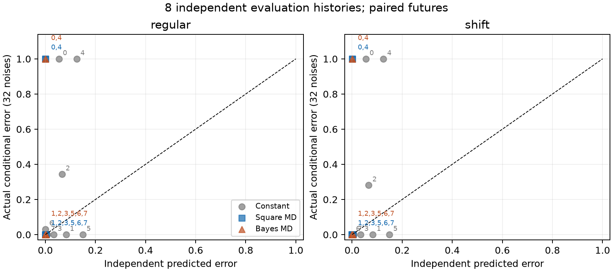
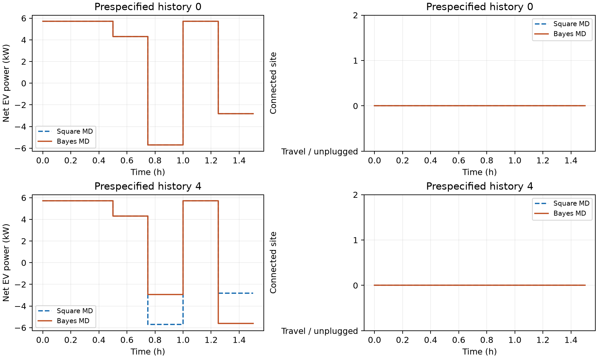

# 条件贝叶斯EV小规模验证

每拓扑固定一组训练R/X；80训练、20证据、6未来。报告保留失败和未决；概率属于局部Gaussian预测模型。
FC/FD/MC/MD为固定只充、固定双向、可移只充、可移双向；移动为选项。无EV不完成电池任务，单列。
实际错误率先对同一历史的未来条件和计量噪声平均，再按独立历史汇总。区间为小样本描述性95% t区间。

## 开发

找到2/2条历史；完成2，状态{"complete": 2}。候选漏真0/2，未知0。

| 方法 | 独立积分风险 | 实际错误率 | 90%集合排真 | 未决 | 完整历史 |
|---|---:|---:|---:|---:|---:|
| 无EV* | 0.5246 | 0.7344 | 7/128 | 114/128 | 2/2 |
| 恒充 | 0.1824 | 0.5 | 54/128 | 24/128 | 2/2 |
| 高低充电 | 0.09941 | 0.5 | 64/128 | 0/128 | 2/2 |
| 平方 FC | 0.07109 | 0.5 | 64/128 | 0/128 | 2/2 |
| 平方 FD | 0.038 | 0.5 | 64/128 | 0/128 | 2/2 |
| 平方 MC | 0.01583 | 0.5 | 64/128 | 0/128 | 2/2 |
| 平方 MD | 0.038 | 0.5 | 64/128 | 0/128 | 2/2 |
| Bayes FC | 0.07109 | 0.5 | 64/128 | 0/128 | 2/2 |
| Bayes FD | 0.038 | 0.5 | 64/128 | 0/128 | 2/2 |
| Bayes MC | 0.01518 | 0.5 | 64/128 | 0/128 | 2/2 |
| Bayes MD | 0.01128 | 0.5 | 64/128 | 0/128 | 2/2 |

排真与未决分母是已观察的配对计量实现；每方法缺失条件数保存在summary.json，每历史32次噪声不计作32条历史。90%为模型后验集合质量，实际排真频率单独记录。

| 配对：前者减后者 | 历史n | Δ预测风险 | Δ实际错误率 [区间] | 前者胜/平/负 |
|---|---:|---:|---:|---:|
| Bayes FC − 平方 FC | 2 | 0 | 0 [0, 0] | 0/2/0 |
| Bayes FD − 平方 FD | 2 | 0 | 0 [0, 0] | 0/2/0 |
| Bayes MC − 平方 MC | 2 | -0.0006567 | 0 [0, 0] | 0/2/0 |
| Bayes MD − 平方 MD | 2 | -0.02672 | 0 [0, 0] | 0/2/0 |
| Bayes FD − Bayes FC | 2 | -0.03309 | 0 [0, 0] | 0/2/0 |
| Bayes MC − Bayes FC | 2 | -0.05591 | 0 [0, 0] | 0/2/0 |
| Bayes MD − Bayes FD | 2 | -0.02672 | 0 [0, 0] | 0/2/0 |
| Bayes MD − Bayes MC | 2 | -0.003896 | 0 [0, 0] | 0/2/0 |
| 高低充电 − 恒充 | 2 | -0.08299 | 0 [0, 0] | 0/2/0 |
| 平方 FC − 恒充 | 2 | -0.1113 | 0 [0, 0] | 0/2/0 |
| Bayes MD − 恒充 | 2 | -0.1711 | 0 [0, 0] | 0/2/0 |

独立预测积分的单方案风险SE最大0.002447；配对积分SE逐历史保存在paired.csv。EIG、Brier集中度及允许未决风险另见summary.json，Brier集中度的补数才与实际平方评分损失对应。

共同规划风险：8条已知继承边有0次退步；提案16，可行返回14，接受2，未成功2，完整AC提案失败0，达到代理相对间隙要求14。统一代理误差最大1.449，取得计划的实际代理误差最大0.4176；MILP间隙闭合不等于原Bayes风险最优。
动作排序（去除重复动作、只比较同任务方案）：{"actual_tie": 30}。这些动作对在同一历史内相关，不能作独立成功次数。

| 离线未来输入诊断 | P RMSE kW | Q RMSE kvar | 源P RMSE kW | 源Q RMSE kvar |
|---|---:|---:|---:|---:|
| regular | 0.02292 | 0.01197 | 0.009032 | 0.005727 |
| shift | 0.2031 | 0.1402 | 0.1787 | 0.02809 |

该表使用保存的真实轨迹，仅用于离线诊断；输入RMSE大小不等于动作收益排序误差的贡献。

保存态物理核查：{"predictive_candidate_blocks": 56, "predictive_failed_or_unknown": 0, "actual_unique_action_conditions": 28, "actual_voltage_failed_or_unknown": 0, "actual_equation_failed_or_unknown": 0}；最大AC方程残差5.07e-16。该项重读保存值，独立回代审计另计。

平均历史耗时：总计83.9s，平方四域5.139s，Bayes四域增量25.93s，计入所用平方初始化后31.07s；完整AC预测/积分0.9245s（属于已列费用，不重复相加）。历史总时还含离线评价与旧联合AC审计；小批耗时不作为固有加速。

完整AC联合重拟合另作预定审计：
- 恒充：完成4条件、失败0，原始最小损失选对2；全SSE间隙均值10.12。
- 平方 MD：完成4条件、失败0，原始最小损失选对3；全SSE间隙均值161.4。
- Bayes MD：完成4条件、失败0，原始最小损失选对4；全SSE间隙均值168.4。

该审计每条件仅一个计量实现，取得值来自局部拟合；与Gaussian后验结果分开解释。

## 独立评价

找到8/8条历史；完成8，状态{"complete": 8}。候选漏真0/8，未知0。

| 方法 | 独立积分风险 | 实际错误率 | 90%集合排真 | 未决 | 完整历史 |
|---|---:|---:|---:|---:|---:|
| 无EV* | 0.4336 | 0.5293 | 76/512 | 403/512 | 8/8 |
| 恒充 | 0.06496 | 0.291 | 138/512 | 21/512 | 8/8 |
| 高低充电 | 0.01882 | 0.2617 | 132/512 | 4/512 | 8/8 |
| 平方 FC | 0.01001 | 0.25 | 128/512 | 0/512 | 8/8 |
| 平方 FD | 0.0005036 | 0.25 | 128/512 | 0/512 | 8/8 |
| 平方 MC | 0.008473 | 0.1621 | 73/512 | 29/512 | 8/8 |
| 平方 MD | 0.0005036 | 0.25 | 128/512 | 0/512 | 8/8 |
| Bayes FC | 0.01002 | 0.25 | 128/512 | 0/512 | 8/8 |
| Bayes FD | 0.0005002 | 0.25 | 128/512 | 0/512 | 8/8 |
| Bayes MC | 0.006915 | 0.1621 | 73/512 | 29/512 | 8/8 |
| Bayes MD | 0.0005048 | 0.25 | 128/512 | 0/512 | 8/8 |

排真与未决分母是已观察的配对计量实现；每方法缺失条件数保存在summary.json，每历史32次噪声不计作32条历史。90%为模型后验集合质量，实际排真频率单独记录。

| 配对：前者减后者 | 历史n | Δ预测风险 | Δ实际错误率 [区间] | 前者胜/平/负 |
|---|---:|---:|---:|---:|
| Bayes FC − 平方 FC | 8 | 6.555e-06 | 0 [0, 0] | 0/8/0 |
| Bayes FD − 平方 FD | 8 | -3.491e-06 | 0 [0, 0] | 0/8/0 |
| Bayes MC − 平方 MC | 8 | -0.001559 | 0 [0, 0] | 0/8/0 |
| Bayes MD − 平方 MD | 8 | 1.185e-06 | 0 [0, 0] | 0/8/0 |
| Bayes FD − Bayes FC | 8 | -0.009516 | 0 [0, 0] | 0/8/0 |
| Bayes MC − Bayes FC | 8 | -0.003102 | -0.08789 [-0.3465, 0.1707] | 1/6/1 |
| Bayes MD − Bayes FD | 8 | 4.675e-06 | 0 [0, 0] | 0/8/0 |
| Bayes MD − Bayes MC | 8 | -0.00641 | 0.08789 [-0.1707, 0.3465] | 1/6/1 |
| 高低充电 − 恒充 | 8 | -0.04614 | -0.0293 [-0.09346, 0.03486] | 2/6/0 |
| 平方 FC − 恒充 | 8 | -0.05495 | -0.04102 [-0.1328, 0.05081] | 2/6/0 |
| Bayes MD − 恒充 | 8 | -0.06446 | -0.04102 [-0.1328, 0.05081] | 2/6/0 |

独立预测积分的单方案风险SE最大0.00252；配对积分SE逐历史保存在paired.csv。EIG、Brier集中度及允许未决风险另见summary.json，Brier集中度的补数才与实际平方评分损失对应。

共同规划风险：32条已知继承边有0次退步；提案64，可行返回58，接受5，未成功6，完整AC提案失败0，达到代理相对间隙要求50。统一代理误差最大1.493，取得计划的实际代理误差最大0.2679；MILP间隙闭合不等于原Bayes风险最优。
动作排序（去除重复动作、只比较同任务方案）：{"actual_tie": 82, "concordant": 19, "reversed": 4}。这些动作对在同一历史内相关，不能作独立成功次数。

| 离线未来输入诊断 | P RMSE kW | Q RMSE kvar | 源P RMSE kW | 源Q RMSE kvar |
|---|---:|---:|---:|---:|
| regular | 0.02774 | 0.01609 | 0.01627 | 0.009096 |
| shift | 0.1996 | 0.1131 | 0.1152 | 0.03143 |

该表使用保存的真实轨迹，仅用于离线诊断；输入RMSE大小不等于动作收益排序误差的贡献。

保存态物理核查：{"predictive_candidate_blocks": 212, "predictive_failed_or_unknown": 0, "actual_unique_action_conditions": 106, "actual_voltage_failed_or_unknown": 0, "actual_equation_failed_or_unknown": 0}；最大AC方程残差5.758e-16。该项重读保存值，独立回代审计另计。

平均历史耗时：总计76.51s，平方四域4.306s，Bayes四域增量29.73s，计入所用平方初始化后34.03s；完整AC预测/积分0.7433s（属于已列费用，不重复相加）。历史总时还含离线评价与旧联合AC审计；小批耗时不作为固有加速。

完整AC联合重拟合另作预定审计：
- 恒充：完成16条件、失败0，原始最小损失选对14；全SSE间隙均值39.34。
- 平方 MD：完成16条件、失败0，原始最小损失选对14；全SSE间隙均值205.6。
- Bayes MD：完成16条件、失败0，原始最小损失选对14；全SSE间隙均值206.8。

该审计每条件仅一个计量实现，取得值来自局部拟合；与Gaussian后验结果分开解释。

预定三方案的预测与实际错误率；数字为独立历史编号，近重合点按显示精度合并标签，数据坐标不移动。两种未来和32次噪声不增加历史分母。

评价前固定历史0和4的平方MD与Bayes MD曲线；允许完全相同，未按收益挑选。负功率为放电，位置−1表示移动或未接线。

## 解释范围

主目标是预期MAP错误率；MILP优化其Bhattacharyya上界的保守分段代理，再用完整AC均值和重新传播的协方差核查原风险。规划256样本与独立2048样本分开；逐历史配对积分SE保存在paired.csv。源和P/Q过程已积分，训练线路及过程超参数仍固定。报告不将求解器成功、后验集合质量或小批经验频率互相替代。

服务公平性采用相同终端电池能量任务、运行约束和吞吐上限。充放电效率及驾驶耗电会改变网侧净电量，所以这些对照并非强制相同grid kWh。计算公平性采用相同单次求解上限；Bayes还使用平方方案作初始化，其取得费用已合计，完整流程并非相同walltime。

输入记录哈希、失败列表、条件噪声SE、预测误差和求解界见summary.json；本汇总不选择或修改策略。
