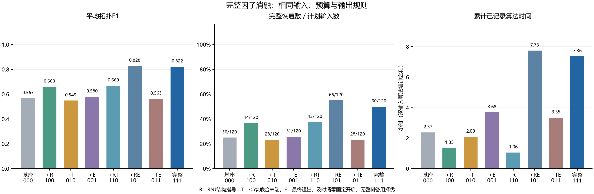
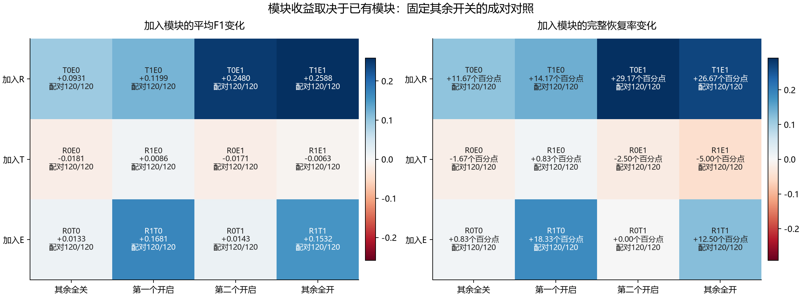
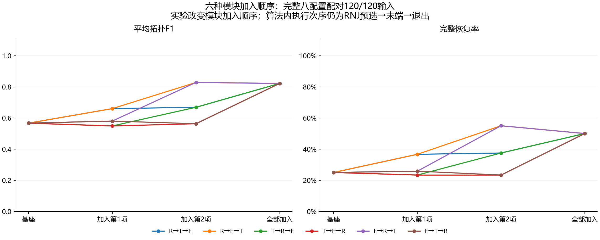
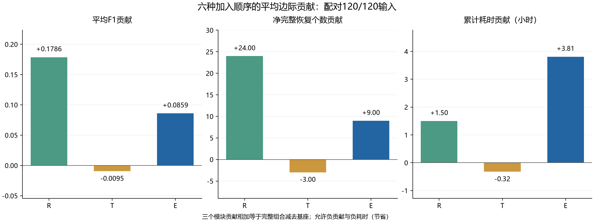

# 完整消融结论：RNJ结构指导与最终退出互补，独立联合末端可以省去

已完成同一批120输入×8组合=960次新配置运行。960/960通过核验，5972次MILP均达到设定精度，313个独立固定家族LP、30567项检查通过；失败、无效、超时及预算超限均为0。全模块输出120/120复现此前无RNJ整树备用的主线。

R是RNJ结构指导（少量种子、几何候选池与热启动），T是≤5直属块独立联合末端，E是一次最终结构退出。及时清零固定开启，所有组合使用相同惩罚、收缩和自身路径验证规则；没有完整RNJ树输出备用。公共QP标定与标量f0保持固定，因此基座是公共标定下的WZZT，不等同于早期无惩罚纯WZZT。

## 八组合完整成绩

| 配置 | R/T/E | F1 | 完整恢复 | 恢复率 | 累计小时 |
|---|---|---|---|---|---|
| WZZT基座 | 000 | 0.566780 | 30/120 | 25.00% | 2.371476 |
| +RNJ结构指导 | 100 | 0.659920 | 44/120 | 36.67% | 1.352442 |
| +联合末端 | 010 | 0.548662 | 28/120 | 23.33% | 2.089658 |
| +最终退出 | 001 | 0.580066 | 31/120 | 25.83% | 3.684182 |
| +RNJ＋联合末端 | 110 | 0.668517 | 45/120 | 37.50% | 1.060246 |
| +RNJ＋最终退出 | 101 | 0.828022 | 66/120 | 55.00% | 7.734860 |
| +联合末端＋最终退出 | 011 | 0.562980 | 28/120 | 23.33% | 3.346798 |
| 全部模块（原主线） | 111 | 0.821755 | 60/120 | 50.00% | 7.356989 |

本批最高F1与完整恢复率来自R＋E：F1=0.828022，66/120（55%），累计7.7349小时；全部模块为0.821755，60/120（50%），7.3570小时。去掉独立T阶段净增6个完整恢复、F1增加0.006266，增加累计22.67分钟（相对全模块约5.14%）。这是本批固定配置下的质量/成本取舍，没有自动更改运行默认。

## 每个模块的条件作用

R在四种上下文中均提高平均F1；其收益在存在E时更大。E在没有R时只净增0或1个完整恢复；有R时净增15或22个，且四种上下文均未损失已有完整恢复。R/E互补的F1交互为T关闭时+0.154815、T开启时+0.138920，表明不能把各模块的单独增益直接相加。

T在没有E、有R时带来F1+0.008597、净增1个完整恢复并节省约17.53分钟；其他三个上下文的平均F1均下降。已有R和E时，加入T为3胜109平8负，完整恢复0新增、6损失，省时22.67分钟。T不宜在当前参数下固定作为默认阶段。E内部仍含小块候选，所以关闭独立T并不等于移除全部小块重构能力。

## 六种加入顺序与平均贡献

| 模块 | 平均F1贡献 | 净完整恢复贡献 | 累计小时贡献 |
|---|---|---|---|
| R：RNJ结构指导 | 0.178607 | 24.000000 | 1.500597 |
| T：联合末端 | -0.009543 | -3.000000 | -0.324826 |
| E：最终退出 | 0.085911 | 9.000000 | 3.809742 |

指定累积链R→T→E的完整恢复数为30→44→45→60，看起来每一步都改善；R→E→T却为30→44→66→60，揭示T最后加入时的负作用。平均贡献按全部六种模块加入顺序计算，三个数相加恰为全模块减去基座的成绩差。这里改变的是实验配置的模块加入顺序；算法内部仍按预选、前向/末端、最终退出的时序执行，并未新运行六套时序重排策略。

## 为什么T会损失6个完整恢复

逐例保存轨迹证实，这6例在有T与无T两侧的最终退出均未被接收；有T一侧的联合末端均接收了一次更新，随后以joint_tail_gap_met结束。无T一侧继续原始单候选扩展，验证选到了正确中间解。有T的输出候选库不含这个正确家族或正确正权重拓扑，且最终验证MAE更高。6例的真连接均已包含在两侧E的MILP候选域中，不能归因为缺失真连接；训练目标和接收门槛也未把正确树恢复到输出路径。问题表现为替代并截断有用的逐步候选路径，而非求解超时或验证在已有正确候选中选错。

其中4个soumalas11常规输入，T的训练MAE更低，却保留5个内部集合而真实为4个，显示局部训练改善伴随过度细分。此诊断来自同参数保存轨迹，不证明所有小块联合模型都无效。

六例详情见lost_exact_cases.csv。按网络比较：

| case | method | F1 | exact | total_seconds |
|---|---|---|---|---|
| paper15 | R1T0E1 | 0.871414 | 17 | 4842.920490 |
| paper15 | R1T1E1 | 0.871414 | 17 | 4488.230729 |
| soumalas11 | R1T0E1 | 0.855159 | 22 | 556.664627 |
| soumalas11 | R1T1E1 | 0.829233 | 17 | 505.152988 |
| flynn16 | R1T0E1 | 0.750715 | 12 | 12290.447543 |
| flynn16 | R1T1E1 | 0.747179 | 11 | 11898.502841 |
| pengwah18 | R1T0E1 | 0.834799 | 15 | 10155.463262 |
| pengwah18 | R1T1E1 | 0.839194 | 15 | 9593.274134 |

关闭T后soumalas11从17增至22个完整恢复、flynn16从11增至12；paper15和pengwah18完整恢复数不变。pengwah18平均F1从0.839194降至0.834799，说明省去T并非逐网络每项指标都改善。弱激励仍为F1=0.071429、0/4；此问题未解决。

## RNJ的贡献不能只归到两个小块

退出候选池覆盖全部真连接：无R的两个E配置均为41/120，有R的两个均为105/120。R显著改善了结构候选覆盖；但完整覆盖不是恢复保证，R＋E仍仅恢复66/120。R的本轮开关同时控制种子、候选池和热启动，不能把全部增益归到预选小块，也没有分别识别这三个子功能的贡献。

## 预算、时间和范围

每配置/输入总上限4小时，总名义上限3840方法小时；单步WZZT≤1小时、固定结构LP≤300秒，统一gap=0.0001、单线程、8个worker。参数为λ=0.003f0、响应界[0,2]、收缩0.24；前向预算规则相同，关闭E不会获得更多前向预算。

实际方法时间之和28.9967小时，其中公共前端按每方法计入；不重复计公共前端的唯一组件时间28.7233小时。调度墙钟227.86分钟，不含冻结和调度前两次试运行；试运行已计入方法成本。方法时间为逐输入算法墙钟之和，包含求解、重拟合及输出选择，不含Python导入。

本轮未调参、未叠加恢复分支，原方案均保留。结果支持本批数据下优先采用R＋原始WZZT及时清零＋E，再统一收缩/重拟合/自身验证；独立T保留作对照。该120输入已用于多轮研究，并非新盲测；候选域MILP最优性与物理拓扑恢复是不同的结论。

可复现入口、原始阶段记录和实际执行源见RECOVERY.md与records.zip；完整原始表、条件边际和交互项见RESULTS.md及CSV。本结论图均有PNG和SVG版本。
