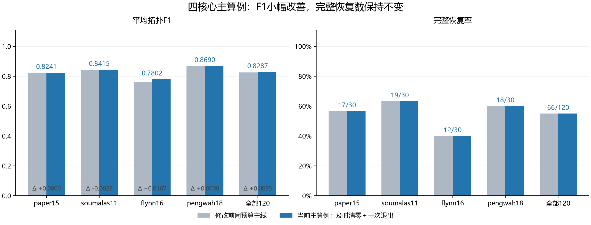
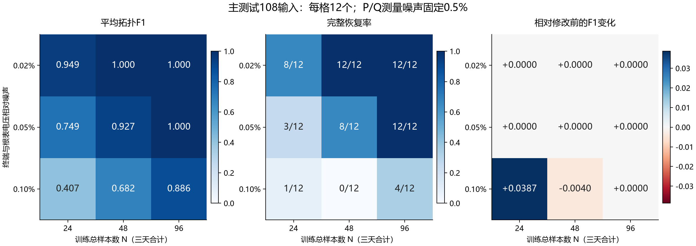

# 主算例：四核心RNJ–WZZT简化主线

本次将用户指定简化主线作为主算例展示：RNJ少量小块预选→原始WZZT逐步扩展且及时清零→≤5直属块联合末端→一次最终退出、收缩、LP重拟合和验证选择。额外停滞删块恢复及屏蔽分支不纳入本主算例。原方案和完整恢复版继续保留。

## 四核心流程

≤5指直属子树块数。前向停滞可直接进入④；末端清零改变结构后重新判断②/③。清零贯穿初始化、扩展、末端和退出。④包括0.24响应收缩、联合LP和严格验证MAE选择，并保留完整RNJ备用库及单点回退；一次最终退出继续允许正权重临时块撤销。

## 主结果

| case | inputs | baseline_F1 | F1 | precision | recall | exact | recovery_rate |
|---|---|---|---|---|---|---|---|
| paper15 | 30 | 0.824098 | 0.824098 | 0.827778 | 0.822222 | 17 | 0.566667 |
| soumalas11 | 30 | 0.844312 | 0.841534 | 0.836667 | 0.850000 | 19 | 0.633333 |
| flynn16 | 30 | 0.763539 | 0.780205 | 0.782011 | 0.783333 | 12 | 0.400000 |
| pengwah18 | 30 | 0.868987 | 0.868987 | 0.890952 | 0.852381 | 18 | 0.600000 |
| all | 120 | 0.825234 | 0.828706 | 0.834352 | 0.826984 | 66 | 0.550000 |

每例30输入=27主测试+3压力测试。F1/完整恢复按正权重内部集合计算，排除单点和全集。完整恢复66/120=55%；精确率0.834352，召回率0.826984。与修改前同预算基线相比，F1增加0.003472，1胜117平2负，没有新增或丢失完整恢复。单看自身路径、去掉RNJ库保护时为F1=0.821755、完整恢复60/120。

## 噪声与训练样本数

| voltage_sigma | N | inputs | F1 | exact | recovery_rate | baseline_F1 |
|---|---|---|---|---|---|---|
| 0.000200 | 24 | 12 | 0.949074 | 8 | 0.666667 | 0.949074 |
| 0.000200 | 48 | 12 | 1.000000 | 12 | 1.000000 | 1.000000 |
| 0.000200 | 96 | 12 | 1.000000 | 12 | 1.000000 | 1.000000 |
| 0.000500 | 24 | 12 | 0.749364 | 3 | 0.250000 | 0.749364 |
| 0.000500 | 48 | 12 | 0.927249 | 8 | 0.666667 | 0.927249 |
| 0.000500 | 96 | 12 | 1.000000 | 12 | 1.000000 | 1.000000 |
| 0.001000 | 24 | 12 | 0.406914 | 1 | 0.083333 | 0.368223 |
| 0.001000 | 48 | 12 | 0.682081 | 0 | 0.000000 | 0.686050 |
| 0.001000 | 96 | 12 | 0.885871 | 4 | 0.333333 | 0.885871 |

每格12输入（4网络×3组随机实现）；N为三天合计训练点数，验证/测试各288点。低噪声0.02%下N48和N96均12/12完整恢复；中噪声0.05%下N96也为12/12。高噪声0.10%下仍有明显误差。

## 压力条件

| condition | inputs | F1 | exact | recovery_rate |
|---|---|---|---|---|
| outliers | 4 | 0.958333 | 3 | 0.750000 |
| root_noise | 4 | 0.958333 | 3 | 0.750000 |
| weak_excitation | 4 | 0.142857 | 0 | 0.000000 |

弱激励F1为0.142857、0/4完整恢复，是本轮明确未解决的条件；根表噪声和异常值各为F1=0.958333、3/4。条件比较是该固定生成器下的样本结果，没有对这些评估输入重新调参。

## 已验证范围与耗时

质量来自前次完整对照中真实执行的after/zero_only baseline分支，共120输入；双侧baseline子问题全部达到原设精度。它不是本次新运行的独立关闭恢复版本。独立端到端耗时尚未测量；原summary中16.15小时等时间列属于整套含恢复分支版本，不用于本主算例。当前只建立展示配置，没有修改fit_mainline的运行默认。

本次未运行仿真、LP或MILP，未更改训练/选模结果。输入CSV、协议、检查回执和展示脚本SHA256记录在main_case_profile.json。运行`python -B -m research_experiments.iterative_benchmark.present_mainline`可从原始结果重新生成此展示。
