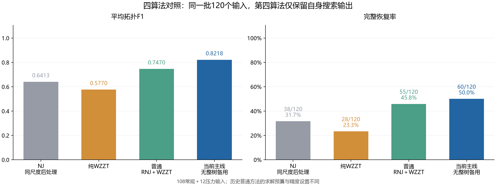
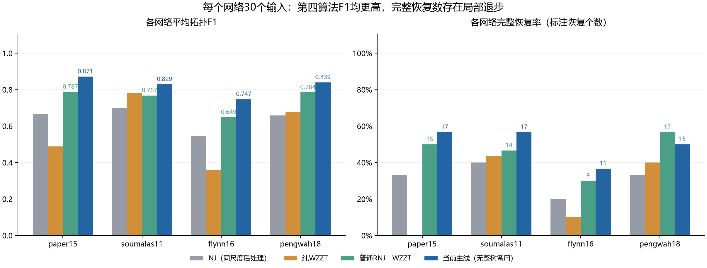
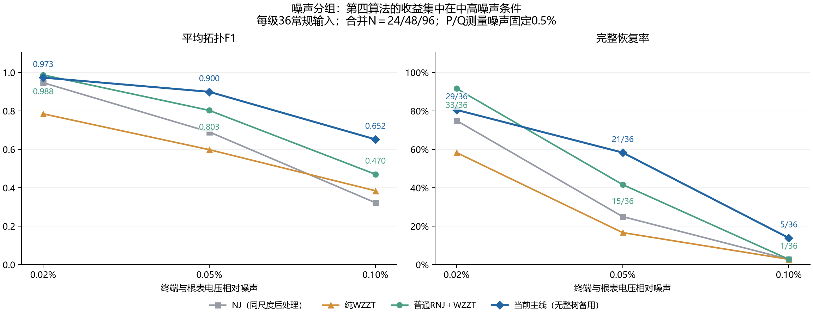
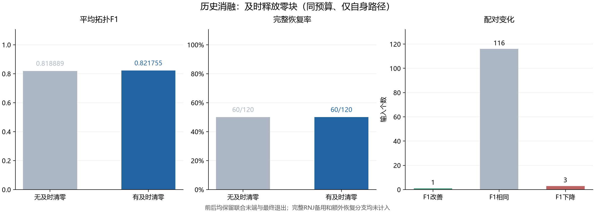
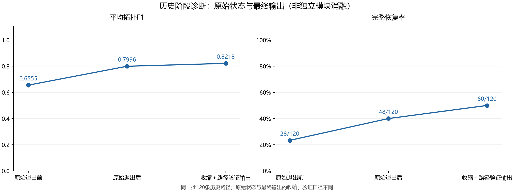

# 四算法对照：无整树备用择优的RNJ–WZZT主线

第四算法固定为after/zero_only_own：少量RNJ小块→原始WZZT及时清零→≤5直属块联合末端→一次最终退出、收缩和自身路径验证择优。输出只比较自身路径与单点候选，120个输出均来自自身baseline路径。完整RNJ树备用择优、额外停滞恢复和屏蔽分支均未纳入。旧版含备用图表保持原样，本目录是本次修订口径。

## 四算法主结果

| algorithm | inputs | F1 | exact | recovery_rate |
|---|---|---|---|---|
| NJ：同尺度收缩与重拟合 | 120 | 0.641251 | 38 | 0.316667 |
| 纯WZZT | 120 | 0.577041 | 28 | 0.233333 |
| 普通RNJ＋WZZT | 120 | 0.746955 | 55 | 0.458333 |
| 当前主线：无整树备用择优 | 120 | 0.821755 | 60 | 0.500000 |

当前主线自身F1为0.821755、完整恢复60/120（50%）。相对普通RNJ＋WZZT，F1增加0.074800，完整恢复净增5个；逐输入44胜60平16负，完整恢复新增13个、损失8个。相对NJ、纯WZZT分别净增22、32个完整恢复。四个网络的平均F1均最高；优势是本批数据上的平均拓扑恢复质量。

## 分网络与条件

| case | algorithm | inputs | F1 | exact | recovery_rate | precision | recall |
|---|---|---|---|---|---|---|---|
| paper15 | NJ_matched | 30 | 0.664105 | 10 | 0.333333 | 0.679722 | 0.655556 |
| soumalas11 | NJ_matched | 30 | 0.698280 | 12 | 0.400000 | 0.689444 | 0.716667 |
| flynn16 | NJ_matched | 30 | 0.543738 | 6 | 0.200000 | 0.580556 | 0.522222 |
| pengwah18 | NJ_matched | 30 | 0.658882 | 10 | 0.333333 | 0.689683 | 0.638095 |
| paper15 | pure_wzzt | 30 | 0.488805 | 0 | 0.000000 | 0.545000 | 0.450000 |
| soumalas11 | pure_wzzt | 30 | 0.781720 | 13 | 0.433333 | 0.801667 | 0.783333 |
| flynn16 | pure_wzzt | 30 | 0.359140 | 3 | 0.100000 | 0.403651 | 0.344444 |
| pengwah18 | pure_wzzt | 30 | 0.678499 | 12 | 0.400000 | 0.720714 | 0.652381 |
| paper15 | ordinary | 30 | 0.787374 | 15 | 0.500000 | 0.788056 | 0.788889 |
| soumalas11 | ordinary | 30 | 0.767460 | 14 | 0.466667 | 0.753333 | 0.791667 |
| flynn16 | ordinary | 30 | 0.648519 | 9 | 0.300000 | 0.645926 | 0.655556 |
| pengwah18 | ordinary | 30 | 0.784466 | 17 | 0.566667 | 0.797222 | 0.776190 |
| paper15 | current_own | 30 | 0.871414 | 17 | 0.566667 | 0.892778 | 0.855556 |
| soumalas11 | current_own | 30 | 0.829233 | 17 | 0.566667 | 0.820556 | 0.841667 |
| flynn16 | current_own | 30 | 0.747179 | 11 | 0.366667 | 0.765714 | 0.733333 |
| pengwah18 | current_own | 30 | 0.839194 | 15 | 0.500000 | 0.871587 | 0.814286 |

pengwah18的平均F1改善，但完整恢复为15/30，低于普通方法17/30。常规108输入为F1=0.841743、55个完整恢复，高于普通方法0.753671、49个；压力12输入则为0.641865、5个，低于普通方法0.686508、6个。

| panel | algorithm | inputs | F1 | exact | recovery_rate | precision | recall |
|---|---|---|---|---|---|---|---|
| main | NJ_matched | 108 | 0.653409 | 37 | 0.342593 | 0.671594 | 0.645833 |
| stress | NJ_matched | 12 | 0.531838 | 1 | 0.083333 | 0.554167 | 0.518849 |
| main | pure_wzzt | 108 | 0.589406 | 28 | 0.259259 | 0.623810 | 0.572090 |
| stress | pure_wzzt | 12 | 0.465759 | 0 | 0.000000 | 0.563294 | 0.426587 |
| main | ordinary | 108 | 0.753671 | 49 | 0.453704 | 0.751878 | 0.761133 |
| stress | ordinary | 12 | 0.686508 | 6 | 0.500000 | 0.694444 | 0.680556 |
| main | current_own | 108 | 0.841743 | 55 | 0.509259 | 0.858973 | 0.830357 |
| stress | current_own | 12 | 0.641865 | 5 | 0.416667 | 0.645833 | 0.638889 |

| voltage_sigma | algorithm | inputs | F1 | exact | recovery_rate | precision | recall |
|---|---|---|---|---|---|---|---|
| 0.000200 | NJ_matched | 36 | 0.947090 | 27 | 0.750000 | 0.954762 | 0.944114 |
| 0.000500 | NJ_matched | 36 | 0.690709 | 9 | 0.250000 | 0.717659 | 0.677249 |
| 0.001000 | NJ_matched | 36 | 0.322427 | 1 | 0.027778 | 0.342361 | 0.316138 |
| 0.000200 | pure_wzzt | 36 | 0.785017 | 21 | 0.583333 | 0.806481 | 0.768519 |
| 0.000500 | pure_wzzt | 36 | 0.598520 | 6 | 0.166667 | 0.635516 | 0.584987 |
| 0.001000 | pure_wzzt | 36 | 0.384680 | 1 | 0.027778 | 0.429431 | 0.362765 |
| 0.000200 | ordinary | 36 | 0.987654 | 33 | 0.916667 | 0.985185 | 0.990741 |
| 0.000500 | ordinary | 36 | 0.802948 | 15 | 0.416667 | 0.800595 | 0.810185 |
| 0.001000 | ordinary | 36 | 0.470411 | 1 | 0.027778 | 0.469852 | 0.482474 |
| 0.000200 | current_own | 36 | 0.973485 | 29 | 0.805556 | 0.973148 | 0.976852 |
| 0.000500 | current_own | 36 | 0.899671 | 21 | 0.583333 | 0.906548 | 0.895833 |
| 0.001000 | current_own | 36 | 0.652073 | 5 | 0.138889 | 0.697222 | 0.618386 |

每个噪声等级36个常规输入；每个噪声×N组合12个。中高电压噪声（0.05%、0.10%）下当前主线优于普通方法；低噪声0.02%下普通方法更好。9个噪声×N格中当前主线6格F1改善、1格相同、2格下降，不能写成所有条件占优。训练N为三天合计24/48/96，P/Q噪声固定0.5%。

| condition | algorithm | inputs | F1 | exact | recovery_rate | precision | recall |
|---|---|---|---|---|---|---|---|
| weak_excitation | NJ_matched | 4 | 0.125000 | 0 | 0.000000 | 0.125000 | 0.125000 |
| root_noise | NJ_matched | 4 | 0.778846 | 1 | 0.250000 | 0.791667 | 0.767857 |
| outliers | NJ_matched | 4 | 0.691667 | 0 | 0.000000 | 0.745833 | 0.663690 |
| weak_excitation | pure_wzzt | 4 | 0.205556 | 0 | 0.000000 | 0.416667 | 0.139881 |
| root_noise | pure_wzzt | 4 | 0.589011 | 0 | 0.000000 | 0.642857 | 0.553571 |
| outliers | pure_wzzt | 4 | 0.602710 | 0 | 0.000000 | 0.630357 | 0.586310 |
| weak_excitation | ordinary | 4 | 0.142857 | 0 | 0.000000 | 0.166667 | 0.125000 |
| root_noise | ordinary | 4 | 0.958333 | 3 | 0.750000 | 0.958333 | 0.958333 |
| outliers | ordinary | 4 | 0.958333 | 3 | 0.750000 | 0.958333 | 0.958333 |
| weak_excitation | current_own | 4 | 0.071429 | 0 | 0.000000 | 0.083333 | 0.062500 |
| root_noise | current_own | 4 | 0.895833 | 2 | 0.500000 | 0.895833 | 0.895833 |
| outliers | current_own | 4 | 0.958333 | 3 | 0.750000 | 0.958333 | 0.958333 |

当前主线弱激励仅F1=0.071429、0/4完整恢复；根表噪声0.895833、2/4；异常值0.958333、3/4。此前含备用版本的压力图不适用于本口径。

## 历史消融与阶段诊断

及时清零的成对历史比较使用before/own与after/zero_only_own：共同输入、4小时总预算、gap=0.0001、相同惩罚、收缩与自身验证规则，120对base子问题都达到设定精度。历史分支分配的时限不同，但未出现求解时钟截断。它衡量及时清零及随后的路径变化，不是全树最优证明。

| 自身输出对照 | F1 | 完整恢复 | 完整恢复率 |
|---|---|---|---|
| 无及时清零 | 0.818889 | 60 | 0.500000 |
| 有及时清零 | 0.821755 | 60 | 0.500000 |

无及时清零F1=0.818889，加入后0.821755，净增0.002866；1胜116平3负，完整恢复均60/120。当前方法相对普通方法的总体优势不能主要归因于及时清零。

另外独立读取保存的最终退出前、退出后权重，并从物理网络重建真实后代集合：

| stage | inputs | F1 | exact | recovery_rate |
|---|---|---|---|---|
| raw_prefix | 120 | 0.655460 | 28 | 0.233333 |
| raw_exit | 120 | 0.799636 | 48 | 0.400000 |
| final_output | 120 | 0.821755 | 60 | 0.500000 |

原始退出前F1=0.655460、28个完整恢复；原始退出后0.799636、48个；最终自身输出0.821755、60个。退出前后是保存轨迹的阶段诊断，未应用统一输出收缩与选模，不能代替“关闭最终退出后按同规则重新选模”的独立消融；最终输出的增益也同时包含收缩、重拟合和路径验证选择。末端枚举、线路数惩罚及最终退出的独立去除消融目前缺失，本次未用其他模型的历史参数实验替代。

## 时间与比较边界

| 算法 | 120输入累计用时 | 口径 |
|---|---|---|
| NJ：同尺度收缩与重拟合 | 163.23秒（2.72分钟） | 共享前端＋NJ/选择开销 |
| 纯WZZT | 10459.37秒（2.91小时） | 已记录组件累计 |
| 普通RNJ＋WZZT | 1714.16秒（28.57分钟） | 已记录组件累计 |
| 当前主线：无整树备用择优 | 独立总耗时缺测；已归属阶段30461.17秒（8.46小时） | 阶段累计缺少部分LP关闭、清零及输出成本 |

累计时间是逐输入算法阶段墙钟之和，不是并行整批等待时间。NJ记账包含公共RNJ候选库前端，非最小独立NJ计时。当前主线的16.15小时旧字段属于含恢复分支的完整运行，禁止用于本表；8.46小时也不作为独立总耗时或计算加速的证据。最终退出约占已归属阶段85%，质量优势伴随较重计算。

普通RNJ＋WZZT为历史300秒结构预算、单MIP/LP30秒、gap=0.001；纯WZZT与当前主线为总预算14400秒、LP300秒、gap=0.0001（单步WZZT≤3600秒）。普通方法280个MIP无超时但20个输入保留no_gain_unresolved；纯WZZT1130个MIP达到gap，1个输入保留no_gain_unresolved。这是同输入的历史算法对照，预算、精度及正则项并非完全一致。

普通RNJ＋WZZT的历史最终输出仍保留原完整RNJ备用政策，107个来源为complete_rnj、13个来源为path；本次按用户指定保留这个原基线。第四算法不参加完整树备用竞争，但仍是RNJ指导的混合方法：RNJ用于小块预选、参考损失、几何校准、退出候选池和热启动。公共候选池还包含NJ/RNJ几何产生的连接；因此准确表述为“无完整树备用择优”，而不是“完全不使用其他算法信息”。

## 复现与核验

本次未新增仿真、LP、MILP或参数调节。读取已有结果和保存权重，核对两个协议全部120个job与各split哈希、归档manifest及480条质量记录；未改变运行默认或原结果。此前多轮设计已使用本批数据，本图是历史比较，不是新盲测。

运行 `python -B -m research_experiments.iterative_benchmark.present_own_comparison`。逐输入与分组CSV、配对变化、阶段诊断、来源哈希和核验回执在本目录；PNG用于预览，PDF为同图矢量版。
