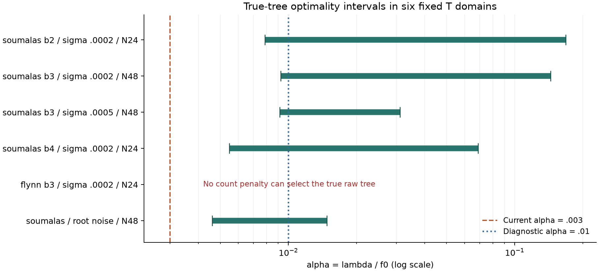

# T 正则机制：五例惩罚偏弱，一例固定块不受惩罚

对上一轮丢失完整恢复的六个输入，固定 T 当时的入口、骨架、候选连接和响应界，重新求解每一种选择数下的最低训练 MAE。完成 6/6 输入、50/50 个基数 MILP，均达到原先设定精度；六个真实家族参考 LP 由独立 HiGHS 实现核验。累计诊断时间 72.846 秒，超时、未完成和预算超限均为零。

这次验证表明：加强 T 的线路数惩罚有明确依据，但不能单独解决所有问题。五个 soumalas 输入的真实树有可支持的正则区间；flynn16 的固定错误大块使用不增加惩罚，任何标量计数系数都无法使原始真实参考最优。

## 固定候选域的完整比较

记 alpha=lambda/f0，当前 alpha=0.003。下表区间保证真实参考可成为训练最优解，端点允许并列，不声明唯一拓扑。

| 输入 | 可支持真实参考的 alpha 区间 |
|---|---:|
| soumalas b2，sigma=.0002，N=24 | [.00788166, .16837963] |
| soumalas b3，sigma=.0002，N=48 | [.00923573, .14418094] |
| soumalas b3，sigma=.0005，N=48 | [.00916364, .03112506] |
| soumalas b4，sigma=.0002，N=24 | [.00548637, .06888172] |
| soumalas，根噪声，N=48 | [.00459978, .01479740] |
| flynn16 b3，sigma=.0002，N=24 | 不存在：同计数竞争解损失更低 |

五例的公共区间约为 [.009235733,.014797400]，因此 alpha=.01 是有根据的诊断点。这个区间来自完整 T 候选域的基数剖面及其求解界，不只是比较两棵已有树。

## 固定错误块为什么无法靠增大惩罚消除

flynn16 的 T 骨架里，已有错误七终端集合 (6,7,8,9,10,11,15)。它与其他四个骨架内部集合一起计为常数成本。真实内部连接数是六；嵌入这份 T 模型时，即使错误七终端块权重为零，也计为七个集合。

参考真实拓扑的训练 MAE 为 .000399929513845；相同可选计数 q=2 的最优解为 .000398521257555，改善 .000001408256291。后者保留全部六条真实连接，并给错误骨架块正权重。新旧计数惩罚完全相同，所以无论 lambda 多大都不能改变这个比较。

这不是所有线路数正则都无法惩罚该错误：若该临时旧块也有选择变量，激活它就会增加成本。当前 T 仅对释放后的新候选收费，保留骨架的成本是常数。核实的障碍来自这种建模边界。最终 E 已允许临时旧块退出，但它仍按自己的原始目标选择解。

## 增强多少，以及增强过头的代价

对每个给定 alpha，基数解只按训练目标 phi(q)+alpha*f0*q 选择，真实拓扑只用于后评分。上述区间和参数网格属于已知故障输入的事后诊断；以下未运行完整算法。

| alpha | 原始 T 正权重拓扑完全正确 | 仅应用既有 .24 阈值 |
|---:|---:|---:|
| .003 | 0/6 | 0/6 |
| .006 | 2/6 | 3/6 |
| .010 | 5/6 | 6/6 |
| .020 | 4/6 | 5/6 |
| .030 | 4/6 | 5/6 |

阈值列直接筛选已存系数，没有再重拟合、及时清零、运行 E 或最终路径验证，所以不能作为完整恢复率。alpha=.02 或 .03 时，根噪声输入开始漏掉真实连接。

## 对算法的含义

原先“逐步法保留正确中间候选，T直接跳过”的诊断仍然成立。这次进一步确定：五例的跳跃可以通过适当增强计数正则改成真实末端；一例还需要处理临时错误骨架的常数计数问题。T 以当前固定 .003 不能充分替代逐步法提供的模型复杂度路径。

合理的后续验证是把 .01 作为预先指定候选，与原 .003、关闭独立 T 在全部输入上作同预算端到端比较；同时明确是否允许局部临时旧块退出。六个故障输入不构成调参后的独立测试集，也没有据此修改运行默认。

数学条件见 THEORY.md；全部上下界、逐输入原始 F1/MAE 和系数见 RESULTS.md、CSV 及 records.zip。原始 960 次消融与旧方案保持原样。
