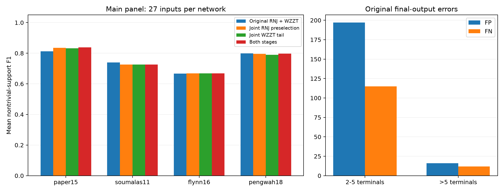

# 五块以内一次联合MILP：RNJ预选与WZZT收尾

120输入×4方法，返回480/480；480次独立HiGHS最终家族重解通过。
本批使用近期四算例的完整RNJ初始层级，不等同于生产默认bootstrap最多两个边界块。矩阵为108主输入和12压力输入，配置见[PROTOCOL.md](PROTOCOL.md)。生产默认未修改。

主要计算收益来自联合收尾：搜索中位数减少39.1%，平均F1近似持平，完整恢复为44→42。两处都改的平均F1仅略升，配对胜负和压力面板不支持稳定的恢复优势。当前保留为研究选项，不替换默认流程。

## 模型和两处介入

每个参与区域最多五个直属块，列出至多25个候选线路；全部区域在同一次MILP中选择连接，共同拟合原始终端P/Q/Y。交叉冲突约束保证层状结构，原有外围权重也联合重拟合。同一次求解可删除已释放的小合并、同时加入多条线路，没有逐候选LP接续。

RNJ预选介入只打开可在五块区域内重选的≤5终端合并，保留较大骨架边界。WZZT收尾在最大剩余直属块数≤5时调用一次联合模型，随后结束搜索。四组共用20秒搜索软预算，预选联合最多5秒，原单步MILP2秒，收尾用剩余预算；无新正下界、无连接数惩罚。

## 主面板结果

| 方法 | 平均F1 | 完整恢复 | 搜索中位数(s) | 验证MAE | 测试MAE |
|---|---:|---:|---:|---:|---:|
| 原RNJ+WZZT | 0.7545 | 44/108 | 4.27 | 0.0013920 | 0.0013570 |
| 只改RNJ预选 | 0.7568 | 42/108 | 3.10 | 0.0013894 | 0.0013544 |
| 只改WZZT收尾 | 0.7540 | 42/108 | 2.60 | 0.0013896 | 0.0013545 |
| 两处都改 | 0.7577 | 42/108 | 5.00 | 0.0013890 | 0.0013540 |

| 算例，每行27输入 | 原流程 | 只改预选 | 只改收尾 | 两处都改 |
|---|---:|---:|---:|---:|
| paper15 | 0.8121 | 0.8354 | 0.8316 | 0.8387 |
| soumalas11 | 0.7399 | 0.7267 | 0.7267 | 0.7267 |
| flynn16 | 0.6665 | 0.6685 | 0.6685 | 0.6685 |
| pengwah18 | 0.7994 | 0.7965 | 0.7893 | 0.7970 |

主面板为三个bundle下相关的噪声和采样条件，不把108行当作108次独立随机网络重复。F1评价非平凡终端支撑；完整恢复是该支撑集合完全一致。

相对原流程的配对F1：

- 只改RNJ预选：平均差+0.00232，12胜/82平/14负。
- 只改WZZT收尾：平均差-0.00043，11胜/83平/14负。
- 两处都改：平均差+0.00327，12胜/82平/14负。

仅自身路径的平均F1（不使用公共RNJ库回退）：

| 方法 | F1 | 完整恢复 |
|---|---:|---:|
| 原RNJ+WZZT | 0.7299 | 41/108 |
| 只改RNJ预选 | 0.7355 | 39/108 |
| 只改WZZT收尾 | 0.7344 | 39/108 |
| 两处都改 | 0.7412 | 39/108 |

## 联合模型实际执行情况

| 方法 | 预选调用/接受 | 收尾调用/接受 | 最终来自公共RNJ库 |
|---|---:|---:|---:|
| 原RNJ+WZZT | 0/0 | 0/0 | 92/108 |
| 只改RNJ预选 | 108/105 | 0/0 | 84/108 |
| 只改WZZT收尾 | 0/0 | 108/105 | 83/108 |
| 两处都改 | 108/105 | 108/16 | 83/108 |

状态2表示达到0.1%相对gap容差，触时incumbent和有效bound单独保留。求解器汇总见[solver_summary.csv](solver_summary.csv)，未达容差不计为已证明最优。

## 为什么训练拟合改善而结构恢复有限

| 未收缩搜索终点 | 平均训练MAE | 平均F1 | 正确线路TP | 假线路FP |
|---|---:|---:|---:|---:|
| 原RNJ+WZZT | 0.0012761 | 0.6025 | 485 | 532 |
| 两处都改 | 0.0012677 | 0.5291 | 516 | 818 |

按未收缩终点的正权重口径（阈值1e-9），两处都改在108输入上累计正确检出变化+31次、误检变化+286次。原始L1目标没有线路数代价，额外连接可用于吸收噪声和线性模型偏差；本轮计数显示这种自由度带来了更多误检。最终收缩、验证选模和公共RNJ库回退对维持输出F1起主要作用。因此本轮的小幅最终均值改善，不能改写成联合训练终点的拓扑质量提高。

## 当前错误：大块还是小块

错误按覆盖终端数分组：小块2..5个终端，大块>5个终端。这与切换使用的“直属块数≤5”是两个口径。下表只看原流程108个最终有效输出：

| 线路大小 | 预测数 | 真线路数 | 误检FP | 漏检FN | 误检比例FP/预测 | 漏检比例FN/真线路 |
|---|---:|---:|---:|---:|---:|---:|
| 小块 | 622 | 540 | 197 | 115 | 31.7% | 21.3% |
| 大块 | 85 | 81 | 16 | 12 | 18.8% | 14.8% |

四个算例的真内部支撑终端数分别为：paper15为3/3/3/5/5/5；soumalas11为3/3/3/5；flynn16为3/3/4/4/8/8；pengwah18为3/3/3/4/4/5/6。主面板共有540次小块真线路、81次大块真线路，原始错误数受分母差异影响，需结合比例判断。

在该基准中，小块的误检总数、漏检总数以及各自错误比例都更高。修正重点应放在小合并的过度细分和错误锁定；大块仍需核查，不能仅因覆盖终端多就当作可靠先验。

再看原流程搜索终点中，错误结构排除了多少真实线路。初始固定集合即使权重为零，也计入结构限制。同一真线路可能同时被多个来源阻断，以下列之间有重叠：

| 阻断来源 | 被排除的真线路次数 |
|---|---:|
| RNJ预选的小块 | 119 |
| RNJ预选的大块 | 21 |
| WZZT后加的小块 | 35 |
| WZZT后加的大块 | 26 |
| 去重后的全部阻断 | 128 |

这项统计核查的是实际搜索域排除关系：错误集合与真集合交叉，后续相容扩展就无法加入它。它比只数误检更接近结构损害，但仍不把重叠计数解释为互斥因果贡献。

原流程初始RNJ结构与后续新增错误：

按大小去重：仅受小块阻断89次，仅受大块阻断2次，同时受两者阻断37次；与当前集合相容但仍遗漏7次。
- 初始RNJ含错误固定集合：102/108输入。
- 后续路径首次新增错误：72/108输入；其中首次错误批次含小块44例、含大块28例。

逐输入、大小和阶段的TP/FP/FN见[size_errors.csv](size_errors.csv)，逐条真线路及其阻断者见[blocking_rows.csv](blocking_rows.csv)。RNJ、预选修正和后续WZZT的责任需结合这些阶段记录判断；最终验证选模的回退来源也已单列。

## 压力面板

| 方法 | 平均F1 | 完整恢复 |
|---|---:|---:|
| 原RNJ+WZZT | 0.6562 | 3/12 |
| 只改RNJ预选 | 0.6258 | 1/12 |
| 只改WZZT收尾 | 0.6258 | 1/12 |
| 两处都改 | 0.6258 | 1/12 |

## 证据与复现

原始损失、层状性、界、单调性、切换、状态与输入/源码等16793项核查通过；独立HiGHS重解480次；失败0。另核验144个观测归档及16个网络目录与父批次一致。

```powershell
python -m research_experiments.joint_five.run freeze outputs/joint_five_NEW
python -m research_experiments.joint_five.run run outputs/joint_five_NEW
python -m research_experiments.joint_five.run analyze outputs/joint_five_NEW
```

完整本地记录：`outputs/joint_five_rnj_wzzt_20261031/`。[records.zip](records.zip)保存冻结源码、输入索引、公共前端、全部逐项结果和核查；原始观测NPZ沿用既有本地基准。


