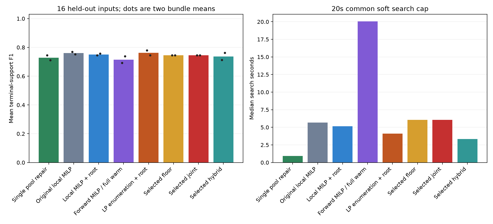

# 联合 LP 枚举：下界、稀疏性与先逐步后联合

本轮目标是解释联合重构为何退化，并在开发集选择改动后评价未用于此前局部法调参的 bundle 5/6。它是既有合成 AC 数据上的小规模扩展，不是新增现场数据。开发 16 输入，每个比较 11 个设置；留出 16 输入，四网络、两 bundle、两档噪声、N=48。两 bundle 内条件相关，不当作 16 个独立重复。

## 先修正搜索域，再比较算法

旧终点的 16 次完整池扫描中，4 次仍有超过共同接收门槛的单步改善，其中 3 次不在任何旧四块邻域内。两个漏掉的改善是全集响应项，另一个涉及四块不能形成的集合。全集不属于局部真子集候选，零权重清理后又可能从保留家族中消失，导致旧联合实现无法重新添加。

本轮让全集响应系数在每个局部问题中始终可用，其系数可以为零，不计入非平凡内部连接数。另加入 `native_corrected`，在完全相同的修正邻域中解二元 MILP，区分修正搜索域与更换求解方式的效果。

四块有 26 个合法层级；新虚拟区域的整体连接再枚举有/无，因此至多 52 个固定家族 LP。每个 LP 仍联合重拟合外围和局部所有权重。列矩阵按区域一次扩充、固定家族拟合缓存复用，保持相同候选域和目标。

## 为什么考虑下界，又为什么不能只抬高 R/X

旧联合终点中新增正确/错误连接的强度分布：

|correct|added|supports|median_depth|below016|
|---|---|---|---|---|
|False|False|282|0.160213|140|
|False|True|296|0.116967|181|
|True|False|444|0.442811|5|
|True|True|62|0.239162|11|

强度为 `(a*r+b*x)/d`，`a,b,d` 由训练前置 RX75 标定。弱假连接多，为分辨率下界提供了动机，但真连接也可能很弱。该量不是欧姆值；响应系数吸收了近似式中的系数 2。没有线路长度、线型等硬先验时，下界是模型选择假设。

还核验了一个反例：Q=0 时，`a*r+b*x >= delta*d` 可以通过增加完全不影响预测的 X 系数满足。因此常数 R/X 下界不等于量测中有足够可识别信号。

本轮加入固定方向的量测响应投影。将某连接的 P/Q 响应列按时间中心化，选取训练数据确定的单位方向 u，计算 `gP=<u,AP>/sqrt(m)`、`gQ=<u,AQ>/sqrt(m)`，约束 `gP*r+gQ*x >= eta*f0`。由 Cauchy–Schwarz，实际中心化响应 RMS 至少为这个投影。Q 无激励时 gQ=0，不能用任意 X 逃过下界。f0 是初始训练 MAE，并非已知噪声标准差；该约束也没有排除其他连接对同一信号的解释。

## 开发集参数选择

深度下界 delta 为 0/0.04/0.08/0.16；投影下界 eta 为 0.5/1；连接数惩罚系数为初始 MAE 的 0.1%/0.5%。稀疏设置另有很小的 0.001 激活深度下界，确保固定家族的连接数等于非零内部响应项数。另比较无正则的先逐步后联合，以及 delta=0.08、惩罚0.1%的混合设置。所有搜索仍用 0.1% 改善门槛，总搜索软预算 20 秒。

连接数惩罚明确改变目标为 `原始训练MAE + lambda*f0*连接数`，所以同时报告原始 MAE。普通深度/投影下界仅限制参数域，固定家族仍最小化原始 MAE。下界贯穿搜索与最终重拟合，最终没有使用无下界 LP 抹掉它。最终收缩阈值固定为 0.16、验证带宽固定为 0%，不再按测试 F1 调这些参数。

|method|config_id|strategy|mode|floor|sparsity|development_log_ratio|
|---|---|---|---|---|---|---|
|best_joint|depth_0.04|joint|depth|0.040000|0.000000|-0.011926|
|best_floor|depth_0.04|joint|depth|0.040000|0.000000|-0.011926|
|best_hybrid|hybrid_regularized|pool_joint|depth|0.080000|0.001000|-0.011681|

|config_id|available|mean_log_ratio|mean_internal|mean_seconds|
|---|---|---|---|---|
|depth_0|16|-0.012224|6.750000|4.363849|
|depth_0.04|16|-0.011926|6.625000|7.368557|
|depth_0.08|16|-0.010359|6.812500|6.711500|
|depth_0.16|16|-0.010125|7.875000|5.240760|
|sparse_0.001|16|-0.011170|6.750000|4.903732|
|sparse_0.005|16|-0.009405|5.875000|3.114587|
|signal_0.5|16|0.039591|5.312500|2.890517|
|signal_1|16|0.191025|2.875000|2.270530|
|hybrid|16|-0.011600|6.625000|4.496146|
|hybrid_regularized|16|-0.011681|6.500000|5.419579|
|pool|16|-0.010229|6.687500|1.937410|

只有开发验证 MAE 参与参数选择；距最佳值 0.1% 内偏向内部集合更少的设置。最优联合、最优非零下界、最优混合三种参数分别冻结。相同配置只执行一次，表中同配置方法是别名，不是额外独立试验。

## 留出结果：公共 RNJ 库加搜索路径

|method|config_id|inputs|available|F1|exact|test_MAE|search_median|
|---|---|---|---|---|---|---|---|
|best_floor|depth_0.04|16|16|0.745191|8|0.001495|6.075343|
|best_hybrid|hybrid_regularized|16|16|0.737512|8|0.001493|3.321138|
|best_joint|depth_0.04|16|16|0.745191|8|0.001495|6.075343|
|enum_control|depth_0|16|16|0.762838|8|0.001493|4.105609|
|native_corrected|native_root|16|16|0.751165|8|0.001492|5.139179|
|native_joint|native|16|16|0.760453|8|0.001489|5.664902|
|original_fullwarm|original_fullwarm|16|16|0.715228|8|0.001500|20.056537|
|pool|pool|16|16|0.728240|8|0.001495|0.924203|

|method|reference|inputs|mean_delta|wins|ties|losses|
|---|---|---|---|---|---|---|
|enum_control|pool|16|0.034598|2|13|1|
|enum_control|native_corrected|16|0.011673|1|14|1|
|enum_control|original_fullwarm|16|0.047609|3|11|2|
|best_floor|pool|16|0.016951|1|14|1|
|best_floor|native_corrected|16|-0.005974|0|15|1|
|best_floor|original_fullwarm|16|0.029962|2|12|2|
|best_joint|pool|16|0.016951|1|14|1|
|best_joint|native_corrected|16|-0.005974|0|15|1|
|best_joint|original_fullwarm|16|0.029962|2|12|2|
|best_hybrid|pool|16|0.009272|1|14|1|
|best_hybrid|native_corrected|16|-0.013653|1|13|2|
|best_hybrid|original_fullwarm|16|0.022283|3|12|1|

## 仅路径、未收缩终点与响应矩阵误差

仅路径输出：

|method|F1|exact|test_MAE|
|---|---|---|---|
|best_floor|0.730699|6|0.001499|
|best_hybrid|0.717605|6|0.001496|
|best_joint|0.730699|6|0.001499|
|enum_control|0.746770|6|0.001495|
|native_corrected|0.736078|6|0.001498|
|native_joint|0.744385|6|0.001491|
|original_fullwarm|0.619462|5|0.001562|
|pool|0.716171|6|0.001497|

未收缩终点：

|method|F1|train_MAE|test_MAE|internal|
|---|---|---|---|---|
|best_floor|0.567160|0.001370|0.001493|10.625000|
|best_hybrid|0.618841|0.001369|0.001492|8.312500|
|best_joint|0.567160|0.001370|0.001493|10.625000|
|enum_control|0.580602|0.001366|0.001491|10.687500|
|native_corrected|0.600119|0.001366|0.001493|10.375000|
|native_joint|0.588855|0.001366|0.001492|10.437500|
|original_fullwarm|0.577849|0.001390|0.001516|6.937500|
|pool|0.605406|0.001370|0.001495|9.500000|

带公共库最终输出的矩阵误差：

|method|R_error|X_error|
|---|---|---|
|best_floor|0.275338|0.706882|
|best_hybrid|0.267196|0.702527|
|best_joint|0.275338|0.706882|
|enum_control|0.244686|0.744000|
|native_corrected|0.260834|0.709187|
|native_joint|0.250098|0.717605|
|original_fullwarm|0.292717|0.691788|
|pool|0.272849|0.696232|

下界可以减少小假连接，也可以排除弱真连接、迫使错误连接系数卡在下界。验证预测与拓扑 F1 仍是不同目标；投影下界保证单个项自身有幅值，不保证该项相对其他项不可替代。

## 证据与复现

旧域开发试验完整保留在 `outputs/lp_rebuild_regularization_20261031/`，176/176 返回，没有读取本轮留出真拓扑/测试评分。发现根项遗漏后，新目录重新冻结修正模型并重新执行开发校准；未覆盖旧代码或结果。正式结果位于 `outputs/lp_rebuild_regularization_20261031_corrected/`。

最终工作进程 112/112 返回；独立重算和域/下界检查 39050 项通过。32 个已冻结输出家族另用 HiGHS LP 独立重解，保留相同响应下界。原生 MILP 的状态、界与 gap 及 LP 的状态和不可行分支保留在 records.zip。完整局部枚举仅在全部家族完成且 LP 求解通过时有该邻域的最优值，不是整棵树的全局最优证明。单个家族因下界不可行时跳过，LP 超时不当作不可行。

在 Topo 环境执行：`python -m research_experiments.lp_rebuild.run freeze <new>`，依次运行 `prepare`、`development`、`select`、`evaluation`；然后运行 `python -m research_experiments.lp_rebuild.analyze old <new>`、`evaluation <new>`、`crosssolver <new>`，最后 `python -m research_experiments.lp_rebuild.report <new> <docs>`。输入依赖既有合成 AC 数据；代码和输入哈希、参数冻结文件及逐输入结果清单均保留。
