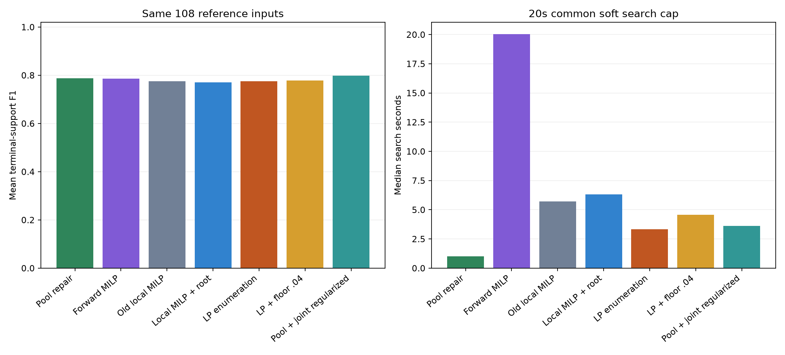
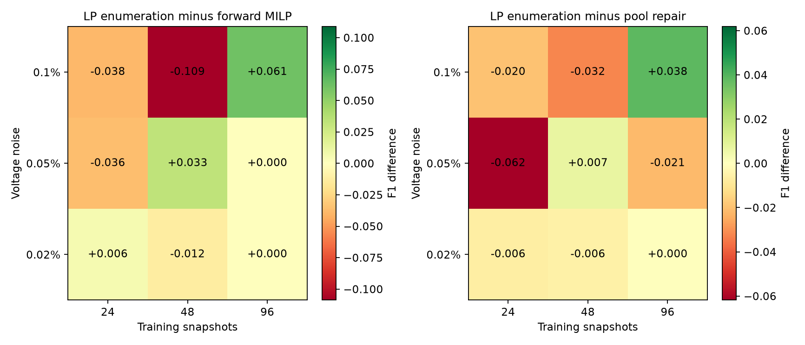
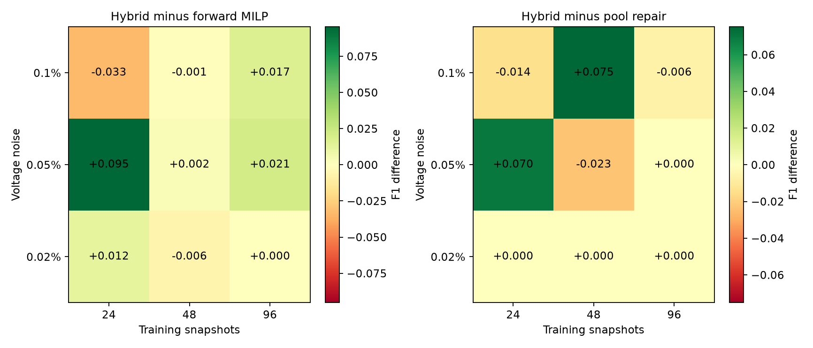

# 四个文献风格算例的冻结参数复测

这是本次对话此前全面对照的同一输入矩阵：主面板 108 输入、压力面板 12 输入，合计 120。每网络 27 个主输入加 3 个压力输入。采用上轮 LP 枚举研究已冻结的参数，未重新调参；已看过的历史输入作为复现与回归测试，不称为新的盲测数据。

## 算例、量测与划分

|case|terminals|hidden|root|base_kV|base_MVA|
|---|---|---|---|---|---|
|paper15|15|6|1|0.4000|0.2000|
|soumalas11|11|4|1|0.4000|0.2000|
|flynn16|16|6|1|0.4000|0.2000|
|pengwah18|18|7|1|0.4000|0.2000|

四者均为文献风格的合成低压径向网络，不是实测馈线或原论文软件复现。根电压已观测，内部节点隐藏且零注入，终端具有同步 P/Q/V；动态负荷和 DER 曲线由代码生成，电压由径向 AC 潮流生成。拟合使用平方电压降 `Vroot²−Vterminal²`，响应系数吸收了线性近似式中的系数 2。

- 主面板：4 网络 × bundle 2/3/4 × 电压噪声 0.02%/0.05%/0.1% × 总训练样本 N=24/48/96，共 108 输入；P/Q 相对噪声为 0.5%。
- 同一物理数据组有三个训练物理日，各日原始 96 点，N 表示跨三日选取后的总样本数，不是每日样本数。验证、测试各为另外三个物理日，共各 288 点。
- 压力：4 网络 × 弱激励/根电压测量噪声/异常点，bundle 2、N=48、电压噪声 0.05%，共 12 输入。实际条件参数保存在 catalog 与原始数据协议；它们不与主面板混合求总体均值。
- 重用前述同一训练前端、候选库和量测文件，144 个不同观测归档及网络文件均校验字节哈希；没有重新抽样生成更容易的数据。

## 固定的方法与预算

|method|config_id|strategy|mode|floor|sparsity|
|---|---|---|---|---|---|
|best_floor|depth_0.04|joint|depth|0.0400|0.0000|
|best_hybrid|hybrid_regularized|pool_joint|depth|0.0800|0.0010|
|enum_control|depth_0|joint|depth|0.0000|0.0000|
|pool|pool|pool|depth|0.0000|0.0000|
|native_joint|native|baseline|depth|0.0000|0.0000|
|native_corrected|native_root|baseline|depth|0.0000|0.0000|
|original_fullwarm|original_fullwarm|baseline|depth|0.0000|0.0000|

`best_floor` 与 `best_joint` 在原冻结记录中指向同一配置，本表仅展示一行；相同配置不会被算作额外独立运行。实际 7 个不同方法配置 ×120 输入，共 840 个工作进程。每个搜索软预算 20 秒；单次 MILP 2 秒、固定家族 LP 5 秒。原始逐步 MILP 扫描相容池内暖启动但保留自由二元支撑域；它仍是逐步贪心模型，不是全树全局最优模型。

所有方法均从公共 RNJ 库、自身路径和同一个单点家族备用候选中选最终模型，输出规则固定为 0.16 收缩、训练重拟合、0% 验证带宽。另报告仅路径（含相同单点备用项）和未收缩终点。另报包含前端、初始化与最终选模的总成本估算；并发单线程计时不称为独立顺序计时。

## 108 个主输入

|method|inputs|available|F1|exact|train_MAE|test_MAE|search_median|total_estimate_median|
|---|---|---|---|---|---|---|---|---|
|pool|108|108|0.787183|47|0.001277|0.001354|1.006044|2.498864|
|original_fullwarm|108|108|0.786544|50|0.001283|0.001353|20.054456|21.486227|
|native_joint|108|108|0.775244|43|0.001280|0.001354|5.723302|7.508787|
|native_corrected|108|108|0.771366|43|0.001279|0.001353|6.316590|8.003883|
|enum_control|108|108|0.775914|44|0.001279|0.001353|3.324669|5.081817|
|best_floor|108|108|0.777801|44|0.001279|0.001353|4.583317|6.233440|
|best_hybrid|108|108|0.798434|44|0.001276|0.001350|3.611859|5.031219|



配对 F1 差值：

|method|reference|inputs|mean_delta|wins|ties|losses|
|---|---|---|---|---|---|---|
|enum_control|pool|108|-0.011269|10|79|19|
|enum_control|native_joint|108|0.000670|8|92|8|
|enum_control|original_fullwarm|108|-0.010630|14|71|23|
|best_floor|pool|108|-0.009382|10|81|17|
|best_floor|native_joint|108|0.002557|8|93|7|
|best_floor|original_fullwarm|108|-0.008743|19|68|21|
|best_hybrid|pool|108|0.011251|8|92|8|
|best_hybrid|native_joint|108|0.023190|16|83|9|
|best_hybrid|original_fullwarm|108|0.011890|22|68|18|

按三个 bundle 的平均差：

|method|reference|bundle|inputs|mean_delta|
|---|---|---|---|---|
|enum_control|pool|2|36|0.000220|
|enum_control|pool|3|36|-0.011009|
|enum_control|pool|4|36|-0.023020|
|enum_control|original_fullwarm|2|36|-0.031044|
|enum_control|original_fullwarm|3|36|-0.010941|
|enum_control|original_fullwarm|4|36|0.010094|

主面板只有三个独立 bundle，网络、噪声及样本数条件成对相关，不按 108 次独立重复推断成功概率。

## 分网络、噪声与样本量

|case|method|inputs|F1|exact|test_MAE|
|---|---|---|---|---|---|
|flynn16|best_floor|27|0.700700|11|0.001349|
|flynn16|best_hybrid|27|0.713422|11|0.001347|
|flynn16|enum_control|27|0.701168|11|0.001348|
|flynn16|native_corrected|27|0.689365|10|0.001349|
|flynn16|native_joint|27|0.705672|10|0.001349|
|flynn16|original_fullwarm|27|0.711653|9|0.001343|
|flynn16|pool|27|0.715064|12|0.001347|
|paper15|best_floor|27|0.823955|11|0.001354|
|paper15|best_hybrid|27|0.856804|10|0.001349|
|paper15|enum_control|27|0.832977|11|0.001353|
|paper15|native_corrected|27|0.832977|11|0.001353|
|paper15|native_joint|27|0.835351|11|0.001355|
|paper15|original_fullwarm|27|0.820988|14|0.001364|
|paper15|pool|27|0.825261|11|0.001361|
|pengwah18|best_floor|27|0.822763|12|0.001347|
|pengwah18|best_hybrid|27|0.854806|13|0.001342|
|pengwah18|enum_control|27|0.811486|12|0.001348|
|pengwah18|native_corrected|27|0.819910|12|0.001348|
|pengwah18|native_joint|27|0.807093|12|0.001350|
|pengwah18|original_fullwarm|27|0.846870|15|0.001348|
|pengwah18|pool|27|0.861926|14|0.001343|
|soumalas11|best_floor|27|0.763786|10|0.001362|
|soumalas11|best_hybrid|27|0.768706|10|0.001361|
|soumalas11|enum_control|27|0.758025|10|0.001362|
|soumalas11|native_corrected|27|0.743210|10|0.001362|
|soumalas11|native_joint|27|0.752862|10|0.001361|
|soumalas11|original_fullwarm|27|0.766667|12|0.001358|
|soumalas11|pool|27|0.746483|10|0.001364|





完整单元格值另存 main_cells.csv，每格为四网络×三个bundle的12个输入。差值图比较相同量测条件，不把某一档噪声结果推广到所有设置。

## 12 个压力输入

|condition|method|inputs|F1|exact|test_MAE|
|---|---|---|---|---|---|
|outliers|best_floor|4|0.911325|1|0.001349|
|outliers|best_hybrid|4|0.892094|0|0.001355|
|outliers|enum_control|4|0.911325|1|0.001349|
|outliers|native_corrected|4|0.911325|1|0.001349|
|outliers|native_joint|4|0.911325|1|0.001349|
|outliers|original_fullwarm|4|0.919872|1|0.001355|
|outliers|pool|4|0.911325|1|0.001349|
|root_noise|best_floor|4|0.895299|1|0.001839|
|root_noise|best_hybrid|4|0.895299|1|0.001839|
|root_noise|enum_control|4|0.895299|1|0.001839|
|root_noise|native_corrected|4|0.895299|1|0.001839|
|root_noise|native_joint|4|0.895299|1|0.001839|
|root_noise|original_fullwarm|4|0.914530|2|0.001839|
|root_noise|pool|4|0.895299|1|0.001839|
|weak_excitation|best_floor|4|0.142857|0|0.001206|
|weak_excitation|best_hybrid|4|0.142857|0|0.001203|
|weak_excitation|enum_control|4|0.142857|0|0.001206|
|weak_excitation|native_corrected|4|0.142857|0|0.001205|
|weak_excitation|native_joint|4|0.142857|0|0.001205|
|weak_excitation|original_fullwarm|4|0.083333|0|0.001207|
|weak_excitation|pool|4|0.142857|0|0.001205|

## 初始化与选模贡献

仅搜索路径输出：

|method|F1|exact|test_MAE|
|---|---|---|---|
|pool|0.776741|46|0.001357|
|original_fullwarm|0.678523|29|0.001403|
|native_joint|0.757795|42|0.001357|
|native_corrected|0.757277|42|0.001356|
|enum_control|0.762663|43|0.001356|
|best_floor|0.764841|43|0.001358|
|best_hybrid|0.790498|44|0.001352|

未收缩终点：

|method|F1|train_MAE|test_MAE|internal|
|---|---|---|---|---|
|pool|0.638930|0.001269|0.001355|9.314815|
|original_fullwarm|0.631809|0.001297|0.001382|6.731481|
|native_joint|0.613530|0.001268|0.001359|10.037037|
|native_corrected|0.616016|0.001267|0.001356|10.018519|
|enum_control|0.612537|0.001266|0.001356|10.259259|
|best_floor|0.623444|0.001267|0.001357|10.240741|
|best_hybrid|0.693474|0.001268|0.001354|8.333333|

最终输出响应矩阵误差：

|method|R_error|X_error|
|---|---|---|
|pool|0.241766|0.690162|
|original_fullwarm|0.241843|0.679266|
|native_joint|0.246052|0.684839|
|native_corrected|0.245527|0.682859|
|enum_control|0.245124|0.682017|
|best_floor|0.240980|0.689519|
|best_hybrid|0.235619|0.685101|

## 完成与核验

原生MILP子问题的状态汇总：

|config_id|calls|status2|timeouts|incumbents_valid|median_gap|
|---|---|---|---|---|---|
|native|3001|2998|3|3001|0.000744|
|native_root|2996|2992|4|2996|0.000728|
|original_fullwarm|1006|159|847|1006|0.169116|

status2按本轮0.1%相对gap容差终止，不等于所有子问题均达到精确零gap。触时但可行的incumbent可以继续用于路径；“工作进程返回”与“每步精确最优”分开解释。

正常返回 840/840，失败 0；失败保留原输入分母，缺失 F1 按 0 计，误差仅在可用结果上平均。逐次 LP/MILP 状态、触时、未决停止原因、界、gap 与原始目标重算保留在记录中。小邻域完整枚举及单步 MILP 的证书不代表整棵树的全局最优性。

独立目标、下界保持、层状性、参数界和代码/输入哈希等 270671 项检查通过；对两个有下界方案的最终固定家族另进行 240 次 HiGHS 独立 LP 重解。计数是程序核查项，不是独立统计证据数。完整表格与协议见 records.zip，本地完整工作记录为 `outputs/paper_cases_lp_rebuild_20261031/`。

复现时使用新输出目录，依赖前述两轮冻结目录与原始合成数据：

```powershell
$py = 'D:/apps/miniconda3/envs/Topo/python.exe'
$replayOutput = 'outputs/paper_cases_lp_replay'
& $py -m research_experiments.lp_rebuild.paper_cases freeze $replayOutput
& $py -m research_experiments.lp_rebuild.paper_cases_report audit $replayOutput
& $py -m research_experiments.lp_rebuild.paper_cases run $replayOutput
& $py -m research_experiments.lp_rebuild.paper_cases analyze $replayOutput
& $py -m research_experiments.lp_rebuild.analyze crosssolver $replayOutput
& $py -m research_experiments.lp_rebuild.paper_cases_report report $replayOutput docs/paper_cases_lp_replay
```
