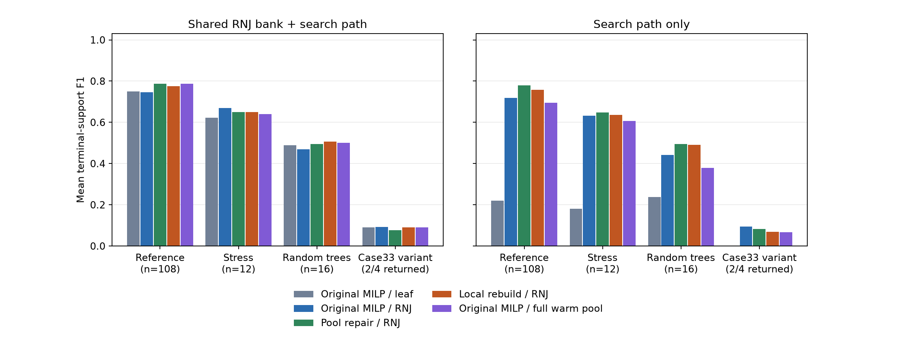
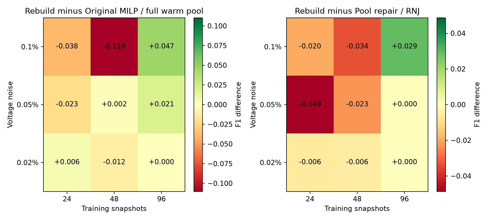

# 调参后的局部重构与原始 MILP：系统配对结果

本报告的算法和数据口径见 [冻结协议](PROTOCOL.md)，参数及完整开发网格见 [冻结记录](tuning_frozen.json)。开发 16 输入、留出 140 输入，四方法共 560 个工作进程。主面板有 108 输入、3 个 bundle；另外的压力、新随机树和 case33 改造例单列。所有数据是既有合成 AC 观测，测试重复未进入本轮调参。

## 参数与公平性

局部搜索参数：`b=4`，相对改善门槛 `0.001`。输出收缩和验证带宽对每个方法、每个视图分别用开发验证数据校准；均先收缩、训练重拟合，再计算实际验证损失。调参不使用 F1 和测试损失。

|method|view|b|relative_gain|resolution|validation_fraction|
|---|---|---|---|---|---|
|original_leaf|selected|4|0.0010|0.1600|0.0000|
|original_leaf|selected_path|4|0.0010|0.0800|0.0000|
|original_RNJ|selected|4|0.0010|0.1600|0.0100|
|original_RNJ|selected_path|4|0.0010|0.1600|0.0100|
|pool_RNJ|selected|4|0.0010|0.1600|0.0000|
|pool_RNJ|selected_path|4|0.0010|0.1600|0.0100|
|rebuild_RNJ|selected|4|0.0010|0.1600|0.0000|
|rebuild_RNJ|selected_path|4|0.0010|0.1600|0.0000|

四者共享同一个训练前端和暖启动信息。原始方法的二元支撑域仍完全自由，但每步固定已有结构；RNJ 同初值对照区分初始化收益，候选池修正对照区分新方法相对当前方法的收益。原始方法是有限时间实现，不是全树全局最优 oracle。

表中的 `original_leaf_fullwarm` 是在读取主结果后追加的更强基线，扫描全部相容池内暖启动候选，仍受同一 20 秒搜索软预算和 2 秒单次 MILP 上限约束，输出参数沿用冻结值。其结果单独保留，不替换原始四方法批次。

## 主面板：带共享 RNJ 库的实际输出

|method|inputs|available|F1|exact|test_mae|
|---|---|---|---|---|---|
|original_RNJ|108|108|0.745582|46|0.001359|
|original_leaf|108|108|0.750481|43|0.001358|
|pool_RNJ|108|108|0.787183|47|0.001354|
|rebuild_RNJ|108|108|0.775244|43|0.001354|
|original_leaf_fullwarm|108|108|0.787155|50|0.001353|

与局部方法的逐输入配对差值：

|reference|inputs|mean_delta|wins|ties|losses|
|---|---|---|---|---|---|
|original_leaf|108|0.024763|20|81|7|
|original_RNJ|108|0.029662|25|70|13|
|pool_RNJ|108|-0.011939|8|84|16|

使用完全相同输出参数的搜索对照：

|reference|inputs|mean_delta|wins|ties|losses|
|---|---|---|---|---|---|
|original_leaf|108|0.024763|20|81|7|
|original_RNJ|108|0.021070|17|84|7|
|pool_RNJ|108|-0.011939|8|84|16|

三个独立 bundle 相对原始叶起点的平均差：

|bundle|inputs|mean_delta|
|---|---|---|
|2|36|0.020775|
|3|36|0.025167|
|4|36|0.028348|

108 个相关条件不当作 108 个独立重复。只有 3 个 bundle，不能靠行数给出很强的总体统计结论。

## 原始 MILP 的完整池暖启动对照

|panel|view|inputs|available|F1|exact|test_mae|
|---|---|---|---|---|---|---|
|case33|tuned_bank|4|2|0.090081|0|0.003134|
|case33|tuned_path|4|2|0.067816|0|0.003803|
|main|tuned_bank|108|108|0.787155|50|0.001353|
|main|tuned_path|108|108|0.694903|28|0.001384|
|stress|tuned_bank|12|12|0.639245|3|0.001467|
|stress|tuned_path|12|12|0.607133|2|0.001482|
|topology|tuned_bank|16|16|0.500015|1|0.001415|
|topology|tuned_path|16|16|0.378317|1|0.001432|

局部重构减去完整池暖启动原始 MILP：

|panel|view|inputs|mean_delta|wins|ties|losses|
|---|---|---|---|---|---|---|
|main|tuned_bank|108|-0.011910|17|71|20|
|stress|tuned_bank|12|0.010582|2|8|2|
|topology|tuned_bank|16|0.005639|5|9|2|
|case33|tuned_bank|4|0.000000|0|4|0|
|main|tuned_path|108|0.062892|56|23|29|
|stress|tuned_path|12|0.028409|4|5|3|
|topology|tuned_path|16|0.111833|11|2|3|
|case33|tuned_path|4|0.001628|1|2|1|

此对照在主分析之后增加，未再用测试结果调参。它检查暖启动限制，不能把结果归因于联合层级搜索本身。每步候选扫描、建模及求解均消耗搜索预算，达到时限时可能尚未扫描完池。

## 训练改善与拓扑恢复的分离

|method|inputs|training_improved|raw_F1_wins|raw_F1_losses|net_TP|net_FP|final_F1_gain_over_bank|
|---|---|---|---|---|---|---|---|
|original_RNJ|108|71|20|45|24|84|0.008516|
|original_leaf|108|108|62|0|122|558|0.006996|
|pool_RNJ|108|92|39|48|61|65|0.043698|
|rebuild_RNJ|108|96|32|53|52|152|0.031759|

raw 指未做最终收缩选模的搜索终点，增量相对同方法初始家族；原始叶起点没有内部集合，F1 的变化不能与 RNJ 起点变化混作同一起点实验。净 TP/FP 为各输入增减的合计。最后一列则将最终输出与同一输出规则选择的公共 RNJ 库比较，分开查看 RNJ 初始化和新增搜索的贡献。

拟合改善同时可能来自恢复真边、加入弱假边或用错误结构近似噪声。F1 对每条额外连接计数，不随权重缩小而减小；验证 MAE 衡量预测，不直接识别真连接。逐步和逐例两侧变化都保存在 `accepted_steps.csv`、`raw_changes.csv` 和 `non_ties.csv`。

## 仅路径输出：分开查看初始化和搜索

|method|inputs|F1|exact|test_mae|
|---|---|---|---|---|
|original_RNJ|108|0.719040|38|0.001367|
|original_leaf|108|0.219840|5|0.001678|
|pool_RNJ|108|0.778559|47|0.001358|
|rebuild_RNJ|108|0.757795|42|0.001357|

## 场景覆盖

|panel|method|inputs|F1|exact|
|---|---|---|---|---|
|case33|original_RNJ|4|0.092105|0|
|case33|original_leaf|4|0.090081|0|
|case33|pool_RNJ|4|0.076923|0|
|case33|rebuild_RNJ|4|0.090081|0|
|main|original_RNJ|108|0.745582|46|
|main|original_leaf|108|0.750481|43|
|main|pool_RNJ|108|0.787183|47|
|main|rebuild_RNJ|108|0.775244|43|
|stress|original_RNJ|12|0.670258|3|
|stress|original_leaf|12|0.622578|2|
|stress|pool_RNJ|12|0.649827|2|
|stress|rebuild_RNJ|12|0.649827|2|
|topology|original_RNJ|16|0.469523|2|
|topology|original_leaf|16|0.488091|1|
|topology|pool_RNJ|16|0.494982|1|
|topology|rebuild_RNJ|16|0.505654|1|

网络、噪声、样本数的全部单元值保存在表格中；压力/随机树/case33 的均值不能用参考网络主面板代替。原始叶起点含 RNJ 库的输出使用了 RNJ 信息，因而不能与仅路径输出混作一个算法。

## 计算与求解状态

|method|inputs|search_median|search_p90|selection_mean|total_estimate_median|MIP_calls|MIP_timeouts|
|---|---|---|---|---|---|---|---|
|original_RNJ|108|3.9367|6.7836|0.2165|4.9197|249|151|
|original_leaf|108|19.8865|20.1024|0.2969|21.1615|962|755|
|pool_RNJ|108|1.0650|2.4185|0.2209|2.4481|0|0|
|rebuild_RNJ|108|5.5843|11.5607|0.2310|7.0928|2742|1|
|original_leaf_fullwarm|108|20.0423|20.1176|0.2814|21.5099|919|760|

|method|calls|timeouts|incumbents_valid|binary_median|constraint_median|median_gap|
|---|---|---|---|---|---|---|
|original_RNJ|311|198|311|96.000000|2989.000000|0.045989|
|original_leaf|1197|946|1197|75.000000|2972.000000|0.300655|
|original_leaf_fullwarm|1129|931|1129|75.000000|2932.000000|0.151366|
|rebuild_RNJ|3456|8|3456|10.000000|1495.000000|0.000775|

时间来自并发的单线程工作进程；前端和输出选模额外计入成本估算，没有称作独立顺序计时。20 秒是搜索软预算，构模或单个 LP 导致的超出保留实际值。相对 gap、incumbent 和 bound 是单个子问题的记录，不是全树最优性证明。触时可行 incumbent 可继续使用，未找到改善且界不充分时保留未决停止原因。

## 100 秒预算与扩池控制：固定八输入

|phase|method|inputs|F1|test_mae|
|---|---|---|---|---|
|primary20|original_leaf|8|0.716920|0.001444|
|primary20|original_RNJ|8|0.718254|0.001440|
|primary20|pool_RNJ|8|0.762088|0.001442|
|primary20|rebuild_RNJ|8|0.760714|0.001437|
|augmented_pool|pool_RNJ|8|0.762088|0.001442|
|budget|original_leaf|8|0.716920|0.001444|
|budget|rebuild_RNJ|8|0.760714|0.001437|

100 秒两方法均不重新调参。扩池控制补入局部方法按训练数据考虑过的候选，需额外支付局部候选发现成本，不把它解释成免费的部署改进。

## 实际历史 100 秒原始实现：同八输入

|view|inputs|F1|exact|test_mae|
|---|---|---|---|---|
|legacy_bank|8|0.739484|4|0.003488|
|legacy_path|8|0.688889|3|0.003712|
|refit_bank|8|0.829167|4|0.001426|
|refit_path|8|0.779464|3|0.001438|

历史路径由当时完整池内暖启动实现产生，与本次“最多四个池内候选暖启动”的限时版本区分。legacy 为历史默认输出，refit 为同路径按本轮已冻结参数重拟合选模；没有重新按真拓扑挑路径。历史参考只在匹配的八个输入上比较，不把其 80 输入总体均值套到本轮 140 输入。

## 共享前端失败的统一恢复

主批次共有 2 个输入的共享前置步骤没有返回，本轮记录为 case33、N=288 固定家族 LP 触及 5 秒上限，四个方法均未启动搜索。原始 140 输入分母保留，F1 缺失按 0 计，预测 MAE 仅在可用结果上平均。因此主表 case33 的全分母 F1 与可用均值应分开理解；具体原因和数量以 `failures.json` 为准。

对所有这类输入统一把每个固定家族 LP 上限提高到 60 秒、工作进程硬上限提高到 900 秒；搜索目标预算仍为 20 秒，参数未变。补充结果如下，未覆盖主记录：

|method|inputs|available|F1|exact|test_mae|
|---|---|---|---|---|---|
|original_RNJ|2|2|0.368421|0|0.001989|
|original_leaf|2|2|0.368421|0|0.001989|
|pool_RNJ|2|2|0.368421|0|0.001989|
|rebuild_RNJ|2|2|0.368421|0|0.001989|

## 核验与记录

独立重算通过 79471 项检查；工作进程失败 8，原分母完整保留。共享前端、参数文件和冻结代码均校验哈希。16 个固定家族的 HiGHS 独立重解另存 `crosssolver.json`。完整逐模型结果、求解状态和输出策略对照见 `records.zip`，各表的未失败预测指标与全分母 F1 分开解释。

源代码入口为 `research_experiments/rebuild_benchmark/`。复现顺序为 `freeze → prepare development → development → select → controls → select_methods → prepare evaluation → evaluation`；随后执行 `budget`、`augmented_pool`、`recovery`、`fullwarm` 及分析。各阶段使用新输出目录，旧原始数据和历史结果保持不变。
