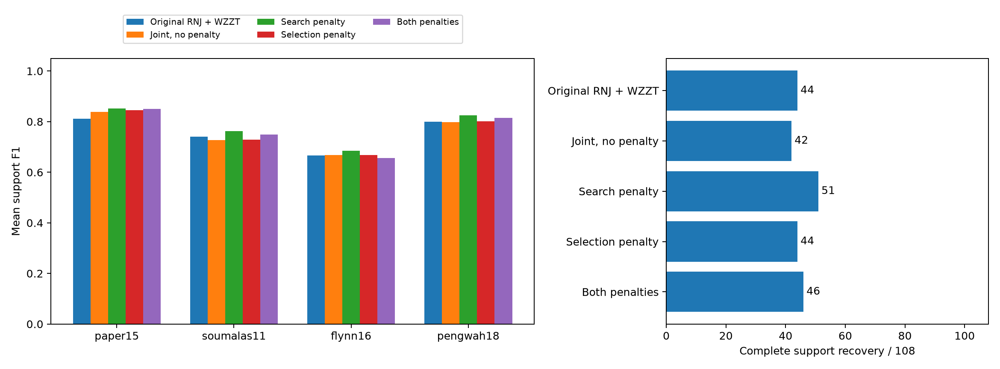
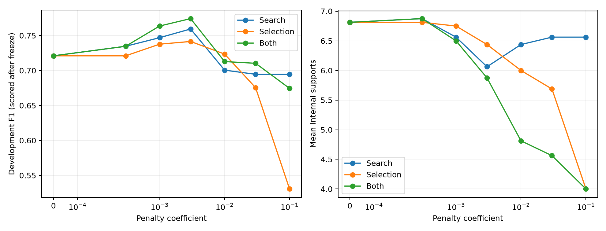

# RNJ小块误选、过度细分与线路数正则化

开发112次搜索全部返回；冻结后正式搜索返回360/360。720个方法输出通过核查，独立重解199个不同的输入/最终家族组合。
同一批paper15、soumalas11、flynn16、pengwah18，108主输入+12压力输入；沿用完整RNJ初值，生产默认bootstrap两边界块口径未覆盖、默认代码未修改。

本批最有效的已冻结配置是仅搜索惩罚lambda=0.003：平均F1为0.7813，完整恢复51/108。无惩罚联合模型为0.7579、42/108；原RNJ+WZZT为0.7545、44/108。改善主要来自减少小块误检，仍有交叉错误和压力条件限制。

## 正则项和调参

采用 J=原始量测MAE+lambda*f0*K。K是非平凡内部连接数；单点和全集不计，固定粗骨架的数量代价作为常数记入。f0是未加惩罚时RNJ初值的训练MAE，用于统一尺度，并非已知噪声标准差。可选零响应线路规范化为不选，没有加入新的正阻抗下界。

开发集为bundle0/1、四网络、两档噪声、N48，共16输入。训练拟合、内层验证选候选、外层开发观测选lambda；历史上名为test_observed的开发归档明确改作调参观测。最终bundle2/3/4的测试观测和真实拓扑均未用于选参。

| 惩罚位置 | 冻结lambda | 开发平均内部连接数 | 开发预测误差对数比 |
|---|---:|---:|---:|
| 仅搜索 | 0.003 | 6.062 | +0.000516 |
| 仅最终选模 | 0.001 | 6.750 | +0.000047 |
| 两处都加 | 0.001 | 6.500 | -0.000414 |

先最小化外层开发预测MAE，再在配对一标准误差或0.1%带内优先较少线路。标准误差按case×bundle八组计算；这是一种简约选模规则，不作置信保证。两处惩罚的严格最小误差控制取lambda=0.001。
参数冻结后才计算开发F1；没有因为开发或最终F1重新选择强度。完整设置见[PROTOCOL.md](PROTOCOL.md)。

## 主面板：F1和完整恢复

| 方法 | 平均F1 | 完整恢复 | 平均预测内部连接数 |
|---|---:|---:|---:|
| 原RNJ+WZZT | 0.7545 | 44/108 (40.7%) | 6.546 |
| 五块联合，无惩罚 | 0.7579 | 42/108 (38.9%) | 6.630 |
| 仅搜索惩罚 | 0.7813 | 51/108 (47.2%) | 6.287 |
| 仅最终选模惩罚 | 0.7613 | 44/108 (40.7%) | 6.574 |
| 搜索与选模都惩罚 | 0.7678 | 46/108 (42.6%) | 6.509 |

严格最小误差规则与简约规则选择了相同的两处惩罚配置，因此合并显示，未把别名算成独立搜索。

预先选定的两处惩罚相对无惩罚联合模型：平均F1变化+0.00983，完整恢复变化+4/108。相对原RNJ+WZZT：平均F1变化+0.01329，完整恢复变化+2/108。

同输入的较早基线参照（本轮未重跑、结构搜索域不同）：

| 历史方法 | F1 | 完整恢复 |
|---|---:|---:|
| 池内逐步修正 | 0.7872 | 47/108 |
| 叶初值自由支撑MILP | 0.7865 | 50/108 |
| 先逐步后局部重构的正则混合 | 0.7984 | 44/108 |

相对无惩罚联合模型的逐输入配对：

- 仅搜索惩罚：平均F1差+0.02342，24胜/79平/5负。
- 仅最终选模惩罚：平均F1差+0.00335，5胜/103平/0负。
- 搜索与选模都惩罚：平均F1差+0.00983，18胜/84平/6负。

三个位置各自调到了不同强度，以上比较是完整配置的效果，不把差异全部归因于惩罚放置位置。仅搜索惩罚的搜索中位数为10.40秒，无惩罚为6.68秒，恢复改善伴随更多求解时间。

| 算例，每行27输入 | 原RNJ+WZZT | 无惩罚联合 | 仅搜索 | 仅选模 | 两处都加 |
|---|---:|---:|---:|---:|---:|
| paper15 | 0.8121 | 0.8387 | 0.8526 | 0.8456 | 0.8504 |
| soumalas11 | 0.7399 | 0.7267 | 0.7621 | 0.7292 | 0.7490 |
| flynn16 | 0.6665 | 0.6685 | 0.6850 | 0.6685 | 0.6563 |
| pengwah18 | 0.7994 | 0.7977 | 0.8257 | 0.8018 | 0.8154 |

108行包含相关的噪声/采样条件，不作为108次独立随机拓扑重复。完整恢复指非平凡终端支撑集合完全一致。

## 是RNJ输入已错，还是后续辨识出错

RNJ自身输出是合法层状树，内部非法交叉数为0。这里“交叉错误”指预测块与真实拓扑块交叉。“相容的多余细分”则与所有真块包含或分离，但多出了不存在的线路。

| 原流程主面板来源 | 相容的多余细分 | 与真树交叉的错误分组 |
|---|---:|---:|
| RNJ初始固定输入 | 355 | 137 |
| WZZT后续新增 | 93 | 39 |
| 最终回退库中另外出现的假块 | 15 | 15 |

按最终实际选择的树来源，误检中164次位于公共RNJ库输出，49次位于自身搜索路径输出。候选生成历史和最终选中来源分别统计，不能相互替代。

43/108个输入在RNJ阶段已经含与真树交叉的错误块；26/108在后续又新增交叉错误。其中两阶段同时出现的为26例，初始无交叉而后来新增交叉为0例。
这个分布受完整RNJ固定支撑限制影响：若初值已保留真支撑，后续相容扩展本身就受到它们约束。因此不能把“未在干净初值后出现交叉”外推为WZZT一般不会出错。

RNJ输入共有947次结构连接，其中455次为真；遗漏的166次真线路中，124次在进入WZZT前已被错误固定块排除。WZZT随后新增163次连接，其中31次为真、132次为假。总数和新增误检比例需结合看：输入先限制了可恢复范围，后续无复杂度代价的扩展又增加了较多假线。

具体例子：paper15、bundle2、0.05%电压噪声、N24，RNJ输入含{106,110}，训练权重为零，仍排除了真块{108,109,110}；后续WZZT又加入{107,108,109}。这说明零权响应与结构解除是两件事。固定粗骨架的线路数代价只是常数，惩罚不能自动解除这些错误。

以上是同一支撑的阶段追踪及搜索域排除关系。最终公共RNJ库回退还可能换树，不能把所有最终误检直接计为后续搜索新造。

## 惩罚减少了哪类错误

| 主面板最终输出 | 小块FP | 小块FN | 大块FP | 大块FN |
|---|---:|---:|---:|---:|
| 原RNJ+WZZT | 197 | 115 | 16 | 12 |
| 五块联合，无惩罚 | 201 | 110 | 14 | 10 |
| 仅搜索惩罚 | 159 | 108 | 16 | 9 |
| 仅最终选模惩罚 | 195 | 110 | 14 | 10 |
| 搜索与选模都惩罚 | 185 | 110 | 16 | 9 |

| 最终假块类型，主面板 | 相容的多余细分 | 与真树交叉 |
|---|---:|---:|
| 原RNJ+WZZT | 141 | 72 |
| 五块联合，无惩罚 | 150 | 65 |
| 仅搜索惩罚 | 117 | 58 |
| 仅最终选模惩罚 | 146 | 63 |
| 搜索与选模都惩罚 | 138 | 63 |

小块指覆盖2..5个终端，大块指>5个终端；与联合模型的“五个直属子树块”分别统计。主面板真线路次数为小块540、大块81。

## 路径与最终选模

| 方法 | 仅路径F1 | 路径完整恢复 | 未收缩终点F1 | 最终来自公共RNJ库 |
|---|---:|---:|---:|---:|
| 原RNJ+WZZT | 0.7299 | 41/108 | 0.6025 | 92/108 |
| 五块联合，无惩罚 | 0.7454 | 39/108 | 0.5387 | 83/108 |
| 仅搜索惩罚 | 0.7820 | 51/108 | 0.7516 | 78/108 |
| 仅最终选模惩罚 | 0.7472 | 39/108 | 0.5387 | 85/108 |
| 搜索与选模都惩罚 | 0.7599 | 43/108 | 0.6752 | 81/108 |

不使用公共RNJ库时，仅搜索惩罚的路径选模F1仍由0.7454升至0.7820，完整恢复由39升至51。因此本批改善也出现在搜索路径本身，并非仅由公共RNJ回退造成。

按实际结构状态检查搜索域是否得到修复（主面板累计；初始被阻断真线路为124次）：

| 训练lambda | 阶段 | 保留真线路 | 相容假细分 | 交叉假分组 | 被阻断真线路 |
|---:|---|---:|---:|---:|---:|
| 0 | 预选后 | 508 | 626 | 160 | 108 |
| 0 | 终点 | 517 | 652 | 163 | 103 |
| 0.001 | 预选后 | 487 | 349 | 126 | 107 |
| 0.001 | 终点 | 509 | 323 | 118 | 95 |
| 0.003 | 预选后 | 480 | 216 | 103 | 99 |
| 0.003 | 终点 | 497 | 162 | 89 | 85 |

搜索惩罚比较的是J而非单独训练MAE，J沿接受路径下降。仅选模惩罚复用零惩罚路径，能揭示收益来自结构搜索还是从已有候选中选择更简约的树。只在搜索中加惩罚时，最终仍可能退回较复杂的原RNJ候选；不同lambda还会改变搜索路径和时限内的解，最终线路数不要求单调。对相同连接数的错误/正确树，数量惩罚没有直接偏好；保留的错误粗边界仍需单独解决。若修复一个错误分组需要同时补入更多真实线路，数量惩罚还会增加这次修复的代价。因此它针对过度细分有明确作用方向，对错误分组的改善依赖可释放范围和量测区分能力。

## 压力面板

| 方法 | F1 | 完整恢复 |
|---|---:|---:|
| 原RNJ+WZZT | 0.6562 | 3/12 |
| 五块联合，无惩罚 | 0.6386 | 1/12 |
| 仅搜索惩罚 | 0.6531 | 3/12 |
| 仅最终选模惩罚 | 0.6728 | 3/12 |
| 搜索与选模都惩罚 | 0.6531 | 3/12 |

## 核验与复现

正则目标、原始损失、界、树结构、选择分数、输入/源码等14399项核查通过。不同的输入/最终家族组合共199个，均以HiGHS独立重解；共享家族复用结果，核查覆盖720个方法输出，未把别名当作独立证据。

相同观测、公共RNJ库、0.16收缩和0..2响应界；每条搜索20秒软预算，预选5秒、单步2秒，收尾用剩余预算。原RNJ+WZZT使用上批同输入结果作参照；其计时与本批非同一次运行。MIP达到0.1%相对gap才计为达到求解容差，触时可行解单列；[solver_summary.csv](solver_summary.csv)保留各配置状态。输入核验覆盖192个观测归档和16个网络目录。源代码、参数、逐输入结果、失败和MIP状态/上下界均保存在[records.zip](records.zip)。

```powershell
python -m research_experiments.rnj_count.run freeze outputs/rnj_count_NEW
python -m research_experiments.rnj_count.run development outputs/rnj_count_NEW
python -m research_experiments.rnj_count.run select outputs/rnj_count_NEW
python -m research_experiments.rnj_count.run evaluation outputs/rnj_count_NEW
python -m research_experiments.rnj_count.run analyze outputs/rnj_count_NEW
```

本地完整记录：`outputs/rnj_small_count_20261031/`。原始观测归档沿用既有本地基准，未在交付包重复存储。




