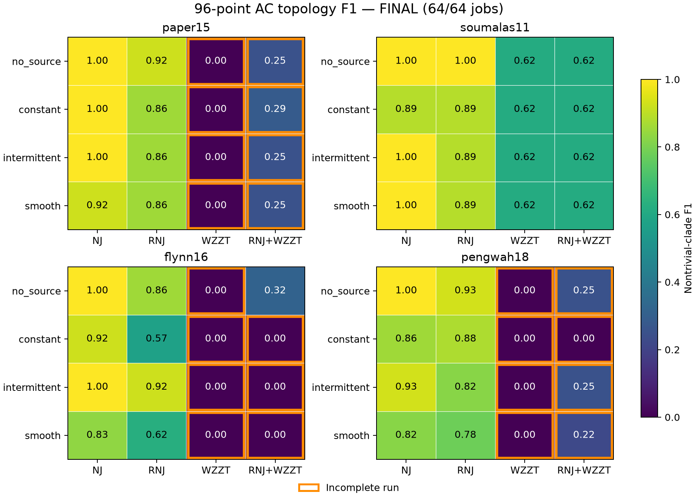

# 一天96点的NJ、RNJ、WZZT及RNJ+WZZT比较

## 实验对象与输入

使用已冻结的 `outputs/source_ac96_20261018/`：paper15、soumalas11、flynn16、pengwah18四网络，每网无源、常值源、间歇源、平滑时变源四组，每组96点，共64个方法运行槽位。沿用[数据协议](source_ac96_20261018.md)的物理配置、量测噪声和源曲线，不重新生成或挑选数据。

每个辨识器只接收同一组终端P/Q、已观测根构造的平方电压降Y，以及已知额外源P/Q时序。接入位置未知；真网架、源母线及真实线路参数只由辨识完成后的父进程评价读取。总表通道随输入保存，但本轮四法不利用它，避免不同方法额外获取信息。

仅使用本日96点拟合，不新增调参日或验证日；所有阈值在执行前固定。不同源曲线共享同一背景日，因此16个条件不是16条独立实测馈线或独立随机重复。

## 四种方法

令P、Q、Y为96×n矩阵，U为额外源有功、无功时序组成的96×2矩阵。

| 方法 | 结构恢复与参数来源 |
|---|---|
| NJ | 同一有序约束R/X回归后，使用含观测根锚点的经典Q准则NJ；RX75融合，内部边收缩阈值0.16倍根深度中位数 |
| RNJ | 使用相同R/X回归和RX75几何，RNJ分组阈值同为0.16倍根深度中位数 |
| WZZT | 全部终端singleton初始化；在全部合法相容支撑中逐次扩展，同时重估所有R/X权重；有源时联合重估完整未知源路径h |
| RNJ+WZZT | 先做RNJ与100次长度4的循环分块bootstrap，固定支持频率至少0.75的至多2个互不相交边界块，再做同一自由支撑WZZT；保留原终端，不做聚合或去嵌入 |

无源NJ/RNJ直接拟合 `Y=P R^T+Q X^T`。有源时拟合 `Y=P R^T+Q X^T+U G`，G是两个自由终端响应向量。先用U的SVD列空间同时投影P、Q、Y，再调用现有零截距、对称/非负/ordered约束回归；最后回算G。此投影等价于消去自由源响应，不使用源位置。常值、间歇源的U秩为1，只回报最小范数的G代表。没有额外添加截距。

NJ与RNJ的主R/X指标取其共同前置回归矩阵，故两者R/X误差应相同；它们的拓扑F1分别按各自输出树计算。没有在建树后隐式增加WZZT重拟合步骤。

WZZT使用物理源路径约束：`R=sum r_k z_k z_k^T`、`X=sum x_k z_k z_k^T`，源预测为 `uP*gR+uQ*gX`，其中 `gR=sum r_k*h_k*z_k`、`gX=sum x_k*h_k*z_k`。每轮对全部h重新联合求解，遵守祖先和互斥关系。它与NJ/RNJ的自由源响应适配具有不同结构约束；本次比较保留这一区别。

bootstrap对量测和源时序同步抽样。失败和未尝试的重复留在100次分母中；错误冻结块按实际保留，评价真值不参与块筛选。

## 计算预算与停止

- Gurobi 13.0.3，单线程；已验证可解超过免费规模限制的模型。后端接收现有core的同一标准矩阵，不修改生产模型。
- 每次固定族/扩展求解最多60秒；每种方法总预算300秒，包括回归、bootstrap、建模和求解。进程外部另加30秒启动/保存宽限，超限保留最后检查点。
- 至多两个新进程并发；BLAS/OMP线程数均固定为1。报告方法内部计算时间，排除解释器启动、输入复制及真值评价。
- R/X原子权重上界均为2，不自动扩界。每次接受需通过core的绝对或相对gap不超过1e-10的严格证书，并独立复算源项预测、目标和原约束。
- 未认证incumbent保留在诊断中，不作为已接受路径点。求解未完成时回报最后认证模型；首个固定模型也未完成时指标记为空。
- 无额外验证数据，因此按最后一个有显著训练增益的认证路径点输出；没有套用需要验证日的1SE规则。增益阈值为 `1e-10+1e-8*previous_MAE`。

证书对象是给定当前族与系数界下的固定族或单步扩展；完整前向路径仍是贪心搜索。运行正常返回与搜索完整分别记录。

## 指标与原始记录

拓扑F1比较每条边的非平凡下游终端集合，排除singleton和全集；WZZT只计 `max(r_k,x_k)>1e-8` 的原子。F1=1表示该约化结构的非平凡终端簇全部匹配。

R/X误差为平方电压灵敏度矩阵的相对Frobenius误差：`||M_est-M_true||_F/||M_true||_F`。物理真值由每条线路的共同根路径构建，包含系数2；不是隐藏物理边逐条阻抗误差。

入口：`python -B -m research_experiments.rnj.run_source_ac96_benchmark`。默认结果目录：`outputs/source_ac96_benchmark_20261018/`。每次运行保存协议、源码/输入SHA256、环境、每job输入指纹、完整模型/源路径/认证路径/求解器gap、stdout/stderr和64行汇总。程序可在协议及代码哈希相同的条件下续跑，失败不自动改成成功或从分母移除。

独立审核入口：`python -B -m research_experiments.rnj.audit_source_ac96_benchmark outputs/source_ac96_benchmark_20261018`。审核不导入方法或主评分器，独立按物理根路径重建R/X与真实clade，复算64项指标、原子分解、源路径/预测、严格证书及输入隔离。

本文件以上协议在正式执行前固定。下文补充正式运行结果，未据恢复成绩修改阈值或重选模型。

## 本轮结果

64/64项已结束，64项均保存可评分模型：41项按各自停止规则完成，23项WZZT扩展因单步60秒超时而未取得最优性证书；进程失败、无模型和遗漏均为0。23项未完成结果保留最后认证模型并参与以下均值，未接受的可行候选另存附表。每方法的均值分母均为16，按网络与源型等权计算。

| 方法 | 完整/未完成 | 平均终端簇F1 | 平均R误差% | 平均X误差% | 平均计算秒 | F1=1 / 计划 |
|---|---:|---:|---:|---:|---:|---:|
| NJ | 16/0 | 0.9489 | 22.19 | 61.44 | 0.29 | 9/16 |
| RNJ | 16/0 | 0.8467 | 22.19 | 61.44 | 0.29 | 1/16 |
| WZZT | 4/12 | 0.1538 | 160.90 | 302.66 | 61.82 | 0/16 |
| RNJ+WZZT | 5/11 | 0.2835 | 145.08 | 288.86 | 95.26 | 0/16 |

R/X列沿用上文的灵敏度矩阵相对Frobenius误差；大于100%的数值按实际保留。NJ/RNJ的两列相同来自共同前置回归。计算时间包含联合方法的100次bootstrap及全部实际建模、求解和检查点保存。

| 源项（每格4个网络平均F1） | NJ | RNJ | WZZT | RNJ+WZZT |
|---|---:|---:|---:|---:|
| 无源 | 1.0000 | 0.9284 | 0.1538 | 0.3578 |
| 常值源 | 0.9173 | 0.7981 | 0.1538 | 0.2253 |
| 间歇源 | 0.9833 | 0.8732 | 0.1538 | 0.2788 |
| 平滑时变源 | 0.8950 | 0.7872 | 0.1538 | 0.2719 |

四网络逐源型F1见下图，橙框为未完成搜索。全部64行的F1、R/X误差、秒数、状态和停止原因见[完整报告](source_ac96_benchmark_20261018_evidence/report.md)及[原始汇总CSV](source_ac96_benchmark_20261018_evidence/summary.csv)。



本轮NJ的拓扑恢复最稳定：无源四网全部F1=1，总计9/16条件完全匹配。WZZT的低F1有两类实物依据：12项纯WZZT及11项联合方法保留了超时前的认证模型；完成的soumalas11八项均包含全部4个真簇，同时额外增加5簇，F1为0.6154。flynn16无源联合方法达到层状族大小上限后结束，预测13簇、匹配3个真簇，F1为0.3158。因此，搜索超时与完成后的结构细分问题应分别处理。

23项未完成模型中20项至少有一个权重达到预设上界2的99.5%，其R/X误差也反映当前受限模型的状态。保存的23个超时可行候选相对正式模型，F1有16项相同、6项降低、1项提高；单纯改为接受这些候选未显示一致的结构改进。该附表仅用于事后诊断，算法未使用真值挑选候选。

联合方法选定15个固定RNJ边界块，其中6个与真实终端簇不匹配；[逐块记录](source_ac96_benchmark_20261018_evidence/frozen_blocks.csv)保留了标签及最终权重。本轮没有验证日、剪枝或撤销冻结块机制，结果评价的是这套预先固定的训练与搜索规则。两类方法的Source适配、损失函数与可行模型类也不同，本轮成绩反映这些设置的共同效果。

## 核验与证据

正式运行前的4组测试共34项通过。正式运行后的[独立审核](source_ac96_benchmark_20261018_evidence/audit_summary.json)共3890项检查全部通过，独立重算64项F1、R/X误差及模型预测。另行[核对协议签名和源码快照](source_ac96_benchmark_20261018_evidence/provenance_audit.json)：64个payload的完整配置、128个payload/result签名、42个冻结源码指纹及43个快照文件全部匹配，数据manifest保持一致。

[证据目录](source_ac96_benchmark_20261018_evidence/README.md)保存按方法/源项汇总、独立重算结果、固定块、23个未认证候选和746份本地原始记录的SHA256。候选附表不替换主表成绩。每个条件只有一个配对背景日；100次bootstrap用于筛选边界块，不作为100次独立恢复实验。

## 复现与保存范围

在仓库根目录使用已有Topo环境执行：

```powershell
& D:/apps/miniconda3/envs/Topo/python.exe -B -m research_experiments.rnj.run_source_ac96_benchmark --output-dir outputs/source_ac96_benchmark_20261018
& D:/apps/miniconda3/envs/Topo/python.exe -B -m research_experiments.rnj.audit_source_ac96_benchmark outputs/source_ac96_benchmark_20261018
& D:/apps/miniconda3/envs/Topo/python.exe -B -m research_experiments.rnj.summarize_source_ac96_benchmark --output-dir outputs/source_ac96_benchmark_20261018
```

已存在的目录在配置和方法源码哈希一致时只补跑缺失项；重做实验应指定新目录。后两条命令只读取已保存模型进行复核及汇总，不重新拟合。执行要求可处理本轮规模的Gurobi许可证。

原始目录保留64个槽位的输入指纹、结果、R/X矩阵、源响应、原子支撑、逐步认证记录、求解器目标/界/gap以及stdout/stderr。另保存43个Python文件的 `source_snapshot/` 和逐文件SHA256：其中42个匹配正式协议指纹，另一个为数据加载器。当前工作区中既有的无关修改未纳入本任务Git提交；快照保留正式运行时的实际文件内容。完整原始目录作为本地生成结果保留，Git只纳入规模较小的汇总与核验证据。
