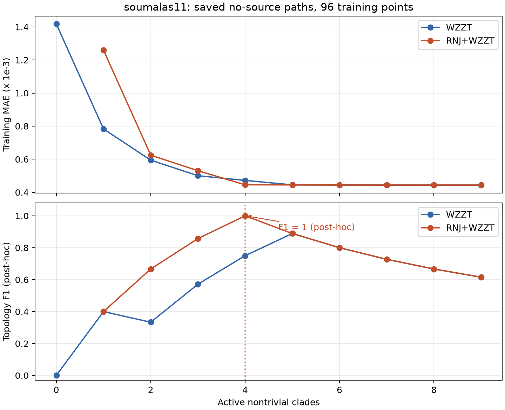

# 96点WZZT结果诊断与单组时限对照

## 完整历史方法复测结果

已按用户选择，仅复测pengwah18无源组，沿用已有一天96点：前64点训练、后32点验证。完整主线的终止条件、RX75、RNJ同簇阈值、bootstrap筛选、扩界、安全剪枝和one-SE均保留。6项全部返回并保存模型，独立复核10084项全部通过；两个原预算超时结果保留为incomplete。

| 方法 | 求解预算 | F1 | R误差% | X误差% | 方法耗时/秒 | 停止原因 |
|---|---|---:|---:|---:|---:|---|
| NJ | 参照 | 0.8571 | 23.16 | 60.71 | 0.298 | 成树完成 |
| RNJ | 参照 | 0.8235 | 23.16 | 60.71 | 0.313 | 成树完成 |
| WZZT | 原预算 | 0.0000 | 206.12 | 400.91 | 60.61 | 首次扩展超时，保留初始认证模型 |
| RNJ+WZZT | 原预算 | 0.0000 | 206.12 | 400.91 | 117.04 | 首次扩展超时，保留初始认证模型 |
| WZZT | 100倍 | 0.7500 | 27.81 | 97.87 | 545.56 | 达主线迭代上限 |
| RNJ+WZZT | 100倍 | 0.7500 | 27.81 | 97.87 | 540.12 | 达主线迭代上限 |

原预算为每次求解60秒、每方法300秒；100倍为6000秒、30000秒。方法耗时包含RNJ筛选与检查点保存；独立审计另计。F1为非平凡支撑簇恢复分数，本次family与active两种口径数值一致。R/X误差为平方电压灵敏度矩阵的相对Frobenius误差，不是隐藏线路逐边阻抗误差。验证32点参与选模，本轮没有独立测试集。

在同一64/32协议下，100倍预算让两种WZZT的F1由0升至0.75，确认首次扩展超时是此前低分的重要原因。首个认证MILP扩展分别耗时377.99秒、333.91秒，均超过原60秒限制；扩大预算后17次扩展全部获得严格单步证书，没有再次超时，也没有触发扩界。单步证书适用于当前族的一个扩展，不是全拓扑最优证书。

两条100倍路径数值相同：训练bootstrap没有任何边界块达到0.75，联合方法没有冻结RNJ块，因而与纯WZZT使用相同初始化和搜索域。0.75阈值保持不变。联合方法这次耗时略短来自各次求解的实际计时差异，不能据此认定它更快。

### 选模、贪心路径和迭代上限的作用

one-SE选中路径索引11、总原子27个，其中9个非平凡簇含6个真簇，F1=0.75。最后路径点有32个原子，F1=0.5714；验证MAE从选中点0.000527291升至末点0.000532010。1SE未选择后续净增5个原子的模型，其训练MAE更低、验证MAE略高且F1更低；选中点的R/X误差27.81%/97.87%略高于末点26.42%/95.22%，选模改善拓扑不等于同时改善参数误差。

事后对整条路径评分，最高F1就是0.75（索引11与12）。因此，单改本条路径的选模规则，无法补回从未进入路径的真簇 `[301,302,303,304,305]`。第二次扩展加入的错误簇 `[302,306,307,308]` 与该真簇交叉，随后一直保持正权；在选中点的R/X权重为0.00520777/0.11981382。层状约束禁止同时保留这两个交叉簇，零权剪枝也无法撤销这个正权错误簇。此处阻塞来自MILP贪心路径，不来自RNJ冻结块。首次认证扩展实际上是另一12终端大簇，已在路径索引8被剪除，不能把最终族的第一项误当作首次扩展。

停止原因 `max_atoms` 也须精确解释：源码从18个初始原子开始，将35同时用于族大小和前向迭代计数上限。17次扩展中两次剪枝累计删去3个原子，最后迭代计数到35时当前族仅32个原子；循环仍按上限停止。最后一次训练增益2.07099e-7，约为显著增益阈值1.04776e-10的1977倍，且未求下一步，故本次没有建立无进一步增益的收敛结论。状态complete表示按配置停止，不能改写为全局收敛。

[本组CSV、路径图和冻结协议](source_ac96_full_history_pengwah18_20261018_evidence/README.md)；[独立审计摘要](source_ac96_full_history_pengwah18_20261018_evidence/independent_audit_summary.json)；[逐步路径诊断摘要](source_ac96_full_history_pengwah18_20261018_evidence/full_history_path_diagnosis_summary.json)。原始模型、求解器incumbent、gap、全部检查点和源码快照保留在 `outputs/source_ac96_full_history_pengwah18_20261018/`，未覆盖首轮64项结果。

## 已查明的原因

上一轮使用了新建的 `source_ac96_wzzt.py` 包装器，保留Source路径的联合估计与严格单步证书，但省略了权威主线的验证one-SE选模、安全零权剪枝、触界扩界重启及基于对偶界的无增益停止。权威 `pipeline.py` 本身也固定全部singleton；空初始化仅属于更早的线性实验，不能把不同历史版本混用。首轮64项基准的低F1应解释为该包装器明确设置下的结果，不宜直接当作完整主线WZZT流程的复现。

| 因素 | soumalas11的现有证据 | pengwah18无源的现有证据 |
|---|---|---|
| 求解超时 | 八项WZZT/联合运行都完成，低F1没有超时原因 | 两种WZZT均在扩展超时后保留初始/早期认证模型 |
| 系数上界2 | 八个最终模型均未触界，不能解释其额外5簇 | 真线路原子R最大0.09975、X最大0.08075，全部在界内；单点初始化X触2源于缺少共享支路的模型错配 |
| 训练末点选模 | 直接观察到继续加假簇并降低F1 | 本次完整one-SE在长预算路径选F1=0.75，末点为0.5714 |
| 零权重剪枝 | 额外簇具有正权，单补零权重剪枝不能解决 | 包装器未剪枝；另一个flynn16结果有零权支撑仍占层状族名额并限制后续扩展 |

### soumalas11：训练收敛与拓扑选择不是同一条件

以无源联合方法为例，已保存路径的训练目标经独立矩阵重建复算：

| 保存路径点 | 非平凡预测簇 | F1 | 训练MAE |
|---|---:|---:|---:|
| 15个总原子 | 4，全为真簇 | 1.0000 | 0.000445553546 |
| 16个总原子 | 5 | 0.8889 | 0.000444836255 |
| 20个总原子，正式输出 | 9，4真5假 | 0.6154 | 0.000443760678 |

从正确结构继续新增5个假簇，总训练MAE仅降低约0.402%。首个退化步骤的训练增益为7.173e-7，数值接受阈值约1.045e-10，因而代码按设定接受了它。该阈值用于排除数值零增益，没有控制噪声下的结构复杂度。MILP已完成单步求解，问题主要在路径选择标准，而非把“未收敛”误报为完成。



图中F1仅为事后评价，标出的正确结构点不参与部署选模；上图展示首轮保存的96点全训练路径。

纯WZZT四种源型的保存路径最高F1均为0.8889，正式末点均为0.6154；无源与间歇源联合方法的中间点曾达到F1=1。前者还包含早期贪心加入的跨主支路假簇 `[101,102,103,109,110,111]`，所以正确选模也未必单独消除全部路径偏差。以上最佳路径点仅为事后诊断，不能用真值直接选择部署模型。

### 实现与数据核查

未发现可确认的P/Q单位、平方电压因子2、源注入或系数索引错误。四法使用的P/Q/Y完全相同，Y严格等于观测根电压平方减终端电压平方。pengwah18的0.2MVA、0.4kV给出0.8Ω阻抗基准，线路原子权重为两倍标幺阻抗。上界2约为最大真实R原子的20倍；“初始化触界”不能推出真实线路需要扩大上界。

pengwah18真实模型包含18个终端原子与7个共享簇，而单点初始化只含前18个。丢失的跨终端贡献占各节点平均真实线性响应的42.34%–83.87%，初始对角系数随之吸收上游其他终端的响应。其大系数符合该受限模型的条件L1最优性，不能据此认定权重提取错误。

含噪设计矩阵 `[P,Q]` 条件数：pengwah18约3486、soumalas11约2228。电压量测引入的平方电压降误差RMSE分别约为真实动态响应尺度的24.9%、59.8%。这些是本日数据的数值诊断；P/Q共变及R/X补偿增加了参数和弱簇的不稳定性。

### 单独改变上界的固定族诊断

另在用户指定的pengwah18前64点上，将初始singleton族保持不变，仅将R/X上界依次取2、4、32；每个终端是独立的两个系数L1小LP，共54项。全部通过独立原始/对偶目标、约束、驻点和互补核验，最大绝对对偶gap为1.84e-18。B=2与正式完整方法初始化的目标完全一致、权重最大差1.1e-15。

| 上界B | 训练MAE | 后32点验证MAE | R矩阵误差% | X矩阵误差% |
|---|---:|---:|---:|---:|
| 2 | 0.00198370 | 0.00278661 | 206.12 | 400.91 |
| 4 | 0.00196142 | 0.00278228 | 206.71 | 421.71 |
| 32 | 0.00196142 | 0.00278228 | 206.71 | 421.71 |

放到4使训练MAE下降1.12%、验证下降0.156%，系数矩阵误差反而增加；最大X为2.279，放到32没有额外收益。因此，初始受限族确有轻微的界截断，但大矩阵误差主要需要通过共享结构恢复来处理。该诊断只改变固定族的连续参数域，不做拓扑搜索，不按真值选界，也不改变正式两档预算实验。

这一结构限制也能直接核算：singleton族的R/X必为对角矩阵，任何对角矩阵到真实R/X的相对Frobenius误差至少为真实非对角部分的范数占比，本例分别为79.29%与80.42%。放大对角系数上界无法补出这些共享响应。

## 历史较好结果为何不能直接横比

| 保留的历史实验 | soumalas11纯WZZT | soumalas11联合方法 | 与本轮主要区别 |
|---|---:|---:|---|
| `outputs/laminar_l1_milp_noisy_paper_cases_final/` 与 `outputs/rnj_warmstart_laminar_noisy_final/` | 0.8889 | 1.0000 | 严格线性响应加Laplace噪声/粗差；P/Q无噪声；48点分32/8/8；训练截距；验证one-SE选模；600秒/扩展 |
| `outputs/mainline/` | 此记录是RNJ后MILP联合流程 | 1.0000 | 约化到7个终端，2个固定RNJ块与2项有限候选池，独立验证 |
| `rnj_wzzt_core/outputs/advantage_stress_20260910/` 的三个soumalas11 reference重复 | 自由搜索均为0且超时 | RNJ候选池版本均为1 | 扩展约1.5秒；旧外层complete只代表程序返回，内部记录search_incomplete；候选池版本不能当作自由WZZT成绩 |

旧线性粗差实验的L1目标针对响应污染，且保留验证选模；首轮64项基准为AC潮流、P/Q和电压均含噪、零截距、96点全部训练、末点输出。历史优势同时包含不同数据机制、候选域、初始化与验证规则的影响。旧线性实验的系数界同样为2且明确关闭扩界，所以不能把该历史优势解释为自动扩界。旧报告与原始运行表均保留，本次未重新执行或将它们当作独立新证据。

## 改进顺序与本次授权复测

1. **先恢复完整主线，再隔离超时。** 用户已选择pengwah18无源一组，已有96点按前64点训练、后32点验证。NJ/RNJ也重新只用训练64点；WZZT与RNJ+WZZT直接调用主线完整路径，各做60秒/300秒和6000秒/30000秒两档单步/总预算，对照倍率100。两档其余规则全部相同，保留完整扩界、剪枝、one-SE和各停止条件。
2. **验证选模已经恢复，后续单独验证其稳定性。** 本次64/32和主线one-SE已改善选模；后续可用预先固定的分块交叉验证检查划分依赖，需要全部96点拟合时，另取独立验证日并单独计入数据预算。Source项必须同步进入验证预测。不可按本次真实F1倒推阈值。
3. **区分初始化与上界。** 无源可以对照历史空初始化；有源须设计可行的初始Source模型。上界以可部署的物理先验或观测规则确定，并单独做受控消融。简单把2放大可能继续放宽错误初始拟合，也会改变MILP松弛，不能预期必然改善。
4. **安全剪枝已经恢复，下一步检查可撤销的结构搜索。** 本次零权剪枝执行有效，但不能消除持续正权的错误簇。后续可增加删除/替换/交换支撑的候选，或保留多条结构路径，所有候选仍用独立验证规则选择；错误RNJ固定块的撤销也应单独设计。这些均属新算法变体，尚未实施或验证。
5. **分开计数上限与族大小。** 建议分别设置前向尝试预算、当前活跃原子数上限，并准确输出停止原因；先检验更长前向路径，再评估结构替换的收益。本次完整历史方法的上限语义保持原样，未看到真值后调整。

本次已执行同组、完整方法的时间对照，没有新增网络或有源工况。正式6个模型均已保存：NJ/RNJ各一个64点训练基线，加两种WZZT各两档预算。新目录为 `outputs/source_ac96_full_history_pengwah18_20261018/`，新入口直接复用主线核心，不再使用上一轮省略步骤的包装器。与旧96点全训练成绩的差异包含数据划分和算法恢复两项，纯时限效应应比较本次两档预算。

完整入口与被动检查点改动已通过69项测试，包括真实Gurobi四终端96点按64/32划分的完整路径预演；独立审计器另通过10项测试，后处理另通过4项测试。检查点回调默认关闭，深拷贝观察及其返回值不改变核心算法。以下入口可复现冻结协议、任务和只读复核（重复运行前保留原目录）：

```powershell
& D:/apps/miniconda3/envs/Topo/python.exe -B -m research_experiments.rnj.run_source_ac96_full_history --prepare-only
& D:/apps/miniconda3/envs/Topo/python.exe -B -m research_experiments.rnj.run_source_ac96_full_history
& D:/apps/miniconda3/envs/Topo/python.exe -B -m research_experiments.rnj.audit_source_ac96_full_history outputs/source_ac96_full_history_pengwah18_20261018
& D:/apps/miniconda3/envs/Topo/python.exe -B -m research_experiments.rnj.summarize_source_ac96_full_history --output-dir outputs/source_ac96_full_history_pengwah18_20261018/reports
```

## 冻结的完整主线规则

复测基准是当前 `rnj_wzzt_core/rnj_wzzt/pipeline.py` 的零截距、原终端、自由支撑流程，而非旧白名单/聚合/截距版。用户已批准将主线默认的多训练日/多验证日改为64/32；时限按首轮60秒基准扩大100倍，后端仍为同一Gurobi标准矩阵适配。

| 规则 | 本次固定值 |
|---|---|
| 原始模型 | 观测根的平方电压降，零截距；不去均值 |
| RX75 | R/X各按正距离均值归一化，再以0.75/0.25合成 |
| RNJ同簇容差 | `0.16 * median(root_depth)` |
| 稳定边界块 | 完整训练树中的inclusion-minimal非平凡簇；100次循环分块bootstrap，块长4 |
| 稳定度与数量 | 频率至少0.75，最多2个互不相交块；保留原终端，不聚合 |
| bootstrap种子 | 主线 `20260903 + training_replicate`，本日replicate=0，故20260903；不用首轮新增的20261018 |
| 初始化 | 纯WZZT为全部singleton；联合方法再加训练数据选出的固定RNJ块 |
| 权重界 | 起始R/X各2；达到99.5%时相关界翻倍，从初始族重启；最多4次扩界 |
| 接受扩展 | 给定当前族的自由、合法、非重复单原子扩展；所有旧权重联合重估；严格gap/目标一致性检查 |
| 训练显著增益 | `1e-10 + 1e-8 * max(abs(previous_MAE), machine_epsilon)` |
| 安全剪枝 | 非冻结原子R/X均不超过1e-9时尝试删除，重拟合保持目标才接受 |
| 验证选模 | 32点分4块估计SE；在最小验证MAE加该点SE阈值内选择原子数最少的认证路径点 |
| 族大小上限 | `2*n-1`，pengwah18为35；仍保留源码中的迭代上限 |
| 评分 | 同时报告主线全部非平凡family的F1，以及首轮`max(r,x)>1e-8`的active F1；不混同剪枝阈值 |

完整停止条件保留：无可行扩展、无显著单步增益、对偶界已证明无显著增益、扩展未获证书、扩界次数上限、剪枝后无增益、剪枝后重复族、层状族/迭代大小上限及显式求解异常。外围总预算触发时另记incomplete，保存认证路径并使用相同验证规则选择已有模型。

## NJ/RNJ怎样处理已知源时序

记P、Q、Y为T×n矩阵，U=[uP,uQ]为T×2已知源时序，G为2×n自由终端响应。当前研究适配拟合

`min ||Y-P R-Q X-U G||_F^2`，

其中R/X沿用对称、非负和对角次序约束，G无符号、幅值、树路径或母线限制。它是本次为NJ/RNJ添加的研究前端，不是原主线已有的物理源定位器。

对U的非零奇异向量组成L，令M=I-L L^T。实际先求

`min ||M Y-(M P) R-(M Q) X||_F^2`，

再回算 `G=pinv(U)*(Y-P R-Q X)`。这是消去自由G后的同一个约束最小二乘问题：固定任意允许R/X时，自由G的最小残差恰是其正交投影。对角margin由投影数据的初始OLS一次计算后固定。

无源时U秩0，G=0，直接原回归。常值和间歇源秩1，只确定组合响应UG，G取最小范数；常值源的投影等价于对P/Q/Y去均值。平滑源秩2，去除两个已知源时间方向，但联合R/X/G的识别仍依赖整个输入设计。该过程没有读取接入母线，也没有估计它。

恢复R/X后令 `D_R[i,j]=R[i,i]+R[j,j]-2R[i,j]`，X类似；mu_R、mu_X为各自正距离均值，构造 `S=0.75*R/mu_R+0.25*X/mu_X`。NJ以观测根作距离锚点，再按0.16尺度收缩内部边；RNJ按相同尺度做递归分组/根连接。两者同数值阈值的作用不同。

与此相比，WZZT要求源响应为 `g_R=sum r_k*h_k*z_k`、`g_X=sum x_k*h_k*z_k`，h是一条完整非根祖先路径，且与终端响应共用同组原子权重。两类方法的源可行域及L2/L1损失不同；此前比较不能解释为同一个物理源模型下仅更换成树算法。本次复测为无源组，不涉及新增的Source高层接口。

## 可复核记录

- [权威主线完整参数与源码指纹](source_ac96_diagnosis_20261018_evidence/mainline_policy_audit.json)
- [旧较好结果、原配置及版本边界](source_ac96_diagnosis_20261018_evidence/legacy_comparison_evidence.json)
- [soumalas11逐路径指标](source_ac96_diagnosis_20261018_evidence/soumalas11_saved_path_audit.csv)：78个保存路径点的预测目标已独立重建；[摘要](source_ac96_diagnosis_20261018_evidence/soumalas11_saved_path_audit.json)。
- [pengwah18初始化与系数界算术](source_ac96_diagnosis_20261018_evidence/pengwah18_no_source_wzzt_readonly_analysis.json)
- [两网络的噪声、条件数与单位核查](source_ac96_diagnosis_20261018_evidence/readonly_conditioning_diagnostics.json)
- [32个WZZT模型设置](source_ac96_diagnosis_20261018_evidence/selection_model_summary.csv)与[117个路径点](source_ac96_diagnosis_20261018_evidence/selection_path_metrics.csv)。
- [固定族上界LP汇总](source_ac96_diagnosis_20261018_evidence/bound_lp_diagnostic_summary.json)、[三档汇总CSV](source_ac96_diagnosis_20261018_evidence/bound_lp_diagnostic.csv)和[54项状态与数值证据](source_ac96_diagnosis_20261018_evidence/bound_lp_diagnostic_terminals.csv)。

路径、历史记录和单位诊断是对已有模型的只读重建；上界诊断另外执行上述54个固定族小LP。最大路径F1仅为事后说明，未进入复测的选模规则。
