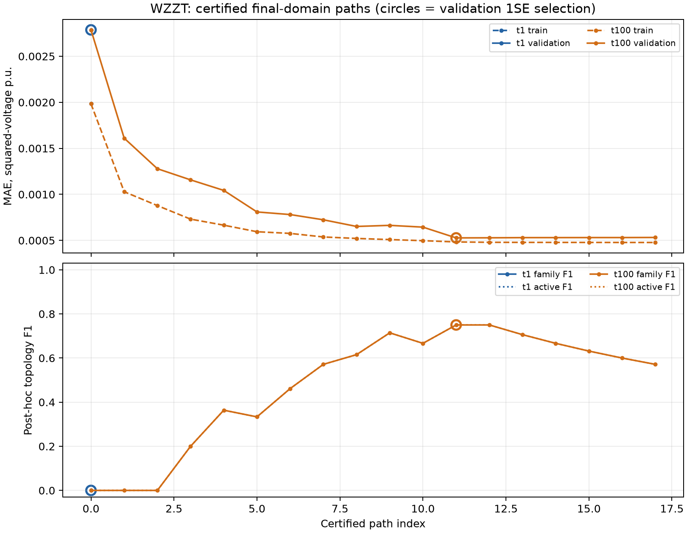
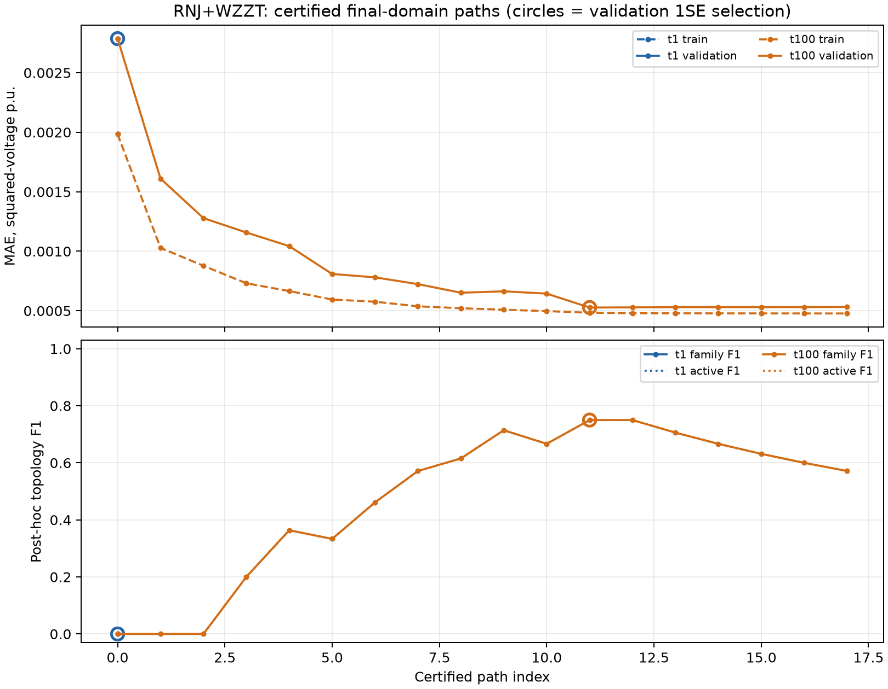

# Pengwah18无源：完整主线、单日64/32与时间预算对照

本次6/6项任务均已返回，4项complete、2项incomplete；均保留最终模型与实际方法耗时。

| 方法 | 预算 | 状态 | family F1 | active F1 | R误差% | X误差% | 秒 | 选中K | 最后K | 扩界 | 验证MAE | 停止原因 |
| --- | --- | --- | --- | --- | --- | --- | --- | --- | --- | --- | --- | --- |
| NJ | 参照 | complete | 0.8571 | 0.8571 | 23.16 | 60.71 | 0.298 | — | — | 0 | 0.000497 | tree_inference_completed |
| RNJ | 参照 | complete | 0.8235 | 0.8235 | 23.16 | 60.71 | 0.3134 | — | — | 0 | 0.000497 | tree_inference_completed |
| WZZT | t×1 | incomplete | 0 | 0 | 206.1 | 400.9 | 60.61 | 18 | 18 | 0 | 0.002787 | extension_not_proven_optimal |
| RNJ+WZZT | t×1 | incomplete | 0 | 0 | 206.1 | 400.9 | 117 | 18 | 18 | 0 | 0.002787 | extension_not_proven_optimal |
| WZZT | t×100 | complete | 0.75 | 0.75 | 27.81 | 97.87 | 545.6 | 27 | 32 | 0 | 0.0005273 | max_atoms |
| RNJ+WZZT | t×100 | complete | 0.75 | 0.75 | 27.81 | 97.87 | 540.1 | 27 | 32 | 0 | 0.0005273 | max_atoms |

原始一天96点保持不变：前64点拟合，后32点用于验证1SE选模。NJ/RNJ仅使用训练64点；RNJ固定块也仅在训练部分按100次、块长4、阈值0.75、最多2块、种子20260903筛选。后32点参与模型选择，因此本轮没有独立测试集。

WZZT直接调用完整核心流程：singleton初始化、联合方法追加主线RNJ固定块；R/X原子初始上界2，触及99.5%时翻倍并重启，最多4次；近零阈值1e-9，非冻结零原子经重解保持目标后才剪枝。验证误差按4个连续8点块计算SE，在最小验证MAE加其SE范围内选择原子数最少的认证模型。

family F1沿历史pipeline口径计算全部非平凡family；active F1筛选max(r,x)>1e-8，便于与旧96点实验的活跃支撑口径比较。两者均排除singleton和全终端支撑。R/X误差为相同平方电压灵敏度矩阵的Frobenius相对误差。

t×1为每次求解60秒、每方法300秒；t×100为6000秒和30000秒。方法时间包括RNJ筛选、建模、多次求解、核心数值核对和保存，外部独立审计另行执行。所有超时incumbent及其gap保留在原始solver记录，正式分数只使用认证路径上的验证选中模型。

## 验证选模与路径末端

selection_effect.csv逐项比较同一路径上的1SE选中点与最后训练点。path_points.csv给出最终系数上界域的完整认证路径；all_certified_path_points.csv另保留扩界重启前的认证路径。路径F1与R/X误差均为事后描述，选模沿用运行时已经保存的1SE索引。

- WZZT t×1：选中K=18，末端K=18；family F1 0/0；验证MAE 0.002787/0.002787（前者为选中点）。
- RNJ+WZZT t×1：选中K=18，末端K=18；family F1 0/0；验证MAE 0.002787/0.002787（前者为选中点）。
- WZZT t×100：选中K=27，末端K=32；family F1 0.75/0.5714；验证MAE 0.0005273/0.000532（前者为选中点）。
- RNJ+WZZT t×100：选中K=27，末端K=32；family F1 0.75/0.5714；验证MAE 0.0005273/0.000532（前者为选中点）。

budget_comparison.csv比较同一64/32协议的两档预算。当前网络与这一天的数据是比较范围；模型恢复差异按实际分数报告，训练误差与求解证书分别表示拟合和子问题数值求解状态。

## 与此前诊断的关系

此前96点全训练实验与本轮同时改变了拟合点数、验证选模、bootstrap种子及完整的扩界/剪枝流程。新旧成绩用于理解配置差异；时间预算的作用由本轮t×1和t×100配对结果判断。

保存真网的独立算术诊断显示：根有4条子支路，真实共享clade为7个；真实原子R范围0.0275–0.09975、X范围0.019–0.08075。singleton初始模型会吸收缺失的跨终端响应，原上界2覆盖真实线路原子。该事实解释初始化系数的含义；本轮路径记录用于检查后续搜索和选模的实际变化。

[此前只读算术诊断](D:/0-github_workspace/Topo/outputs/source_ac96_diagnosis_20261018/pengwah18_no_source_wzzt_readonly_analysis.json)

## 图与证据

[原始冻结运行](D:/0-github_workspace/Topo/outputs/source_ac96_full_history_pengwah18_20261018)；独立审计结果应与原始运行中的auditor输出一起读取。
