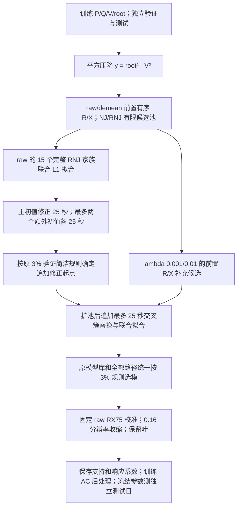

# 当前 RNJ+WZZT 推荐流程

推荐输出为本轮代码中的 `ridge_union`，对应上一轮 `ridge_pool` 的两档正则化候选并集策略。后向删簇和两步修正仍作为独立实验组件。



1. 训练、验证、测试分开。目标为平方电压降，P/Q、V/root 沿用同一标幺基准和列顺序，根标签为 1。每份输入按三个等长物理日顺序拼接。
2. 训练 raw、每日去均值两分支分别估计有序 R/X。三几何 R/RX75/X、五阈值 0/0.04/0.08/0.16/0.24、NJ/RNJ 形成去重候选池，加入全部叶及全末端支持。
3. raw 分支 15 个完整 RNJ 家族分别联合 L1 拟合。L1 指平均绝对残差，r/x 界为 [0,2]，非叶双通道近零支持可删除，叶始终保留。
4. 从 raw/RX75/0.16 完整原始家族启动修正；候选加入时删除与其交叉的旧支持，再联合重估。训练改善门槛 1e-10+0.001×当前损失。额外初值先收缩、重估，再按验证误差排序去重，最多取两个。
5. 把原 RNJ 模型库与三个初值的路径合并，在最终输出收缩前计算验证 MAE。最低值 3% 范围内依次优先支持少、误差低、出现早的模型。
6. 用已有接口增加两档正则化前置估计：alpha=lambda×trace(DᵀD)/(2n)，D=[P Q]，lambda=0.001、0.01。只扩充候选池，保留原池、原校准及最终参数拟合规则。由上一步模型追加最多 25 秒修正。
7. 原库和新增路径再次使用相同验证规则选模，然后执行最终 0.16 收缩。非叶强度为 a*r+b*x，a=0.75/mu_r、b=0.25/mu_x；阈值为 0.16×原 raw 稠密矩阵的中位根深度。保留系数不再重估。
8. 结构 F1 与参数误差先单列。AC 只在训练数据上作最多 12 次函数评价的局部共享阻抗重估，再冻结参数评价独立测试日。AC 不参与当前拓扑选模。

固定簇家族的预测为 `y_hat = P R^T + Q X^T`，其中 `R = sum(r_s z_s z_s^T)`、`X = sum(x_s z_s z_s^T)`，`z_s` 表示簇包含哪些末端；`r_s/x_s` 是响应系数，转换到 AC 阻抗时由现有后处理统一处理。目标为所有样本及末端的平均绝对残差。

本轮池内修正枚举合法候选、逐个解连续 LP；没有运行自由支持的全树 MILP，`mip_rel_gap` 不参与本轮设置。每条路径最多 `3×末端数` 步，遇训练改善不足或路径预算到达时提前停止；每个固定家族 LP 独立要求最优状态。全树最优性不由这些局部停止条件推出。

本轮已提供从新观测开始的入口，不再依赖旧批次模型：

```python
from research_experiments.wzzt_fine.pipeline import infer

# train/validation 均为 (P_dataframe, Q_dataframe, V_dataframe, root_series)
result = infer(train, validation, targeted=False)
model = result["models"]["ridge_union"]
```

这个研究入口同时生成固定基线和扩池对照，不能将总计时当作只部署单一模型的耗时。每条局部路径在候选之间检查预算，单次 LP 可略超名义路径截止点；固定族 LP 上限 15 秒，Threads=1，容差 1e-9。有限池局部停点与全树最优性分别解释。

本轮细化面板：四网络×三电压噪声×五数据量×三个独立训练/验证/测试重复，共 180 组新输入；主对照 1620 条记录，高噪声 24/48 点子面板另有 144 条记录。完整结果见同目录 README.md。
