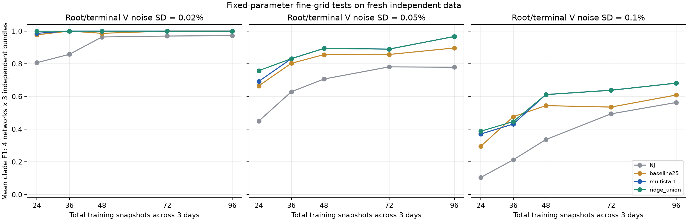
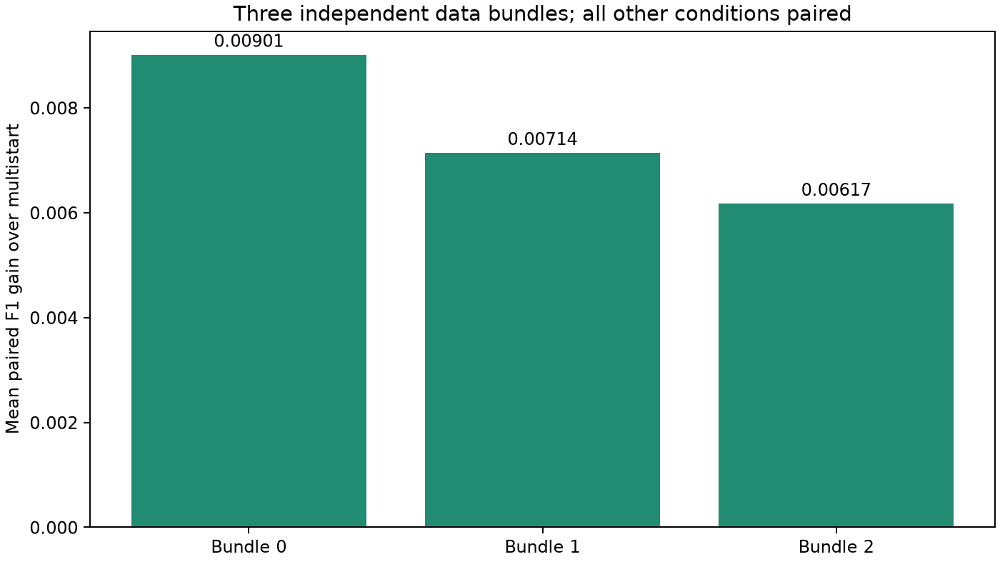

# 当前流程与 RNJ+WZZT 细化重复测试

正式批次 180/180 组新输入返回；主面板 1620/1620、定向子面板 144/144，共 1764/1764 条模型记录。算法、验证规则和阈值冻结，未重新按真簇调参。

## 当前实际流程

完整步骤、公式、参数位置和新观测接口见 [FLOW.md](FLOW.md)。主线为平方压降 → 原始/去均值前置 R/X 与 NJ/RNJ 池 → 完整 RNJ 联合 L1 库和多初值修正 → 正则化扩池追加修正 → 3% 验证简洁规则 → 0.16 最终收缩 → 独立测试评价。后向删除、两步修正保留为实验组件。

## 本轮实验设计

四网络 paper15/soumalas11/flynn16/pengwah18，电压相对高斯噪声标准差 0.02%/0.05%/0.1%，末端和根同档；P/Q 标准差固定 0.5%。N=24/36/48/72/96 为三个物理日总快照数。每个网络用三组独立训练/验证/测试数据：replicate 为 10/11/12、20/21/22、30/31/32。验证和测试各 288 点。

同一 bundle 内各噪声档共用物理轨迹及标准正态误差抽样，N 采用嵌套采样；24/48/96 仍与旧均匀网格一致，36/72 为中间补点。各条件配对，三个 bundle 才是独立随机重复单位；结果报告均值、逐重复差值和计数，不把 180 个相关条件当成独立同分布的重复。

本轮集中在更小样本和中高噪声，不含 288 点大样本；其总平均与旧 80 组 0.9319 的面板不同。算法效果通过本轮相同输入上的配对差值判断。四网络仍为既有文献启发合成网络，本轮增加了随机实现，未增加未知拓扑。

## 主面板结果



|variant|rows|F1|exact|delta_vs_multistart|wins|ties|losses|delta_vs_restart|pool_recall|
|---|---|---|---|---|---|---|---|---|---|
|NJ|180|0.64158|32|-0.15786|4|36|140|-0.15786|0.90952|
|RNJ_native|180|0.6592|36|-0.14024|9|42|129|-0.14024|0.90952|
|RNJ_L1_bank|180|0.74971|80|-0.049726|11|119|50|-0.049726|0.90952|
|baseline25|180|0.76656|83|-0.03287|13|125|42|-0.03287|0.90952|
|multistart|180|0.79943|93|0|0|180|0|0|0.90952|
|restart_control|180|0.79943|93|0|0|180|0|0|0.90952|
|ridge_1e3|180|0.80375|95|0.004317|3|177|0|0.004317|0.92275|
|ridge_1e2|180|0.80688|95|0.0074435|6|174|0|0.0074435|0.95569|
|ridge_union|180|0.80688|95|0.0074435|6|174|0|0.0074435|0.95754|

结构指标比较去掉叶簇与全末端簇后的根向末端簇集合，F1=2×共同簇数/(预测簇数+真簇数)；exact 为该集合完全一致的条数，所有方法均保留失败/未恢复分母。

NJ 使用固定 raw/RX75/0.16 几何，普通 RNJ 使用固定 raw/RX75/0.24；RNJ_L1_bank 单独考察联合 L1 与原选模规则。参数/预测比较统一使用固定树联合 L1 重估，普通 NJ/RNJ 的结构保留原生家族；这与旧表中 NJ 的稠密矩阵参数误差口径分开。pool_recall 记录对应算法环境的可用候选池真簇覆盖率；固定 NJ/RNJ 本身不进行池内搜索。

restart_control 与扩池版本从同一个多初值选中模型出发，均最多追加 25 秒，各分支使用独立的新 LP/缓存。LP 共享相同并集列库，但控制分支只允许原池候选，其他列上界为零，确保比较候选域而非单纯追加计算时间。前置正则化矩阵为各 lambda 对照共享，搜索计时不能直接解释为独立部署总耗时。

本轮 restart_control 在 180 项的最终 F1 都与 multistart 相同；扩池并集提升 6 项、持平 174 项、零退化。lambda=0.001 单独提升 3 项，lambda=0.01 单独与并集的逐项结构 F1 一致。单 lambda=0.01 可作为减少前置候选成本的精简候选；本轮没有独立测量其单方法端到端耗时。

## 按噪声和样本量展开

|voltage_sigma_pct|24|36|48|72|96|
|---|---|---|---|---|---|
|0.02|1|1|1|1|1|
|0.05|0.75791|0.83112|0.89373|0.88958|0.96667|
|0.1|0.38704|0.44652|0.61145|0.63784|0.68132|

上表每格为四网络×三重复，共 12 项平均。0.02% 档当前扩池版全部完整恢复；0.1% 档到 96 点仍明显受限。个别条件随样本量存在回落，例如 0.05% 的 48→72 点，保留原始值而不作单调平滑。

高电压噪声 0.1% 下各网络三重复的平均 F1：

|case|24|36|48|72|96|
|---|---|---|---|---|---|
|flynn16|0.16317|0.26573|0.41026|0.40415|0.52525|
|paper15|0.70513|0.9188|0.86325|0.73016|0.86325|
|pengwah18|0.28464|0.24176|0.62466|0.75433|0.69524|
|soumalas11|0.39524|0.35979|0.54762|0.6627|0.64153|

扩池版仍有 85/180 项未完整恢复：0.02% 档 0 项、0.05% 档 27 项、0.1% 档 58 项。后两档分别有 3/23 项的候选池缺真簇，6/25 项所选错误簇与漏掉真簇交叉；两类可重叠，交叉关系只作最终模型诊断，未据此断言搜索历史中的因果。完整按数据量明细见 failure_modes.csv，所漏真簇和错误簇见 unidentified.csv。

扩池追加路径的终止记录如下。pool_local_optimum 表示有限候选及训练改善阈值下停止；pool_wall_limit 表示在候选之间检查时已触及 25 秒路径预算。这一项保留在所有分母中，具体输入见 ridge_wall_limit.csv；180/180 工作进程返回与路径是否触时分别记录。

|search_stop|inputs|
|---|---|
|pool_local_optimum|179|
|pool_wall_limit|1|

## 独立重复与具体改善



|bundle|variant|rows|F1|delta_vs_multistart|wins|losses|
|---|---|---|---|---|---|---|
|0|multistart|60|0.79915|0|0|0|
|0|ridge_union|60|0.80816|0.0090132|2|0|
|1|multistart|60|0.77494|0|0|0|
|1|ridge_union|60|0.78208|0.0071429|1|0|
|2|multistart|60|0.82421|0|0|0|
|2|ridge_union|60|0.83039|0.0061744|3|0|

三个 bundle 的平均增益均为正，但独立重复数为 3；当前零退化为这批条件的观测结果。以下列出全部六项改善；selected_new_true_clades 为所选模型中原池外真簇数量，仅作事后机制诊断。

|case|bundle|voltage_sigma|N|clade_f1|delta_vs_multistart|selected_new_true_clades|
|---|---|---|---|---|---|---|
|flynn16|0|0.0005|24|0.66667|0.35897|2|
|flynn16|0|0.001|36|0.18182|0.18182|1|
|flynn16|2|0.0002|24|1|0.16667|1|
|flynn16|2|0.001|24|0.18182|0.18182|1|
|pengwah18|1|0.0005|24|1|0.42857|2|
|pengwah18|2|0.001|24|0.30769|0.021978|0|

## 48 点退化是否重复出现

0.1% 电压噪声、48 点的新 12 项中，多初值相对 baseline25 提升 4 项、退化 2 项，其余持平。此前三项退化并非所有 48 点实例都会发生，仍有实例相关的选模风险。

|case|bundle|clade_f1|delta_vs_baseline25|
|---|---|---|---|
|paper15|0|0.92308|0|
|paper15|1|0.83333|0.10606|
|paper15|2|0.83333|0|
|soumalas11|0|0.5|0|
|soumalas11|1|0.57143|0|
|soumalas11|2|0.57143|0.28571|
|flynn16|0|0.30769|-0.12088|
|flynn16|1|0.30769|-0.025641|
|flynn16|2|0.61538|0.43357|
|pengwah18|0|0.53333|0.13333|
|pengwah18|1|0.57143|0|
|pengwah18|2|0.76923|0|

## 后向删除与两步宽度的定向子面板

子面板预先固定为四网络×三 bundle×0.1% 电压噪声×24/48 点，共 24 组。其 multistart 基准平均 F1=0.49075，与全部 180 组平均分开比较。后向删除只做一轮，delete_all 保留全部提案；guard0/1pct/3pct 仅把收缩前验证误差不超过当前模型 0%/1%/3% 的提案送入原最终选模规则。

|variant|rows|F1|delta_vs_multistart|wins|ties|losses|
|---|---|---|---|---|---|---|
|delete_all|24|0.49957|0.0088173|16|3|5|
|delete_guard0|24|0.49997|0.0092197|7|17|0|
|delete_guard1pct|24|0.50652|0.015762|15|5|4|
|delete_guard3pct|24|0.49957|0.0088173|16|3|5|
|two_step_w3|24|0.49075|0|0|24|0|
|two_step_w5|24|0.49075|0|0|24|0|

严格 guard0 在这 24 项提升 7 项、17 项持平、零退化；1% 容差虽平均较高，仍有 4 项退化，3%/不保护有 5 项退化。它是单轮删除、限定高噪声小样本的组件结果，未与扩池输出组合验证，不把两者增益相加。两步宽度从 3 提到 5 均没有改变这 24 项最终 F1。

## 参数与独立预测

|variant|R_error|X_error|linear_test_mae|AC_planned|AC_evaluated|AC_valid|test_ac_rmse|
|---|---|---|---|---|---|---|---|
|NJ|0.3872|1.0716|0.0014531|180|180|180|0.0008929|
|RNJ_native|0.32709|0.9156|0.0014104|0|0|0|—|
|RNJ_L1_bank|0.28809|0.80608|0.0015902|0|0|0|—|
|baseline25|0.27529|0.78784|0.0016507|0|0|0|—|
|multistart|0.25019|0.76231|0.0014859|180|180|180|0.00084474|
|restart_control|0.25019|0.76231|0.0014859|0|0|0|—|
|ridge_1e3|0.24758|0.75344|0.0015037|0|0|0|—|
|ridge_1e2|0.24687|0.74914|0.0015122|0|0|0|—|
|ridge_union|0.24687|0.74914|0.0015122|180|180|180|0.00084327|

AC 仅评价预先固定的 NJ、multistart、ridge_union：计划 540 项，实际 540 项，可行 540 项；对应 370 个不同输入/参数组合，基础设施错误 0，其中 231 个局部重估收敛。其余对照 AC 未评价，0/0 不是失败。结构 F1、线性预测误差和 AC 误差分别记录。

## 调用已有结果与当前算法

记录库增加 bundle 维度，使用本轮专用读取接口：

```python
from research_experiments.wzzt_fine.records import load, load_trace
catalog = r"D:\0-github_workspace\Topo\docs\wzzt_fine_20261028\catalog.sqlite"
m = load(catalog, case="flynn16", voltage_sigma=0.0005, bundle=0, N=24,
         variant="ridge_union", with_observations=True)
R, X = m["R"], m["X"]
P, Q, V, root = m["train"]
trace = load_trace(catalog, case="flynn16", voltage_sigma=0.0005, bundle=0, N=24)
```

per_job.csv 保存全部 1764 条；by_noise_N.csv、by_case_noise_N.csv、by_bundle.csv 保留不同汇总层次；changes_vs_multistart.csv 和 unidentified.csv 保留所有变化和未完整恢复项。完整搜索、模型库、正则化前置矩阵、LP 原生记录位于运行目录，并绑定字节哈希。

## 独立核验与复现

核验通过：True。检查 1011 项数据/域约定、206575 条 LP 记录、4768 个不同物理模型、720 个正则化前置矩阵，并用 HiGHS 独立重解 24 个选中收缩前家族 LP。四项新单元检查通过；新入口另在两例历史数据上复现 baseline25/multistart 四项已保存 F1。

```powershell
& D:/apps/miniconda3/envs/Topo/python.exe -B -m research_experiments.wzzt_fine.prepare outputs/<新目录>
& D:/apps/miniconda3/envs/Topo/python.exe -B -m research_experiments.wzzt_fine.run outputs/<新目录>
& D:/apps/miniconda3/envs/Topo/python.exe -B -m research_experiments.wzzt_fine.evaluate outputs/<新目录> docs/<新目录>
& D:/apps/miniconda3/envs/Topo/python.exe -B -m research_experiments.wzzt_fine.audit outputs/<新目录> docs/<新目录>
& D:/apps/miniconda3/envs/Topo/python.exe -B -m research_experiments.wzzt_fine.report outputs/<新目录> docs/<新目录>
& D:/apps/miniconda3/envs/Topo/python.exe -B -m research_experiments.wzzt_fine.verify outputs/<新目录> docs/<新目录>
```
