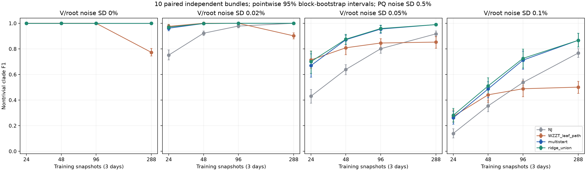
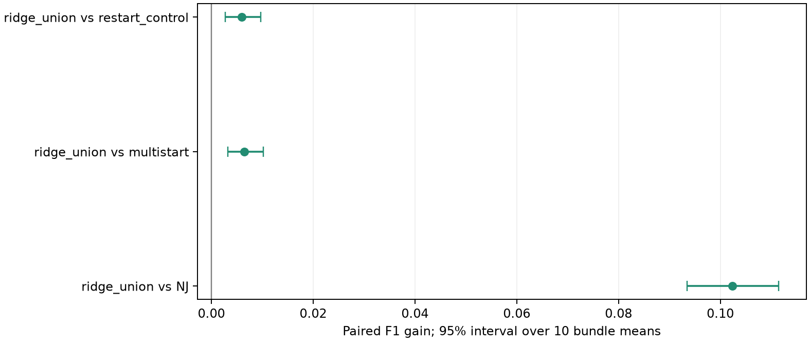
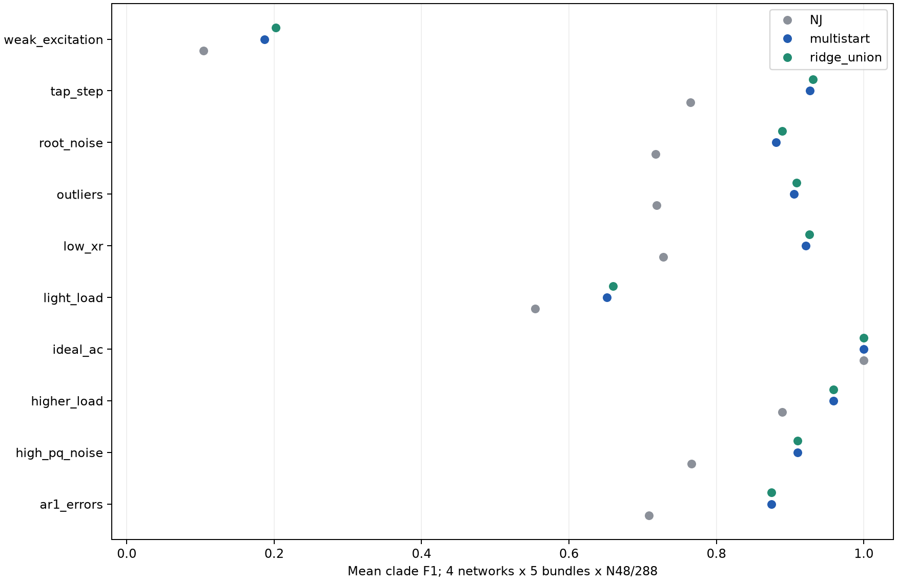
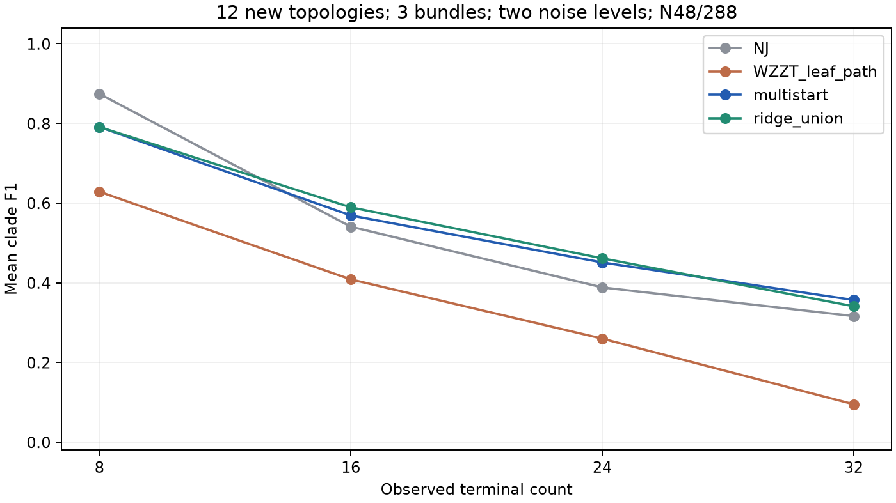

# RNJ+WZZT 论文证据：全面测试

计划 1204 输入，已结束 1204，正常返回 1191；13 错误、0 工作进程触时。模型记录 13500/13500，可用模型 13371。所有失败进入原分母。

主结论：四固定网络独立主面板中，扩池平均F1为0.867278，多初值为0.860769；配对增量0.006510，95%区间[0.003200,0.010161]。相同640输入中改善20、持平618、退化2组。结果支持该模拟域的平均改善；新树、case33及弱激励的失败另外保留，未以旧网络总体均值概括泛化。

## 测试方案与当前流程

结果前冻结的设计见 [PROTOCOL.md](PROTOCOL.md)。流程沿用上一轮：训练平方压降 → 前置有序 R/X、NJ/RNJ 候选池 → 完整 RNJ 联合 L1 库 → 三初值局部修正 → 两档正则化扩池追加修正 → 原 3% 验证简洁规则 → 0.16 最终收缩。AC 为独立训练后处理，未参与拓扑选择。严格保护删簇、两步及100秒分支作为预定对照，不按本轮真拓扑选择部署阈值。

四旧网络主面板为640输入、10个独立bundle；400场景输入、12棵新随机树144输入、端点化case33的20输入分别报告。训练N=24/48/96/288对应相同三个物理日的不同采样密度；验证和测试各288点。主面板V=0仍有P/Q噪声0.5%，ideal_ac场景才去除全部计量噪声。

指标为非平凡根向末端簇集合的F1，去掉叶簇和全末端簇；exact为该集合完全一致。R/X误差是平方压降响应矩阵的相对Frobenius误差，不用作逐条线路阻抗准确率。四旧网络和新随机树均为合成网络，负荷/DER曲线也由代码生成，没有导入实测曲线。case33使用本地参数表的hybrid-leaf改造，内部额定负荷移到服务端点；33行额定P/Q和32条骨干欧姆参数已与[MATPOWER官方表](https://matpower.org/docs/ref/matpower6.0/case33bw.html)逐项核对，结果见case33_provenance.json。添加28条服务边后得到32个端点；动态曲线仍由共同合成模型生成，不是原始IEEE33恒负荷工况。本地MVA基准10与该官方版本100的差异只改变标幺换算。

物理电压与压降范围如下。每个物理bundle合并训练/验证/测试九日共864时刻，在加入计量噪声与N采样前计算；drop为根电压减端点电压，以额定标幺电压的百分点表示。表内中位数/P95再对bundle取均值，完整场景记录见physical_regimes.csv。压降尺度与拓扑可辨识性分别评价。

|case|physical_bundles|minimum_V_pu|maximum_V_pu|mean_drop_median_pct|mean_drop_p95_pct|
|---|---|---|---|---|---|
|case33_terminal|5|0.93351|1.0275|2.9745|5.0032|
|flynn16|10|0.98719|1.0219|1.2673|1.8702|
|paper15|10|0.99272|1.0242|1.0666|1.6316|
|pengwah18|10|0.98627|1.025|0.78033|1.6356|
|random16_t0|3|0.99922|1.0271|0.58805|0.98707|
|random16_t1|3|1.0044|1.0284|0.35628|0.58717|
|random16_t2|3|1.0003|1.0288|0.46412|0.90616|
|random24_t0|3|0.98559|1.0288|1.2096|1.8803|
|random24_t1|3|0.99716|1.0276|0.73951|1.1424|
|random24_t2|3|1.004|1.0269|0.43075|0.6749|
|random32_t0|3|0.99304|1.0273|0.50722|1.1721|
|random32_t1|3|1.004|1.0273|0.35952|0.58281|
|random32_t2|3|1.0024|1.0265|0.44865|0.706|
|random8_t0|3|0.99313|1.0284|0.5214|1.3252|
|random8_t1|3|1.0042|1.0273|0.36043|0.61888|
|random8_t2|3|0.99453|1.0288|0.89262|1.4163|
|soumalas11|10|0.99651|1.0274|0.47258|1.0395|

data_diagnostics.csv逐物理日记录实际噪声尺度、动态平方压降信号/噪声RMS、中心化P/Q设计的秩与条件数及AC收敛数。设计诊断使用每天96点，训练N子集另由catalog的索引定位；不把满秩或信噪比转换为拓扑恢复保证。

## 独立主面板

|variant|rows|available|F1|exact|wins|ties|losses|R_error|X_error|
|---|---|---|---|---|---|---|---|---|---|
|NJ|640|640|0.76489|263|29|279|332|0.25655|0.63833|
|RNJ_native|640|640|0.76175|279|20|301|319|0.2241|0.57917|
|RNJ_L1_bank|640|640|0.82624|389|27|478|135|0.2004|0.52708|
|WZZT_leaf_path|640|640|0.7859|340|95|338|207|0.25477|0.5712|
|WZZT_leaf_bank|640|640|0.81637|383|92|389|159|0.22544|0.5261|
|baseline25|640|640|0.83671|394|34|498|108|0.19124|0.51069|
|multistart|640|640|0.86077|427|0|640|0|0.17318|0.48148|
|restart_control|640|640|0.8613|427|3|636|1|0.17257|0.47982|
|ridge_union|640|640|0.86728|430|20|618|2|0.17016|0.47238|
|multistart_guard0|640|640|0.86723|454|77|557|6|0.17096|0.47581|
|ridge_guard0|640|640|0.87367|457|91|542|7|0.16799|0.46695|

wins/ties/losses以多初值为参照；叶初值仅路径和加完整RNJ库的两行分别报告，完整候选保留与实际搜索修正不混为一个机制。selected_origins.csv 与逐条搜索终止状态保留最终模型来源。

|variant|selected_origin|inputs|
|---|---|---|
|multistart|extra0|222|
|multistart|extra1|83|
|multistart|primary25|6|
|multistart|tree_bank|329|
|ridge_union|extra0|181|
|ridge_union|extra1|69|
|ridge_union|primary25|4|
|ridge_union|ridge_union|171|
|ridge_union|tree_bank|215|



|voltage_sigma_pct|24|48|96|288|
|---|---|---|---|---|
|0|1|1|1|1|
|0.02|0.96974|0.99808|1|1|
|0.05|0.70022|0.87563|0.95907|0.98969|
|0.1|0.28103|0.51038|0.72571|0.8669|

每格40输入，由四固定网络×10独立数据组构成。误差棒是10个bundle均值上的逐点95%区间，噪声/采样条件不当成独立重复。三个主比较另报精确符号检验及Holm校正；bootstrap区间和检验分别解释。



|contrast|mean|lower|upper|independent_blocks|wins|ties|losses|holm_sign_p|
|---|---|---|---|---|---|---|---|---|
|ridge_union vs NJ|0.10239|0.093444|0.11145|10|338|275|27|0.0058594|
|ridge_union vs multistart|0.0065097|0.0032003|0.010161|10|20|618|2|0.0078125|
|ridge_union vs restart_control|0.0059767|0.0027285|0.0097032|10|19|620|1|0.0078125|

## 场景、新拓扑与case33



|panel|variant|rows|F1|exact|wins|ties|losses|
|---|---|---|---|---|---|---|---|
|case33|NJ|20|0.092131|0|1|11|8|
|case33|WZZT_leaf_path|20|0.066904|0|3|10|7|
|case33|multistart|20|0.12888|0|0|20|0|
|case33|ridge_guard0|20|0.12917|0|2|16|2|
|case33|ridge_union|20|0.12887|0|1|17|2|
|stress|NJ|400|0.69519|82|22|107|271|
|stress|WZZT_leaf_path|400|0.69774|131|57|141|202|
|stress|multistart|400|0.82177|215|0|400|0|
|stress|ridge_guard0|400|0.833|232|52|345|3|
|stress|ridge_union|400|0.8261|216|10|390|0|
|topology|NJ|144|0.53009|23|48|27|69|
|topology|WZZT_leaf_path|144|0.34811|12|16|28|100|
|topology|multistart|144|0.54206|16|0|144|0|
|topology|ridge_guard0|144|0.54495|18|41|88|15|
|topology|ridge_union|144|0.54584|16|16|123|5|



新树为固定随机生成器的12棵未调参拓扑，端点8/16/24/32各三棵；拓扑区间按树分块，并以共享的三个数据bundle为条件。case33仅一棵改造网络，五数据重复不能替代五棵网络。按条件/网络/数据量/噪声的完整表见 by_condition.csv、by_case.csv、by_noise_N.csv。

## 组件与预算消融

|variant|reference|inputs|F1|mean|lower|upper|independent_blocks|wins|ties|losses|
|---|---|---|---|---|---|---|---|---|---|---|
|ridge_1e3|ridge_union|72|0.7886|-0.0082285|-0.02376|0|3|0|68|4|
|ridge_1e2|ridge_union|72|0.79445|-0.002381|-0.0071429|0|3|0|71|1|
|restart100|restart_control|40|0.77537|0|0|0|5|0|40|0|
|ridge100|ridge_union|40|0.78499|0|0|0|5|0|40|0|
|ridge_guard0|ridge_union|640|0.87367|0.0063904|0.0042094|0.0085615|10|74|560|6|
|multistart_guard0|multistart|640|0.86723|0.006463|0.0041953|0.008794|10|77|557|6|
|ridge_two_step|ridge_union|16|0.808|0.052541|—|—|1|2|14|0|
|ridge_two_step_guard0|ridge_union|16|0.81735|0.061889|—|—|1|5|11|0|
|WZZT_leaf_bank|WZZT_leaf_path|640|0.81637|0.030473|0.02712|0.034309|10|69|560|11|

每行与其自身输入子集上的reference配对，不能用不同子集总体F1相减。单lambda子面板有3个独立bundle；100秒子面板有5个；两步子面板只有1个bundle，保留结果但不据此给出稳定性结论。联合删除是实际从扩池选中模型继续执行的一轮保护删除。

lambda=.001/.01表示无量纲strength，实际前置QP的alpha按相应raw/demean设计矩阵的Gram尺度计算；实际数值与尺度均保存在fronts，公式见HANDOFF.md。

|variant|mean|lower|upper|independent_blocks|wins|losses|
|---|---|---|---|---|---|---|
|multistart_guard0|0.006463|0.0041953|0.008794|10|77|6|
|ridge_guard0|0.0129|0.0088543|0.017259|10|91|7|
|ridge_union|0.0065097|0.0032003|0.010161|10|20|2|

单bundle两步消融之后，按JOINT_EXTENSION_PROTOCOL.md追加十bundle的组件测试。固定已有扩池收缩前模型库与初值，分别用新LP执行25秒单步追加修正和25秒宽度5两步提案；另报两步后追加15秒删除。它复用原主面板数据，属于观察初轮结果后的次要扩展，区间用于描述，不增加预定三个主检验。

|variant|reference|inputs|F1|mean|lower|upper|independent_blocks|positive_blocks|negative_blocks|sign_p|wins|ties|losses|
|---|---|---|---|---|---|---|---|---|---|---|---|---|---|
|joint_control25|ridge_union|160|0.81065|0|0|0|10|0|0|1|0|160|0|
|joint_width5|ridge_union|160|0.82008|0.0094322|0.0011905|0.020524|10|4|1|0.375|5|154|1|
|joint_width5|joint_control25|160|0.82008|0.0094322|0.0011905|0.020524|10|4|1|0.375|5|154|1|
|joint_width5_delete|ridge_union|160|0.82807|0.017423|0.0072283|0.029686|10|8|1|0.039062|31|125|4|
|joint_width5_delete|joint_width5|160|0.82807|0.0079909|0.0042355|0.011774|10|8|0|0.0078125|26|131|3|
|joint_width5_delete|ridge_guard0|160|0.82807|0.0089858|0.00089286|0.020078|10|4|1|0.375|5|154|1|

追加组件测试返回160/160输入，模型480/480可用；数值/结构核验True。单步与两步LP不共享缓存或基。全部失败仍进入该补充分母。

次要符号检验未作多重比较校正，逐bundle正负分布同时列出。均值区间与符号检验针对的目标不同，不能只取其中较有利的一项。两步单独改善集中于0.1%噪声、N48的少数soumalas11/pengwah18输入；joint_selected_diagnostics.csv记录最终来源、实际保留的成对提案及第一步是否低于原接受阈值。两步增加了可供验证选择的联合候选，不将所有收益归为跨越非改善第一步。

## 自由支持MILP补充对照

FREE_DOMAIN_PROTOCOL.md说明额外80个匹配输入上的自由支持单步MILP：使用有限池可行暖启动，100秒路径预算、每次MILP10秒、MIPGap=1%，叶初始化；统一原验证/收缩规则。路径单独与保留完整RNJ库分别报告。它补齐自由域和有限池的实际比较，主检验保持原样。

该自由域基线按与当前家族兼容的簇追加；有限池修正允许先删除交叉旧簇。两者的提案机制和路径预算也有差异，因此表中差值比较完整策略，不能归因于候选域大小这一单独因素。

|variant|reference|inputs|F1|mean|lower|upper|independent_blocks|wins|ties|losses|
|---|---|---|---|---|---|---|---|---|---|---|
|WZZT_free_path|WZZT_leaf_path|80|0.61856|-0.10339|-0.13373|-0.076123|5|3|47|30|
|WZZT_free_path|WZZT_leaf_bank|80|0.61856|-0.14187|-0.16447|-0.12742|5|0|45|35|
|WZZT_free_path|multistart|80|0.61856|-0.21699|-0.25246|-0.18153|5|7|27|46|
|WZZT_free_path|ridge_union|80|0.61856|-0.22112|-0.2607|-0.18153|5|6|27|47|
|WZZT_free_bank|WZZT_leaf_path|80|0.74651|0.024561|-0.0060854|0.048651|5|15|57|8|
|WZZT_free_bank|WZZT_leaf_bank|80|0.74651|-0.013917|-0.038129|0.0077408|5|2|70|8|
|WZZT_free_bank|multistart|80|0.74651|-0.08904|-0.12192|-0.053228|5|8|43|29|
|WZZT_free_bank|ridge_union|80|0.74651|-0.093161|-0.13016|-0.056161|5|7|43|30|

补充模型 160/160 可用，实际MILP调用 626 次，零次MILP调用的输入 0 项；数值核验 True。free_domain_MIP_events.csv保留native状态、incumbent、bound、gap及可行性。复用训练前置估计的成本未计入，表中路径预算不能解释成独立部署总耗时。该实现是项目的自由支持逐步策略及本轮统一选模，不称为原作者软件逐设置复现。

|raw_status|decision|calls|median_native_gap|maximum_native_gap|
|---|---|---|---|---|
|2|accept_bounded_improvement|37|0.0014933|0.0080545|
|2|refine_or_report_unresolved|107|0.0069777|0.0099741|
|2|stop_bound_proves_no_material_gain|1|0|0|
|9|refine_or_report_unresolved|408|0.55147|1|
|11|accept_bounded_improvement|73|0.073295|1|

表中gap为单次原生MILP的相对gap，decision还考虑了已核验可行暖启动和上下界；未决和触时原样保留。这些数值不作为整条路径或全树的最优性界。

## 失败、目标偏好与终止机制

unidentified.csv 保留所有未完整恢复项；failure_modes.csv 区分候选池漏真簇、最终交叉错误簇。greedy_events.csv 记录错误正权簇被接受时的训练损失、最佳已测试真簇提案损失及是否全扫：只有完整有限池扫描且错误端点严格更优的事件，才支持该一步目标偏好诊断；最终交叉关系本身不作为早期阻挡的因果证明。

|panel|inputs|available|pool_missing|final_crossing|false_accept_events|full_sweep_with_true|strict_false_preference|strict_preference_inputs|
|---|---|---|---|---|---|---|---|---|
|case33|20|10|10|10|55|14|14|6|
|main|640|640|65|72|7200|2079|2075|446|
|stress|400|400|47|54|3490|1281|1279|292|
|topology|144|141|75|68|1159|940|936|100|

pool_missing与final_crossing只统计可用的ridge_union模型；其余事件列汇总已正常返回输入的多条预定搜索，事件之间不独立。strict_false_preference要求完整扫描、至少一个真簇提案且训练损失优势超过1e-8，strict_preference_inputs按输入去重。该表证明观测到的一步训练目标偏好，长期阻挡仍需具体路径判断。

termination_counts.csv 保留每方法每面板的局部停止与触时。固定家族LP最优状态不扩展成全树最优性；900秒工作进程上限与25/100秒搜索路径预算分别记录。

原批次固定LP触时输入13组，另有LP_RETRY_PROTOCOL.md规定的60秒补充重试：13/13返回。原共享阶段未生成的模型保持不可用标记及零分分母，不能将它们解释成所有算法各自失败。扩展预算结果单列如下，保留原始15秒数据。

|job_id|variant|returned|clade_f1|longest_LP_seconds|worker_seconds|
|---|---|---|---|---|---|
|topology__random32_t2__b1__reference__v0010__N288|NJ|True|0.054054|23.679|430.71|
|topology__random32_t2__b1__reference__v0010__N288|multistart|True|0.11765|23.679|430.71|
|topology__random32_t2__b1__reference__v0010__N288|ridge_union|True|0.11765|23.679|430.71|
|topology__random32_t2__b1__reference__v0010__N288|ridge_postfilter_guard|True|0.11765|23.679|430.71|
|topology__random32_t2__b2__reference__v0002__N288|NJ|True|0.77778|32.768|486.74|
|topology__random32_t2__b2__reference__v0002__N288|multistart|True|0.62857|32.768|486.74|
|topology__random32_t2__b2__reference__v0002__N288|ridge_union|True|0.62857|32.768|486.74|
|topology__random32_t2__b2__reference__v0002__N288|ridge_postfilter_guard|True|0.62857|32.768|486.74|
|topology__random32_t2__b2__reference__v0010__N288|NJ|True|0.27027|19.012|425.72|
|topology__random32_t2__b2__reference__v0010__N288|multistart|True|0.48485|19.012|425.72|
|topology__random32_t2__b2__reference__v0010__N288|ridge_union|True|0.48485|19.012|425.72|
|topology__random32_t2__b2__reference__v0010__N288|ridge_postfilter_guard|True|0.48485|19.012|425.72|
|case33__case33_terminal__b0__reference__v0002__N288|NJ|True|0.5|44.635|679.43|
|case33__case33_terminal__b0__reference__v0002__N288|multistart|True|0.57895|44.635|679.43|
|case33__case33_terminal__b0__reference__v0002__N288|ridge_union|True|0.57895|44.635|679.43|
|case33__case33_terminal__b0__reference__v0002__N288|ridge_postfilter_guard|True|0.85185|44.635|679.43|
|case33__case33_terminal__b0__reference__v0010__N288|NJ|True|0.16667|30.185|571.96|
|case33__case33_terminal__b0__reference__v0010__N288|multistart|True|0.23529|30.185|571.96|
|case33__case33_terminal__b0__reference__v0010__N288|ridge_union|True|0.23529|30.185|571.96|
|case33__case33_terminal__b0__reference__v0010__N288|ridge_postfilter_guard|True|0.5|30.185|571.96|
|case33__case33_terminal__b1__reference__v0002__N288|NJ|True|0.54054|40.954|751.54|
|case33__case33_terminal__b1__reference__v0002__N288|multistart|True|0.65|40.954|751.54|
|case33__case33_terminal__b1__reference__v0002__N288|ridge_union|True|0.65|40.954|751.54|
|case33__case33_terminal__b1__reference__v0002__N288|ridge_postfilter_guard|True|0.77551|40.954|751.54|
|case33__case33_terminal__b1__reference__v0010__N288|NJ|True|0.20513|32.01|594.9|
|case33__case33_terminal__b1__reference__v0010__N288|multistart|True|0.15789|32.01|594.9|
|case33__case33_terminal__b1__reference__v0010__N288|ridge_union|True|0.15789|32.01|594.9|
|case33__case33_terminal__b1__reference__v0010__N288|ridge_postfilter_guard|True|0.2381|32.01|594.9|
|case33__case33_terminal__b2__reference__v0002__N288|NJ|True|0.44444|42.055|667.34|
|case33__case33_terminal__b2__reference__v0002__N288|multistart|True|0.55|42.055|667.34|
|case33__case33_terminal__b2__reference__v0002__N288|ridge_union|True|0.55|42.055|667.34|
|case33__case33_terminal__b2__reference__v0002__N288|ridge_postfilter_guard|True|0.77551|42.055|667.34|
|case33__case33_terminal__b2__reference__v0010__N288|NJ|True|0.2|29.591|542.47|
|case33__case33_terminal__b2__reference__v0010__N288|multistart|True|0.31579|29.591|542.47|
|case33__case33_terminal__b2__reference__v0010__N288|ridge_union|True|0.31579|29.591|542.47|
|case33__case33_terminal__b2__reference__v0010__N288|ridge_postfilter_guard|True|0.31818|29.591|542.47|
|case33__case33_terminal__b3__reference__v0002__N288|NJ|True|0.5|38.147|644.17|
|case33__case33_terminal__b3__reference__v0002__N288|multistart|True|0.57895|38.147|644.17|
|case33__case33_terminal__b3__reference__v0002__N288|ridge_union|True|0.57895|38.147|644.17|
|case33__case33_terminal__b3__reference__v0002__N288|ridge_postfilter_guard|True|0.81633|38.147|644.17|
|case33__case33_terminal__b3__reference__v0010__N288|NJ|True|0.27778|30.09|520.3|
|case33__case33_terminal__b3__reference__v0010__N288|multistart|True|0.36842|30.09|520.3|
|case33__case33_terminal__b3__reference__v0010__N288|ridge_union|True|0.36842|30.09|520.3|
|case33__case33_terminal__b3__reference__v0010__N288|ridge_postfilter_guard|True|0.37209|30.09|520.3|
|case33__case33_terminal__b4__reference__v0002__N288|NJ|True|0.48649|41.657|621.31|
|case33__case33_terminal__b4__reference__v0002__N288|multistart|True|0.52632|41.657|621.31|
|case33__case33_terminal__b4__reference__v0002__N288|ridge_union|True|0.52632|41.657|621.31|
|case33__case33_terminal__b4__reference__v0002__N288|ridge_postfilter_guard|True|0.69767|41.657|621.31|
|case33__case33_terminal__b4__reference__v0010__N288|NJ|True|0.15789|27.336|549.81|
|case33__case33_terminal__b4__reference__v0010__N288|multistart|True|0.26316|27.336|549.81|
|case33__case33_terminal__b4__reference__v0010__N288|ridge_union|True|0.26316|27.336|549.81|
|case33__case33_terminal__b4__reference__v0010__N288|ridge_postfilter_guard|True|0.33333|27.336|549.81|

LP60恢复模型中，沿用原预定AC条件补评6/6行（潮流计算有效6行，去重4组，基础设施异常0组）；该补充单列于lp60_retry.csv，不改原AC分母。其他重试与过滤保护模型未追加AC。

case33恢复覆盖表仅为补充：未触时N48取原LP15记录，原触时N288整体取独立LP60重试，另列探索性过滤输出。它提供全部二十输入的模型检索，同时保留原始失败表；由于N档使用不同LP上限，不把此表解释成严格相同计算预算的数据量效应。逐条来源见case33_recovered_coverage.csv。

|N|fixed_LP_seconds|variant|inputs|F1|test_mae|
|---|---|---|---|---|---|
|48|15|NJ|10|0.18426|0.0073614|
|48|15|multistart|10|0.25776|0.021245|
|48|15|ridge_postfilter_guard|10|0.35246|0.0018794|
|48|15|ridge_union|10|0.25774|0.021124|
|288|60|NJ|10|0.34789|0.0091498|
|288|60|multistart|10|0.42248|0.026313|
|288|60|ridge_postfilter_guard|10|0.56786|0.0016037|
|288|60|ridge_union|10|0.42248|0.026313|

resolution_diagnostic.csv 另记录物理线路响应系数经过本轮数据所得校准与0.16滤波时损失的真簇，用于检查分辨率设置是否会主动删掉弱边。该诊断固定物理系数，不作为允许重新拟合参数后的结构恢复上界，也不参与估计器选模。

补充探索性后处理敏感性见EXPLORATORY_DIAGNOSTICS.md：固定原先选中的收缩前扩池模型及其参数，只改变最终过滤阈值，不重新搜索或拟合。五个阈值全部保留，未用真簇选取部署阈值。

|panel|floor|rows|F1|exact|validation_mae|test_mae|
|---|---|---|---|---|---|---|
|case33|0|20|0.17576|0|0.0018879|0.001873|
|case33|0.04|20|0.18177|0|0.0030693|0.0030661|
|case33|0.08|20|0.16642|0|0.0052739|0.0052283|
|case33|0.16|20|0.12887|0|0.021175|0.021124|
|case33|0.24|20|0.086326|0|0.028827|0.028789|
|main|0|640|0.86388|423|0.0010369|0.0010358|
|main|0.04|640|0.86466|425|0.001037|0.0010359|
|main|0.08|640|0.86527|425|0.0010571|0.0010559|
|main|0.16|640|0.86728|430|0.0011141|0.001114|
|main|0.24|640|0.86902|443|0.0013021|0.0013041|
|stress|0|400|0.82243|213|0.0011557|0.0011426|
|stress|0.04|400|0.8229|213|0.0011557|0.0011426|
|stress|0.08|400|0.82382|215|0.0011833|0.0011705|
|stress|0.16|400|0.8261|216|0.0013117|0.0012999|
|stress|0.24|400|0.82865|226|0.0015332|0.0015257|
|topology|0|144|0.54759|16|0.0014246|0.0014223|
|topology|0.04|144|0.54859|16|0.0014526|0.001453|
|topology|0.08|144|0.54976|16|0.0015593|0.0015656|
|topology|0.16|144|0.54584|16|0.0018676|0.0018798|
|topology|0.24|144|0.52187|14|0.0024461|0.0024626|

探索性验证保护只在0/0.04/0.08/0.16间按验证误差和原3%简洁规则选输出；保证相同预选模型的验证误差不增，独立测试和F1仍单独评价。该规则在观察预检与主面板诊断后提出，以下为补充证据，不替换原固定0.16主结果。

|panel|rows|F1|exact|delta_vs_ridge_union|wins|ties|losses|test_mae|
|---|---|---|---|---|---|---|---|---|
|case33|20|0.17623|0|0.04736|7|12|1|0.0018794|
|main|640|0.86544|426|-0.001837|3|608|29|0.0010362|
|stress|400|0.82447|216|-0.0016323|0|384|16|0.001143|
|topology|144|0.54714|16|0.001291|12|115|17|0.0014234|

guard_freeze_receipt.json确认规则在正式新拓扑/case33结果产生前确定。独立补充检查排除动机预检所用random32_t0整棵树和case33的bundle0；剩余132个新树输入按11棵树分块，16个case33输入按四数据组分块。主面板不重复当作新规则的确认数据。

|panel|inputs|F1|mean|lower|upper|independent_blocks|wins|ties|losses|
|---|---|---|---|---|---|---|---|---|---|
|case33|16|0.17426|0.046253|0.022556|0.064167|4|6|9|1|
|topology|132|0.55943|0.0006477|-0.0031797|0.0057373|11|9|106|17|

## AC与独立预测

|panel|variant|AC_planned|AC_evaluated|AC_valid|test_ac_rmse|
|---|---|---|---|---|---|
|case33|NJ|4|2|2|0.0070224|
|case33|multistart|4|2|2|0.0027295|
|case33|ridge_union|4|2|2|0.0026695|
|main|NJ|160|160|160|0.0008966|
|main|multistart|160|160|160|0.00087702|
|main|ridge_union|160|160|160|0.00087708|
|stress|NJ|80|80|80|0.00072025|
|stress|multistart|80|80|80|0.00070511|
|stress|ridge_union|80|80|80|0.00070511|
|topology|NJ|48|48|48|0.00090835|
|topology|multistart|48|48|48|0.00088043|
|topology|ridge_union|48|48|48|0.0008787|

预定AC 876行，实际评价870行、潮流计算有效870行；去重580个输入/参数组合，其中局部重估收敛359个。局部least_squares(max_nfev=12)只用训练日，参数冻结后评价独立测试日；局部重估未收敛、潮流计算失败与基础设施异常分开保留。RMSE均值以可返回的物理预测为条件，并同时列出有效分母。AC_valid指全部测试点潮流求解成功，本轮未配置线路热限或运行电压限值。

test_mae是平方压降MAE，单位p.u.^2；test_ac_rmse是电压幅值的相对RMSE，两者分别解释。探索性收缩保护本轮记录线性预测，未追加AC重估，不能将原三方法的AC结果移作它的证据。

## 独立运行成本

|variant|replays|median_seconds|p90_seconds|median_process_seconds|equal_structures|
|---|---|---|---|---|---|
|NJ|16|1.292|6.7579|2.5622|16|
|RNJ_native|16|1.4835|7.0992|2.8034|16|
|multistart|16|13.866|57.653|15.504|16|
|ridge_union|16|24.549|83.89|26.344|16|

四旧网络、bundle0、中低/高噪声、N48/288的16输入各重放四方法，共64次，全批估计结束后顺序运行。各方法使用新进程且不共享前置矩阵、LP或搜索缓存；estimator_seconds不含输入读取/进程导入，process_wall_seconds包含进程启动，结构一致数另列。多初值/扩池计时为当前研究入口，其基本库仍生成固定基线。主批shared_worker_seconds包含额外对照，不能作为单方法部署耗时；大网络仅报告该批成本及路径预算，不从小网络计时外推。

独立计时为拓扑估计，不含AC后处理。AC运行耗时另存于原始AC记录；其训练重估和冻结测试是独立评价阶段。

AC的max_nfev=12约束最小二乘主迭代的函数评价计数；数值Jacobian需要的额外潮流调用不计入该值。实际运行成本以AC记录的seconds为准。

硬件与求解环境见hardware.json及protocol.json：Intel Core i9-14900HX、32逻辑处理器，操作系统可见物理内存31.64GiB；主批使用四工作进程，每个Gurobi模型一线程。

## 论文主张与证据边界

|claim|status|evidence|scope|
|---|---|---|---|
|ridge_union vs NJ|conditional_mean_gain_supported|paired mean 0.10239; 95% CI [0.0934443,0.111446]; Holm sign p=0.0058594|four fixed balanced radial terminal-only networks; ten independent bundles; frozen parameters|
|ridge_union vs multistart|conditional_mean_gain_supported|paired mean 0.00650974; 95% CI [0.00320028,0.0101606]; Holm sign p=0.0078125|four fixed balanced radial terminal-only networks; ten independent bundles; frozen parameters|
|ridge_union vs restart_control|conditional_mean_gain_supported|paired mean 0.00597674; 95% CI [0.00272849,0.00970316]; Holm sign p=0.0078125|four fixed balanced radial terminal-only networks; ten independent bundles; frozen parameters|
|universal topology recovery / original full-domain MILP optimality|not_established|finite candidate local paths; all counterexamples and wall limits retained|no global certificate|
|field data / unbalanced three-phase deployment|not_tested|synthetic grids and modified terminalized case33; balanced AC|simulation only|

这批数据覆盖已声明的平衡径向、隐藏零注入、同步计量模拟域。对比结论使用预定配对差值及区间；记录数、局部求解状态、AC拟合误差和bootstrap区间各自承担相应证据，不互换成拓扑正确概率或全域保证。

## 核验、复现与调用

可用记录的数值核验：True；检查1215341次保存LP、38063个不同模型，HiGHS独立重解16个选中收缩前家族。输入返回覆盖与原始失败另列。八项单元检查通过。数据、实际计算代码、逐条原始记录与分析代码均保留哈希。

```python
from research_experiments.wzzt_paper.records import find, load, load_trace
catalog = r"D:\0-github_workspace\Topo\docs\wzzt_paper_20261029\catalog.sqlite"
m = load(catalog, panel="main", case="flynn16", condition="reference",
         voltage_sigma=0.001, bundle=3, N=288, variant="ridge_union", with_observations=True)
R, X = m["R"], m["X"]
```

大体积逐条表与SQLite在本机保留原文件，同时压缩到records.zip提交；从仓库重新取用可调用records.restore恢复。原始观测、checkpoint、完整搜索与LP原生记录位于outputs/wzzt_paper_20261029_full，输入元数据和哈希供定位。论文复用时保留失败分母及本节的网络/观测适用域。

```powershell
& D:/apps/miniconda3/envs/Topo/python.exe -B -m research_experiments.wzzt_paper.prepare outputs/<new>
& D:/apps/miniconda3/envs/Topo/python.exe -B -m research_experiments.wzzt_paper.run outputs/<new>
& D:/apps/miniconda3/envs/Topo/python.exe -B -m research_experiments.wzzt_paper.free_domain outputs/<new>
& D:/apps/miniconda3/envs/Topo/python.exe -B -m research_experiments.wzzt_paper.evaluate outputs/<new> docs/<new>
& D:/apps/miniconda3/envs/Topo/python.exe -B -m research_experiments.wzzt_paper.free_domain outputs/<new> --evaluate docs/<new>
& D:/apps/miniconda3/envs/Topo/python.exe -B -m research_experiments.wzzt_paper.statistics docs/<new>
& D:/apps/miniconda3/envs/Topo/python.exe -B -m research_experiments.wzzt_paper.audit outputs/<new> docs/<new>
& D:/apps/miniconda3/envs/Topo/python.exe -B -m research_experiments.wzzt_paper.resolution outputs/<new> docs/<new>
& D:/apps/miniconda3/envs/Topo/python.exe -B -m research_experiments.wzzt_paper.timing outputs/<new>
& D:/apps/miniconda3/envs/Topo/python.exe -B -m research_experiments.wzzt_paper.report outputs/<new> docs/<new>
& D:/apps/miniconda3/envs/Topo/python.exe -B -m research_experiments.wzzt_paper.verify outputs/<new> docs/<new>
```
