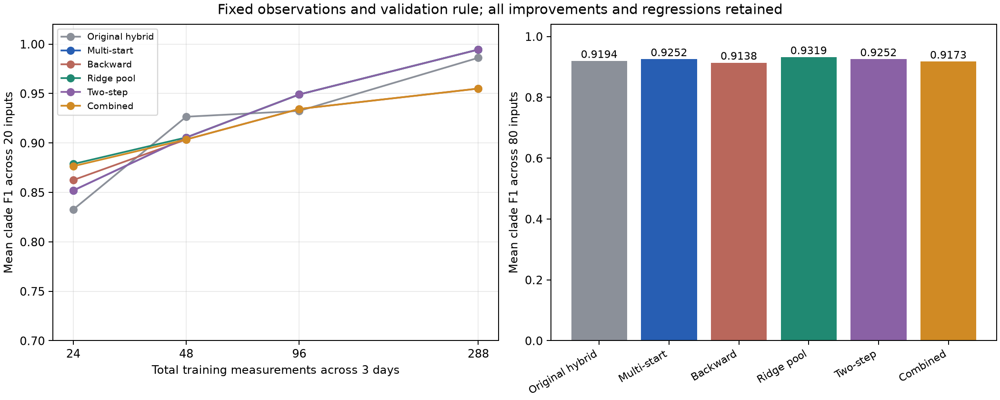

# RNJ+WZZT 三项增强实现及噪声—数据量核查

三项功能均已实现。正式批次 80/80 组输入，形成 320 项新增配置结果与 160 项复用对照，共 480/480 条记录。当前平均 F1 最高版本为 `ridge_pool`。原输入、验证/测试日、原始候选及输出分辨率保持绑定，未进行新的真值调参。

## 基线与版本

baseline25 是原完整 RNJ+WZZT 组合，平均 F1=0.9194；multistart_original_rule 是上轮最佳多初值策略，平均 F1=0.9252；NJ 使用同一批量测的已调优 NJ。所有逐项记录同时保存三种参照的 F1 差值，避免把不同基线混在一起。

新增 backward、ridge_pool、two_step 分别单独作用于上轮候选模型库；combined 依次使用正则化候选池修正、两步修正、后向删除。最终保持原 3% 验证简洁规则和 0.16 收缩规则，AC 门控关闭。

## 实现细节

后向删簇：每轮删除一个非叶支持后用训练数据联合 L1 拟合，保留叶。删除候选允许训练损失上升；局部以验证 MAE 最小值 3% 范围内优先简单模型决定是否继续，最多两轮、15 秒。全部已计算删除候选进入最终原规则选模；局部未选中的候选也保留其来源和分数。

正则化候选：在 raw/demean 两分支使用已有有序 R/X QP 接口，lambda=0.001、0.01，alpha=lambda×trace(DᵀD)/(2n)，D=[P Q]。三几何、五阈值、NJ/RNJ 生成补充簇，仅扩充原候选池；最终 L1 系数拟合、原稠密矩阵校准及分辨率不变。在原多初值选中的收缩前模型上进行一次最多 25 秒的扩池修正。

两步联合修正：先评价单候选替换，按训练损失保留宽度 3，允许第一步损失上升；随后同时加入两个相容支持，删除与任一新支持交叉的旧簇，联合拟合。终点实际训练改善超过 1e-10+0.001×当前损失时才成为新候选，最多保留 3 个不同家族。每次最多 25 秒，第一阶段最多占 40%；宽度和时间限制下的启发式状态单列。

单位检查包含一个显式反例：正权错误簇的训练 MAE=0.0025，任一单簇替换都更差，而双簇联合替换达到 0.001875。另一个例子验证后向删除在训练损失上升时仍能改善独立验证误差。这些检查验证实现机制，实际效果由以下 80 组对照给出。

新增算子分别有额外预算，旧模型库和路径复用，各分支还共享 LP 缓存。additional_seconds 是本次共享执行的算子计时；正则化版本包括前置 QP/树生成，仍不等于独立部署总耗时。此比较属于增量增强消融，未把增加的计算量写成与原策略完全相同的端到端预算。

## 完整结果



|variant|rows|F1|exact|delta_vs_multistart|wins|ties|losses|delta_vs_baseline25|
|---|---|---|---|---|---|---|---|---|
|baseline25|80|0.91944|63|-0.0058026|3|72|5|2.7756e-18|
|multistart_original_rule|80|0.92524|65|3.4694e-18|0|80|0|0.0058026|
|backward|80|0.91384|63|-0.011398|7|63|10|-0.0055956|
|ridge_pool|80|0.93194|65|0.0066964|2|78|0|0.012499|
|two_step|80|0.92524|65|3.4694e-18|0|80|0|0.0058026|
|combined|80|0.91734|63|-0.0079017|7|63|10|-0.0020991|

|N|baseline25|multistart_original_rule|backward|ridge_pool|two_step|combined|
|---|---|---|---|---|---|---|
|24|0.83269|0.85192|0.86249|0.87871|0.85192|0.87647|
|48|0.92653|0.90555|0.90351|0.90555|0.90555|0.90351|
|96|0.93242|0.94904|0.93437|0.94904|0.94904|0.93437|
|288|0.98611|0.99444|0.955|0.99444|0.99444|0.955|

|variant|precision|recall|R_error|X_error|candidate_pool_true_recall|test_ac_rmse|ac_valid|
|---|---|---|---|---|---|---|---|
|baseline25|0.91174|0.92887|0.1377|0.39918|0.96324|0.00046965|80|
|multistart_original_rule|0.91609|0.93661|0.12059|0.39459|0.96324|0.00046722|80|
|backward|0.9378|0.89896|0.145|0.46663|0.96324|0.00047058|80|
|ridge_pool|0.92278|0.9433|0.11518|0.39154|0.98244|0.000467|80|
|two_step|0.91609|0.93661|0.12059|0.39459|0.96324|0.00046722|80|
|combined|0.94092|0.90253|0.14113|0.46399|0.98244|0.0004701|80|

正则化扩池加追加修正版本相对多初值策略：提升 2 项、持平 78 项、退化 0 项，完整恢复 65/80；候选池平均真簇覆盖率从 0.9632 升至 0.9824，覆盖不完整的输入由 7 项变为 5 项。下表为所有结构变化，保留其噪声条件与数据量。

|case|condition|N|baseline25_F1|multistart_F1|clade_f1|delta_vs_multistart|
|---|---|---|---|---|---|---|
|soumalas11|high_voltage_noise|24|0.5|0.5|0.75|0.25|
|pengwah18|high_voltage_noise|24|0.14286|0.14286|0.42857|0.28571|

两项改善均选中了原池之外的新真簇：soumalas11 的 {101,102,103}，pengwah18 的 {313,314,315,316,317,318}。selected_new_supports.csv 保存所有选中池外支持及事后真值标签。该配置同时增加了扩池后的修正计算量，本文按完整配置解释增益。

后向删除版本提高了平均 precision，但 recall 下降并拉低 F1，存在过度简化。组合版本也没有超过单独扩池。两步联合动作已执行并核验，当前单独版本最终 F1 与多初值基线相同。其提出/接受终点和局部状态保留于 operation_diagnostics.csv，训练改善与结构增益分别记录。

## 未成功辨识场景的噪声量级

每个通道加入独立零均值高斯误差，标准差为 relative_sigma×max(|瞬时真值|,1e-12)。根电压使用独立随机数发生器。设置值是标准差，误差没有以该百分比为硬上限。P/Q 的相对标准差为 0.005=0.5%；参考/高负荷/低 X/R 的末端及根电压为 0.0002=0.02%，高电压噪声条件为 0.001=0.1%。ideal_ac 无量测噪声。

根物理电压过程 sigma=0.003 是已生成的运行变化，与根电表测量噪声分开。约 1 p.u. 时，两端独立 0.1% 电压噪声对应电压差噪声标准差约 0.0014 p.u.，平方压降约 0.0028 p.u.²；根误差还使不同末端目标误差相关。previous_all_noise.csv 保存实际训练样本相对误差标准差、压降误差标准差和物理平均压降。模拟真值仅用于这些事后统计，估计器未读取该文件。

上轮最佳策略未完全恢复 15 项，其中 12 项高电压噪声；其余为 flynn16/higher_load/24、flynn16/low_xr/24、pengwah18/low_xr/48。当前 ridge_pool 未完整恢复 15 项，其中高电压噪声 12 项；逐场景分数如下。

|case|condition|N|pq_sigma_relative|v_sigma_relative|baseline25_F1|multistart_F1|clade_f1|
|---|---|---|---|---|---|---|---|
|paper15|high_voltage_noise|24|0.005|0.001|0.61538|0.76923|0.76923|
|paper15|high_voltage_noise|48|0.005|0.001|0.83333|0.76923|0.76923|
|paper15|high_voltage_noise|96|0.005|0.001|0.76923|0.92308|0.92308|
|soumalas11|high_voltage_noise|24|0.005|0.001|0.5|0.5|0.75|
|soumalas11|high_voltage_noise|48|0.005|0.001|0.88889|0.88889|0.88889|
|soumalas11|high_voltage_noise|288|0.005|0.001|0.88889|0.88889|0.88889|
|flynn16|high_voltage_noise|24|0.005|0.001|0|0|0|
|flynn16|high_voltage_noise|48|0.005|0.001|0.5|0.16667|0.16667|
|flynn16|high_voltage_noise|96|0.005|0.001|0.30769|0.30769|0.30769|
|flynn16|higher_load|24|0.005|0.0002|0.85714|0.85714|0.85714|
|flynn16|low_xr|24|0.005|0.0002|0.76923|0.76923|0.76923|
|pengwah18|high_voltage_noise|24|0.005|0.001|0.14286|0.14286|0.42857|
|pengwah18|high_voltage_noise|48|0.005|0.001|0.375|0.35294|0.35294|
|pengwah18|high_voltage_noise|96|0.005|0.001|0.57143|0.75|0.75|
|pengwah18|low_xr|48|0.005|0.0002|0.93333|0.93333|0.93333|

## 相对基线改善或劣化时的数据量

上轮多初值相对 baseline25：改善 5 项，分别在 24 点两项、96 点两项、288 点一项；退化 3 项全为高电压噪声 48 点。下面保留准确场景，最新新增算子的变化见 changes_vs_multistart.csv、changes_vs_baseline25.csv。NJ 参照另列在 comparison_events.csv。

|case|condition|N|pq_sigma_relative|v_sigma_relative|baseline25_F1|clade_f1|F1_change|direction|
|---|---|---|---|---|---|---|---|---|
|paper15|high_voltage_noise|24|0.005|0.001|0.61538|0.76923|0.15385|improved|
|paper15|high_voltage_noise|48|0.005|0.001|0.83333|0.76923|-0.064103|degraded|
|paper15|high_voltage_noise|96|0.005|0.001|0.76923|0.92308|0.15385|improved|
|flynn16|reference|24|0.005|0.0002|0.76923|1|0.23077|improved|
|flynn16|high_voltage_noise|48|0.005|0.001|0.5|0.16667|-0.33333|degraded|
|flynn16|high_voltage_noise|288|0.005|0.001|0.83333|1|0.16667|improved|
|pengwah18|high_voltage_noise|48|0.005|0.001|0.375|0.35294|-0.022059|degraded|
|pengwah18|high_voltage_noise|96|0.005|0.001|0.57143|0.75|0.17857|improved|

N 为三个固定物理日上的总快照数，24/48/96/288 对应每日 8/16/32/96 点；各档是相同日内的嵌套采样。训练 replicate=0、验证 replicate=2、测试 replicate=1，验证与测试各 288 点。本轮未新增随机重复或新网络。

## 数据复用与入口

core.py 提供 backward、regularized_pool、two_step、pair_family；worker.py::refine_bank 接受 train、validation、原观察数据生成的 base_points/base_pool 和固定 calibration，返回四种模型及逐候选记录，接口不接受真簇。输入必须按同一末端列顺序对齐，并保留所有叶支持。

```python
from research_experiments.wzzt_budget.records import load, load_trace, find
catalog = r"D:\0-github_workspace\Topo\docs\wzzt_refine_20261028\catalog.sqlite"
model = load(catalog, case="soumalas11", condition="high_voltage_noise", N=24,
             variant="ridge_pool", with_observations=True)
R, X = model["R"], model["X"]
P, Q, V, root = model["train"]
trace = load_trace(catalog, case="soumalas11", condition="high_voltage_noise", N=24)
backward_moves = trace["operations"]["backward"]["decisions"]
pair_moves = trace["operations"]["two_step"]["pairs"]
```

记录库与原接口兼容，含 480 条模型、80 组输入及声明/实际噪声索引。ranking_validation_mae 显式保留新增版本选模时的收缩前分数，validation_mae 为最终输出模型的实际误差；diagnostic_json 为含真簇的事后标签。完整新增候选、删簇/双簇动作、正则化前置矩阵和 LP 记录保存在输出目录，以哈希绑定。

## 核验与复现

独立核验通过：True。重算 1595 个物理模型、检查 27476 条 LP 记录、320 个正则化前置矩阵、14171 个双簇提案及 1236 个删簇检查；HiGHS 独立重解 32 个 LP。五项单元检查通过。

AC 共 160 个独立输入组/参数组合记录，复用 109 份已有结果，125 份局部重估收敛。基础设施错误 0，所选记录 AC 可行 480/480；达到评价上限与物理可行分别计数。AC 仅以训练数据拟合，测试冻结参数。

```powershell
& D:/apps/miniconda3/envs/Topo/python.exe -B -m research_experiments.wzzt_refine.noise_context docs/<新目录>
& D:/apps/miniconda3/envs/Topo/python.exe -B -m research_experiments.wzzt_refine.prepare outputs/<新目录>
& D:/apps/miniconda3/envs/Topo/python.exe -B -m research_experiments.wzzt_refine.run outputs/<新目录>
& D:/apps/miniconda3/envs/Topo/python.exe -B -m research_experiments.wzzt_refine.evaluate outputs/<新目录> docs/<新目录>
& D:/apps/miniconda3/envs/Topo/python.exe -B -m research_experiments.wzzt_refine.audit outputs/<新目录> docs/<新目录>
& D:/apps/miniconda3/envs/Topo/python.exe -B -m research_experiments.wzzt_refine.report outputs/<新目录> docs/<新目录>
& D:/apps/miniconda3/envs/Topo/python.exe -B -m research_experiments.wzzt_refine.verify outputs/<新目录> docs/<新目录>
```
