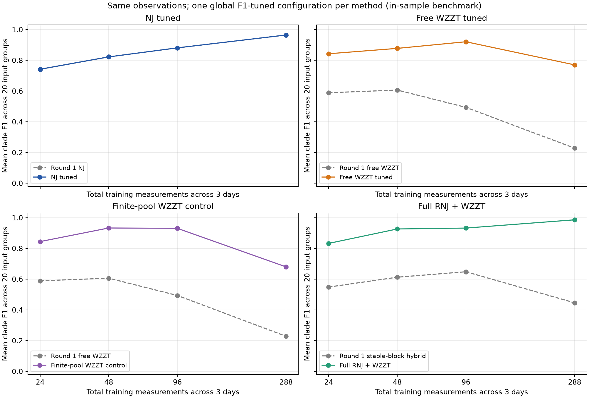
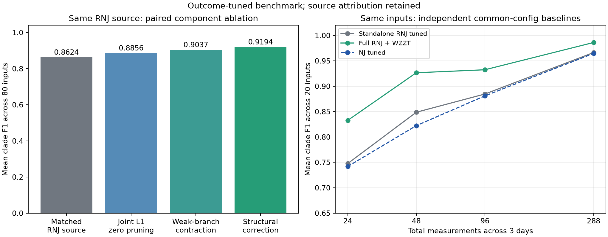

# WZZT 早期结果核查与第二轮系统调优

本轮 80/80 组输入返回，四种配置形成 320/320 个可评价模型。主结果对每种方法选一个共同配置，使用本算例库真实簇 F1 调参。训练和测试量测与首轮逐字节一致；新增 replicate=2 的独立验证日。

## 早期为什么表现好

早期四例 F1=1 来自 RNJ 白名单、每日去均值、末端收缩和独立验证，单步预算为 1800 秒；当时三个网络的 RNJ 已 F1=1，四例的池加冻结支持均覆盖所有真簇。单树候选彼此层状相容，在覆盖真簇时不会出现自由域的交叉簇阻挡。低样本压力实验中的明显收益主要来自 L1 删除假细分。

上轮同时更换自由域、初始化、预算和选点：288 点纯 WZZT 只完成 5/20，完整 RNJ 家族也被少量稳定末端块替代，训练 AC 一标准误规则还有误选反例。具体证据、可确认的机制和未分离的因素见 [早期结果核查](early_results_audit.md)。

## 本轮配置与调参边界

同一 80 组输入覆盖 paper15、soumalas11、flynn16、pengwah18，五种条件及 24/48/96/288 点。N 对应固定三个物理日的采样密度。原 replicate=0 训练与 replicate=1 测试不变，验证独立使用 replicate=2；无额外隐藏源。

NJ 同样允许在原始/每日去均值、R/RX75/X 几何和五档收缩阈值中面向结果调参。自由域 WZZT 保持叶初值和全部相容支撑域，增加数据候选给出的合法热启动；限时可保留有实际改善的可行解，优化证书单列。有限池 WZZT 作为额外对照，比较有无交叉簇替换。RNJ+WZZT 恢复完整普通 RNJ 家族，并允许零权删除及交叉旧簇替换。

本轮有限池固定为两种预处理、三种几何下 NJ/RNJ 簇的并集，比早期单树白名单更宽，也保留跨候选交叉风险。preprocess 参数控制所选分支的回归树库及 L1 拟合，两种分支仍共享候选并集。完整 RNJ 方法包含固定族联合 L1 模型库及一次修正搜索，选中模型的来源单独统计。候选、初值和热启动均不使用真簇；真实 F1 只用于外层配置选择。

每种方法的共同配置覆盖全部 80 组输入；逐网络配置只在同网络的 20 组输入中共享，另列为探索性结果。不是逐实例挑最高真值 F1 后拼接。结构 F1 为算例调优成绩；独立测试日预测误差和留一网络重选结果均作补充。

|method|configuration|trial_count|
|---|---|---|
|NJ|{"collapse": 0.16, "geometry": "RX75", "preprocess": "raw"}|30|
|WZZT_free|{"preprocess": "demean", "repair": false, "resolution": 0.24, "selection": "validation_min"}|48|
|WZZT_pool|{"preprocess": "demean", "repair": true, "resolution": 0.16, "selection": "validation_simple_1pct"}|96|
|RNJ_WZZT|{"preprocess": "raw", "repair": true, "resolution": 0.16, "selection": "validation_simple_3pct"}|48|

结构搜索参数：固定族 LP 系数界为 2、单次 LP 最多 15 秒；候选池前向及修正每次最多 25 秒；自由域每种预处理最多 40 秒、单次 MILP 最多 5 秒、请求 gap=1%，物理改善阈值 1e-10+0.001×当前损失。原始、每日去均值分别生成路径，再选一个共同配置。初始星形模型触界不自动丢弃路径，在线 RX75 二元正权下限改为公开的后处理分辨率网格。

组内共享候选库、LP 缓存及前置回归。per_job.csv 同时保存局部搜索、共享模型库和整组时间；局部搜索秒数不能直接解释为单独部署某方法的全部耗时。机器同时最多四个工作进程，硬限制每组 420 秒。

## 主结果



|method|rows|models|old_F1|F1|change|exact|test_ac_rmse|ac_valid|
|---|---|---|---|---|---|---|---|---|
|NJ|80|80|0.8524|0.8524|8.327e-18|42|0.0004913|80|
|RNJ_WZZT|80|80|0.5639|0.9194|0.3555|63|0.0004697|80|
|WZZT_free|80|80|0.4795|0.8529|0.3734|51|0.0005678|80|
|WZZT_pool|80|80|0.4795|0.847|0.3675|55|0.0005355|80|

参数误差为相对 Frobenius 比例，0.1 表示 10%。NJ 使用稠密前置 R/X，结构方法使用分辨率处理后的原子矩阵；AC 列使用统一训练后处理。

|method|R_error|X_error|test_ac_rmse|physical_test_ac_rmse|ac_valid|
|---|---|---|---|---|---|
|NJ|0.2063|0.6365|0.0004913|0.0001716|80|
|RNJ_WZZT|0.1377|0.3992|0.0004697|0.0001302|80|
|WZZT_free|0.2069|0.5353|0.0005678|0.0002681|80|
|WZZT_pool|0.2086|0.5839|0.0005355|0.0002194|80|

有限池和完整 RNJ 初值包含算法域/初始化变化；其差值应按相应配置解释，不能全归因于放宽 MIP gap。NJ 基线也进行了同库结果调参。

|N|method|planned|models|round1_F1|F1|F1_change|exact_recoveries|
|---|---|---|---|---|---|---|---|
|24|NJ|20|20|0.7419|0.7419|5.551e-18|8|
|24|RNJ_WZZT|20|20|0.5487|0.8327|0.284|13|
|24|WZZT_free|20|20|0.5891|0.8427|0.2537|14|
|24|WZZT_pool|20|20|0.5891|0.8444|0.2554|16|
|48|NJ|20|20|0.8223|0.8223|1.249e-17|8|
|48|RNJ_WZZT|20|20|0.6127|0.9265|0.3138|15|
|48|WZZT_free|20|20|0.6064|0.8776|0.2712|15|
|48|WZZT_pool|20|20|0.6064|0.9329|0.3265|17|
|96|NJ|20|20|0.881|0.881|1.527e-17|11|
|96|RNJ_WZZT|20|20|0.6482|0.9324|0.2842|17|
|96|WZZT_free|20|20|0.494|0.9208|0.4268|15|
|96|WZZT_pool|20|20|0.494|0.9308|0.4368|16|
|288|NJ|20|20|0.9646|0.9646|0|15|
|288|RNJ_WZZT|20|20|0.4462|0.9861|0.54|18|
|288|WZZT_free|20|20|0.2286|0.7704|0.5418|7|
|288|WZZT_pool|20|20|0.2286|0.68|0.4514|6|

## 同数据、同 RNJ 来源的配合机制



独立调优的普通 RNJ 在相同 30 个几何/预处理/收缩组合中选择一个共同配置，平均 F1=0.8618，配置为 {'preprocess': 'raw', 'geometry': 'RX75', 'collapse': 0.24}。完整 RNJ+WZZT 为 0.9194，比较未改变训练、验证或测试观测。

进一步固定最终组合模型所对应的初始 RNJ 来源，逐输入依次比较原生簇、同簇联合 L1 后零权删除、弱支路收缩及结构修正。这里的 RNJ 来源已经由组合方法的验证选模确定，故属于机制分解；独立调优的普通 RNJ 基线另列。

|N|native_RNJ_F1|same_family_L1_F1|L1_resolution_F1|final_hybrid_F1|standalone_tuned_RNJ_F1|
|---|---|---|---|---|---|
|24|0.7278|0.7745|0.788|0.8327|0.7476|
|48|0.8665|0.8799|0.9154|0.9265|0.8487|
|96|0.8861|0.9121|0.9254|0.9324|0.8846|
|288|0.9691|0.9757|0.9861|0.9861|0.9663|

同源平均 F1：0.8624 → 0.8856 → 0.9037 → 0.9194。三部分增量分别为 0.0232、0.0182、0.0157。结构修正相对相同初值收缩模型的簇变化合计为 {'added_true': 7, 'added_false': 0, 'removed_true': 0, 'removed_false': 7}，共 5 项选中修正路径、75 项选中固定族重估。

固定原始 raw/RX75/0.16 RNJ 来源、所有输入不改变这项配置时，原生簇 F1=0.8306，联合 L1 加 0.16 分辨率后 F1=0.8854。这一对照表明收益并非完全来自扩大初始树模型库。完整组合另有验证选模及局部修正收益。

建议的测试主线是保留完整普通 RNJ 家族、允许联合拟合将假细分权重归零，再收缩弱支路并允许有限的交叉簇替换；初始固定族候选与全部修正路径共用相同验证规则。稳定末端块初始化与叶初值自由搜索继续单列。上述局部收益按实际来源报告，75 项固定族选择不计为新的搜索发现。

完整组合相对独立调优 RNJ：提升 29 项、持平 50 项、退化 1 项。退化发生在 flynn16/high_voltage_noise/N24，F1 从 0.1429 降至 0，说明小样本高噪声的验证选点仍有反例。

## 结果调参的敏感性

|method|F1|casewise_tuned_F1|exploratory_LOCO_F1|
|---|---|---|---|
|NJ|0.8524|0.8631|0.8349|
|RNJ_WZZT|0.9194|0.9248|0.9169|
|WZZT_free|0.8529|0.8736|0.8212|
|WZZT_pool|0.847|0.8518|0.8448|

casewise_tuned_F1 允许每个已知网络选择一个共享配置，属于额外适配能力；LOCO 是同一结果库中的探索性留一网络重选。参数网格全部保留于 parameter_grid.csv，主结果仍只采用全矩阵共同配置。path_grid_oracle_f1 仅是所保存路径和选点网格的事后上限，不作为主成绩。

## 搜索与初始化的实际作用

自由域最终有 4/80 项达到当前单步无实质改善证书或家族上限；其余停止原因单列于 diagnosis.json。可行解限时保留具有启发式性质，不能写为全树最优。

完整 RNJ 方法选中来源：{'tree_bank': 75, 'tree_initialized_correction': 5}。自由域所选模型中，1 项包含原始有限池外的新真簇，共 1 个。原池平均真簇覆盖率为 0.9632。这些数值区分固定族重估、候选筛选与真正的池外发现。

## 独立核验与证据

核验通过：True。数据检查 82 项；检查原生 LP 求解记录 66258 条，独立重算 4800 个模型点、3537 份原始自由域向量；另用 SciPy/HiGHS 重解 32 个固定族 LP，覆盖四网络、24/288 点及四种方法。热启动、最终采用解和原始求解解分别检查全部约束、边界及整数性。

AC 在已选拓扑上统一作训练数据共享阻抗局部重估，最多 12 次函数评价；随后冻结参数评价原独立测试日。AC 可行、局部优化收敛和结构 F1 分别记录，不将预测低误差当成正确拓扑证书。

AC 记录 320/320，基础设施错误 0，训练可行 320，测试可行 320，局部重估收敛 224。达到 12 次评价上限但潮流可行的结果仍保留。首次 AC 后处理出现 Windows 多进程导入路径冲突，失败记录保存在 ac_infrastructure_failed；修正后仅重做 AC 后处理，结构模型、输入及调参配置未改，详见 ac_recovery.json。

## 逐算例条件结果

|case|condition|NJ|WZZT_free|WZZT_pool|RNJ_WZZT|
|---|---|---|---|---|---|
|flynn16|high_voltage_noise|0.3126|0.2273|0.2273|0.4103|
|flynn16|higher_load|0.9066|0.825|0.75|0.9643|
|flynn16|ideal_ac|1|0.8611|0.75|1|
|flynn16|low_xr|0.7637|0.7625|0.7308|0.9423|
|flynn16|reference|0.8159|0.8667|0.95|0.9423|
|paper15|high_voltage_noise|0.5519|0.8217|0.7863|0.8045|
|paper15|higher_load|0.9808|1|0.9773|1|
|paper15|ideal_ac|1|0.95|0.8864|1|
|paper15|low_xr|0.9093|0.9773|0.9773|1|
|paper15|reference|0.9808|0.9583|0.9773|1|
|pengwah18|high_voltage_noise|0.4465|0.6397|0.6571|0.5223|
|pengwah18|higher_load|0.9833|0.8308|0.8125|1|
|pengwah18|ideal_ac|1|0.9318|0.9|1|
|pengwah18|low_xr|0.8976|0.8615|0.85|0.9833|
|pengwah18|reference|0.9164|0.8611|0.8611|1|
|soumalas11|high_voltage_noise|0.6389|0.6825|0.8472|0.8194|
|soumalas11|higher_load|1|1|1|1|
|soumalas11|ideal_ac|1|1|1|1|
|soumalas11|low_xr|0.9722|1|1|1|
|soumalas11|reference|0.9722|1|1|1|

## 文件与复现

per_job.csv 为 320 项主结果，by_sample_size.csv 和 by_case_condition.csv 为配对汇总；selected_models.json 保存全矩阵共同配置对应模型；parameter_grid.csv 保存全部参数尝试，chosen_global.json 与 chosen_casewise.json 区分选择层次。audit_details.json、输入清单及源码快照用于复核。原大体积模型和原始向量保留在运行输出目录，result_manifest.json 绑定其字节哈希。

same_source_ablation.csv 为 80 项同源机制分解，standalone_RNJ_grid.json 保留普通 RNJ 独立调参网格，same_source_summary.json 记录逐项结构修正。

```powershell
& D:/apps/miniconda3/envs/Topo/python.exe -B -m research_experiments.wzzt_retune.prepare outputs/<新目录>
& D:/apps/miniconda3/envs/Topo/python.exe -B -m research_experiments.wzzt_retune.run outputs/<新目录>
& D:/apps/miniconda3/envs/Topo/python.exe -B -m research_experiments.wzzt_retune.evaluate outputs/<新目录> docs/<新目录>
& D:/apps/miniconda3/envs/Topo/python.exe -B -m research_experiments.wzzt_retune.audit outputs/<新目录> docs/<新目录> --independent-lp
& D:/apps/miniconda3/envs/Topo/python.exe -B -m research_experiments.wzzt_retune.ablation outputs/<新目录> docs/<新目录>
& D:/apps/miniconda3/envs/Topo/python.exe -B -m research_experiments.wzzt_retune.report outputs/<新目录> docs/<新目录>
& D:/apps/miniconda3/envs/Topo/python.exe -B -m research_experiments.wzzt_retune.verify_delivery outputs/<新目录> docs/<新目录>
```
