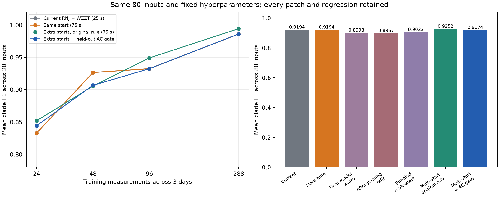

# RNJ+WZZT：时间放宽、小补丁与可复用场景记录

相同 80 组输入全部返回，形成 560/560 个所选模型记录；原始数据、独立验证/测试日、候选池、0.16 分辨率及 3% 验证选模容差均冻结。本轮只检验 RNJ+WZZT，未重跑叶初值自由域 WZZT。

主要发现：延长单初值搜索没有提升；保留原选模规则的多初值版本平均 F1 从 0.9194 升至 0.9252，5 项提升、3 项退化。收缩后重评分、重估及本轮 AC 门控均未提高平均拓扑 F1。以本库平均精度为目标时，多初值版本可作后续增强对照；原始版本继续保留，避免将局部增益写成逐场景保证。

## 当前策略

完整普通 RNJ 树库提供初值，固定族联合 L1 拟合允许零权删除，随后进行弱支路收缩和有限池交叉簇替换。初始模型和搜索路径共用验证规则，保留较好初始模型。原始量测分支 raw、分辨率 0.16×中位根深度、验证 MAE 最小值 3% 以内优先选更简单模型；原子响应系数界为 2。

RNJ 负责提供较可靠的整体层次，WZZT 负责联合重估、删除假细分和有限修正。固定族候选与修正路径的选中来源分开记录。当前库基线平均 F1 为 0.9194；其面向结果调优过程见上一轮报告。

## 放宽求解时间

从相同 raw/RX75/0.16 完整 RNJ 家族重跑，将单初值修正上限从 25 秒提高到 75 秒，其他数学设置及选模规则不变。80/80 项最终 F1 均未改变。原停止原因 {'pool_local_optimum': 79, 'pool_wall_limit': 1}；新停止原因 {'pool_local_optimum': 79, 'pool_wall_limit': 1}。

仍限时的是 flynn16/ideal_ac/288；该组最终选中原始树库模型，F1 已为 1。79 项的局部停点仅覆盖当前候选池及一次加入/交叉替换邻域。增加时间没有改变候选覆盖、训练目标或局部邻域，因此本轮未得到结构精度增益。time_diagnosis.csv 同时保留末点训练损失及路径长度变化。

LP 缓存按相同数学家族重新建立，未保存/恢复上一批求解器基。原初值 LP 最优值已逐项核验一致。时间是共享库之后的局部搜索秒数；多初值复用原来的 25 秒轨迹，再增加至多两个 25 秒搜索，声明上限合计 75 秒。库构建、收缩后重估、AC 训练重估和评分另耗时间，不能由局部搜索秒数推算独立部署总成本。

本轮各补丁还共享同组 LP 缓存，包括较长单初值搜索已求解的家族；因此 search_seconds 是这次共享执行中的计时，独立部署的实际秒数仍需独立运行测量。AC 门控即使保留基线，也计入生成多初值替代模型所用的搜索时间。

## 小补丁逐项结果



|variant|rows|F1|F1_change|exact|wins|ties|losses|test_ac_rmse|
|---|---|---|---|---|---|---|---|---|
|baseline25|80|0.91944|0|63|0|80|0|0.00046965|
|long75|80|0.91944|0|63|0|80|0|0.00046965|
|final_score|80|0.8993|-0.020141|61|3|68|9|0.00046982|
|post_refit|80|0.89668|-0.022755|63|3|70|7|0.00046943|
|multistart75|80|0.90325|-0.016184|64|5|69|6|0.000469|
|multistart_original_rule|80|0.92524|0.0058026|65|5|72|3|0.00046722|
|multistart_ac_gate|80|0.91735|-0.0020833|64|1|77|2|0.00046817|

各版本含义：baseline25 为已发表的完整 RNJ 组合；long75 仅增加时间；final_score 按收缩后实际模型重算验证分数；post_refit 再加入收缩后的联合 L1 重估候选；multistart75 在这一组合中增加两个验证较好的收缩/重估初值。

multistart_original_rule 使用相同新增轨迹，恢复原来未收缩模型的验证选点及最终收缩规则，从而分离初值多样化和选模规则变化。multistart_ac_gate 比较基线与该多初值模型：参数只用训练数据作最多 12 次 AC 局部重估；独立验证日的 AC 相对电压 RMSE 降低超过 3% 才替换基线。测试日和真簇均不参与门控。

新增后两项是在发现组合补丁降低拓扑 F1 后，使用已保存轨迹进一步分解的探索性规则；未重新生成输入、修改原参数、按单实例真簇挑模型或重新运行结构搜索。analysis_policy.json 保留这一边界。

|N|baseline25|long75|multistart_original_rule|multistart_ac_gate|
|---|---|---|---|---|
|24|0.83269|0.83269|0.85192|0.84423|
|48|0.92653|0.92653|0.90555|0.90666|
|96|0.93242|0.93242|0.94904|0.93242|
|288|0.98611|0.98611|0.99444|0.98611|

收缩后评分/重估虽然降低了电压预测误差，仍可能选择更多错误细分。较低预测误差与较高拓扑 F1 在本库中存在冲突，因此这些补丁保留为对照，不能仅凭拟合改善替换原策略。多初值及 AC 门控的提升、退化逐项保存在 changed_models.csv 和 AC_gate_adoptions.csv。

保留原规则的多初值版本，其三项退化均发生在 high_voltage_noise/48 点：paper15、flynn16、pengwah18；其中 flynn16 从 0.5000 降至 0.1667。这一档数据量的平均 F1 从 0.9265 降至 0.9056。24/96/288 点平均分分别提高，但尚未进行新的随机重复，故当前只支持本批输入上的平均增益。

|variant|R_error|X_error|linear_test_mae|physical_test_ac_rmse|ac_valid|ac_refit_success|
|---|---|---|---|---|---|---|
|baseline25|0.1377|0.39918|0.00093053|0.00013023|80|67|
|long75|0.1377|0.39918|0.00093053|0.00013023|80|67|
|final_score|0.14474|0.4196|0.00077954|0.00013007|80|64|
|post_refit|0.14001|0.43693|0.00077713|0.00012909|80|66|
|multistart75|0.14058|0.43277|0.00077716|0.00012838|80|67|
|multistart_original_rule|0.12059|0.39459|0.00087171|0.00012333|80|69|
|multistart_ac_gate|0.12969|0.3961|0.00092161|0.00012603|80|66|

AC 门控采用新增模型 3/80 项。AC 记录对应 168 个不同的输入组/参数组合，重复模型复用相同结果；其中 80 份训练重估复用已有匹配模型，129 份达到局部终止条件，基础设施错误 0。最终 AC 可行 560/560，局部收敛与结构恢复分别计数。

## 可直接调用的场景记录

catalog.sqlite 保存 80 组输入索引及 560 项模型：网络/条件/样本量、噪声和负荷配置、输入数据哈希、压降与 P/Q 波动摘要、支持簇、响应系数、选模来源、搜索停止原因、F1、矩阵误差、独立预测误差，以及明确标记的事后真簇诊断。r/x 是响应原子系数；R/X 为据此求和的响应矩阵。

decision_summary.csv 保存每步当前支持、训练损失、候选数量、最佳新增簇和被替换簇。load_trace 返回运行目录中完整逐候选记录、每步家族及系数，读取时校验哈希。原始量测和完整搜索记录保留在输出目录，目录清单绑定其位置与内容。

```python
from research_experiments.wzzt_budget.records import find, load, load_trace
catalog = r"D:\0-github_workspace\Topo\docs\wzzt_rnj_budget_20261028\catalog.sqlite"
rows = find(catalog, case="paper15", condition="high_voltage_noise", N=24)
m = load(catalog, case="paper15", condition="high_voltage_noise", N=24,
         variant="multistart_ac_gate", with_observations=True)
R, X = m["R"], m["X"]
P, Q, V, root = m["train"]
trace = load_trace(catalog, case="paper15", condition="high_voltage_noise", N=24)
steps = trace["searches"]["multistart_0"]["decisions"]
```

记录中的 diagnostic_json 包含事后真实/错误簇及阻挡关系，作为分析标签保存，与仅依赖观测的估计过程分开。raw P/Q/V/root 数据保留原存储单位和标签，压降摘要来自含噪观测。

## 核验与复现

独立核验通过：True；检查 2269 个不同物理模型、20235 条原生 LP 记录、791 步搜索，并用 SciPy/HiGHS 独立重解 15 个固定族 LP。基线 80 项逐一复现已发表成绩。

正式批次失败/超时均为零。试跑中的两次导入/评分字段错误保留在原试跑目录；它们未用于主结果，修正后两例完整试跑通过才冻结正式批次。单元检查 4 项通过。

```powershell
& D:/apps/miniconda3/envs/Topo/python.exe -B -m research_experiments.wzzt_budget.prepare outputs/<新目录>
& D:/apps/miniconda3/envs/Topo/python.exe -B -m research_experiments.wzzt_budget.run outputs/<新目录>
& D:/apps/miniconda3/envs/Topo/python.exe -B -m research_experiments.wzzt_budget.evaluate outputs/<新目录> docs/<新目录>
& D:/apps/miniconda3/envs/Topo/python.exe -B -m research_experiments.wzzt_budget.audit outputs/<新目录> docs/<新目录>
& D:/apps/miniconda3/envs/Topo/python.exe -B -m research_experiments.wzzt_budget.report outputs/<新目录> docs/<新目录>
& D:/apps/miniconda3/envs/Topo/python.exe -B -m research_experiments.wzzt_budget.verify outputs/<新目录> docs/<新目录>
```
