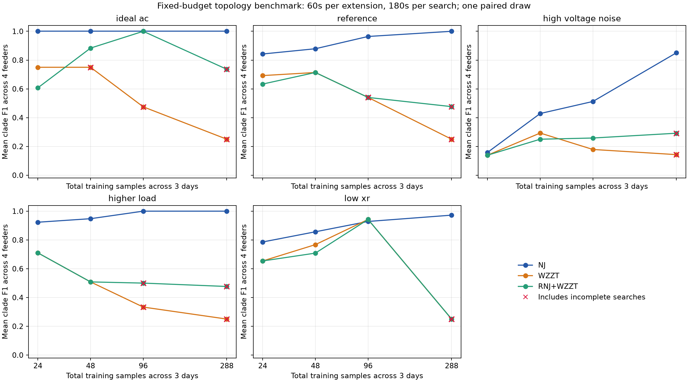

# WZZT 多数据量系统测试

首轮计划 240 项方法任务，已返回 240/240；正常完成 207/240，状态分布为 {'complete': 207, 'incomplete': 33}。可评价模型 240/240。首次程序异常 2 项，其中采用修复后补跑结果 2 项；首次记录保留。

按本轮返回模型等权汇总，平均簇 F1：NJ=0.852，WZZT=0.480，RNJ+WZZT=0.564。以下分别列出数据量、条件、完成情况与逐路径机制，未完成模型保留在汇总内。

最大采样量 288 点时，WZZT 完成 5/20 项，RNJ+WZZT 完成 9/20 项。该档均值包含大量未决模型，需结合完成分母理解；三种方法共同完成的配对结果另列。

## 测试范围

四个网络 paper15、soumalas11、flynn16、pengwah18；训练总点数为 24、48、96、288，分别在三个物理日取 8、16、32、96 点。每个物理日先按 96 点生成，再作嵌套抽样；独立测试集固定为另三个 96 点物理日。每个条件只有一组训练和测试随机路径，跨算例均值用于本轮比较。

本轮数据量变化对应固定三个物理日内的采样密度，观测天数保持一致。物理压降为根电压减末端电压，以额定电压的标幺百分数表示，完整数值见 physical_envelope.csv。

五种条件为无量测噪声、参考条件、高电压噪声、1.5 倍净注入和低 X/R。参考条件的 P/Q 相对噪声标准差为 0.5%，末端及根电压均为 0.02%；高电压噪声将两类电压噪声改为 0.1%。净注入压力条件将末端净 P/Q 同时乘 1.5，包含反送幅度。低 X/R 保持 R 不变，干线和服务线 X/R 分别为 0.30、0.06，是受控敏感性分析。根电压物理过程均值 1.02、sigma=0.003；所有条件采用实际阻抗倍率 1，无额外隐藏源。

## 方法与终止条件

NJ 使用有序 R/X 回归和带观测根的经典 NJ，RX75 内边收缩系数 0.16。WZZT 从单点簇开始；RNJ+WZZT 额外加入最多两个通过预设 bootstrap 检查的稳定末端块，并共享块内成员变量。每个块使用 100 次同步移动块 bootstrap，块长度随采样间隔调整到约一小时。

RNJ+WZZT 有 49/80 项未选出稳定块，保留空初值退化情况。该配置沿用现有稳定末端块算法；完整 RNJ 树初始化是另一种算法配置，本轮未混入该名称。

WZZT 每步最多 60 秒，结构搜索总计最多 180 秒，包含前端及 RNJ bootstrap。目标改善阈值为 1e-10 + 0.001×当前损失。若可行改善 g>阈值，且求解上、下界差不超过 0.5g，则接受；若有效下界证明最大可能改善不超过阈值，则终止；其他状态保留为未完成。请求相对 gap=1e-4，较大改善通过回调提前返回。

系数初始上界为 2，触及 99.5% 时倍增并从初始簇重启，最多四次扩张。全路径使用同一训练 R/X 校准的 RX75 下限。只在固定重拟合确认不恶化目标时删除非初始零权簇；正权簇保持兼容约束。路径最多含 2n-1 个簇，前向步数另限为 4n。

结构搜索后，在最终重启路径的每个点用训练数据作局部共享阻抗 AC 拟合，最多 12 次函数评价。训练 AC 电压 MSE 最小值加一个日块标准误范围内，选簇数最少、然后最早的点。三个物理日为三个误差块，测试数据在选择之后才由独立评价器读取。AC 拟合单独计时，因此端到端时间可超过 180 秒；进程保护上限为 600 秒。

## 评价口径

主要结构指标为非平凡下游簇 F1，与完整物理真簇比较。NJ 按其收缩树计分；WZZT 按固定 RX75 分辨率下的有效簇计分，同时保存家族 F1、正权簇 F1 和最后路径点 F1。R/X 误差为原估计器矩阵的相对 Frobenius 误差：NJ 使用稠密回归矩阵，WZZT 使用原子矩阵。

AC 测试误差为训练选定模型和训练拟合阻抗在独立三个测试日上的相对电压 RMSE。NJ 额外采用固定树 L1 及相同 AC 拟合，以统一物理预测参数口径，原 NJ 拓扑与稠密矩阵指标保持独立记录。物理输入误差使用测试真实 P/Q、根电压及末端电压，量测输入误差使用对应带噪数据。

选中模型的局部 AC 拟合达到所设优化终止容差 203/240 项；AC 测试物理计算有效 240/240 项。优化容差未达到和潮流计算失败分别记录；测试 RMSE 均值按有效项计算，逐项状态见 per_job.csv。

## 数据量与结构精度



下表对四个网络与五个条件等权平均，每档每方法 20 项。未完成任务采用已有模型计分，缺失模型记零。该比较反映本轮预算下实际返回的效果；仅三种方法都完成的配对比较另存 common_complete_comparison.csv。

|N|method|planned|returned|complete|F1_all_planned|exact_clade_recoveries|test_ac_valid|test_ac_rmse|elapsed_seconds|
|---|---|---|---|---|---|---|---|---|---|
|24|NJ|20|20|20|0.7419|8|20|0.0005353|1.658|
|24|RNJ+WZZT|20|20|20|0.5487|6|20|0.0005837|60.07|
|24|WZZT|20|20|20|0.5891|7|20|0.0005666|46.84|
|48|NJ|20|20|20|0.8223|8|20|0.0005047|1.664|
|48|RNJ+WZZT|20|20|20|0.6127|6|20|0.0005538|63.39|
|48|WZZT|20|20|19|0.6064|6|20|0.0006126|63.18|
|96|NJ|20|20|20|0.881|11|20|0.0004737|2.016|
|96|RNJ+WZZT|20|20|18|0.6482|10|20|0.0006118|88.37|
|96|WZZT|20|20|16|0.494|6|20|0.0007361|98.7|
|288|NJ|20|20|20|0.9646|15|20|0.0004511|2.825|
|288|RNJ+WZZT|20|20|9|0.4462|5|20|0.0008519|105.2|
|288|WZZT|20|20|5|0.2286|4|20|0.001178|81.38|

与 NJ 在相同网络、条件和采样量下的 F1 配对比较：

|method|paired|better_than_NJ|equal_to_NJ|worse_than_NJ|
|---|---|---|---|---|
|WZZT|80|8|21|51|
|RNJ+WZZT|80|9|25|46|

|condition|N|method|planned|returned|complete|clade_f1_all_planned|test_ac_rmse|elapsed_seconds|
|---|---|---|---|---|---|---|---|---|
|ideal_ac|24|NJ|4|4|4|1|2.507e-08|0.9434|
|ideal_ac|24|WZZT|4|4|4|0.75|8.471e-05|52.15|
|ideal_ac|24|RNJ+WZZT|4|4|4|0.6071|0.0001676|52.39|
|ideal_ac|48|NJ|4|4|4|1|2.729e-08|0.8125|
|ideal_ac|48|WZZT|4|4|3|0.75|0.0003567|58.24|
|ideal_ac|48|RNJ+WZZT|4|4|4|0.8833|5.741e-05|36.85|
|ideal_ac|96|NJ|4|4|4|1|5.954e-09|1.099|
|ideal_ac|96|WZZT|4|4|2|0.475|0.0005236|99.15|
|ideal_ac|96|RNJ+WZZT|4|4|4|1|7.19e-09|61.71|
|ideal_ac|288|NJ|4|4|4|1|6.743e-09|1.906|
|ideal_ac|288|WZZT|4|4|1|0.25|0.001048|68.6|
|ideal_ac|288|RNJ+WZZT|4|4|2|0.7361|0.0004005|97.95|
|reference|24|NJ|4|4|4|0.8424|0.0003132|1.723|
|reference|24|WZZT|4|4|4|0.6923|0.0003745|53.37|
|reference|24|RNJ+WZZT|4|4|4|0.6333|0.0003773|83.39|
|reference|48|NJ|4|4|4|0.8788|0.0003018|1.969|
|reference|48|WZZT|4|4|4|0.7137|0.0003524|82.81|
|reference|48|RNJ+WZZT|4|4|4|0.7137|0.0003524|87.35|
|reference|96|NJ|4|4|4|0.9641|0.000291|2.053|
|reference|96|WZZT|4|4|3|0.5404|0.000386|117.4|
|reference|96|RNJ+WZZT|4|4|3|0.5404|0.000386|116.2|
|reference|288|NJ|4|4|4|1|0.0002822|2.841|
|reference|288|WZZT|4|4|1|0.25|0.0008731|79.99|
|reference|288|RNJ+WZZT|4|4|2|0.4765|0.0006652|92.7|
|high_voltage_noise|24|NJ|4|4|4|0.1582|0.001709|2.369|
|high_voltage_noise|24|WZZT|4|4|4|0.1389|0.001588|39.6|
|high_voltage_noise|24|RNJ+WZZT|4|4|4|0.1389|0.001588|50.73|
|high_voltage_noise|48|NJ|4|4|4|0.4286|0.00163|2.322|
|high_voltage_noise|48|WZZT|4|4|4|0.2929|0.001538|40.61|
|high_voltage_noise|48|RNJ+WZZT|4|4|4|0.25|0.001539|49.71|
|high_voltage_noise|96|NJ|4|4|4|0.5124|0.001493|2.947|
|high_voltage_noise|96|WZZT|4|4|4|0.1788|0.001513|79.84|
|high_voltage_noise|96|RNJ+WZZT|4|4|4|0.2583|0.001513|75.05|
|high_voltage_noise|288|NJ|4|4|4|0.8508|0.001407|3.899|
|high_voltage_noise|288|WZZT|4|4|1|0.1429|0.00154|101.4|
|high_voltage_noise|288|RNJ+WZZT|4|4|2|0.2917|0.00145|150.9|
|higher_load|24|NJ|4|4|4|0.9231|0.0003294|1.693|
|higher_load|24|WZZT|4|4|4|0.7103|0.0004233|46.18|
|higher_load|24|RNJ+WZZT|4|4|4|0.7103|0.0004233|58.06|
|higher_load|48|NJ|4|4|4|0.9476|0.0002935|1.486|
|higher_load|48|WZZT|4|4|4|0.5082|0.0004684|68.42|
|higher_load|48|RNJ+WZZT|4|4|4|0.5082|0.0004684|73.69|
|higher_load|96|NJ|4|4|4|1|0.0002935|2.016|
|higher_load|96|WZZT|4|4|3|0.3333|0.0009529|95.31|
|higher_load|96|RNJ+WZZT|4|4|3|0.5|0.0008544|80.83|
|higher_load|288|NJ|4|4|4|1|0.0002846|2.572|
|higher_load|288|WZZT|4|4|1|0.25|0.001669|67.36|
|higher_load|288|RNJ+WZZT|4|4|2|0.4765|0.0009849|87.27|
|low_xr|24|NJ|4|4|4|0.7857|0.0003251|1.562|
|low_xr|24|WZZT|4|4|4|0.6538|0.0003629|42.93|
|low_xr|24|RNJ+WZZT|4|4|4|0.6538|0.0003629|55.77|
|low_xr|48|NJ|4|4|4|0.8566|0.0002981|1.729|
|low_xr|48|WZZT|4|4|4|0.7673|0.0003478|65.83|
|low_xr|48|RNJ+WZZT|4|4|4|0.7083|0.0003515|69.34|
|low_xr|96|NJ|4|4|4|0.9284|0.0002905|1.965|
|low_xr|96|WZZT|4|4|4|0.9423|0.000305|101.8|
|low_xr|96|RNJ+WZZT|4|4|4|0.9423|0.000305|108|
|low_xr|288|NJ|4|4|4|0.9722|0.0002816|2.909|
|low_xr|288|WZZT|4|4|1|0.25|0.0007585|89.59|
|low_xr|288|RNJ+WZZT|4|4|1|0.25|0.0007585|97.4|

## 参考条件逐算例结果

[全部条件逐算例曲线](f1_all_cases.png)

|case|N|NJ|WZZT|RNJ+WZZT|
|---|---|---|---|---|
|flynn16|24|0.5714|0.8333|0.8333|
|flynn16|48|0.7692|0.7692|0.7692|
|flynn16|96|0.9231|0.2|0.2|
|flynn16|288|1|0|0|
|paper15|24|0.9231|0.1667|0.1667|
|paper15|48|1|0.2857|0.2857|
|paper15|96|1|0.4615|0.4615|
|paper15|288|1|0|0.4615|
|pengwah18|24|0.875|0.7692|0.5333|
|pengwah18|48|0.8571|0.8|0.8|
|pengwah18|96|0.9333|0.5|0.5|
|pengwah18|288|1|0|0.4444|
|soumalas11|24|1|1|1|
|soumalas11|48|0.8889|1|1|
|soumalas11|96|1|1|1|
|soumalas11|288|1|1|1|

## 三类机制诊断

在 160 项 WZZT 系列运行中，33 项结构搜索未完成；84 项最终家族含正权错误簇，与至少一个遗漏真簇交叉。保留该簇时，对应真簇不属于兼容扩展域。初始 RNJ 原子分组直接切开真簇的情况为 0 项。

AC 筛选在 87 项选了更早路径点；相对最后路径点，F1 提升 47 项、下降 33 项，160 项平均 F1 改变量为 -0.0096。mechanisms.csv 同时记录后续训练损失下降、额外错误簇数和首次正权阻挡位置。该检查使用运行完成后的物理真值，结果未反馈给训练或路径选择。

以下列出选点后结构 F1 与测试电压误差同时变差的反例。它们用于诊断当前一标准误规则；主结果仍采用预先冻结的选点规则。相对电压 RMSE=0.001 对应 0.1%。

|case|condition|N|method|clade_f1|last_clade_f1|test_ac_rmse|last_test_ac_rmse|
|---|---|---|---|---|---|---|---|
|flynn16|ideal_ac|24|WZZT|0|0.5|0.0003387|0.0002847|
|flynn16|ideal_ac|24|RNJ+WZZT|0|0.5|0.0003387|0.0002847|
|soumalas11|high_voltage_noise|96|RNJ+WZZT|0.3333|0.8|0.00149|0.001451|
|soumalas11|high_voltage_noise|96|WZZT|0.3333|0.8|0.00149|0.001451|
|soumalas11|high_voltage_noise|288|WZZT|0.5714|1|0.001412|0.001408|

## 完成情况与核验

数据核验通过：True。求解原始约束、整数性、目标值和判据重算：True，共 1331 次扩展求解。逐路径物理目标、层状兼容与损失单调性核验：True，共 1515 个路径点。所有失败、超时和未完成任务保留在 per_job.csv 的计划分母中。未完成模型按停止时已有路径评分，状态列同时保留。

首轮冻结的生产者有一处日志字段名冲突：系数上界覆盖了保存的 bound 键。求解回调与决策在覆盖前已完成；独立评价器从原路径当前损失与保留的 gain_possible 恢复实际求解下界，并重算判据。solver_audit.json 逐项记录恢复值；原始 source 和日志保留，后续驱动已采用不同字段名。

首轮还出现提前中断解的残差辅助变量有余量、从而触发目标相等校验的程序异常。对最小化绝对残差模型，可行辅助变量目标给出实际解码 L1 的上界；修复为核查实际 L1 不超过该上界，并将实际 L1 用于后续搜索。所有程序异常项在原任务结束后统一补跑，训练观测、参数和预算保持一致；求解未决项不补跑。修复源及补跑清单单独冻结。

控制器曾因 Windows 进度文件并发读写退出，随控制器退出的 4 项工作进程，其中间记录归档于 interrupted_attempts，随后按相同输入和预算重跑。控制器写入已加入短重试。该基础设施中断与求解未决、程序校验异常分别记录；表中时间为返回结果对应的有效尝试，重跑范围与归档位置见 controller_recovery.json。

本轮 normal complete 只表示声明的前向搜索规则完成；优化界覆盖当前有界单步问题。AC 低误差和 bootstrap 稳定度作为诊断使用。四个网络是仓库构建的文献启发合成网络；工程数据、额外源及多随机种子重复另行测试。

## 交付与复现

逐项结果见 per_job.csv，完整条件汇总见 aggregate.csv，物理电压和实际压降见 physical_envelope.csv，原始扩展求解核验见 solver_audit.json，冻结输入清单见 frozen_manifest.json。producer_source.zip 保留真正运行的源代码闭包。

```powershell
& D:/apps/miniconda3/envs/Topo/python.exe -B -m research_experiments.rnj.prepare_source_ac288_runtime
& D:/apps/miniconda3/envs/Topo/python.exe -B -m research_experiments.wzzt_systematic.prepare outputs/<新目录>
& D:/apps/miniconda3/envs/Topo/python.exe -B -m research_experiments.wzzt_systematic.run outputs/<新目录>
& D:/apps/miniconda3/envs/Topo/python.exe -B -m research_experiments.wzzt_systematic.repair outputs/<新目录>
& D:/apps/miniconda3/envs/Topo/python.exe -B -m research_experiments.wzzt_systematic.evaluate outputs/<新目录> docs/<新报告目录>
& D:/apps/miniconda3/envs/Topo/python.exe -B -m research_experiments.wzzt_systematic.report outputs/<新目录> docs/<新报告目录>
```

冻结历史结果可将 producer_source.zip 解压到该运行的 source 目录，由冻结控制器执行。新驱动修复了日志字段名与循环检测的规范化；原历史冻结源仍可精确核对。
