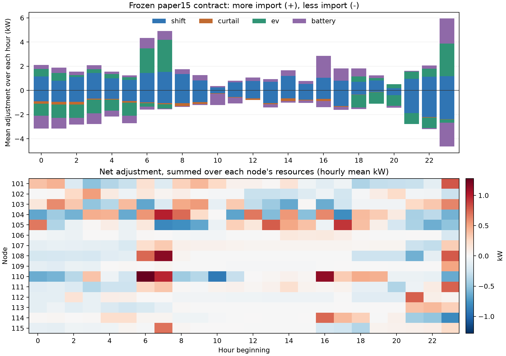

# paper15 冻结报价的调度结果

本页只汇总已完成的 `optimization_restore/quote.pkl`，没有重新优化、抽样或运行AC。正号表示相对基线增加取电，负号表示减少取电。以下均为规划时的名义合同交付，和32条随机实际执行的平均值分开。

`x` 是每资源每小时的无量纲带方向请求，形状60×24。`u` 是经过原设备控制器后的15分钟功率增量，形状60×96、单位kW。`unit_reward` 是对应的非负奖励单价，形状60×96、单位为本算例合同费用单位/kWh。控制器保留功率、能量和终端任务，故一小时内实际合同增量可随15分钟槽变化。费用为预付固定服务费，不在交付不足后退款；`fees(delivered)`只是使用成本代理。

总增加取电 **46.171985 kWh**，总减少取电 **46.762796 kWh**，绝对调节 **92.934781 kWh**，净变化 **-0.590811 kWh**。合同费 **43.401926**，规划条件过线概率 **90.0004296876%**。原库存21.596368kW保持不变。

15个节点全部有交付；1290个有容量小时中1188个请求非零。资源绝对功率和峰值 **12.051497 kW**，发生在23:30；它把所有资源的绝对值相加，并非节点净功率峰值。单资源最大绝对调节 **1.035846 kW**。极小非零变量未人为删除，统计阈值为1e−8。

## 按资源

| 资源 | 增加取电kWh | 减少取电kWh | 净值kWh | 绝对调节kWh | 固定合同费用 |
| --- | --- | --- | --- | --- | --- |
| 用户移位 | 22.4371 | 22.4371 | 0.0000 | 44.8742 | 28.9746 |
| 用户削减 | 0.0000 | 2.3628 | -2.3628 | 2.3628 | 0.9224 |
| EV | 11.9214 | 11.9214 | 0.0000 | 23.8429 | 8.4327 |
| 储能 | 11.8134 | 10.0414 | 1.7720 | 21.8549 | 5.0722 |

用户移位和EV的全天净电量为零。储能净增加1.772016kWh用于补偿损耗，用户削减净减少2.362827kWh；两者合计得到总净值−0.590811kWh。绝对调节包含转移后的回补，不等于净增加用电。

## 按节点

| 节点 | 增加取电kWh | 减少取电kWh | 净值kWh | 绝对调节kWh | 固定合同费用 |
| --- | --- | --- | --- | --- | --- |
| 101 | 3.8552 | 3.9419 | -0.0867 | 7.7970 | 2.2969 |
| 102 | 1.9289 | 2.2030 | -0.2742 | 4.1319 | 1.6081 |
| 103 | 4.7523 | 4.9193 | -0.1670 | 9.6717 | 5.3651 |
| 104 | 6.5804 | 6.7680 | -0.1875 | 13.3484 | 8.3928 |
| 105 | 4.7862 | 5.1254 | -0.3393 | 9.9116 | 5.9443 |
| 106 | 0.5713 | 0.6095 | -0.0382 | 1.1808 | 0.1788 |
| 107 | 1.9838 | 1.9286 | 0.0552 | 3.9124 | 1.4535 |
| 108 | 4.5169 | 4.4783 | 0.0386 | 8.9951 | 3.4735 |
| 109 | 0.6168 | 0.6022 | 0.0146 | 1.2191 | 0.2068 |
| 110 | 5.2275 | 4.8946 | 0.3329 | 10.1222 | 5.3954 |
| 111 | 2.3319 | 2.3458 | -0.0139 | 4.6777 | 1.9857 |
| 112 | 1.8978 | 1.9449 | -0.0471 | 3.8427 | 1.2892 |
| 113 | 1.6000 | 1.6552 | -0.0552 | 3.2552 | 1.2589 |
| 114 | 3.5495 | 3.3416 | 0.2078 | 6.8911 | 2.2190 |
| 115 | 1.9736 | 2.0044 | -0.0308 | 3.9780 | 2.3340 |

## 按小时

下表为每个小时内四个15分钟槽的电量汇总。因为小时长度为1h，增加/减少电量的数值也分别等于该小时平均正/负调节功率的数值，单位不同。功率峰值列则是四个槽中的最大值。

| 小时 | 增加取电kWh | 减少取电kWh | 净值kWh | 固定合同费用 | 槽内绝对功率和峰值kW |
| --- | --- | --- | --- | --- | --- |
| 00:00–01:00 | 2.0973 | 3.1549 | -1.0577 | 1.5659 | 5.3854 |
| 01:00–02:00 | 1.8787 | 3.1521 | -1.2735 | 1.4910 | 5.5591 |
| 02:00–03:00 | 1.5547 | 2.8221 | -1.2674 | 1.4590 | 4.7047 |
| 03:00–04:00 | 2.0893 | 2.7731 | -0.6838 | 1.6162 | 4.8714 |
| 04:00–05:00 | 1.5597 | 2.1691 | -0.6094 | 1.0247 | 3.9010 |
| 05:00–06:00 | 1.2352 | 2.7177 | -1.4825 | 1.2357 | 4.1774 |
| 06:00–07:00 | 4.3285 | 1.5948 | 2.7337 | 3.1927 | 6.4431 |
| 07:00–08:00 | 4.9203 | 1.5582 | 3.3621 | 4.0631 | 6.8591 |
| 08:00–09:00 | 1.7475 | 1.3628 | 0.3847 | 2.3367 | 3.2956 |
| 09:00–10:00 | 1.2698 | 1.2075 | 0.0622 | 1.4858 | 2.8283 |
| 10:00–11:00 | 0.3682 | 1.2175 | -0.8493 | 0.4590 | 2.0235 |
| 11:00–12:00 | 0.8103 | 1.0777 | -0.2674 | 0.8579 | 2.5691 |
| 12:00–13:00 | 1.0592 | 0.7910 | 0.2682 | 0.9356 | 1.8611 |
| 13:00–14:00 | 0.9272 | 1.4123 | -0.4851 | 1.2362 | 2.3395 |
| 14:00–15:00 | 1.6716 | 1.0187 | 0.6529 | 1.3612 | 2.9676 |
| 15:00–16:00 | 0.7847 | 1.0395 | -0.2548 | 0.6976 | 1.8242 |
| 16:00–17:00 | 2.8534 | 1.3833 | 1.4700 | 1.8104 | 4.3972 |
| 17:00–18:00 | 1.8106 | 1.6125 | 0.1981 | 2.5230 | 3.4641 |
| 18:00–19:00 | 1.8180 | 1.5399 | 0.2781 | 1.5787 | 3.6805 |
| 19:00–20:00 | 1.2464 | 1.0929 | 0.1536 | 1.3083 | 2.7348 |
| 20:00–21:00 | 0.5091 | 1.4363 | -0.9272 | 0.9290 | 2.0005 |
| 21:00–22:00 | 1.6289 | 2.7893 | -1.1605 | 3.2417 | 5.9186 |
| 22:00–23:00 | 2.0609 | 3.1941 | -1.1331 | 2.6042 | 6.2756 |
| 23:00–24:00 | 5.9427 | 4.6453 | 1.2973 | 4.3883 | 12.0515 |

## 日内分布

图中只有本次合成合同的聚合调整，没有自然负荷、真实P/Q/V或AC轨迹。

## 调节量最多的10个节点资源

| 节点 | 资源 | 增加kWh | 减少kWh | 绝对调节kWh | 合同费 |
| --- | --- | --- | --- | --- | --- |
| 104 | shift | 4.5807 | 4.5807 | 9.1614 | 7.0693 |
| 105 | shift | 3.3684 | 3.3684 | 6.7367 | 4.8744 |
| 103 | shift | 3.2413 | 3.2413 | 6.4825 | 4.3100 |
| 108 | ev | 2.9216 | 2.9216 | 5.8432 | 2.1456 |
| 110 | battery | 2.5093 | 2.1329 | 4.6421 | 1.3300 |
| 110 | shift | 2.1237 | 2.1237 | 4.2475 | 3.6610 |
| 101 | ev | 1.7546 | 1.7546 | 3.5092 | 1.2091 |
| 114 | battery | 1.6409 | 1.3948 | 3.0358 | 0.5853 |
| 104 | battery | 1.4630 | 1.2436 | 2.7066 | 0.7068 |
| 111 | ev | 1.2833 | 1.2833 | 2.5665 | 1.0487 |

## 完整表与核验

- `schedule_summary.csv`统一包含4类资源、15节点和24小时的聚合统计，共43行。增加、减少、净值、绝对值和费用均使用未取整数据核对。
- 私有完整15分钟表为 `C:/Users/23761/.codex/visualizations/2026/10/25/01a1726e-8ec7-7bc1-9f18-391f9cf79a1a/wzzt_dr_full_price_v1/schedule_delivery/full_resource_slot_schedule.csv`，5760行；含节点、资源、时间、小时请求、名义kW、奖励单价、电量和槽合同费。1440行小时请求另存同目录`hourly_requests.csv`。这些完整数组留私有，不上传仓库。
- 冻结报价SHA-256为 `ef0c6161ed1a9e07a9c3387fba4dc245beffe48aa192a32945cef47ec0e2e383`。
- 原allocation审计SHA-256为 `bc7926e4e68c1ae551d51c4ee9828d3113105d4a79edaa27be633b4aee22e1a9`。
- 本次导出源码、逐项算术核对及生成文件hash见私有同目录`receipt.json`。源名义设备审核通过；本次逐项重算费用、正负电量、各节点/类型/小时合计，失败0。

既有AC评价新合同32/32完整恢复，旧90合同27/32、同费轮换0/32；一个固定自然日、32条独立执行/量测路径。新合同平均实际绝对交付90.560224kWh，与名义92.934781kWh不同。这些既有结果未参与本次导出或重新规划。
