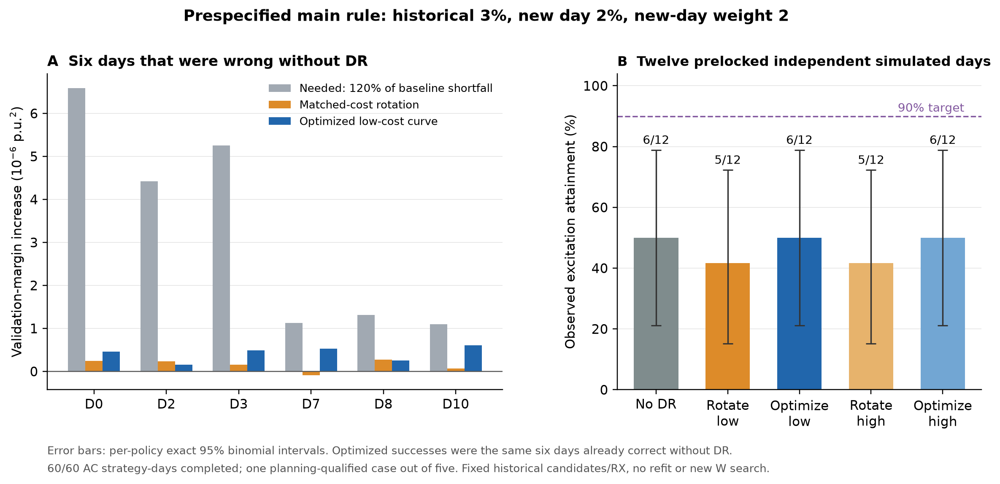

# 冻结DR报价的独立AC日测试

2026-11-01。主规则结论：低费用优化曲线在12/12日都提高了实际验证裕量，但没有补足6个原错误日的缺口，没有相对无DR产生新增恢复。90%激励要求在本次声明模拟分布下未成立。预设敏感规则中存在两例真实新增纠错，完整结果另列，不替代主结论。物理执行、算法回选和规划误差已分开核验，未调价、重抽或追加样本。

## 测试范围和信息时序

原5条件只有paper15/b2/.0005得到当前目标下规划可行报价，其余2个条件模型不可行、2个未决。它们保留在资格分母，不将未达标的第一阶段曲线当优化价执行。本次检验全部已得到的可行paper报价：最低已知费用见证作为主版本，无支付上限求解返回的较高费用曲线作为预锁敏感性。

主版本不是全局最小费用已证：期望费.228748、保守预留支付.274498；较高版本.583110/.699731。两层各自匹配全天简单轮换的期望费用及保守上界，匹配发生在随机响应产生前。轮换使用6小时交替、两节点反向、全天96槽非零的固定模式，初始相位按预锁独立随机数选择；不拿短时探索冒充全天对照。

价格、曲线、模型、261源文件、全部60请求、12个独立模拟日的profile/replicate/响应/轮换相位先冻结并纯预审60/60。source/case/profile/replicate身份与946份已存request清单中可识别的27个物理身份没有重叠。新日使用原AC生成器和独立根电压/自然P/Q/计量随机数，未沿用规划历史残差。

保留完整288训练/288验证历史，R/X及.16输出映射固定。每个新日独立追加到同一历史做一次回选：真实验证384行，w2有效权重480；不累计上一测试日，不重拟合或重跑W接受/搜索。历史3%、新日2%为主，完整9套预设规则同时重算。所有预测/选择先冻结，之后才读真拓扑标记错漏。

源及运行冻结协议SHA：f1e0f5ac0e798481888600c3f37b57aa001efd0a83dce7a5169df6b932659ee7。实际case15终端，root1，200kW基值，电压相对误差.0005、P/Q .005保持。响应仍为合成连续相关整段模型，非实证用户校准。

## 主结果：有方向收益，没有新增恢复

60/60策略日、5760 AC时点完成，失败/超时/未决0。独立分母为12日，不能把策略数、时段数或模型数放大为独立样本。

| 策略 | 激励达标 | 完整恢复 | 总错漏 | 平均实际模拟支付/日 | 平均实际ΔM，微p.u.² |
|---|---:|---:|---:|---:|---:|
| 无DR自然新增 | 6/12 | 6/12 | 6 | 0 | 0 |
| 同低费全天轮换 | 5/12 | 5/12 | 7 | .241501 | .092872 |
| 低费优化，主版本 | 6/12 | 6/12 | 6 | .241170 | .385762 |
| 同高费全天轮换 | 5/12 | 5/12 | 7 | .615618 | .179581 |
| 较高费优化，敏感性 | 6/12 | 6/12 | 6 | .614775 | .107745 |

费用为合成合同单位。真实随机支付没有事后强制配平；低费总额2.894040对轮换2.898007，高费7.377297对7.387412。费用上界是已选计划的数学支付保证，不是重新加回的优化预算限制。

每一档优化相对匹配轮换均1日改善、0日恶化、11日相同，但同为D6轮换把原已正确的结果变错。优化避免了这一次副作用，未纠正无DR仍错误的6日。两优化的6次成功全部来自无DR已成功的同6日，新增纠错0。单个不一致日不足以支持稳定优于轮换的统计结论。

低费优化ΔM为12/12正，冻结预测距离增量也为12/12正、均值1.746707微单位。较高费曲线4日ΔM为负。两份优化时形不同，不能将它们视为同曲线的纯强度缩放实验。

## 90%要求的核验

同日无DR实测裕量为M0，缺口r=[-M0]+。预锁激励事件为物理执行通过且M_DR>=.2r+1e-10 p.u.²；基线为负时等价于增加至少1.2r加数值余量。

主优化达标6/12，95%双侧精确二项区间[21.09%,78.91%]。预锁单侧检验H0:p>=.9的下尾p=.000541232，故本次固定网络/profile混合/计量/响应模拟分布不支持90%要求。它不是线路真实性概率或对其他拓扑的恢复保证，也不证明所有DR策略无效。

## 九套预设规则全部结果

以下为每策略12日的完整错漏总数，同一60份观测只重评分，不改变报价或新增AC。主规则w2/2%已在前文，用户要求的同权重1%敏感性也保留。

| 新日权重/容差 | 无DR | 低轮换 | 低优化 | 高轮换 | 高优化 |
|---|---:|---:|---:|---:|---:|
| w1/3% | 11 | 11 | 11 | 11 | 11 |
| w1/2% | 11 | 11 | 9 | 10 | 11 |
| w1/1% | 5 | 4 | 3 | 4 | 5 |
| w2/3% | 11 | 11 | 11 | 11 | 11 |
| w2/2%，主 | 6 | 7 | 6 | 7 | 6 |
| w2/1% | 1 | 1 | 1 | 1 | 1 |
| w4/3% | 9 | 9 | 9 | 9 | 9 |
| w4/2% | 3 | 3 | 3 | 3 | 3 |
| w4/1% | 0 | 0 | 0 | 0 | 0 |

在w1/2%下，低优化由11错降为9错，两个原错误日真实纠正，低轮换没有纠正；w1/1%下低优化也少2错，比轮换少1错。说明正裕量增量在临界日可以转成选线变化，并非所有规则都无DR收益。这些是预设敏感性观察，不是为它们重新优化或独立选定新主规则；不能以此改写主90%要求或稳定收益结论。

## 实际需要的gap与提供的增量

下表只用于事后定位6个无DR错误日，其他6个原正确日仍保留在全部统计分母。

| 日索引 | 120%所需ΔM | 低费优化实际ΔM |
|---|---:|---:|
| D0 | 6.590590 | .460099 |
| D2 | 4.425299 | .151723 |
| D3 | 5.252888 | .492694 |
| D7 | 1.131276 | .524779 |
| D8 | 1.311247 | .254323 |
| D10 | 1.095613 | .608436 |

单位微p.u.²。D10最接近：M0=-.912927，优化增加.608436，最终M=-.304491，仍未退出验证带。这里的灰色需求柱是1.2r加数值余量，不是最终裕量目标.2r，二者不能混用。

## 为什么训练规划达标，实际仍不够

旧3个训练工作日M0仅为{-1.115819,3.022101,3.267672}微单位；实际12日范围[-5.492075,13.407820]。有3日比规划工作模型的最差日更差，需求缺口被低估。

同时做了事后transport诊断：使用实际无DR残差，将新增电压假设为参考模型预测的增量，保持同一观测P/Q变化和冻结R/X；它只用于归因，不用于设计或重新报价。

| 低费优化平均ΔM | 微p.u.² |
|---|---:|
| 原3训练块、相同响应因子的预测 | .902292 |
| 用实际无DR残差的transport | .389037 |
| 独立实际观测 | .385762 |

旧残差迁移差的RMS为.536116微，实际相对transport差的RMS仅.004538微；二者不是仅靠平均抵消得到的结果。主要损失发生在旧残差形状迁移，而非DR未执行或AC增量电压近似失真。即使直接使用实际基线残差transport，六个错误日仍未达标。

60/60选中raw族与冻结收缩后的完整错漏相同。本次没有新W接受/搜索或调权，收益没有在这些阶段被吞掉；实际正裕量增量未跨过最终验证门槛。当前结果不应归为WZZT核心结构搜索失败。

## 核验、边界和下一步

39项worker回归/新门控＋4项driver检查通过；纯预审独立856/856通过。物理/资源/CRN/费用与机制复核5017/5017、观测选择与统计复核7194/7194通过。自然P/Q/root、观测root及标准化表计噪声配对一致；标准化P/Q/V最大差4.37e-13。AC收敛、功率守恒和电压界均通过，未核支路载流量。

接口仅增加显式frozen_plan_bound结算模式，旧1.6默认合同保留。零执行按每资源精确全零判断，绕过不必要的柔性组成门但保留完整物理/观测；弱非零和资源间相消不跳。这些接口修复不算DR创新或收益。后处理首版SVG读取用Windows默认编码失败，已另存回执，仅显式UTF-8重绘，未重跑实验。

目前可支持：优化曲线确实增加实际辨识裕量，部分预设敏感规则下产生新增恢复；主版本仍没有相对无DR的新增恢复，也不支持其90%概率校准。下一步若改进，应优先建模跨日验证残差和真实需求缺口的分布，再研究节点/时段异质随机响应。单纯继续提高随机维度、增加报价计算或挑选新seed不能修复这次已定位的失配。

本批已关闭，无待续worker，没有据结果调价、换case或追加样本。全部原始P/Q/V、AC、曲线和完整参数私有，公共仅源码、标量、图与hash。恢复见README和RECOVERY_INDEX。
