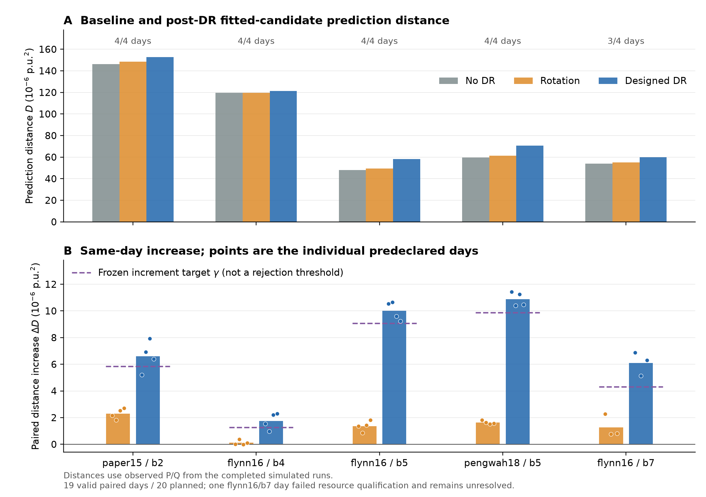
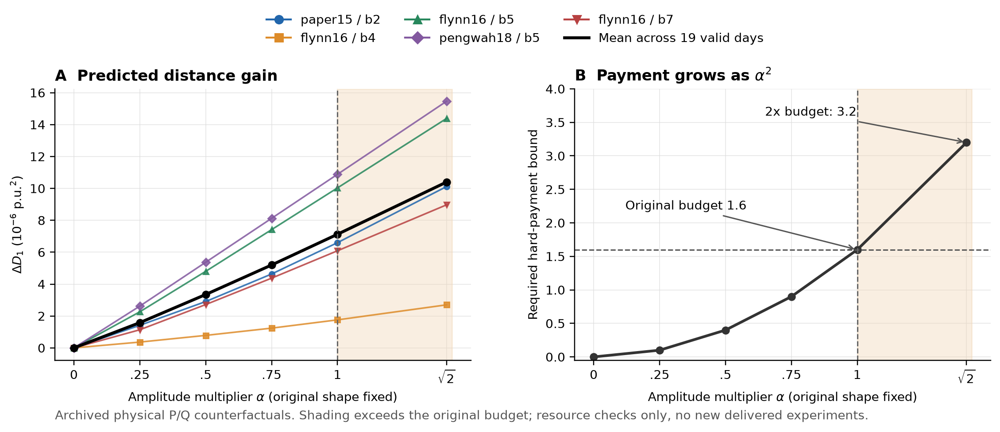
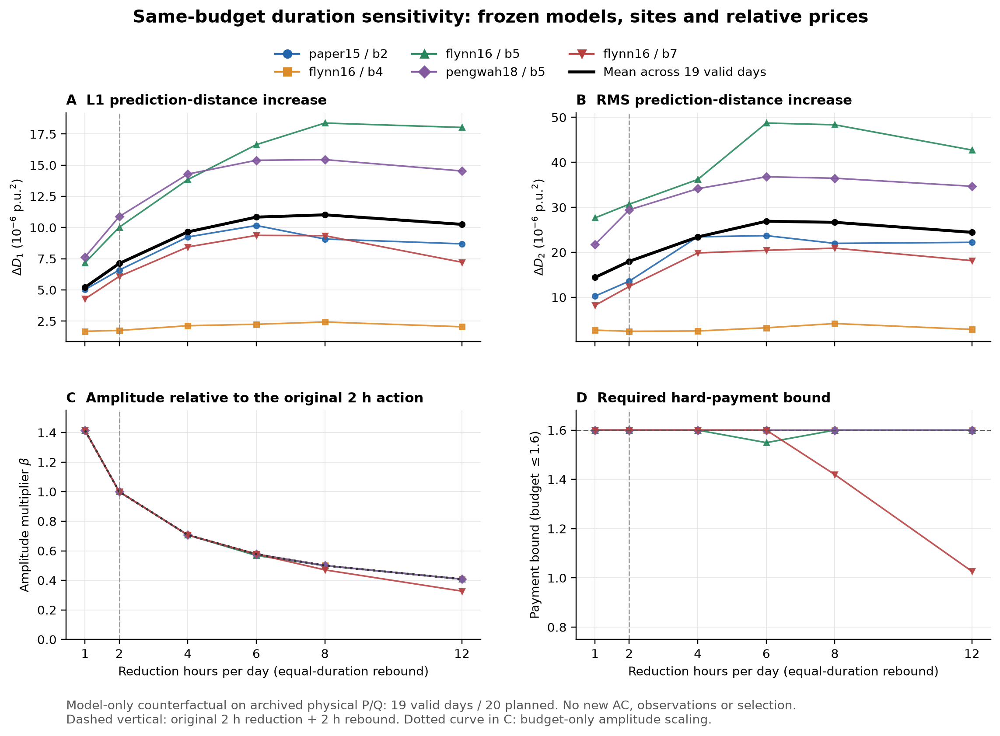
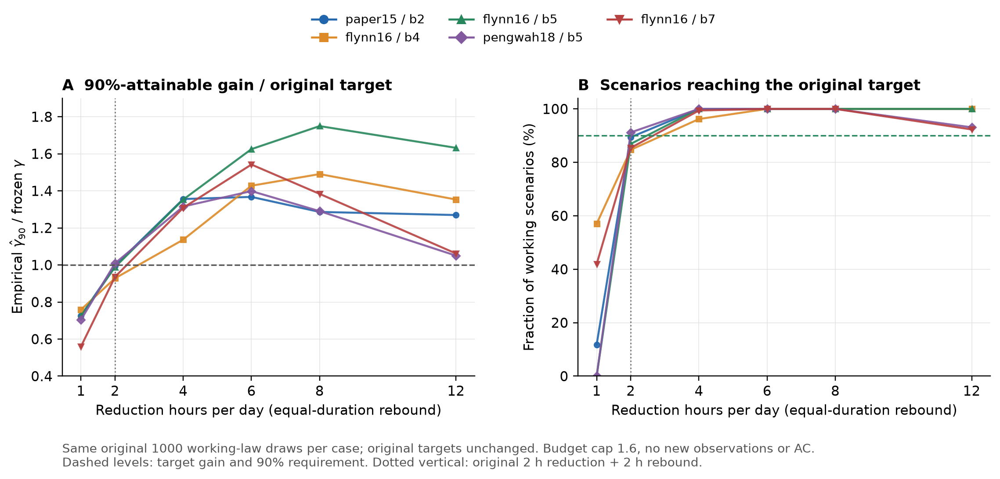
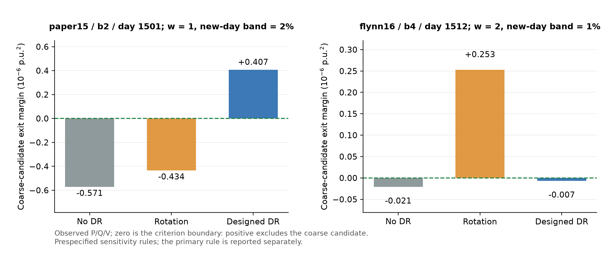

# DR距离增量、规划目标及强度／时长曲线

2026-11-01。本轮把已有结果画成图，并进行了固定模型的输入反事实核算。没有新增AC、辨识、拟合或价格搜索。已有执行数据仍为5个历史条件、3种网络、19/20个有效配对模拟日；延长时长的曲线不当作新实施数据。

## 距离增量究竟是什么

历史拟合后固定两组完整模型(R1,X1)、(R2,X2)。对节点i、时段t：

\[
\widehat y_{k,it}=\sum_j(R_{k,ij}p_{jt}+X_{k,ij}q_{jt}).
\]

这里预测的是根节点与末端节点的电压平方差Y=Vroot²−Vi²。定义两模型在同一输入下的平均预测距离

\[
D_1(P,Q)=\frac1{nT}\sum_{i,t}|\widehat y_{1,it}-\widehat y_{2,it}|,
\qquad T=96.
\]

对完全相同的自然负荷P0、Q0，无DR基值为D0=D1(P0,Q0)。价格c和整段随机响应xi产生UP、UQ后，所买到的增量是

\[
\Delta D(c,\xi)=D_1(P^0+U_P,Q^0+U_Q)-D_1(P^0,Q^0).
\]

两项使用同一自然背景、同一组固定参数。自然负荷变化不能被记为DR收益。该量也不同于仅计算DR响应的范数||DeltaR UP+DeltaX UQ||：原模型差与新响应可能相互抵消。

这是**冻结拓扑模型的预测距离**，不是随DR改变的图结构距离，也不是直接用未知真实物理R/X算出的距离。新日V和真拓扑不进入这个指标，因此它可在规划时计算；实际拟合与选模另需观测V。

## 规划目标可以直接评价

规划优化的不是平均增量，而是“至少90%场景可达到的增量”。有限场景定义为

\[
\widehat g_{90}(c)=\sup\left\{g:\frac1S\sum_{s=1}^S
\mathbf1[\Delta D(c,\xi_s)\ge g]\ge.9\right\}.
\]

给定预算和资源约束，原价格模型最大化这个量。S=64时取增量降序第58个；评价S=1000时取降序第900个，即低端约10%分位，而不是通常的上侧90%分位。

还应固定原报价时得到的gamma，报告

\[
\widehat p_\gamma=\frac1{1000}\sum_s\mathbf1[\Delta D_s\ge\gamma].
\]

所以评价需要同时给：D0、平均DeltaD、90%可达增量g90、达到原gamma的场景比例、费用。均值提高不自动说明原90%约束达标。

## 已完成执行数据的距离基值与增量

下表以已执行记录的观测P/Q计算，单位均为微p.u.²。相对增幅按“本条件平均增量／平均基值”计算，避免与逐日百分比的平均混用。

| 条件 | 有效/计划日 | 无DR基值D0 | 轮换增量 | 设计增量 | 设计相对增幅 | 冻结gamma |
|---|---:|---:|---:|---:|---:|---:|
| paper15/b2 | 4/4 | 146.133 | 2.301 | 6.610 | 4.52% | 5.839 |
| flynn16/b4 | 4/4 | 119.637 | .114 | 1.750 | 1.46% | 1.257 |
| flynn16/b5 | 4/4 | 48.107 | 1.362 | 10.009 | 20.81% | 9.068 |
| pengwah18/b5 | 4/4 | 59.641 | 1.629 | 10.889 | 18.26% | 9.881 |
| flynn16/b7 | 3/4 | 53.872 | 1.274 | 6.107 | 11.34% | 4.306 |

19个有效日设计增量全部为正。原1个资源资格失败日仍保留未决，不填0；本轮没有补样本。

图上gamma是**原规划的增量目标**。对应每个背景的绝对目标为D0+gamma，不存在跨所有背景共用的一条绝对D判断线。

## 原预算下能否直接增加强度

现有响应为A=lambda*c*(1+D*z)。保持时形不变，报价和响应统一放大alpha倍，合同费用随alpha²增长。原方案已经基本用满1.6硬预算，因此原预算内统一增幅的上限约为1；可以重新分配，而不能无成本整体拉高。

固定背景下，q(alpha)=||b+alpha v||1−||b||1是凸函数且q0=0，因此alpha≥1时q(alpha)≥alpha q1。原方向已有正增量时，增幅可提高预测距离；参数线性响应、无裁剪及资源可行是成立条件，选模裕量没有相同单调性。

在单列的预算放宽反事实中，alpha=sqrt2、硬预算1.6→3.2，平均DeltaD由7.1243增至10.4016（增量提高46.0%）。价格、功率和累计能量角点核验通过，但没有新增AC或实际长时交付，不能把该结果当作原预算下的算法提升。

## 延长有效执行时长有用，但并非越长越好

原时形每节点累计削减2h、另回补2h，分散在同一个96槽全天。新曲线用历史梯度选择更多削减/回补槽，比较累计削减1/2/4/6/8/12h，分别另有等时回补。12h意味着全天24h非零调节，不是增加新观测日。

节点、完整R/X、相对报价及全天可用资源声明保持；仅增加时形槽数，并沿原报价比例取资源/预算允许的共同幅值（数值容差内）。没有为每个时长重新求最优价格，也未用旧真实背景选时段。旧19日自然P/Q和响应因子仅用于事后评价，保持1/20原未决。此时长核算使用归档物理P/Q，因此原2h基线与前表基于观测P/Q的数值存在小量计量差；各曲线内部均使用同一种输入配对比较。

| 累计削减时长 | 活跃时间含回补 | 平均DeltaD1 | 平均预测差RMS增量 | DR单独响应RMS |
|---:|---:|---:|---:|---:|
| 1h | 2h | 5.2125 | 14.4330 | 46.6124 |
| 原2h | 4h | 7.1243 | 18.0075 | 47.3066 |
| 4h | 8h | 9.6539 | 23.4215 | 48.3088 |
| 6h | 12h | 10.8406 | 26.9144 | 49.3131 |
| 8h | 16h | 11.0238 | 26.6764 | 49.6446 |
| 12h | 24h | 10.2602 | 24.4554 | 48.6231 |

单位微p.u.²，预算上限仍1.6。4h/8h时，DR带来的平均L1增量比原2h提高35.5%/54.7%；这不是总模型距离提高54.7%。RMS增量也改善，但DR单独响应RMS仅小幅上升，说明时形与背景的匹配也在起作用。

较长并非普遍最优：不同条件最佳时长不同，平均L1在8h最高，平均RMS增量在6h最高。12h下降并不全是能量约束造成；仅部分条件触能量界并未花满预算，其他条件即使用满1.6也会因新增时段的方向作用较弱而回落。

固定预算、相同灵敏度的简单情形下，幅值约随1/sqrt(时长)下降，L1信号可随sqrt(时长)增大，而平方信号能量不变。因此延长后的L1增幅不能全部解释为新增可辨识信息；RMS与原选模辅助结果仍需保留。

## 延长后，直接评价90%规划目标

以下配对复用原每例1000个工作场景：自然P/Q从六个历史完整日等概率抽取，连续响应因子仍为原分布。原目标gamma不变，不重新优化报价方向；报价仅按事前资源/预算规则共同缩放，未据场景结果重挑。这些旧场景不当作新增独立验证。

| 条件 | 原2h g90 | 4h | 6h | 8h | 12h |
|---|---:|---:|---:|---:|---:|
| paper15/b2 | 5.815 | 7.917 | 7.984 | 7.510 | 7.412 |
| flynn16/b4 | 1.167 | 1.429 | 1.795 | 1.874 | 1.701 |
| flynn16/b5 | 8.966 | 12.269 | 14.738 | 15.865 | 14.800 |
| pengwah18/b5 | 9.972 | 12.998 | 13.819 | 12.751 | 10.378 |
| flynn16/b7 | 4.029 | 5.634 | 6.639 | 5.958 | 4.571 |

单位微p.u.²。原gamma达标数：

| 累计削减时长 | paper15/b2 | flynn/b4 | flynn/b5 | pengwah/b5 | flynn/b7 |
|---:|---:|---:|---:|---:|---:|
| 原2h | 894 | 847 | 869 | 912 | 854 |
| 4h | 1000 | 962 | 1000 | 1000 | 994 |
| 6h | 1000 | 1000 | 1000 | 1000 | 1000 |
| 8h | 1000 | 1000 | 1000 | 1000 | 1000 |
| 12h | 1000 | 1000 | 1000 | 931 | 923 |

每格分母1000，仅为当前工作分布下的模型评价。延长不仅提高均值，也改善了同定义规划目标；但pengwah从6h到8h均值上升而g90下降，说明直接看规划目标比只画均值更有用。当前长时模型仍假定全天可用、整日同一响应乘子，持续服务与EV到离站尚未实证验证。

## 判断阈值与阶段表述

主图可围绕“有限预算下增强历史竞争模型的预测区分度”，分别展示D0、DeltaD、g90与gamma达标比例。gamma只衡量是否达到约定的激励幅值；它不是通用拓扑拒绝阈值。

实际排除需要观测V形成的损失差，原判据是M>0。单靠D无法给出精确拒绝线；若另有参考残差上界eta，可由三角不等式给出保守充分距离界，但本例很松，不应画成实际必须达到的距离。辅助图保留已执行数据中的正例和反例，原主版本最终DR净收益0的结论不改。

下一步宜把原2h及新增1/4/6/8/12h时形一起放入规划可选库，用历史场景选择并保留旧可行解，再对冻结方案做新的独立运行验证。当前曲线不能用来直接宣布8h最优，也不应将事后最好时长改成主版本。

## 文件与恢复

`figures/`提供每图PNG/SVG/PDF，已逐图查看。`evidence/signal_analysis_v1`只有标量和配置，不含P/Q/V、AC、完整R/X。全部输入、代码与网格在私有分析协议中锁定；12种反事实设置保留240条算术记录，其中228有效、12为同1个原未决日的重复设置，不能计作228个独立样本。

新代码16单元检查通过，剂量核算246检查、独立剂量核验5296检查、工作目标评价192检查通过。无新增求解、拟合、AC或实际观测。首个剂量脚本在ResourceDay无功比96维展开处报广播错误，协议/失败回执保留；修正版只改时间维代数，网格和价格方向未变。

私有阶段根为wzzt_dr_visual_stage：scalar_extract_v1、visual_release_v1、dose_run_v1（失败）、dose_run_v2（完成）、working_law_v1（完成）。本轮没有待续物理实验；原资源失败日保持未决。
