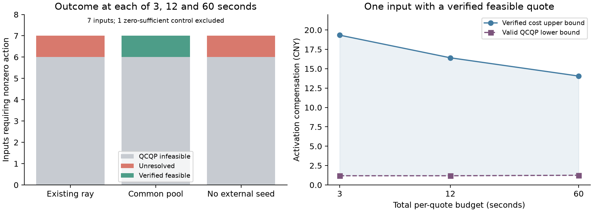

# 同一QCQP下的初值对照

固定8个开发输入，四个网络各2个。选例先检查同一对称恢复约束下是否需要非零动作，再按预锁的历史分组和顺序选择；没有读取实际未来AC结果。所有方法使用同一已封存预测，按08:00时钟对齐并加入相同的已知设备基线。候选、目标、风险分配、费用和资源域均相同，只改变初值。

三种设置分别为：原单个最差比较方向LP加41点线搜索、共享多个资源可行方向、没有外部初值。共享集合包括零动作、固定轮换、至多3个历史主要竞争者的正负预测距离梯度方向，以及旧增量2支持LP，并保留固定四分之一比例点。原资源域对每个点逐一核查，各求解器再检查自身完整证据约束。共享集合平均生成0.0568秒，原单方向流程平均0.2124秒，生成时间均完整计入每个3/12/60秒总预算；缓存没有减免计时。

8个输入中1个零动作已经充分，只核算一次零解并保留为对照。其余7个输入执行7×3种初值×3种预算=63次同问题求解，另有8次旧增量2模型的12秒参考报价。所有记录完成，无程序失败。

|初值设置|3秒：可行／已证不可行／未决|12秒|60秒|
|---|---:|---:|---:|
|原单方向流程|0／6／1|0／6／1|0／6／1|
|共享方向集合|1／6／0|1／6／0|1／6／0|
|无外部初值|0／6／1|0／6／1|0／6／1|

共享集合帮助soumalas11的一个输入找到可行点。该例3秒原样保留可行初值；12和60秒均由原QCQP求解器进一步降低费用。原单方向和无外部初值在60秒内仍未找到可行点，这些超时状态保留为未决。

|共享集合预算|已验证费用上界（元）|有效费用下界（元）|相对差距|实际动作|
|---:|---:|---:|---:|---|
|3秒|19.3315|1.1862|93.86%|保留初值|
|12秒|16.4124|1.1862|92.77%|求解器改进初值|
|60秒|14.0543|1.2489|91.11%|求解器改进初值|

同样的可行性在3秒已找到，但费用界始终很宽；这些报价都是可行费用上界。该结果支持共享初值改善一个难解实例的可行点发现，不支持声称它解决了全局优化或普遍提高辨识恢复。

6个非零动作输入在所有初值设置下都被原QCQP求解器判为不可行，其中5个还能用独立的简单上界证明。设某一对预测距离J受原资源功率边界给出的上界U限制，则

\[
f(J)=h+J-z\sqrt{2J},\qquad
\max_{0\le J\le U} f(J)=\max\{h,h+U-z\sqrt{2U}\}.
\]

因为z为正，f是凸函数，其区间最大值在端点。若这个上界仍小于选模门槛，该对约束在原资源域内就无法满足，增加初值或求解时间均无效。这里证明的是预设风险分配和误差模型下的QCQP不可行；实际AC恢复或精确联合概率要求可能比这些充分条件宽松。

旧增量2参考模型在8个输入中3个可行、5个已证不可行。它的要求与本次对称恢复条件不同，不能根据费用高低直接排名。容易对照中，旧增量要求仍采购，而绝对恢复要求返回零动作。

所有返回点均独立复算直接预测矩阵约束、二次展开、资源约束和费用。完整协议、8个输入来源哈希、初值生成、所有状态、逐点上下界和控制量留在`outputs/absolute_initialization_20261114_v1`。资源共用初值接口见`commonseeds.py`，同问题对照入口见`init_benchmark.py`；本实验没有新增AC日或重新辨识。
