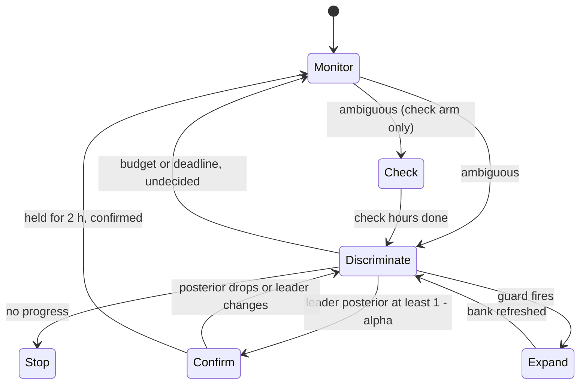

# Safe Market Probing for Sequential Topology Discrimination in Low-Voltage Distribution Grids

*Manuscript draft v3, 2026-11-19, revised 2026-11-20. Method and case-study design only. The design is topology-only and uses active power only. No study results exist yet; Section VIII summarises a design pre-check, not evidence.*

---

**Abstract.** Smart-meter-based identifiers of low-voltage distribution grid (LVDG) topology often end with a small bank of candidate topologies that passive data cannot separate. We propose that the grid operator resolve this ambiguity by *buying* excitation, using only the flexibility that LV networks actually have today. In each market hour the operator buys signed active-power blocks at chosen nodes from an aggregator of household batteries and EV chargers. It then observes the metered response and decides the next hour's purchase. Reactive power is not dispatched, because household inverters run local volt-var control by default and remote reactive set-points exist only in trials.

We formulate the problem as sequential, safety-constrained model discrimination, and approximate it with a five-step loop called PROBE: **P**osterior, **R**egime, **O**ptimal design, **B**ound, **E**xecute. Four elements make the loop work:
- **Branch parameters are nuisance parameters.** Every candidate is refitted on all data and scored with a complexity-penalised evidence, so parameter error is not mistaken for structural evidence. Accurate R or X is never required.
- **Each hour's purchase minimises cost subject to a Bayesian topology condition and safety.** The condition is a Chernoff bound on the marginal posterior. It reduces to the quadratic constraint of frozen-parameter designs when the parameters are known, saturates in directions in which a rival can explain the data by re-tuning its parameters, and becomes a convex quadratic constraint after a variational step. A feasible, monotone sequence of convex programs handles the remaining nonconvexity. Its single-rival frozen core has a closed-form global solution, which supplies the starting plan and a lower bound on the cost.
- **Each probe is a shape times a level κ,** in units of each node's natural variation. This gives closed-form laws for information, evidence, cost and the safe excitation window.
- **Voltage safety is certified over every plausible topology,** not just the leader.

Active power alone suffices, because the resistance matrix carries the full support structure. In a linear-model pre-check with realistic levels (κ = 1.5–3), targeted active-power probes confirmed the true topology in every run and sooner than passive data, without any reactance calibration. Scoring with the frozen passive fit caused wrong confirmations.

**Index terms.** Topology identification, grid probing, optimal experimental design, local flexibility market, sequential hypothesis testing, low-voltage distribution grid.

---

## Nomenclature

| Symbol | Meaning |
| --- | --- |
| $\mathcal N$, $n$ | Metered terminal nodes (root excluded) |
| $t$, $h$, $m$ | 15-min sample, market hour, samples per hour ($m=4$) |
| $x_t=(p_t,q_t)\in\mathbb R^{2n}$ | Metered net consumption (pu, 200 kVA base) |
| $y_{j,t}=v_{0,t}^2-v_{j,t}^2$ | Squared-voltage drop at node $j$ |
| $\mathcal S_k$ | Support family (laminar set of downstream-terminal sets) of candidate $k$ |
| $\theta_k=(r_C,x_C)_{C\in\mathcal S_k}\in\Theta_k$ | Branch parameters (nuisance), bounded; $r_C\ge r_{\min}$ on non-singleton supports |
| $R_{\min}$, $r_{\min}$ | Resistance floor (Ω) and its coefficient, $r_{\min}=2R_{\min}/Z_{\mathrm{base}}$ |
| $H_k=[R_k\ X_k]$ | Response matrix, $R_k=\sum_C r_C z_C z_C^\top$ |
| $\Phi_k(x)$ | Regressor, $H_k(\theta_k)x=\Phi_k(x)\theta_k$; linear in $x$ |
| $u_h\in\mathbb R^n$ | Active-power probe held over hour $h$; + means buy (consumption up) |
| $\sigma_i$, $D_\sigma$ | Training standard deviation of node $i$'s P; $D_\sigma=\mathrm{diag}(\sigma)$ |
| $\bar s$, $\kappa$ | Probe shape ($\lVert\bar s\rVert_\infty=1$) and level, $u=\kappa D_\sigma\bar s$ |
| $A_i^\pm$, $c_i$ | Enrolled active-power headroom, activation price |
| $\pi_k$, $L$, $E_j$ | Posterior weight, leader, log-odds $\ln(\pi_L/\pi_j)$ |
| $\hat\theta_k$, $\Sigma_k$ | Posterior mean and covariance of $\theta_k$ given topology $k$ |
| $U$, $\mu_k(U)$, $S_k(U)$ | Planned probes over the horizon; predictive mean and covariance of the planned measurements under $k$ |
| $\mathcal K_h$, $\mathcal A_h$ | Plausible candidates ($\pi_k\ge0.01$); active rivals |
| $1-\alpha$, $\delta$ | Posterior level for confirmation; allowed probability of missing it by the end of the plan |
| $T_r$, $H_c$, $T_{\max}$ | Planned hours; rolling confirmation target; end of the probing day |
| $\mathcal B_j$, $\gamma_j$, ω | Chernoff exponent against rival $j$; its required level; Chernoff order |
| $\sigma_e$ | Noise of $y$ (≈ $1.4\times10^{-3}$ pu² for two 0.05% voltage meters) |

---

## I. Introduction

Topology knowledge of LVDGs is incomplete: records are outdated, laterals are reconfigured, and customers are reconnected without being documented. Smart-meter data have made data-driven identification practical, for example through voltage-sensitivity estimation and graph learning [5], [6] or structure learning [26]. Passive identification has a basic limit, however. Loads at neighbouring nodes share a daily profile, and meter noise is comparable to the voltage differences between topologies. The identifier of this repository (an RNJ baseline and the MIQP-based WZZT pipeline) therefore often ends with a *bank* of candidate topologies whose fits differ by less than the noise.

Grid probing, in which inverter set-points are deliberately perturbed to reveal topology, has been shown to make topologies identifiable [1]–[4]. Existing probing schemes assume operator-controlled inverters, often with reactive-power set-points, and a one-shot design. Real LV networks offer less:
- household inverters can supply reactive power [13], but they run the local volt-var and volt-watt responses that standards enable by default [14], [15];
- remote reactive set-points have so far been used only in trials [16], [23], [27];
- active power, by contrast, is already dispatched commercially: aggregators run household batteries as virtual power plants (VPPs) [18], and DSOs buy flexibility in local markets [12].

This paper treats probing as **procurement of active power**. In each market hour the operator buys signed P blocks at chosen nodes, observes the response and updates its belief over the candidate bank. It stops when the evidence is decisive, or when probing makes no progress. The contributions are:

1. **Formulation.** Market probing is posed as a sequential, safety-constrained model-discrimination problem, using only controls that exist in today's LV networks, together with a tractable supervised approximation, the PROBE loop.
2. **Parameters as nuisance.** Topology and branch parameters share one hierarchical posterior, and the topology weight integrates the parameters out:
   - the per-hour topology condition is a Chernoff bound on this marginal posterior;
   - it generalises the quadratic constraint of frozen-parameter designs, never certifies evidence that parameter re-tuning can explain, and becomes a convex quadratic constraint after a variational step, so the program is solved by a feasible, monotone sequence of convex programs, started from the closed-form solution of its single-rival frozen core, which also bounds the cost from below;
   - a lemma shows that the resistance matrix alone carries the support structure, so active-power probes suffice and reactance calibration is unnecessary;
   - a proposition shows that against a rival with one extra line, evidence comes from the complexity penalty and the resistance floor rather than from probing. This sets the floor in the refit and a reach test that stops buying against rivals that probing cannot resolve.
3. **Shape–level analysis.** Writing each probe as a shape times a level κ gives closed-form laws:
   - information and evidence grow with κ²;
   - under a quadratic flexibility contract, evidence per unit cost does not depend on κ;
   - five ceilings (headroom, voltage, transformer, unbalance, linearisation) define an excitation window that serves as a feasibility test.
4. **Candidate-robust safety.** Voltage limits are enforced as a chance constraint under every candidate with non-negligible posterior weight, and the safe set provably does not shrink as data accrue.
5. **A realistic resource model and pre-check.** Meter nodes are modelled as clusters of households whose batteries and EV chargers are enrolled with an aggregator at observed participation rates. A pre-check at the resulting levels (κ = 1.5–3) supports the design and exposes its remaining weakness, the case in which the true topology is not in the bank.

## II. Related work

**Passive topology identification.** Smart-meter methods estimate voltage sensitivities and learn a radial graph [5], [6]. Structure-learning methods recover trees from voltage statistics [26]. These methods are limited by the excitation that loads happen to provide.

**Grid probing.** Cavraro and Kekatos perturb inverter injections and infer topology from the voltage deviations [1]. Their graph algorithms [2] and an MILP reformulation [3] followed. Bhela *et al.* analysed identifiability under probing and designed probing injections within inverter and network limits [4]. These works establish probing as an identification tool. They do not price the excitation, adapt it hour by hour, restrict it to the controls that exist today, or certify safety over an uncertain topology.

**Inverter reactive power in practice.** AS/NZS 4777.2:2020 requires volt-var and volt-watt responses to be available and enabled by default [14], [15]. Distribution-network trials have dispatched customer inverters and network-owned batteries for voltage support [16], [23]. Utilities report unreliable communications and resistance from solar owners to remote control, so autonomous curves remain the common practice [27].

**Experimental design and sequential testing.** Optimal designs for discriminating rival models go back to Box and Hill [8] and to the T-optimality criterion of Atkinson and Fedorov [7]. Sequential probability ratio tests are due to Wald [9], BIC as an approximate log marginal likelihood to Schwarz [10], and Chernoff bounds on test error to [29]. Safe exploration with a safe set that grows as the model is learned is studied in [11].

**Local flexibility markets.** Market designs and clearing methods through which DSOs buy flexibility from aggregators are reviewed in [12].

**Gap.** No prior work, to our knowledge, combines market-priced active-power probing, sequential refit-aware discrimination over a structure-learning bank, and safety certified over that bank. This claim still needs a systematic literature check before submission.

## III. System model

### A. Network and measurement

We use the branch-flow model in squared voltages [24]. Summing its branch equations along each root path cancels the intermediate voltages and is exact for a balanced radial feeder. For candidate $k$ and every 15-min sample,

$$
y_t=\sum_{C\in\mathcal S_k} z_C\big(r_C\,z_C^\top \tilde p_t+x_C\,z_C^\top \tilde q_t\big)+\lambda_k(\tilde x_t;\theta_k)+\varepsilon_t
= H_k(\theta_k)\,\tilde x_t+\lambda_k+\varepsilon_t
=\Phi_k(\tilde x_t)\,\theta_k+\lambda_k+\varepsilon_t,
\tag{1}
$$

where:
- $z_C\in\{0,1\}^n$ marks the metered terminals downstream of branch $C$;
- $r_C=2R_C^{\Omega}/Z_{\mathrm{base}}$, and $x_C$ likewise;
- $\tilde x_t$ are the *metered* injections, including any probe and any locally controlled inverter reactive power;
- $\lambda_k(x;\theta)=\sum_Cz_C\big(r_CL^P_C+x_CL^Q_C-\tfrac14(r_C^2+x_C^2)\ell_C\big)$ is the loss term. Here $\ell_C$ is the squared current of branch $C$, and $L^P_C$, $L^Q_C$ are the losses that the branch carries for its downstream branches (closed form in the LaTeX version). The flows are accumulated from the leaves upwards, and the sending-end voltages are taken from the candidate's linear prediction, which leaves an error of third order.

**Why the loss term is kept.** The linearised model (LinDistFlow) drops $\lambda_k$, and that leaves a systematic, load-dependent error rather than noise. A probe's sensitivity on branch $C$ is $r_C$ plus the derivative $J_k=\partial\lambda_k/\partial p$, whose leading part is a fraction $(r_C^2+x_C^2)P_C/(2r_Cv_C^2)$ of $r_C$, with $P_C$ the branch flow. For the backbone cable of Section VII this fraction is about $0.87\,L_CP_C$ ($L_C$ in km, $P_C$ in pu): 1–6% on the head segment between mean and peak load. The error is coherent across hours, so treating it as noise would let it accumulate as false evidence. Because $\lambda_k$ has the support structure of the linear part, (1) is exact for the true candidate. Each refit evaluates $\lambda_k$ at the candidate's previous fit and subtracts it, so the refit stays a QP on the same $p_k$ parameters (Section V-A). Planning linearises $\lambda_k$ at the forecast background, so a probe's sensitivity under candidate $k$ is $R_k+J_k(\hat x_t)$, which moves with the operating point.

Hidden branching nodes are absorbed into the supports. A candidate bank $\mathcal M=\{1,\dots,K\}$ of laminar support families comes from a passive identifier (RNJ or WZZT in this repository).

### B. Controllable resources

Each meter node $i$ is modelled as a cluster of $N_i$ household equivalents behind one service point. The background net load $x_t$ already contains the baseline operation of all devices. The operator can buy deviations from that baseline from an aggregator, which dispatches enrolled household batteries and EV chargers device by device. The aggregator can therefore deliver node-specific blocks within the enrolled envelope

$$
-A_i^{-}\le u_i\le A_i^{+},\qquad
e_{i}(h+1)=e_i(h)+\Delta t\,\eta_i\,u_{i,b}(h),\qquad 0.2\,\bar e_i\le e_i(h)\le0.8\,\bar e_i ,
\tag{2}
$$

where $u_{i,b}$ is the battery part of the block, $\eta_i$ its charge or discharge efficiency and $\bar e_i$ the enrolled energy. EV charging adds upward and downward headroom only while vehicles are plugged in. Section VII gives the sizes.

**Reactive power is not dispatched.** Household inverters keep the local volt-var response that AS/NZS 4777.2:2020 enables by default [14], [15]. Under the Australia A settings this response gives zero reactive power between 220 and 240 V, which is about 0.953–1.039 pu on a 230.9 V base. The operator keeps every probe inside this deadband (Section IV-C), so the local responses stay inactive. Any inverter reactive power that does occur is metered and enters (1) through $\tilde x_t$, so it does not bias the fit.

### C. Market, contract and timing

The operator (a DSO, or an aggregator acting for it) buys two products:

| Product | Physical source | Root effect |
| --- | --- | --- |
| P block | Battery charge or discharge, EV charging start, pause or shift | ± energy at the transformer |
| Zero-sum P swap | P blocks at two node sets, equal and opposite | None, to first order |

Activation is paid through the prepaid quadratic contract of the repository's resource library:

$$
C_h(u)=\Delta t\sum_i c_i\Big(\frac{(u_i^+)^2}{A_i^+}+\frac{(u_i^-)^2}{A_i^-}\Big).
\tag{3}
$$

Here $u_i^\pm\ge0$ are the upward and downward activations requested at node $i$, with $u_i=u_i^+-u_i^-$; both are paid.

Blocks for hour $h+1$ are sealed at the start of hour $h$, using data up to the end of hour $h-1$. Delivery is $a\odot u$ with an unknown gain $a\in[0.9,1]$. Because (1) uses metered injections, a delivery shortfall weakens the excitation but never biases the fit.

## IV. Problem formulation

*Derivations.* The LaTeX version ([`paper/probe_method.tex`](paper/probe_method.tex)) has a derivation outline (Section II: a flow figure, assumptions A1–A7, and a table that traces every term of the final convex subproblem to the formula that produces it) and an appendix with the proofs specific to this paper. It fixes the Chernoff order at ω = ½ throughout. This section states the results.

### A. One posterior for topology and parameters

The unknowns are hierarchical: a discrete topology $k\in\mathcal M$ and, given $k$, continuous branch parameters $\theta_k$. With Gaussian noise in (1) and a Gaussian prior $\theta_k\sim\mathcal N(\theta_k^0,\Sigma_k^0)$ taken from the passive fit, the joint posterior is

$$
p(k,\theta_k\mid\mathcal D)=\pi_k\,\mathcal N\big(\theta_k;\hat\theta_k,\Sigma_k\big),\qquad
\Sigma_k=\Big(\Sigma_k^{0\,-1}+\tfrac{1}{\sigma^2}\Phi_k^\top\Phi_k\Big)^{-1},\qquad
\pi_k\propto\pi_k^0\!\int p(\mathcal D\mid k,\theta)\,p(\theta\mid k)\,d\theta .
\tag{4}
$$

The topology weight is a *marginal* likelihood: R/X are integrated out, not plugged in. Its sequential form shows how:

$$
\ln p(\mathcal D\mid k)=\sum_t\ln\mathcal N\Big(y_t;\ \Phi_k(\tilde x_t)\hat\theta_k^{(t-1)},\ \sigma^2I+\Phi_k(\tilde x_t)\Sigma_k^{(t-1)}\Phi_k(\tilde x_t)^\top\Big).
\tag{5}
$$

Each new sample is scored against the candidate's predictive distribution. Its covariance carries the parameter uncertainty, and with it the Occam factor that penalises flexible structures. A plug-in score drops this term, which is why it favours spurious splits (Section VIII). With box bounds on θ, (4)–(5) hold approximately on the free coordinates.

For operations, what matters is the response matrix $H$. The law of total covariance splits its uncertainty into two parts:

$$
\operatorname{Cov}[\operatorname{vec}H\mid\mathcal D]
=\underbrace{\sum_k\pi_k\operatorname{Cov}[\operatorname{vec}H_k\mid k,\mathcal D]}_{\text{within topology}}
+\underbrace{\sum_k\pi_k\,\Delta_k\Delta_k^\top}_{\text{between topologies}},
\qquad \Delta_k=\operatorname{vec}(\hat H_k-\bar H),\ \ \bar H=\sum_k\pi_k\hat H_k .
\tag{6}
$$

**This design buys only the second term.** The first term, R/X accuracy within a topology, is reported but not purchased, for two reasons:
- the topology decision already integrates over it (Proposition 5);
- reactance cannot be excited without reactive power (Proposition 1).

### B. Ideal problem

Let the belief at the gate be $b_h=(\pi_h,\{\hat\theta_k,\Sigma_k\}_k,\hat\sigma^2)$, the posterior (4). The operator chooses probes $\{u_h\}$ and a stopping time τ to solve

$$
\min_{\{u_h\},\tau}\ \mathbb E\Big[\sum_{h<\tau}C_h(u_h)+\lambda_{\mathrm w}\mathbf 1\{\text{wrong confirmation}\}+\lambda_\tau\tau\Big]
\quad\text{s.t.}\quad u_h\in\mathcal U^{\mathrm{safe}}_h(b_h),\ \ \sum_hC_h(u_h)\le B .
\tag{7}
$$

Problem (7) is a partially observed sequential decision problem. Its belief ranges over 40–60 candidates, its actions are continuous, and its observations are delayed. We do not solve it exactly. Instead, $\lambda_{\mathrm w}$ is replaced by the confirmation level $1-\alpha$, $\lambda_\tau$ by a rolling confirmation target $H_c$ within the day's deadline $T_{\max}$, and the cost by hourly and daily caps. Section IV-C turns these thresholds into the constraints of a per-gate program, and Section V embeds it in a supervised loop.

### C. Per-gate dispatch program

At each gate the operator plans the hours $\mathcal H=\{h+1,\dots,h+T_r\}$ up to a rolling confirmation target, $T_r=\min\{H_c,T_{\max}-h\}$, with $H_c=2$ h by default and $T_{\max}$ the end of the probing day. It executes only the first block (receding horizon). The target sets the pace of probing: against a distant deadline, the background alone can meet (9b), and nothing would be bought. Stack the planned probes $U=(u_\tau)_{\tau\in\mathcal H}$ and the forecast background $\hat X$. Under candidate $k$, the planned measurements have the predictive distribution

$$
y_{\mathcal H}\mid\mathcal D,k\ \sim\ \mathcal N\big(\mu_k(U),S_k(U)\big),\qquad
\mu_k(U)=\Phi_k(\hat X+U)\,\hat\theta_k+\lambda_k(\hat X)+J_k(\hat X)\,u,\qquad
S_k(U)=\hat\sigma^2I+\Phi_k(\hat X+U)\,\Sigma_k\,\Phi_k(\hat X+U)^\top .
\tag{8}
$$

Here $\lambda_k$ and $J_k$ are evaluated at $\hat\theta_k$, and the loss term is linearised at the forecast background. $\mu_k$ is affine in $U$, and $S_k$ is a convex quadratic matrix function of $U$. Probes enter only the P channels, so they change only the $r$ columns of $\Phi_k$ and, through $J_k$, the loss term. The dependence of $\lambda_k$ on θ is left out of $S_k$; it is of the order of the loss fraction above. Because all hours share $\theta_k$, $S_k$ couples the hours of the plan.

The program is

$$
\begin{aligned}
\min_{U}\quad & \textstyle\sum_{\tau\in\mathcal H}C_\tau(u_\tau) && \text{(9a) procurement cost (3)}\\
\text{s.t.}\quad & \mathcal B_j(U)\ \ge\ \gamma_j,\quad j\in\mathcal A_h && \text{(9b) topology}\\
& \Pr\nolimits_k\{\underline v+\mu\le v_{j,t}(u_t)\le\bar v-\mu\}\ \ge\ 1-\epsilon_V,\quad k\in\mathcal K_h,\ \forall j,t && \text{(9c) voltage}\\
& u_\tau\in\mathcal U^{\mathrm{dev}}_\tau\ \text{by (2)},\quad (P_{0,t}+\mathbf 1^\top u_t)^2+Q_{0,t}^2\le\bar S^2 && \text{(9d) devices, transformer}\\
& C_\tau(u_\tau)\le B_h,\quad \textstyle\sum_\tau C_\tau(u_\tau)\le B-B^{\mathrm{spent}} && \text{(9e) budget}
\end{aligned}
$$

**Objective (9a).** The objective is the activation cost of the contract (3), which is convex quadratic in $U$. Information enters as a constraint rather than as a weighted objective, so the solution reads directly: *the cheapest safe purchase that makes the posterior decisive by the end of the plan.* If (9) is infeasible, a penalised slack on (9b) turns it into "most progress per CNY". Persistent infeasibility means the excitation window is empty (Remark 1, Section VI).

**Topology condition (9b): the Bayesian condition.** The target is $\pi_L\ge1-\alpha$ at the end of the plan, with probability at least $1-\delta$ under the leader's predictive distribution. Let $\Delta L_j=\ln p(y_{\mathcal H}\mid\mathcal D,L)-\ln p(y_{\mathcal H}\mid\mathcal D,j)$ be the log ratio of the predictive densities (8). Then $\pi_L^+<1-\alpha$ holds exactly when $\sum_je^{-E_j-\Delta L_j}>\alpha/(1-\alpha)$. Markov's inequality applied to the ω-th power, $0<\omega<1$, gives the same union bound as the repository's earlier posterior-procurement derivation (`unified_posterior_dr_20261112`):

$$
\Pr\nolimits_L\{\pi_L^+<1-\alpha\}\le\sum_{j\ne L}c_j\,e^{-\mathcal B_j(U)},\qquad
c_j=\Big(\tfrac{1-\alpha}{\alpha}\Big)^{\omega}e^{-\omega E_j},\qquad
\mathcal B_j(U)=-\ln\mathbb E_L\big[e^{-\omega\Delta L_j}\big].
\tag{10}
$$

For Gaussian predictives, $\mathcal B_j$ is the Chernoff divergence of order ω between them [29]:

$$
\mathcal B_j(U)=\frac{\omega(1-\omega)}{2}\,\Delta\mu_j^\top S_{j\omega}^{-1}\Delta\mu_j
+\frac12\ln\frac{\det S_{j\omega}}{(\det S_L)^{\omega}(\det S_j)^{1-\omega}},
\tag{11}
$$

where $\Delta\mu_j=\mu_L(U)-\mu_j(U)$ and $S_{j\omega}=\omega S_L(U)+(1-\omega)S_j(U)$.

The admissible failure probability is split among the active rivals $\mathcal A_h$, with $\sum_{j\in\mathcal A_h}\delta_j=\delta-R_{\mathrm{tail}}$. Here $R_{\mathrm{tail}}=\sum_{j\notin\mathcal A_h}c_j$ bounds the remaining rivals for every $U$, because $\mathcal B_j\ge0$. The active set takes the non-equivalent rivals that probing can still reach today (the reach test of Section V-C) in increasing $E_j$ until $R_{\mathrm{tail}}\le\delta/2$, and the rest of δ = 0.1 is split equally, so $\delta_j$ lies between 0.017 and 0.1 for one to three active rivals. This split gives the required level

$$
\gamma_j=\ln\frac{c_j}{\delta_j}=\omega\Big(\ln\frac{1-\alpha}{\alpha}-E_j\Big)+\ln\frac1{\delta_j},
\tag{12}
$$

which for α = 0.05 is $\omega(\ln19-E_j)+\ln(1/\delta_j)$. The design uses ω = ½, for which (11) is the Bhattacharyya distance between the two predictives. Rivals that are operationally equivalent to the leader (Section V-B) are left out.

*How parameter uncertainty enters.* If R/X were known ($\Sigma_k=0$), then $S_L=S_j=\hat\sigma^2I$ and (11) collapses to

$$
\mathcal B_j^{\mathrm{frozen}}(U)=\frac{\omega(1-\omega)}{2\hat\sigma^2}\,\big\lVert(H_L-H_j)(\hat X+U)\big\rVert^2 .
\tag{13}
$$

This is the quadratic constraint of the repository's earlier procurement designs (ω = ½ gives the factor 1/8). With the loss terms of (1), $(H_L-H_j)(\hat X+U)$ is replaced by $\Delta\mu_j(U)$. It grows as κ² in every direction, including directions in which rival $j$ could match the leader by re-tuning its parameters, so evidence bought there is really parameter error. In (11), the term $\Phi_j\Sigma_j\Phi_j^\top$ inside $S_j$ grows in exactly those directions, so the evidence saturates (Proposition 5).

**Voltage condition (9c).** Under (4), the voltage change that $u_t$ causes under candidate $k$ is Gaussian. Its mean is $g_{kj}(u_t)=-\big(\phi_{kj}(u_t)^\top\hat\theta_k+[J_k(\hat x_t)u_t]_j\big)/(2\hat v_j)$ and its standard deviation is $\beta_{kj}(u_t)=\lVert\Sigma_k^{1/2}\phi_{kj}(u_t)\rVert/(2\hat v_j)$, where $\phi_{kj}^\top$ is row $j$ of $\Phi_k$. Probes enter only the $r$ columns, so only the resistance part of $\Sigma_k$ matters here. With z = 2.33, (9c) is the second-order cone pair

$$
\hat v^{+}_{j,t}+g_{kj}(u_t)+z\,\beta_{kj}(u_t)\le\bar v-\mu,\qquad
\hat v^{-}_{j,t}+g_{kj}(u_t)-z\,\beta_{kj}(u_t)\ge\underline v+\mu,
\tag{14}
$$

imposed for every plausible candidate $k\in\mathcal K_h$. The effective band is $[\underline v+\mu,\bar v-\mu]=[0.96,1.035]$ pu: the 0.95–1.05 pu planning band with a 0.01 pu margin, with the top edge lowered so that household volt-var stays inside its deadband (Section III-B). The device envelope (2), the transformer disc and the budgets are linear or convex quadratic.

**Coupling and modes.** Data shrink $\Sigma_k$, which widens the cones (14) (Proposition 4). For fixed predictive means, it also raises $\mathcal B_j$ against rivals that differ structurally. Discrimination removes candidates from $\mathcal K_h$ and drops their cones. When no rival is active, $U=0$.

### D. Handling the nonconvexity

The ideal problem (7) and the program (9) contain six sources of nonconvexity. Modelling choices remove five of them; only the topology condition (9b) needs an algorithm.

| Source | Why it is nonconvex | Treatment | Status |
| --- | --- | --- | --- |
| Sequential decision (7) | Belief-state control over 40–60 topologies | Thresholds α, $T_{\max}$ and caps replace the penalties; receding horizon (Section IV-B) | Approximation; no optimality claim for (7) |
| Topology choice | Discrete | Finite bank, enumerated; $\pi_k$ in closed form by (4)–(5) and (17). Program (9) has no integer variables | Exact |
| Parameters × injections, $H_k(\theta)\tilde x$ | Bilinear | At the gate, $\hat\theta_k$ and $\Sigma_k$ are fixed and θ is integrated out, so $\mu_k$ is affine and $S_k$ convex quadratic in $U$ (8). The refit after each hour is a convex QP on fixed supports (16) | Exact under the Gaussian model |
| AC power flow | Nonconvex equalities | Branch-flow model (1): the loss term is fixed at the previous fit in the refit and linearised at the forecast in planning; margin μ = 0.01 pu; the remainder is capped through $\kappa_L$ (27); every executed block is checked against AC | Approximation, checked after the fact |
| Device granularity | One battery cannot charge and discharge at once; EV charging cannot run below its 6 A minimum | Each node's envelope (2) is continuous, with upward and downward activations $u_i^\pm\ge0$ both paid by (3). Using both at once means one household battery charges while another discharges, which a cluster allows. The aggregator rounds EV requests towards zero, the rounded block is re-checked (Section V-D), and the residual is metered through $\tilde x_t$ | Relaxation a cluster can deliver; the residual weakens the probe but never biases the fit |
| Topology condition (9b) | $\mathcal B_j^{\mathrm{frozen}}$ is convex in $U$, so (9b) asks $U$ to stay *outside* a convex "blind zone": a reverse-convex constraint. With $\Sigma\ne0$, $\mathcal B_j$ is neither convex nor concave | Steps 1–4 below | Conservative; locally optimal, with a reported gap |

**Step 1: drop the log-determinant term (conservative).** By concavity of ln det, the second term of (11) is non-negative, and it is zero when Σ = 0. Hence

$$
\mathcal B_j(U)\ \ge\ \tfrac{\omega(1-\omega)}{2}\,q_j(U),\qquad
q_j(U)=\Delta\mu_j(U)^\top S_{j\omega}(U)^{-1}\Delta\mu_j(U).
\tag{15a}
$$

The dropped term is the evidence carried by differences in predictive spread. P-only probes create little of it, because only the resistance block of Σ enters.

**Step 2: a concave minorant that touches.** For $S\succ0$, $a^\top S^{-1}a=\max_w\,(2w^\top a-w^\top Sw)$, attained at $w=S^{-1}a$ [31]. This is the quadratic transform of fractional programming [32]. For a fixed vector $w_j$, let

$$
s_j(U;w_j)=2w_j^\top\Delta\mu_j(U)-\hat\sigma^2\lVert w_j\rVert^2-\omega\big\lVert\Sigma_L^{1/2}\Phi_L(\hat X+U)^\top w_j\big\rVert^2-(1-\omega)\big\lVert\Sigma_j^{1/2}\Phi_j(\hat X+U)^\top w_j\big\rVert^2 .
\tag{15b}
$$

Three facts make $s_j$ a valid surrogate for $q_j$:
- **Minorant:** $s_j(U;w_j)\le q_j(U)$ for every $U$ and every $w_j$.
- **Touching:** at $w_j^\star(U_i)=S_{j\omega}(U_i)^{-1}\Delta\mu_j(U_i)$, $s_j(U_i;w_j^\star)=q_j(U_i)$.
- **Tangent:** the maximiser is unique, so by Danskin's theorem $\nabla_Us_j(U_i;w_j^\star)=\nabla q_j(U_i)$.

Because $\Phi_k$ is linear in its argument, $s_j$ is affine minus convex quadratic in $U$, that is, concave. The constraint

$$
\tfrac{\omega(1-\omega)}{2}\,s_j(U;w_j)\ \ge\ \gamma_j
\tag{15c}
$$

is therefore a **convex quadratic constraint** (one rotated second-order cone), and by (15a) it implies (9b). The Bayesian condition is still a QC, as in the earlier designs, but now a convex one that carries the parameter uncertainty:
- The vector $w_j^\star$ is the whitened refit residual: the direction in measurement space in which leader and rival still disagree after the rival has re-tuned its parameters.
- The two norm terms subtract exactly the part of that disagreement that re-tuning can explain.
- With $\Sigma=0$, (15c) is the tangent half-space of the frozen QC (13): the classical convex–concave linearisation of a reverse-convex constraint [28].

**Step 3: a sequence of convex programs.**
1. Start from $U_0$: one of the starts of Step 4, scaled along its ray until it meets the conservative condition.
2. At iterate $U_i$, set $w_j=w_j^\star(U_i)$ for every active rival.
3. Solve the convex program (9a), (15c), (9c)–(9e) to get $U_{i+1}$.
4. Stop when the cost falls by less than 10⁻⁴ (relative) or after 20 iterations, and submit $u_{h+1}$.

The three facts give the standard guarantees of inner-approximation methods [28], [33]:
- **Feasibility:** every iterate satisfies the exact condition (9b), since $\mathcal B_j\ge\tfrac{\omega(1-\omega)}{2}q_j\ge\tfrac{\omega(1-\omega)}{2}s_j\ge\gamma_j$.
- **Monotone cost:** by touching, $U_i$ is feasible for subproblem $i+1$, so the cost never increases.
- **Convergence:** the cost is bounded below by zero, so it converges. Under a constraint qualification, every limit point is a KKT point of the *conservative program*: (9) with $\mathcal B_j$ replaced by the right side of (15a).
- **Not guaranteed:** global optimality.

**Step 4: starts and a lower bound.** The reverse-convex set has separate lobes: a rival can be separated by buying at one node or another, in one hour or another, with either sign. The sequence stays in the lobe of its start. A relaxation with a closed-form global solution picks the lobe and bounds the cost.

Since $S_{j\omega}\succeq\hat\sigma^2I$, $q_j(U)\le\lVert\Delta\mu_j(U)\rVert^2/\hat\sigma^2$, which is the frozen quadratic (13) with the refitted responses $\hat H_k$. By (8), $\Delta\mu_j(U)=d_j+D_ju$ with $u=\operatorname{vec}U$:
- $d_j=\Delta\mu_j(0)$ is the leader–rival difference under the forecast background alone;
- $D_j$ applies the operating-point difference $\Delta R_{j,t}=R_L(\hat\theta_L)+J_L(\hat x_t)-R_j(\hat\theta_j)-J_j(\hat x_t)$ to the probe of planned sample $t$.

The cost satisfies $\sum_\tau C_\tau(u_\tau)\ge u^\top Wu$ with $W=\Delta t\,\mathrm{diag}\big(c_i/\max(A_i^+,A_i^-)\big)$ in each hour, because $(u_i^+)^2+(u_i^-)^2\ge u_i^2$. Keeping one rival and dropping (9c)–(9e) gives the **core problem**

$$
C_j^{\mathrm{core}}=\min_u\ u^\top Wu\quad\text{s.t.}\quad\lVert d_j+D_ju\rVert^2\ \ge\ \hat\sigma^2\eta_j,\qquad \eta_j=\frac{2\gamma_j}{\omega(1-\omega)} .
\tag{15d}
$$

It has one quadratic objective and one quadratic constraint, so the S-lemma gives zero duality gap [31], [34]. If $\lVert d_j\rVert^2\ge\hat\sigma^2\eta_j$, then $C_j^{\mathrm{core}}=0$. Otherwise its global minimiser is

$$
u_j(\lambda)=\lambda\big(W-\lambda D_j^\top D_j\big)^{-1}D_j^\top d_j ,
\tag{15e}
$$

where $\lambda\in(0,1/\nu_1)$ is the unique root of $\lVert d_j+D_ju_j(\lambda)\rVert^2=\hat\sigma^2\eta_j$ and $\nu_1$ is the largest eigenvalue of $W^{-1}D_j^\top D_j$. If no root exists (the hard case of trust-region problems [34]), λ = 1/ν₁ and a multiple of the top generalised eigenvector is added. With $d_j=0$, the minimiser is the top generalised eigenvector of $(D_j^\top D_j,W)$, scaled to meet the constraint, and $C_j^{\mathrm{core}}=\hat\sigma^2\eta_j/\nu_1$.
- **Cheap.** $W$ and $D_j^\top D_j$ are block diagonal over the hours, so (15e) needs only $n\times n$ solves.
- **Interpretable.** In hour τ, $u_\tau=\lambda\big(W_\tau-\lambda\sum_{t\in\tau}\Delta R_{j,t}^\top\Delta R_{j,t}\big)^{-1}\sum_{t\in\tau}\Delta R_{j,t}^\top d_{j,t}$, where $d_{j,t}$ is the part of $d_j$ at sample $t$. The core plan reinforces the leader–rival difference that the background already produces, weighted by price. It concentrates on the nodes at which the refitted sensitivities differ, which is where the dictionary's group blocks are placed. For $d_j\ne0$ its sign is fixed.
- **Lower bound.** Every plan that is feasible for the conservative program meets (15d) and costs at least $u^\top Wu$, so

$$
C^{\mathrm{LB}}=\max_{j\in\mathcal A_h}C_j^{\mathrm{core}}\ \le\ C^\star_{\mathrm{cons}}\ \le\ C^{\mathrm{seq}},
\tag{15f}
$$

where $C^{\mathrm{seq}}$ is the cost the sequence returns. The bound is exact when one rival is active, $A_i^+=A_i^-$, $\Sigma_k=0$, and the core plan meets (9c)–(9e).

**Multiple starts.** The sequence is run from the core plan of each active rival, the dictionary plan (23), and the previous plan shifted by one hour. Each start is first scaled along its ray to the smallest level that meets the conservative condition for every active rival, a one-dimensional search; the dictionary plan already lies at that level. A start is dropped if that level violates (9c)–(9e). Whenever the dictionary plan meets the condition, the returned plan therefore costs no more than it: $C^{\mathrm{LB}}\le C^{\mathrm{seq}}\le C^{\mathrm{dict}}$. The cheapest result is kept, and the relative gap $(C^{\mathrm{seq}}-C^{\mathrm{LB}})/C^{\mathrm{seq}}$ is reported for every planned block:
- a small gap certifies that the plan is close to globally optimal for the conservative program;
- a large gap is inconclusive, because it mixes local optimality with what the core problem ignores: saturation, the other rivals, unequal up and down headroom, and the limits (9c)–(9e).

Where Gurobi is available, its spatial branch-and-bound (NonConvex = 2, as in the repository's earlier designs) can bound the frozen program on small validation cases. The Bayesian condition (11) itself cannot be passed to such a solver: it contains the inverse and log-determinant of quadratic matrix functions of $U$, not quadratic forms.

**Infeasible starts and fallbacks.** If no start survives the scaling, slacks $\xi_j\ge0$ enter (15c) with a penalty $\lambda_{\mathrm{pen}}\sum_j\xi_j$, and $\lambda_{\mathrm{pen}}$ doubles each iteration up to a cap (the penalty variant of [28]). If slack remains at convergence, (9) is infeasible at this gate, and the slack solution is the "most progress per CNY" plan of Section IV-C. If the sequence fails (solver error, the 60 s planning cap, or a failed check in Section V-D), the first block of the dictionary plan is executed, and if that also fails, zero. Refinement therefore never weakens the safety logic, and it never costs more than its scaled start.

**Effort and quality.**
- *Effort.* Each subproblem has $2nT_r$ non-negative variables (72 for the default $H_c=2$ h and $n\le18$; 432 for a 12-h target), two cones of dimension at most $p_k+2$ per active rival, and the voltage cones. Each $w_j^\star$ needs one Cholesky factorisation of $S_{j\omega}$, which is $mnT_r$ square (144, or 864 for 12 h). The core plans need one $n\times n$ generalised eigenproblem per hour and rival, and the restricted planner (23) a few dozen evaluations of $q_j$ per shape and rival. Every iterate is feasible, so the sequence can be stopped at any iteration, for example at the 60 s planning cap, and still returns a safe plan that meets (9b). These sizes suggest seconds per gate with open-source conic solvers. Planning needs neither Gurobi nor a nonconvex QCQP solver. Neither the sizes nor the solvers have been tested.
- *What limits the cost of the plan.* Three things separate the returned cost from that of the cheapest plan that meets the target: local optimality, bounded by (15f); the dropped log-determinant term; and the Chernoff bound (10)–(12) itself. Only the last can be computed in advance. In the frozen single-rival case with ω = ½, the log-likelihood ratio $\Delta L_j$ is Gaussian with mean $D$ and variance $2D$, where $D=q_j/2$. The exact chance constraint is then $D-z_\delta\sqrt{2D}\ge\ln19-E_j$, with $z_\delta$ the standard normal $(1-\delta_j)$-quantile, whereas (12) asks for $D\ge2(\ln19-E_j)+4\ln(1/\delta_j)$. For $\ln19-E_j$ between 1 and 3 and $\delta_j$ between 0.017 and 0.1, the bound asks for 1.5–2.2 times the information, and hence the cost, of the exact constraint. Optimising ω instead of using ½ saves less than 5%. This is the price of a guarantee that still holds when the parameters are uncertain, where $\Delta L_j$ is not Gaussian.

## V. The PROBE method

Each hour runs five steps (Fig. 1), and a supervisor switches between six modes (Fig. 2).


*Fig. 1. The hourly PROBE loop.*

### A. Posterior (P)

Every candidate is refitted on all data available at the gate by exact bounded least squares, warm-started from its previous fit $\hat\theta_k^-$ (initially the passive identifier's fit). The loss term is evaluated at $\hat\theta_k^-$ and subtracted, a fixed-point step that keeps the refit a QP; with warm starts one step per hour suffices, and three are used at the first gate:

$$
\hat\theta_k=\arg\min_{\theta\in\Theta_k}\ \mathrm{SSE}_k(\theta)=\sum_{t}\lVert y_t-\lambda_k(\tilde x_t;\hat\theta_k^-)-\Phi_k(\tilde x_t)\theta\rVert^2 .
\tag{16}
$$

The set $\Theta_k$ keeps the passive identifier's box bounds and adds a resistance floor $r_C\ge r_{\min}$ on every non-singleton support, with $r_{\min}=2R_{\min}/Z_{\mathrm{base}}$:
- $R_{\min}$ is the resistance of the shortest internal segment the operator's records allow. The default is 0.003 Ω, the identifier's recommended floor.
- The floor is a bound, not a deletion. A branch at its floor stays in the candidate, so a candidate with an extra line remains the hypothesis that the line exists and is at least $R_{\min}$. Deleting the branch during the day would silently turn the candidate into another one.
- Reactance has no floor, because P-only probes inform only the resistance block.

Proposition 6 shows why the floor matters: against a rival with one extra line, probing can add evidence only through it.

Refitting is computation, not procurement. Each candidate is then scored with the Schwarz criterion [10], the large-sample form of (5):

$$
J_k=\frac{\mathrm{SSE}_k(\hat\theta_k)}{2\hat\sigma^2}+\tfrac12p_k\ln N,\qquad
\hat\sigma^2=\min_k\frac{\mathrm{SSE}_k}{N-p_k},\qquad
\pi_k\propto\pi_k^0e^{-J_k},\qquad E_j=J_j-J_L .
\tag{17}
$$

Here $p_k=2\lvert\mathcal S_k\rvert$, $N$ is the number of scalar residuals, and $L=\arg\min_kJ_k$ is the leader. Under a flat prior, the parameter covariance on the free (non-floored) coordinates is

$$
\Sigma_k=\hat\sigma^2\big(\Phi_k^\top\Phi_k\big)^{-1}.
\tag{18}
$$

### B. Regime (R): trigger, modes, stopping, progress and guard

**Trigger.** Probing is armed while some rival that is not operationally equivalent to the leader has $E_j<\ln19$. Two candidates are operationally equivalent when their refitted voltage predictions over the forecast day differ by at most the meter resolution:

$$
k\sim L\iff\max_{t,j}\big\lvert\hat v^{(k)}_{j,t}-\hat v^{(L)}_{j,t}\big\rvert\le\varepsilon_V .
\tag{19}
$$

Exact-topology accuracy is still reported.

**Modes.**



*Fig. 2. Supervisor modes. "Stop" ends buying for the day and reports "unresolved, possible model mismatch".*

**Stopping.** The leader is confirmed when

$$
\pi_L\ \ge\ 1-\alpha\quad\Longleftrightarrow\quad \sum_{j\ne L,\ j\nsim L}e^{-E_j}\le\frac{\alpha}{1-\alpha}
\tag{20}
$$

holds for two consecutive hours, with α = 0.05. Each pairwise term then satisfies $E_j\ge\ln19$, which is Wald's threshold $\ln\frac{1-\beta}{\alpha}$ for α = β = 0.05 [9]. The pre-check used only the pairwise condition; the aggregate form (20) is stricter.

**No-progress rule.** Let $G_h=\min_{j\in\mathcal A_h}E_j$ be the log-odds of the closest active rival. If $G$ has risen by less than $\Delta E_{\min}=1$ over the last $H_{\mathrm{np}}=6$ probed hours, buying stops for the day and the input is reported as unresolved. In the pre-check, runs whose true topology was missing from the bank kept buying for about 20 h without progress. The rule caps that waste and doubles as a mismatch flag.

**Guard and bank expansion.** For a nested local extension of the leader with extra parameters ψ (a new support, or a split of an existing one), the Rao score statistic [30] needs no refit:

$$
\mathrm{LM}=g_\psi^\top\big(\mathcal I_{\psi\psi}-\mathcal I_{\psi\theta}\mathcal I_{\theta\theta}^{-1}\mathcal I_{\theta\psi}\big)^{-1}g_\psi,\qquad
g_\psi=\partial_\psi\log\ell\,\big|_{\hat\theta_L,\psi=0}.
\tag{21}
$$

If LM > χ²₂,₀.₉₉ = 9.21 for two consecutive hours, that neighbour joins the bank. Non-nested neighbours (moving or swapping a leaf, dropping a support) are few enough to refit directly.

### C. Optimal design (O)

**Shape–level decomposition.** Every probe is written as $u_h=\kappa_h D_\sigma\bar s_h$ with $\lVert\bar s_h\rVert_\infty=1$. The shape $\bar s_h$ chooses the nodes and signs, and the level $\kappa_h$ says how hard, in units of each node's natural variation.

**Restricted design.** The default planner solves the program (9) restricted to rays. A shape $\bar s$ from a dictionary $\mathcal D_h$ is held at one level over the planned hours, $U(\kappa;\bar s)=(\kappa D_\sigma\bar s,\dots,\kappa D_\sigma\bar s)$. Its level is the smallest that meets the conservative topology condition (15a) for every active rival:

$$
\kappa_{\mathrm{need}}(\bar s)=\min\big\{\kappa\ge0:\ q_j\big(U(\kappa;\bar s)\big)\ge\eta_j\ \ \forall j\in\mathcal A_h\big\}.
\tag{22}
$$

The planner keeps the cheapest shape whose level lies inside its excitation window (28):

$$
\bar s_h=\arg\min_{\bar s\in\mathcal D_h}\ \kappa_{\mathrm{need}}(\bar s)^2\,c(\bar s)\quad\text{s.t.}\quad\kappa_{\mathrm{need}}(\bar s)\le\kappa_{\max}(\bar s),
\tag{23}
$$

where:
- $\mathcal D_h$ is the dictionary of single-node ±P blocks, plus group ±P blocks on the nodes whose upstream path differs between the leader and each active rival;
- $c(\bar s)$ is the hourly cost at unit level (Proposition 3), so the plan costs $T_r\kappa^2c(\bar s)$;
- $\eta_j$ is the level of (15d), $8\gamma_j$ for ω = ½.

Problem (23) is solved by enumeration. For each shape, $q_j$ is evaluated on a grid of $[0,\kappa_{\max}(\bar s)]$ and the first crossing is refined by bisection. Each evaluation needs one Cholesky factorisation of $S_{j\omega}$. Along a ray, $q_j$ need not be monotone, because a probe that opposes the background difference $d_j$ first lowers it. It can also stay below $\eta_j$ at every level, when parameter changes that the passive data find plausible make the two candidates agree along the shape (Proposition 2); such a shape is not admissible. The block is zero if the background alone meets the condition. If no shape is admissible, the planner takes the shape with the largest $\min_jq_j/\eta_j$ at its ceiling, which is the ray version of the slack fallback of (9).

**Reach test.** Before the active set is formed, each non-equivalent rival is tested for whether the dictionary can still resolve it before the end of the day. Its reach is

$$
\bar Q_j=\sum_{\tau=h+1}^{T_{\max}}\ \max_{\bar s\in\mathcal D_h}\ \max\big\{q_{j,\tau}^0(0),\ q_{j,\tau}^0\big(\bar\kappa_\tau(\bar s)D_\sigma\bar s\big)\big\},
$$

where:
- $q_{j,\tau}^0=\lVert\Delta\mu_{j,\tau}\rVert^2/\hat\sigma^2$ is the frozen form of the condition for hour τ;
- $\bar\kappa_\tau(\bar s)$ is the ceiling of hour τ alone, from headroom, voltage, transformer, unbalance and linearisation, with energy and caps dropped.

$\bar Q_j$ bounds $q_j$ for every dictionary plan of the day, even one that changes shape every hour, for three reasons:
- $\bar S_j\succeq\hat\sigma^2I$ gives $q_j\le q_j^0$;
- $q_j^0$ is additive over samples;
- $q_j^0$ is convex along a ray, so its maximum on $[0,\bar\kappa_\tau]$ lies at an end.

A rival with $\bar Q_j<\eta_j$ at the most lenient share $\delta_j=\delta$ is *beyond probing reach*:
- it is left out of $\mathcal A_h$, and its $c_j$ is added to $R_{\mathrm{tail}}$;
- if these terms alone exceed δ/2, the active-set rule cannot be met and the gate buys nothing;
- it stays in the stopping rule (20), so its evidence can come only from the penalty and passive data;
- if the day ends unconfirmed while such a rival has $E_j<\ln19$, the input is reported as "unresolved: beyond probing reach".

The typical rival beyond reach is the leader plus one extra branch held at its floor (Proposition 6). The test costs one frozen evaluation per shape, rival and remaining hour.

*Same requirement as the full program.* An admissible plan is feasible for the conservative program, so it is also a valid start of the sequence (Section IV-D), and refinement can only lower its cost. The pre-check's solver was different (Section VIII). It scored blocks by the expected refit-aware evidence gain, with the leader's prediction taken as exact, and scaled them to an expected evidence of $\ln19-E_j$ within two hours. Condition (15a) asks for that evidence with probability at least $1-\delta_j$. In the frozen single-rival case this takes $2+4\ln(1/\delta_j)/(\ln19-E_j)$ times as much information: 5–18 times for $\ln19-E_j$ between 1 and 3 and $\delta_j$ between 0.017 and 0.1. The level is therefore 2.2–4.3 times higher. Under R1 the window may then often be empty, and the planner runs its best shape at the ceiling.

**Optional mismatch check.** In the check arm, the first $H_{\mathrm{chk}}$ triggered hours buy a broad zero-sum block instead:

$$
u^{\mathrm{chk}}_h=\rho\,D_A\,\tilde s_h,\qquad \mathbf 1^\top u^{\mathrm{chk}}_h=0,
\tag{24}
$$

where $\tilde s_h$ has random signs, rescaled so that buys and sells balance; $D_A=\mathrm{diag}(A)$; and ρ ≤ 1. Such a block excites every node at once and exposes a leader that fits well only in the targeted directions. In the pre-check (ρ = 1, $H_{\mathrm{chk}}=3$) it lowered wrong confirmations when the truth was missing, but at 10–50 times the cost of targeted probing. The level ρ and the hours $H_{\mathrm{chk}}$ are open settings.

### D. Bound (B): the excitation window

For a shape $\bar s$, each constraint caps the level of the plan $U(\kappa;\bar s)$, over all planned hours.

**Headroom and energy.**

$$
\kappa_A(\bar s)=\min_{i:\bar s_i\ne0}\frac{A_i^\pm}{\sigma_i\lvert\bar s_i\rvert},
\qquad
\kappa_E\ \text{from (2) over the planned hours.}
\tag{25}
$$

**Robust voltage.** The voltage ceiling is (14) restricted to the ray $u=\kappa D_\sigma\bar s$:

$$
\kappa_V(\bar s)=\min_{k\in\mathcal K_h,\,j,\,t\in\mathcal H}\min\Big\{\frac{\bar v-\mu-\hat v^+_{j,t}}{(g_{kj}+z\beta_{kj})^+},\ \frac{\hat v^-_{j,t}-\underline v-\mu}{(-g_{kj}+z\beta_{kj})^+}\Big\},
\tag{26}
$$

with $g_{kj}$ and $\beta_{kj}$ evaluated at $D_\sigma\bar s$, $\hat v^\pm$ the forecast ± 2σ, and $\mathcal K_h=\{k:\pi_k\ge0.01\}$.

**Transformer, unbalance and linearisation.**

$$
\kappa_S(\bar s)=\max\{\kappa:(P_{0,t}+\kappa\mathbf 1^\top D_\sigma\bar s)^2+Q_{0,t}^2\le\bar S^2\ \forall t\},\qquad
\kappa_U=\kappa_V/6\ \ (\text{single-phase blocks}),\qquad
\kappa_L=\max\{\kappa:\rho_{j,t}(\kappa)\le\sigma_e\ \forall j,t\},
\qquad
\rho_{j,t}(\kappa)\approx\sum_{C\ni j}\frac{\lvert Z_C\rvert^2}{\hat v^2}\big(2\bar\xi_{C,t}+\lvert\Delta S_C(\kappa)\rvert\big)\lvert\Delta S_C(\kappa)\rvert,
\tag{27}
$$

where $Z_C$ is the branch impedance, $\Delta S_C=\kappa\sum_{i\in C}\sigma_i\bar s_i$ is the probe's flow on branch $C$, and $\bar\xi_{C,t}$ is the $2\sigma$ forecast-error band of the branch's background flow. $\rho_{j,t}$ is what the planning model leaves out of the loss term after linearising it at the forecast: the cross term of the probe with the forecast error, and the probe's own square. Without the loss term in (1), the cross term would involve the whole background flow instead of its forecast error, and it would usually dominate. $\rho_{j,t}$ is linear plus quadratic in κ, so $\kappa_L$ is the positive root of $\max_{j,t}\rho_{j,t}=\sigma_e$.

The caps (9e) give $\kappa_B(\bar s)=\min\big\{\sqrt{B_h/c(\bar s)},\ \sqrt{(B-B^{\mathrm{spent}})/(T_rc(\bar s))}\big\}$. The level actually executed is

$$
\kappa_h=\min\big\{\kappa_{\mathrm{need}},\ \kappa_{\max}\big\},\qquad
\kappa_{\max}=\min\{\kappa_A,\kappa_E,\kappa_V,\kappa_S,\kappa_U,\kappa_L,\kappa_B\}.
\tag{28}
$$

A block that fails a check is scaled down or replaced by zero. During delivery, the rest of an hour is cut if a metered voltage comes within μ/2 of a limit.

### E. Execute (E)

Sealed blocks are submitted to the aggregator as signed P requests. Delivery is metered, and settlement follows (3). Data from block $h+1$ first shape block $h+3$.

### F. Algorithm

```text
Algorithm 1  PROBE, one feeder-day
Input: bank M, passive fits, forecast, enrolled envelope (2), caps B_h and B, deadline T_max
D-1: screen M with (17) and (19); if nothing is ambiguous, stay in Monitor all day
for each hour h (data up to the end of h-1); seals the block for hour h+1:
    P: refit all k by (16), warm-started; update J, pi, E, Sigma by (17)-(18)
    R: guard (21) -> Expand?   stopping test (20)   no-progress rule -> Stop?
       reach test: rivals beyond reach go to R_tail; form A_h (none left -> u = 0)
    O: if in Check: u = next block of (24)
       else:        U0 = plan of (22)-(23), at the smallest level meeting (15a)
                    refine: run the sequence (15c) from U0, the core plans (15e)
                            and the shifted previous plan, the last two scaled to meet (15a);
                            keep the cheapest (never dearer than U0); log the gap (15f)
                    u = first block of the kept plan
    B: check (25)-(28) on u; otherwise fall back to the first block of U0, then to 0
    E: submit u for hour h+1; deliver; meter; cut on a voltage alarm; settle by (3)
Output: confirmed, undecided or unresolved topology; refitted H_L with Sigma_L; cost ledger
```

## VI. Properties

**Lemma 1 (the structure is in R).** Let $\mathcal S$ be a laminar family that contains the singletons and the full set, and let $r_C>0$ for every $C\in\mathcal S$. Then $R=\sum_Cr_Cz_Cz_C^\top$ determines $\mathcal S$.

*Proof sketch.* For a terminal $i$, the supports containing $i$ form a chain $C_1\supset C_2\supset\dots\supset\{i\}$, because the family is laminar. $R_{ij}$ is the sum of $r_C$ over the chain members that also contain $j$. Since every $r_C>0$, $R_{ij}$ strictly increases with the depth of the deepest common support. The level sets $\{j:R_{ij}\ge c\}$ over the distinct values $c$ of row $i$ therefore recover every $C$ in the chain. ∎

*Consequence.* Active-power probes, which reveal columns of $R$, can identify the topology without any reactive excitation. Reactance carries no additional structural information, because $X$ has the same supports.

**Proposition 1 (information grows with κ²; channel separation).** Let the shape $\bar s$ be a zero-mean code, independent of the background and the noise, with $\mathbb E\bar s\bar s^\top=I$. Then

$$
\mathbb E\,\mathcal I_h(\kappa D_\sigma\bar s)=\mathcal I_h(0)+\kappa^2\frac{m}{\sigma_e^2}\Gamma_k,\qquad
\Gamma_k=\sum_{i=1}^{n}\sigma_i^2\Phi_k(e_i^P)^\top\Phi_k(e_i^P),
\tag{29}
$$

and $\Gamma_k$ is non-zero only in the $r$ block.

*Proof sketch.* $\Phi_k$ is linear in $x$. The cross terms $\Phi_k(x_t)^\top\Phi_k(u)$ have zero mean because $\mathbb E\bar s=0$, and a P channel fills only the $r$ columns of $\Phi_k$. ∎

*Consequences.*
- R error falls as $1/\kappa$ once the probe dominates; X information comes only from passive data.
- Hours and level trade through the excitation energy: $T$ hours at level κ count as $\kappa^2T$.

**Proposition 2 (refitting isolates structural misfit).** Hold a shape $\bar s$ over $T$ hours, neglect the background term (zero-mean code), let the bounds be inactive and take ω = ½. Define the information per sample at unit level, $\iota_j(\bar s,\kappa)=\hat\sigma^2q_j\big(U(\kappa;\bar s)\big)/(\kappa^2mT)$. Then $\iota_j$ is non-increasing in κ and tends to its frozen value $\lVert(H_L-H_j(\hat\theta_j))D_\sigma\bar s\rVert^2$ as κ → 0, while $q_j$ itself never exceeds

$$
2\min\Big\{\lVert\theta_L'-\hat\theta_L\rVert^2_{\Sigma_L^{-1}}+\lVert\theta_j'-\hat\theta_j\rVert^2_{\Sigma_j^{-1}}\ :\ H_L(\theta_L')D_\sigma\bar s=H_j(\theta_j')D_\sigma\bar s\Big\},
\tag{30}
$$

with $\lVert x\rVert_M^2=x^\top Mx$. If parameter changes that the passive data find plausible make the two candidates agree along $\bar s$, probing in that direction cannot certify evidence against rival $j$, however hard it pushes. Frozen scoring would instead charge $\kappa^2\lVert(H^\star-H_k(\hat\theta_k))D_\sigma\bar s\rVert^2$ to *every* candidate, the true one included, and this charge is parameter error.

*Proof sketch.* Let $a$ be the stacked frozen misfit at unit level and $A\succeq0$ half the stacked $\Phi_L\Sigma_L\Phi_L^\top+\Phi_j\Sigma_j\Phi_j^\top$, both evaluated at $D_\sigma\bar s$. Then $q_j=a^\top(\hat\sigma^2\kappa^{-2}I+A)^{-1}a$ and $\iota_j\propto a^\top(\hat\sigma^2I+\kappa^2A)^{-1}a$, and the last matrix increases with κ. For any pair in (30), $a=\Phi_Lb_L+\Phi_jb_j$ with $b_L=\hat\theta_L-\theta_L'$ and $b_j=\theta_j'-\hat\theta_j$. The variational identity of Section IV-D then bounds each part by $\max_z(2z^\top b-\tfrac12z^\top\Sigma z)=2b^\top\Sigma^{-1}b$. ∎

**Proposition 3 (cost law).** Under the contract (3), $C_h(\kappa D_\sigma\bar s)=\kappa^2c(\bar s)$, with $c(\bar s)=\Delta t\sum_ic_i\sigma_i^2\bar s_i^2/A_i^\pm$. Hence the information bought per unit cost by a plan held over $T$ hours,

$$
\frac{q_j}{T\kappa^2c(\bar s)}=\frac{m\,\iota_j(\bar s,\kappa)}{\hat\sigma^2c(\bar s)},
\tag{31}
$$

does not depend on κ or $T$ except through the slow change of $\iota_j$. *The shape sets price efficiency; the level sets speed and risk.* ∎

**Proposition 4 (data do not shrink the safe set).** Fix the candidate set $\mathcal K_h$, the forecast, $\hat\sigma$ and the active bounds. Adding data can only lower $\Sigma_k$ in the Loewner order, because $\Sigma_{\mathrm{new}}^{-1}=\Sigma_{\mathrm{old}}^{-1}+\Phi_{\mathrm{new}}^\top\Phi_{\mathrm{new}}/\hat\sigma^2$. Therefore $\beta_{kj}$ cannot increase, the cones (14) cannot shrink, and $\kappa_V(\bar s)$ in (26) cannot decrease. For P-only probes, $\beta_{kj}$ involves only the resistance block of $\Sigma_k$, so reactance uncertainty does not affect probe safety. ∎

**Proposition 5 (frozen limit and saturation of the Bayesian condition).** Assume the bounds are inactive.
- (a) With $\Sigma_L=\Sigma_j=0$, the exponent (11) equals the frozen form (13).
- (b) If the two candidates can be made to agree along a shape, $H_L(\theta_L')D_\sigma\bar s=H_j(\theta_j')D_\sigma\bar s$, then $\mathcal B_j(\kappa D_\sigma\bar s)$ grows at most like ln κ, while the frozen form grows like κ².

*Proof sketch.*
- (a) Direct substitution.
- (b) By Proposition 2, the mean term of (11) is bounded by (30) for every κ. The log-determinant term is the logarithm of a ratio of polynomials in κ. ∎

*Consequences.*
- The topology condition never certifies evidence that parameter re-tuning can explain. Uncalibrated reactance therefore cannot create false topology evidence.
- For inactive bounds, the pre-check's refit-aware gain (Section VIII) equals $\tfrac12\Delta\mu_j^\top S_j^{-1}\Delta\mu_j$, by a ridge argument and the Woodbury identity: the mean term of (11) with the leader's prediction taken as exact. The pre-check therefore supports the mean term, but not yet the Chernoff margin or the leader-uncertainty term that the planner (22)–(23) now uses.

**Remark 1 (hours to confirm and the excitation window).** With a constant shape and level, and the background neglected, the condition (15a) needs

$$
T_j\approx\frac{\hat\sigma^2\eta_j}{\kappa^2m\,\iota_j}\ \text{hours},\qquad
\kappa_{\mathrm{need}}(\bar s)\approx\max_{j\in\mathcal A_h}\sqrt{\frac{\hat\sigma^2\eta_j}{T_r\,m\,\iota_j}};
\tag{32}
$$

Equation (22) computes $\kappa_{\mathrm{need}}$ exactly. The excitation window $[\kappa_{\mathrm{need}},\kappa_{\max}]$ is a feasibility test. If it is empty, change the shape, lengthen $H_c$, or report that the enrolled resources cannot separate these rivals.

**Remark 2 (impedance scaling).** Multiply all branch impedances by $s$, and assume voltage-meter noise dominates $\sigma_e$. Then:
- $\iota_j\propto s^2$, so $\kappa_{\mathrm{need}}\propto1/s$;
- $\kappa_A$ and $\kappa_S$ do not change;
- $\kappa_V$ falls roughly like $1/s$ for upward pushes, and faster for downward pushes, because the background drop also grows with $s$.

**Proposition 6 (rivals with one extra line).** Let the rival $W$ equal the leader $T$ plus one internal support $C_e$. It has resistance column $\phi^r_e(x)=z_ez_e^\top p$ and $n_e=\lvert C_e\rvert$ metered terminals below it. Assume:
- $T$ is true and the model (1) is exact;
- the noise is white with variance $\sigma^2$, independent across samples and terminals, and $\hat\sigma=\sigma$;
- every bound other than those on $C_e$ is inactive.

Let $G=\mathrm{SSE}_T-\mathrm{SSE}_W$ be $W$'s fit gain, so that $E_W=\ln N-G/(2\sigma^2)$ by (17).
- (a) *No floor* ($r_e,x_e\ge0$). Setting $r_e=x_e=0$ reproduces $T$ for every data set and every probe, so $G\ge0$, and by Proposition 5(b) probing cannot make the evidence against $W$ grow faster than ln κ. Under $T$,

$$
\Pr\{E_W<\ln19\}\le\Pr\{\chi^2_2>2\ln(N/19)\}=\frac{19}{N}.
\tag{33}
$$

- (b) *Systematic error.* Suppose the data contain an error $b$ that the model omits. Let $g$ be the part of $b$ that $W$'s extra columns explain beyond $T$'s, and write $\lVert g\rVert^2=N\beta^2\sigma^2$. If its sign is one the bounds allow, then $\mathbb E\,G\ge\lVert g\rVert^2$, and $W$ leads $T$ by ln 19 in expectation once

$$
\beta>\beta^\star=\sqrt{\frac{2(\ln N+\ln19)}{N}},
\tag{34}
$$

  which is 0.10 at N = 2,000 and 0.049 at N = 10,000.
- (c) *Floor* ($r_e\ge r_{\min}$). Under $T$ the refit holds $r_e$ at its floor. Up to the noise fitted by the free reactance $x_e$, $\Delta\mu_W(U)=r_{\min}\,a_e(U)$. Here $a_e$ is the part of $\phi^r_e$ that $W$'s free columns do not absorb on the fitted data, and it does not depend on $r_{\min}$. Hence $q_W(U)\le r_{\min}^2\lVert a_e(U)\rVert^2/\hat\sigma^2$. For a block $u_t$ inside the subtree of $C_e$, the probe part of $a_e$ is of the order of $\sqrt{n_e}\,\lvert z_e^\top u_t\rvert$ per sample.

*Proof sketch.*
- (a) Nesting is immediate. $G$ is the squared norm of the projection of the noise, orthogonalised against $T$'s columns, onto a closed convex cone of dimension at most two. It is therefore stochastically below $\sigma^2\chi^2_2$, whose survival function is $e^{-x/2}$.
- (b) Without bounds, $G=\lVert\Pi(b+\varepsilon)\rVert^2$ with Π that projector, and its mean is $\lVert g\rVert^2+2\sigma^2$. A sign the bounds allow keeps the first term. Requiring $\mathbb E\,G/(2\sigma^2)\ge\ln N+\ln19$ gives (34).
- (c) Both candidates are fitted to the same data. With the other bounds inactive, $W$'s free coefficients equal those of its fit without $r_e$, minus $r_{\min}$ times the regression of $\phi^r_e$ on the free columns. The predicted difference is therefore linear in $r_{\min}$. Finally, $q_W\le\lVert\Delta\mu_W\rVert^2/\hat\sigma^2$ because $\bar S_W\succeq\hat\sigma^2I$. ∎

*Consequences.*
- **Against an extra-line rival, the evidence comes from the penalty, not from probing.** By (33), BIC leaves such a rival within ln 19 with probability at most 19/N, about 1% at N = 2,000, without any probe. Validation MSE gives no such protection. This matches the pre-check, whose dominant wrong rivals were exactly these splits (Section VIII).
- **The protection holds only while the residual has no systematic part along the extra branch.** By (34), an aligned error of 5–10% of σ_e is enough, and an error that grows with flow grows under probing. This is why the model keeps the loss term (1), b/J is reported by rival type, and Stage D adds an unbalanced AC evaluation (Section VII-D).
- **The floor sets what probing can add** (c). Take $R_{\min}$ = 0.003 Ω ($r_{\min}$ = 0.0075), σ̂ = σ_e and a 5–20 kW block below the extra branch:
  - a block adds at most $n_e$·(0.07–1.15) to $q_W$ per hour;
  - the condition needs $\eta_j$ = 22–45 for the settings of Section V-C, so even 20 kW blocks need 19–39 h when $n_e$ = 1;
  - meeting $\eta_j$ within $H_c$ = 2 h with a 10 kW block would need $R_{\min}$ ≈ 0.019–0.026 Ω;
  - a floor of half the shortest backbone segment of the case library (46 m at 0.42 Ω/km, so about 0.01 Ω) brings this down to 2–4 h at 20 kW.

  A higher floor trades spurious lines for deleted real short lines. The short-line set of Stage D measures the second error.
- **At $R_{\min}$ = 0.003 Ω, such a rival is usually operationally equivalent.** It changes the predicted voltage of a 10 kW subtree by about 0.04 V, below the 0.05% meter class, so (19) usually removes it from the trigger and from the stopping rule. Otherwise, the reach test (Section V-C) stops the planner from buying against it.
- **(33) assumes noise independent across terminals.** All drops share the root meter, which correlates the terminals' noise (ρ ≈ ½ for equal meters). How much this weakens (33) is not yet quantified.

## VII. Case-study design

### A. Networks

Two balanced LV feeders from the repository are used, each with hidden branching nodes and metered terminals: Soumalas11 (11 terminals) and Pengwah18 (18 terminals). The repository metadata label them "Soumalas-style" and "Pengwah-style". They are synthetic feeders, not the networks published in those studies. Their parameters are:
- base 200 kVA and 0.4 kV;
- a balanced synthetic line library: about 0.42 + j0.34 Ω/km on backbone segments (X/R 0.81) and 0.55 + j0.38 Ω/km on services (X/R 0.69);
- backbone segments of 46–95 m and services of 20–45 m, so the deepest terminal is 176 m (Soumalas) or 186 m (Pengwah) from the transformer;
- the repository's synthetic load law.

The metadata also record an original impedance scale of 5.2 (Soumalas) and 4.5 (Pengwah), which the current cases reset to 1. At the original scale, the peak background voltage drop would be roughly 8–11%, which breaches the 0.95 pu limit even without probes. At scale 1 the feeders are short and stiff, with a voltage spread of about 2%, which is the hardest case for probe information (Remark 2). The main case keeps impedance scale 1, because the candidate banks and the earlier results of this repository exist at this scale. Two sensitivities follow: impedance scale 2 (peak drop about 3–5%), for which the passive identifier must regenerate the candidate banks, and service X/R 0.25.

Over 10 seeds × 2 days, the background statistics are:

| | Soumalas11 | Pengwah18 |
| --- | --- | --- |
| Mean P per node | 3.1–6.2 kW | 3.0–7.7 kW |
| σ_P per node | 0.94–2.03 kW | 0.90–2.40 kW |
| σ_Q per node | 0.32–0.71 kvar | 0.28–0.97 kvar |
| Voltage range | 1.003–1.023 pu | 0.996–1.022 pu |
| Root peak / mean | 75 / 52 kVA | 136 / 96 kVA |

### B. Resource scenarios

Each node is read as a cluster of $N_i=\bar p_i/0.8$ kW household equivalents. The 0.8 kW mean (about 19 kWh/day) lies within the Australian Energy Regulator benchmarks of roughly 14–20 kWh/day for two- to four-person households, as quoted by secondary sources; these values still have to be checked against the AER tables [20]. This gives 3.8–9.6 household equivalents per node: 62 on Soumalas11 and 114 on Pengwah18.

The main scenario R1 uses only controls that exist today:

| Item | R1 setting | Basis |
| --- | --- | --- |
| Home batteries | 25% of households, 5 kW / 13.5 kWh | Rebate-era averages of 20–30 kWh [17]. 25% ownership is likely above today's national average and represents high-uptake suburbs; 10% is a sensitivity |
| EV chargers | 20% of households, 7 kW, plugged in 18:00–08:00 | Library EV template; well above today's EV ownership, so 5% is a sensitivity |
| Enrolment | 25% of device owners join the aggregator program | About 24% per the ACCC; 4–10% in an Energy Consumers Australia survey [18] |
| Reactive power | Not dispatched; household inverters keep local volt-var | Enabled by default under AS/NZS 4777.2:2020 [14], [15]; remote reactive set-points only in trials [16], [23], [27] |
| Transformer | 125 kVA (Soumalas), 200 kVA (Pengwah) | Standard ratings giving 60% / 68% peak loading without probes |
| Probing voltage band | [0.96, 1.035] pu | 0.95–1.05 pu planning band with 0.01 pu margin, top edge kept inside the volt-var deadband; tighter than EN 50160 (±10%) and AS 60038 (+10/−6%) [25] |
| P price | Library, 0.3–1.2 CNY/kWh; sensitivity ×0.5–×2.5 | The upper sensitivity covers Chinese household DR payments of 1.2–3 CNY/kWh [22]. UK DSO examples include a £210/MWh battery utilisation price and ceilings of about £430/MWh; these UK figures could not be re-checked because the sites block automated access [21] |

Two further scenarios bracket R1:
- **R0 (reference):** the repository's original resource library.
- **R2 (sensitivity):** R1 plus one operator-owned community battery at a mid-feeder node. Community batteries of this kind exist, for example Dickson (ACT) at 220 kW / 450 kWh for up to 47 houses and units [19], and network-run batteries have accepted central set-points in trials [23]. Size and location are open settings. A battery located at the transformer would give no topology information, because a root injection moves all terminal voltages alike.

The level available from enrolled headroom alone, $\kappa_A$, per node:

| Scenario | Daytime $\kappa_A$ | Night $\kappa_A$ (EVs plugged in) |
| --- | ---: | ---: |
| R0 library | 0.5–1.2 at one node; < 1 for multi-node shapes | same |
| **R1 main** | **1.2–1.5** | **2.5–3.3** (upward) |
| R1 with 10% batteries and 5% EVs | about 0.5–0.6 | about 0.8–1.1 |
| R2 | R1, plus one node limited by voltage rather than headroom | as R1 |

The background net-load profiles are kept unchanged across scenarios, so identification baselines stay comparable with earlier studies of this repository. A PV-shaped background is a planned sensitivity (Section IX).

### C. Excitation window

The voltage and transformer ceilings were computed under the true topology with the linear model of (1). They cover 10 seeds × 2 days, an effective band of [0.96, 1.04] pu, and no posterior or forecast term. The operational values from (26), with the 1.035 pu top edge, will be lower, by up to about 30% for upward-limited shapes.

| Shape | $\kappa_V$ (Sou / Peng) | $\kappa_S$ (Sou / Peng) |
| --- | ---: | ---: |
| Single node ±P | ≥ 22 / ≥ 19 | ≥ 25 / ≥ 26 |
| Zero-sum P code | 12.6 / 8.9 | ∞ |
| All nodes consume | 17.8 / 9.9 | 3.4 / 2.3 |
| All nodes export | 9.3 / 7.0 | 9.9 / 9.1 |

Under R1, $\kappa_{\max}$ equals the headroom (1.2–3.3) for single-node and zero-sum shapes, far below the voltage ceilings. Only same-sign multi-node blocks at night on Pengwah approach the transformer limit (κ_S ≈ 2.3), so they are excluded. Probing at realistic levels is limited by enrolled resources, not by network safety.

### D. Arms, metrics and decisions

The arms are those of study protocol v3:

| Arm | Probing | Scoring |
| --- | --- | --- |
| `passive_bic` | None | Refit + BIC |
| `t_opt_P` (main) | Targeted P blocks (23), refined by (9) | Refit + BIC |
| `frozen_replay` | The exact blocks of `t_opt_P` | Frozen passive fit (negative control) |
| `check_then_t_opt` | Mismatch check (24), then targeted | Refit + BIC |
| `random_matched_P` | Random single-node P blocks at `t_opt_P`'s hourly cost | Refit + BIC |

The strata are ambiguous, confident and truth-missing.

Primary metrics are:
- correct and wrong confirmations;
- the ever-confirmed-wrong rate in the confident and truth-missing strata, in total and by type relative to the truth: an *extra line* (the wrong leader contains the truth's supports plus at least one more), a *missing line* (it is contained in them) or a *wrong placement* (neither);
- hours to confirmation;
- cost;
- unresolved outcomes, either from no progress or because the remaining rivals are beyond probing reach;
- AC voltage violations.

R and X errors of the confirmed topology are reported as outcomes, not targets. As a diagnostic, every probed block also reports the bias ratio $b/J=2\langle e,d_j\rangle/\lVert d_j\rVert^2$:
- $e$ is the leader's prediction error on the noise-free AC response and $d_j$ the predicted leader–rival difference, both for that hour;
- at $b/J=-1$ the bias cancels the evidence against rival $j$;
- it is computed with and without the loss term, and reported by rival type, with extra-line rivals separately, because a systematic error can make an extra line win (Proposition 6(b)).

The development stage adds two variants that target the extra-line risk:
- **Unbalanced AC evaluation.** Households sit on single phases and blocks are delivered on their devices' phases, while the fit and the planner stay balanced. This needs a three-phase evaluator, because the repository's AC backend is balanced.
- **Short-line set.** One internal segment of the true network is shortened to $1.5R_{\min}$ ($3R_{\min}$ as a sensitivity), and the bank is regenerated. This measures the other error the floor can cause, a real short line that is missed.

An extra-line confirmation in the unbalanced runs that the paired balanced run does not have, or more than 10% of blocks flagged against extra-line rivals, obliges the protocol amendment to address unbalance before the main batch.

## VIII. Design pre-check (not evidence)

A self-contained linear simulator (`precheck/precheck.html`) tested the design on Soumalas11 and Pengwah18, with 20 seeds per configuration. Its candidate banks are the truth plus its local perturbations, and its gate lead is 0 h. Its planner was the earlier restricted design. It scored dictionary blocks by the refit-aware evidence gain: the rise in the rival's bounded least-squares misfit, in units of $2\hat\sigma^2$, when the leader's prediction for the next hour is appended as pseudo-data [7]. It then scaled the chosen block to an expected evidence of $\ln19-E_j$ within two hours. The planner (22)–(23) asks for that evidence with probability $1-\delta_j$ (Section V-C), so these findings do not test it. Five findings shaped the method:

1. **Frozen or prequential scoring fails under strong probing.** At κ = 10, 50–85% of runs confirmed a wrong topology, as Proposition 2 predicts.
2. **The complexity penalty is decisive.** Before any probing, the truth led in 0–5% of runs under validation MSE, and in 65–100% under (17). The dominant wrong rivals were the truth plus one spurious branch at the floor, the case of Proposition 6.
3. **Targeted active-power probes at realistic levels confirm the truth sooner, without any R/X calibration** (no Q, uniform κσ box):

   | Network | Arm | Confirmed correct | Ever confirmed wrong | Mean hours to confirm | Cost (CNY/day) | X error |
   | --- | --- | ---: | ---: | ---: | ---: | ---: |
   | Soumalas | Passive | 85% | 0% | 7.8 | 0 | 0.77 |
   | | Targeted P, κ = 1.5 / 3 | 100% / 100% | 0% | 4.8 / 4.1 | 4.3 / 3.0 | 0.77 |
   | | Same probes, frozen scoring | 100% | 15% | 5.5 / 3.9 | 4.3 / 3.0 | 1.07 |
   | | Random, matched cost | 95% / 90% | 0% | 7.4 / 7.2 | 3.5 / 2.6 | 0.78 |
   | Pengwah | Passive | 95% | 0% | 4.4 | 0 | 0.58 |
   | | Targeted P, κ = 1.5 / 3 | 100% / 100% | 0% | 3.3 / 2.9 | 2.2 | 0.58 |

4. **The truth-missing case remains the weak point.** With the truth removed from the Soumalas bank, 35–40% of passive and targeted runs confirmed a wrong topology, and frozen scoring raised this to 55–60%. The broad zero-sum check (24) at ρ = 1 for 3 h lowered it to 20% (κ = 1.5) and 5% (κ = 3), but cost 32–151 CNY a day. The residual-variance alarm of earlier drafts never fired.
5. **Reactance calibration needs Q but is not needed for topology.** P-only probes stall near 0.2 X error. A separate P+Q calibration phase cut X error to 0.16–0.20 but confirmed no more topologies correctly, and it cost 412–752 CNY a day at κ = 10.

## IX. Limitations and open items

- **Physics.** The model keeps the branch losses through the loss term of (1), but it is balanced and omits phase unbalance. The study evaluates every executed block in AC and measures the leader's remaining bias against each planned leader–rival difference (the ratio b/J of the repository's response-bias audit). Single-phase blocks use the 6× allowance in (27) until a three-phase model is available. Unbalance is the largest systematic residual the balanced model still leaves, and an extra line can absorb it (Proposition 6(b)), so the development stage adds an unbalanced AC evaluation. The pre-check was linear and did not test the loss term. The noise model treats terminals as independent, although all drops share the root meter.
- **Extra-line rivals.** Probing cannot separate a rival that is the truth plus one extra line, except through the resistance floor (Proposition 6). At the default $R_{\min}$ = 0.003 Ω such rivals are left to the complexity penalty, which protects only while the residual has no aligned systematic part. A higher floor lets probing act but can push real short lines to the floor; the short-line set measures this.
- **Background.** Net-load profiles do not yet include explicit PV. A PV-shaped background adds natural excitation and reverse flows, which will move both the passive baseline and $\kappa_V$. If background voltages leave the volt-var deadband, inverter reactive power becomes voltage-dependent; it is metered, but it then needs 15-min Q metering at every terminal.
- **Timing.** The one-hour gate lead is untested; it delays feedback by two blocks.
- **Truth missing.** Targeted probing does not protect against a bank that lacks the truth. The no-progress rule, the score-test guard (21) and a cheaper mismatch check (24) are proposed but untested.
- **Planner pace and cost.** The planner (22)–(23) asks for 5–18 times the information that the pre-check's planner aimed for, so under R1 it may often run at its ceiling or hit the caps. Stage D must report how often the window is empty, the cost per confirmation, and the effect of the open settings $H_c$ and δ.
- **Untested components:** the loss-compensated refit (1), (16) with its resistance floor, the planner (22)–(23) and its reach test, the full program (9) with the sequence (15a)–(15c), its starts and the core bound (15d)–(15f), the aggregate stopping rule (20), operational equivalence (19), the chance-constrained voltage ceiling (26), and node-specific headroom (the pre-check used a uniform κσ box).
- **Resources.** Battery ownership and EV shares in R1 are above today's averages; the low-adoption sensitivity (κ ≈ 0.5–1) is untested. Enrolment is a policy choice.
- **Novelty.** The claim in Section II needs a systematic literature search before submission.

## X. Conclusion

Market probing turns an identification bottleneck into a procurement decision, and it can be done with the active-power flexibility that LV networks already have. Three choices make it work:
- branch parameters are treated as nuisance: refitted at every hour, integrated out of the topology posterior, and never bought for their own sake;
- the shape of each probe decides price efficiency and safety, and its level decides speed;
- refitting decides whether the evidence is about structure at all.

In the pre-check, household batteries and EV chargers at observed enrolment rates were enough to confirm topologies faster than passive data. The open problem is the bank that lacks the true topology.

---

## References

[1] G. Cavraro and V. Kekatos, "Inverter probing for power distribution network topology processing," *IEEE Trans. Control Netw. Syst.*, 2019. arXiv:1802.06027.
[2] G. Cavraro and V. Kekatos, "Graph algorithms for topology identification using power grid probing," *IEEE Control Syst. Lett.*, 2018. arXiv:1803.04506.
[3] S. Taheri, V. Kekatos, and G. Cavraro, "An MILP approach for distribution grid topology identification using inverter probing," arXiv:2004.02370.
[4] S. Bhela, V. Kekatos, and S. Veeramachaneni, "Smart inverter grid probing for learning loads: Part I—Identifiability analysis" (arXiv:1806.08834) and "Part II—Probing injection design," *IEEE Trans. Power Syst.*, vol. 34, pp. 3537–3546, 2019.
[5] A. B. Pengwah *et al.*, "Topology identification of radial distribution networks using smart meter data," *IEEE Systems Journal*, 2022.
[6] C. Flynn *et al.*, "An improved algorithm for topology identification of distribution networks using smart meter data and its application for fault detection," *IEEE Trans. Smart Grid*, 2023.
[7] A. C. Atkinson and V. V. Fedorov, "The design of experiments for discriminating between two rival models," *Biometrika*, vol. 62, no. 1, pp. 57–70, 1975.
[8] G. E. P. Box and W. J. Hill, "Discrimination among mechanistic models," *Technometrics*, vol. 9, no. 1, pp. 57–71, 1967.
[9] A. Wald, "Sequential tests of statistical hypotheses," *Ann. Math. Statist.*, vol. 16, no. 2, pp. 117–186, 1945.
[10] G. Schwarz, "Estimating the dimension of a model," *Ann. Statist.*, vol. 6, no. 2, pp. 461–464, 1978.
[11] Y. Sui, A. Gotovos, J. Burdick, and A. Krause, "Safe exploration for optimization with Gaussian processes," in *Proc. ICML*, 2015.
[12] X. Jin, Q. Wu, and H. Jia, "Local flexibility markets: Literature review on concepts, models and clearing methods," *Applied Energy*, vol. 261, 114387, 2020.
[13] IEEE Std 1547-2018, reactive power capability by performance category (Category B: 44% of nameplate kVA for injection and absorption), as tabulated in https://egsa.org/Portals/0/IEEE%20US%20Grid%20Code.pdf
[14] AS/NZS 4777.2:2020, volt-var defaults for region Australia A as published by DNSPs, e.g. SA Power Networks: https://www.sapowernetworks.com.au/your-power/quality-reliability/solar-inverter-settings/ and Endeavour Energy: https://www.endeavourenergy.com.au/__data/assets/pdf_file/0026/32786/Endeavour-Energy-Inverter-Advice_2021.pdf
[15] Clean Energy Council, "New inverter standard to improve grid stability" (volt-var and volt-watt available and enabled by default): https://www.cleanenergycouncil.org.au/news/new-inverter-standard-to-improve-grid-stability
[16] AusNet Services, UTS *et al.*, *Networks Renewed: public dissemination report*, Oct. 2019: https://opus.lib.uts.edu.au/bitstream/10453/159875/2/Networks%20Renewed%20-%20public%20dissemination%20report%20October%202019_0.pdf
[17] Average battery size under the Cheaper Home Batteries Program: https://www.pv-magazine-australia.com/2025/12/09/oversized-batteries-are-blowing-out-cheaper-home-batteries-budget and https://www.energy-storage.news/australias-cheaper-home-batteries-program-hits-16-8gwh-installed-capacity/
[18] VPP participation of battery owners: Energy Consumers Australia (2026), https://energyconsumersaustralia.com.au/sites/default/files/2026-07/web-doc-report-survey-why-households-adopt-batteries-why-many-arent-joining-vpp.pdf; ACCC figure as reported in https://www.solarquotes.com.au/blog/most-battery-owners-passed-on-vpps-offer-them-something-better/
[19] ACT community battery network (Dickson 450 kWh / 220 kW, up to 47 houses and units): https://www.act.gov.au/our-canberra/latest-news/2026/march/acts-first-network-of-neighbourhood-batteries-complete and https://www.energy-storage.news/australias-act-government-completes-its-first-community-battery-network-with-new-450kwh-system/
[20] Australian Energy Regulator, *Residential Energy Consumption Benchmarks*, Dec. 2020: https://www.aer.gov.au/system/files/Residential%20energy%20consumption%20benchmarks%20-%209%20December%202020_0.pdf (values used here come from secondary reports and still need checking against the AER tables).
[21] Electricity North West, *Flexibility Services Spring 2024 Tender Results*: https://www.enwl.co.uk/globalassets/future-energy/flexibility-hub/previous-requirements/spring-2024/results/spring-2024--tender-results.pdf; UK Power Networks participation guidance: https://files.dso.ukpowernetworks.co.uk/app/uploads/2024/10/Participation-Guidance-V1.2.pdf (prices not re-checked on 2026-11-18: the sites block automated access).
[22] Shanghai household demand-response payments (3 / 1.2 CNY/kWh): https://www.sixthtone.com/news/1013131
[23] Ausgrid community battery trial, Beacon Hill (custom volt-var curves; controls built for central reactive dispatch), conference slides, 2023: https://bsgip.com/wp-content/uploads/2023/12/Alan_Luc.pdf
[24] M. E. Baran and F. F. Wu, "Network reconfiguration in distribution systems for loss reduction and load balancing," *IEEE Trans. Power Del.*, vol. 4, no. 2, pp. 1401–1407, 1989.
[25] EN 50160, *Voltage characteristics of electricity supplied by public distribution networks*; AS 60038, *Standard voltages*.
[26] D. Deka, S. Backhaus, and M. Chertkov, "Structure learning in power distribution networks," *IEEE Trans. Control Netw. Syst.*, vol. 5, no. 3, 2018.
[27] California investor-owned utilities, *EPIC Project 2.03A Joint IOU Smart Inverter White Paper, Appendix*: https://PGE.com/assets/pge/docs/about/corporate-responsibility-and-sustainability/PGE-EPIC-Project-2.03A-Joint-IOU-SI-White-Paper-Appendix.pdf
[28] T. Lipp and S. Boyd, "Variations and extension of the convex–concave procedure," *Optimization and Engineering*, vol. 17, no. 2, pp. 263–287, 2016.
[29] H. Chernoff, "A measure of asymptotic efficiency for tests of a hypothesis based on the sum of observations," *Ann. Math. Statist.*, vol. 23, no. 4, pp. 493–507, 1952.
[30] C. R. Rao, "Large sample tests of statistical hypotheses concerning several parameters with applications to problems of estimation," *Proc. Cambridge Philos. Soc.*, vol. 44, pp. 50–57, 1948.
[31] S. Boyd and L. Vandenberghe, *Convex Optimization*. Cambridge, U.K.: Cambridge Univ. Press, 2004 (matrix-fractional function; quadratic problems with one quadratic constraint and the S-procedure, Appendix B).
[32] K. Shen and W. Yu, "Fractional programming for communication systems—Part I: Power control and beamforming," *IEEE Trans. Signal Process.*, vol. 66, no. 10, pp. 2616–2630, 2018.
[33] B. R. Marks and G. P. Wright, "A general inner approximation algorithm for nonconvex mathematical programs," *Operations Research*, vol. 26, no. 4, pp. 681–683, 1978.
[34] J. J. Moré and D. C. Sorensen, "Computing a trust region step," *SIAM J. Sci. Stat. Comput.*, vol. 4, no. 3, pp. 553–572, 1983.

*Reference details marked only by an arXiv number, or by a web page, must be checked against the published versions before submission.*
