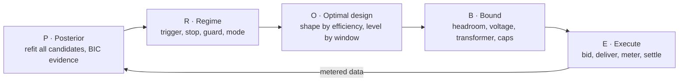
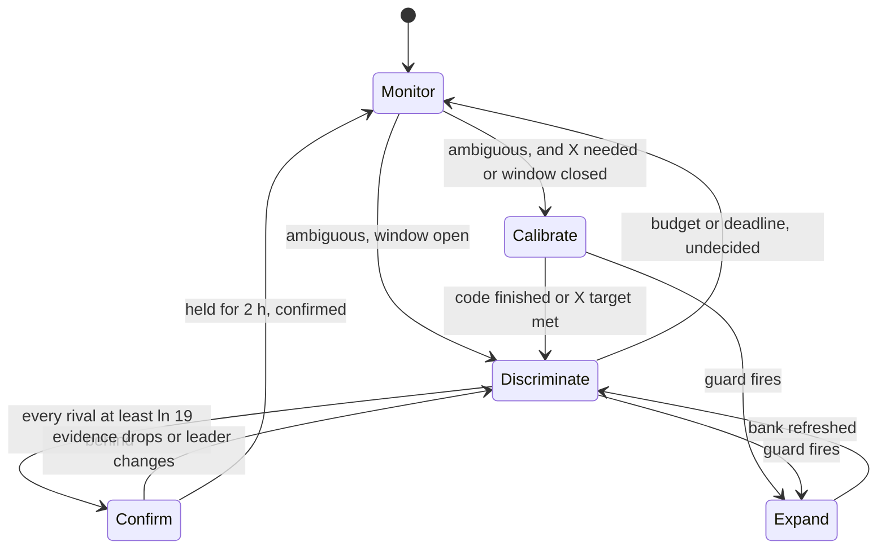

# Safe Market Probing: Method Specification

> **Superseded by [MANUSCRIPT.md](MANUSCRIPT.md) v3 and [PROTOCOL.md](PROTOCOL.md) v3 (2026-11-19).** The current design:
> - dispatches active power only, because household inverters keep local volt-var;
> - treats R/X as nuisance parameters, with no calibration phase or Q codes;
> - uses enrolled household batteries and EVs as resources (κ ≈ 1.2–3.3).
>
> This note is kept as the record of the v2 reasoning. Its Q-based calibration and its node-battery scenario no longer apply.

**Status: proposal for discussion, 2026-11-18.** This note formalises the trust region κ and the hourly procurement loop behind [PROTOCOL](PROTOCOL.md) v2. It also marks which parts the [pre-check](PRECHECK.md) has tested. Nothing in the protocol changes until the decisions in Section 6 are agreed.

In one sentence: the operator treats each market hour as a designed experiment. It buys just enough safe excitation to separate the remaining candidate topologies, and stops when the evidence reaches posterior odds of 19:1.

## 1. Notation and model

| Symbol | Meaning |
| --- | --- |
| $i, j \in \mathcal N$, $n$ | measured terminals |
| $t$, $h$, $m$ | 15-min sample, market hour, samples per hour ($m = 4$) |
| $x_t = (p_t, q_t) \in \mathbb R^{2n}$ | metered net consumption, pu on 200 kVA |
| $y_{j,t} = v_{0,t}^2 - v_{j,t}^2$ | squared-voltage drop at terminal $j$ |
| $\mathcal S_k$, $\theta_k = (r_C, x_C)_{C \in \mathcal S_k} \in \Theta_k$ | supports of candidate $k$ and their bounded parameters (internal ones ≥ floor) |
| $H_k = [R_k\ X_k]$, $R_k = \sum_C r_C z_C z_C^\top$ | response matrix; $X_k$ likewise |
| $\Phi_k(x)$ | regressor with $H_k(\theta_k)\,x = \Phi_k(x)\,\theta_k$; it is linear in $x$ |
| $u_h \in \mathbb R^{2n}$ | probe: planned change of P and Q, held over hour $h$, delivered as $a \odot u_h$ with $a \in [0.9, 1]$ |
| $\sigma_i$, $D_\sigma$ | training standard deviation of channel $i$ (P or Q at one node); $D_\sigma = \operatorname{diag}(\sigma)$ |
| $A_i^\pm$, $c_i$ | enrolled headroom up/down and activation price of channel $i$ |
| $\sigma_e$ | noise of $y$; two 0.05% voltage meters give about $1.4 \times 10^{-3}$ pu² |
| $\pi_k$, $L$, $E_j$ | posterior weight, leader, evidence against rival $j$ (PROTOCOL §4) |

$$
y_t = H_k(\theta_k)\,\tilde x_t + \varepsilon_t = \Phi_k(\tilde x_t)\,\theta_k + \varepsilon_t,\qquad
\tilde x_t = x_t + a \odot u_h + \text{meter error},\quad t \in h .
$$

The fit uses the **metered** injections $\tilde x_t$, not the ordered probe $u_h$. A delivery shortfall therefore weakens the excitation but does not bias the estimates.

## 2. κ: the excitation level

### 2.1 Definition

Write every probe as a level times a shape:

$$
u_h = \kappa_h\, D_\sigma\, \bar s_h,\qquad \lVert \bar s_h \rVert_\infty = 1,\qquad \kappa_h = \lVert D_\sigma^{-1} u_h \rVert_\infty .
$$

- The **shape** $\bar s_h \in [-1, 1]^{2n}$ says which nodes and channels move, and in which direction (+ buys, i.e. raises consumption; − sells).
- The **level** $\kappa_h$ says how hard, in units of each node's own natural variation.

The trust region of PROTOCOL §2 is

$$
\mathcal U(\kappa) = \big\{u :\ -\min(\kappa\sigma_i, A_i^-) \le u_i \le \min(\kappa\sigma_i, A_i^+)\ \ \forall i\big\},
$$

so the level actually available on channel $i$ is $\kappa_i^{\mathrm{eff}} = \min(\kappa,\ A_i^\pm/\sigma_i)$.

Scaling by $\sigma_i$ does three things:
- one κ means the same thing at nodes of very different size;
- it measures the probe against what passive identification already has, the node's natural variation;
- it marks the edge of the fitted envelope. The background spans about $\mu_i \pm 2\sigma_i$, so κ ≤ 2 stays inside the range where the effective, linearised parameters were estimated. Larger κ extrapolates (ceiling $\kappa_L$ in 2.5).

### 2.2 Information grows with κ²

The Fisher information about $\theta_k$ from one hour is

$$
\mathcal I_h(u) = \frac{1}{\sigma_e^2}\sum_{t\in h}\Phi_k(x_t+u)^\top\Phi_k(x_t+u)
= \mathcal I_h(0) + \frac{1}{\sigma_e^2}\sum_{t\in h}\big[\Phi_k(x_t)^\top\Phi_k(u) + \Phi_k(u)^\top\Phi_k(x_t)\big] + \frac{m}{\sigma_e^2}\,\Phi_k(u)^\top\Phi_k(u).
$$

For a zero-mean code ($\mathbb E\,\bar s = 0$, $\mathbb E\,\bar s\bar s^\top = I$) the cross terms vanish on average:

$$
\mathbb E\,\mathcal I_h(\kappa D_\sigma \bar s) = \mathcal I_h(0) + \kappa^2\,\frac{m}{\sigma_e^2}\,\Gamma_k,\qquad
\Gamma_k = \sum_{i=1}^{2n}\sigma_i^2\,\Phi_k(e_i)^\top\Phi_k(e_i).
$$

Three consequences:

- **Level.** Parameter error scales as $(\mathcal I_0 + \kappa^2\Gamma_k)^{-1/2}$, i.e. as 1/κ once the probe dominates. Finding 1 fits this: κ × (X error) = 0.32, 0.42 and 0.45 at κ = 1, 3 and 10.
- **Channel.** $\Phi_k(e_i)$ for a P channel fills only the R columns, and for a Q channel only the X columns. So $\Gamma_k$ is block-diagonal: P probes add information about R only, Q probes about X only. Without Q probes, X depends on natural Q variation, which largely follows P. This is why P-only probes stall at an X error of about 0.2 (Finding 1): they only remove the P–Q confounding.
- **Codes.** If the shapes over $H_c$ chips are rows of a Hadamard matrix (all-ones row dropped), $\sum_h \bar s_h \bar s_h^\top = H_c I$ exactly. The cross terms then vanish deterministically, not just on average, and every node is excited equally. This needs $H_c$ at least the next Hadamard order above $n$. A chip can be one hour, or one 15-min slot if Q setpoints may change within the hour (decision D2).

### 2.3 Evidence between topologies grows with κ², after refitting

The predicted evidence gain against rival $j$ uses the leader's prediction as pseudo-data and refits $j$ on all data. This is the refit-aware T-criterion used by the pre-check:

$$
\Delta E_j(u) = \frac{1}{2\hat\sigma^2}\Big[\min_{\theta\in\Theta_j}\Big(\mathrm{SSE}_j^{\le h}(\theta) + \sum_{t\in h+1}\big\lVert \Phi_L(\hat x_t+u)\,\hat\theta_L - \Phi_j(\hat x_t+u)\,\theta \big\rVert^2\Big) - \mathrm{SSE}_j^{\le h}(\hat\theta_j)\Big].
$$

For a fixed shape, $\Delta E_j(\kappa D_\sigma\bar s) = \kappa^2\, m\, d_j(\bar s,\kappa)/(2\hat\sigma^2)$. The per-sample misfit $d_j$ falls from its frozen value to its structural value as the probe grows:

$$
d_j(\bar s, 0^+) = \big\lVert (H_L - H_j(\hat\theta_j))\,D_\sigma\bar s \big\rVert^2,\qquad
d_j(\bar s, \infty) = \min_{\theta\in\Theta_j}\big\lVert (H_L - H_j(\theta))\,D_\sigma\bar s \big\rVert^2 .
$$

Only $d_j(\bar s,\infty)$ is evidence about structure. **This is where v1 failed.** v1 scored hourly residuals with frozen parameters, so under a probe each candidate's residual grew like κ² times its structural gap *plus* its parameter error. Before calibration the X error is 0.5–1, so the parameter error is as large as the structural gaps, and a wrong topology with luckier parameters wins. Refitting removes the parameter error as data accrue.

With a constant shape and level, after $T$ hours

$$
E_j(T) \approx E_j(0) + T\,\frac{\kappa^2 m\, d_j}{2\hat\sigma^2} - \tfrac12 (p_j - p_L)\ln\!\Big(1 + \frac{T m n}{N_0}\Big),
$$

so the hours to confirm, and the smallest level that confirms within $T$ hours, are

$$
T_j \approx \frac{2\hat\sigma^2\,(\ln 19 - E_j(0))^+}{\kappa^2 m\, d_j},\qquad
\kappa_{\mathrm{info}}(\bar s, T) = \sqrt{\frac{2\hat\sigma^2\,(\ln 19 - E_j(0))^+}{T\, m\, d_j(\bar s)}} .
$$

The penalty term helps against richer rivals ($p_j > p_L$, e.g. spurious splits) and works against simpler ones. The protocol's quota $q_j = (\ln 19 - E_j)^+/2$ aims at $T = 2$ h, and shrinking a block "until it just meets the quota" sets $\kappa = \kappa_{\mathrm{info}}(\bar s, 2)$.

### 2.4 Energy equivalence and cost

Both 2.2 and 2.3 depend on the level only through

$$
\mathcal E = \sum_h \kappa_h^2 \qquad (T \text{ hours at level } \kappa \text{ count as } \kappa^2 T).
$$

Probing gently for longer or hard for shorter gives the same identification, as long as the background and the parameters stay stationary.

Under the prepaid quadratic contract of `resources/library.json`,

$$
C_h(u) = \Delta t\sum_i c_i\Big(\frac{(u_i^+)^2}{A_i^+} + \frac{(u_i^-)^2}{A_i^-}\Big) = \kappa^2 c(\bar s),\qquad
c(\bar s) = \Delta t\sum_i c_i\,\frac{\sigma_i^2\,\bar s_i^2}{A_i^\pm},
$$

so the evidence bought per CNY is

$$
\eta(\bar s) = \frac{\Delta E_j}{C_h} = \frac{m\, d_j(\bar s, \kappa)}{2\hat\sigma^2\, c(\bar s)}\quad \text{[nats per CNY]},
$$

which does not depend on κ except through the slow fall of $d_j$.

- **The shape decides price efficiency; the level decides speed and risk.**
- Scaling every shape to the same hourly cost and comparing ΔE (PROTOCOL §5, steps 2–4) is the same as ranking shapes by η, unless the trust region binds.
- Under a linear energy price, $C \propto \kappa$ and $\eta \propto \kappa$, so short hard probes are cheaper and the safety ceilings decide.
- The pre-check set $A_i = \kappa\sigma_i$, so its costs grow in proportion to κ. The study should use the enrolled $A_i$ from `resources/case_allocations.json` (decision D6).

### 2.5 Ceilings on κ

For a shape $\bar s$, each constraint caps the level.

**Headroom.**

$$
\kappa_A(\bar s) = \min_{i:\ \bar s_i \ne 0}\ \frac{A_i^\pm}{\sigma_i\,\lvert \bar s_i\rvert}.
$$

**Robust voltage, over every plausible candidate.** The linear voltage rise per unit level, and its parameter uncertainty, for candidate $k$ at terminal $j$ are

$$
g_{kj}(\bar s) = -\frac{\phi_{kj}(D_\sigma\bar s)^\top\hat\theta_k}{2\hat v_j},\qquad
\beta_{kj}(\bar s) = \frac{\big\lVert \Sigma_k^{1/2}\,\phi_{kj}(D_\sigma\bar s)\big\rVert}{2\hat v_j},
$$

where $\phi_{kj}(\cdot)^\top$ is row $j$ of $\Phi_k(\cdot)$ and $\Sigma_k$ is the covariance of $\hat\theta_k$. Then

$$
\kappa_V(\bar s) = \min_{k\in\mathcal K_h,\ j,\ t\in h}\ \min\left\{\frac{\bar v - \mu - \hat v^+_{j,t}}{\big(g_{kj} + z\,\beta_{kj}\big)^+},\ \frac{\hat v^-_{j,t} - \underline v - \mu}{\big(-g_{kj} + z\,\beta_{kj}\big)^+}\right\},
$$

with $\mathcal K_h = \{k : \pi_k \ge 0.01\}$, $\hat v^\pm$ the forecast ± 2σ, band [0.95, 1.05] pu, margin μ = 0.01 pu and z = 2.33 (1% per node-hour, *open*). This is the chance-constrained form of the protocol's "X inflated by 50%". $\Sigma_k$ shrinks as data accrue, so β falls and κ_V rises: **calibration widens the safe set.**

**Transformer.**

$$
\kappa_S(\bar s) \approx \frac{\bar S - S_{0,t}}{\big\lvert \mathbf 1^\top D_\sigma \bar s^{P}\big\rvert},
$$

where $\bar s^P$ is the P part of the shape. A zero-sum P shape has $\mathbf 1^\top D_\sigma\bar s^P = 0$, so $\kappa_S = \infty$ to first order.

**Unbalance.** $\kappa_U = \kappa_V/6$ for single-phase blocks, using the protocol's 6× phase sensitivity, until a three-phase model is available.

**Linearisation.** LinDistFlow drops terms quadratic in branch flow. For a probe they are about

$$
\rho_j(\kappa) \approx \sum_{C \ni j}\lvert z_C\rvert^2\,\frac{\lvert \Delta S_C\rvert^2}{\hat v^2},\qquad \Delta S_C = \kappa\sum_{i\in C}\sigma_i\bar s_i
\quad\Rightarrow\quad \kappa_L(\bar s) = \sqrt{\sigma_e \big/ \max_j \rho_j(1)} ,
$$

where $C \ni j$ runs over the branches on $j$'s path to the root. $\kappa_L$ has not been computed yet; Stage D must estimate it against AC.

### 2.6 The excitation window

$$
\mathcal W(\bar s, T) = \big[\kappa_{\mathrm{info}}(\bar s, T),\ \kappa_{\max}(\bar s)\big],\qquad
\kappa_{\max} = \min\{\kappa_A, \kappa_V, \kappa_S, \kappa_U, \kappa_L\}.
$$

- **Window open:** probe at $\kappa_h = \kappa_{\mathrm{info}}$, i.e. just enough.
- **Window closed**, in order of preference:
  1. change the shape: Q-only, zero-sum and group blocks raise $\kappa_{\max}$;
  2. calibrate first: β shrinks so κ_V rises, and $d_j$ approaches its structural value;
  3. allow more hours: $T \ge 2\hat\sigma^2(\ln 19 - E_j)^+ / (m\, d_j\, \kappa_{\max}^2)$;
  4. accept that the enrolled resources cannot separate these rivals.

Rough window for the two pre-check networks. Entries in the form *x* / *y* are Soumalas / Pengwah.

| Shape | κ_A, library as-is | κ_A, inverter-Q scenario | κ_V (rough) | κ_S at 200 kVA |
| --- | ---: | ---: | ---: | ---: |
| All nodes, same-sign P | < 1 | — | ≈ 6 export; 10–13 consume | ≈ 8 / ≈ 2 (consume) |
| Random-sign P+Q code | < 1 | — | ≈ 8–11 | ≈ 15 / ≈ 5 |
| Zero-sum P pairs | < 1 | — | ≈ 10–16 | ∞ (first order) |
| One node, ±P | 0.3–2.5 | — | ≈ 14 or more | ≥ 20 |
| Q-only code, all nodes | 0 | ≈ 3–7 | ≈ 30–60 | ≥ 18 |

How the entries were obtained:
- **κ_A, library as-is:** `case_allocations.json`. Each node has 0.55–1.96 kW (Soumalas) or 0.76–2.04 kW (Pengwah) of P inventory, against σ_P of 0.8–2.3 / 0.7–2.7 kW. Multi-node shapes are limited by the matched enrollment cap of 1.17 / 2.14 kW for the *whole feeder*. No resource offers independent Q: user Q follows P at a ratio of 0.2–0.5, and EV and battery reactive ratios are 0.
- **κ_A, inverter-Q scenario:** a hypothetical 5 kVA inverter at each node with the 44% guaranteed reactive capability typical of grid codes (e.g. IEEE 1547-2018 category B), about 2.2 kvar, against σ_Q of 0.3–0.8 kvar.
- **κ_V and κ_S:** linear extrapolation from the extremes in PRECHECK Finding 6 (worst over 10 seeds, μ = 0.01, no posterior term).

What the window says:
- **Headroom, not voltage, is the binding ceiling under the repo's resource model:** κ < 1 for any multi-node shape, at most 2.5 at a single node, and no independent Q. The pre-check's κ = 10 corresponds to roughly ten times the enrolled flexibility.
- **With inverter reactive power, a Q-only calibration at κ ≈ 3–7 is feasible** and far from the voltage ceiling. Finding 1 gives an X error of about 0.16 after one day at κ = 3, with the code at every node.
- **Discrimination needs little energy:** T-optimal probes cost 1.5 CNY/day in the pre-check. Their amplitudes were not logged; judging from the cost they are a few kW, which may exceed one node's 0.6–2 kW inventory. This must be checked.

## 3. The procurement procedure: the PROBE loop

### 3.1 The problem it approximates

The operator faces a sequential decision problem over its belief:

$$
\min_{\{u_h\},\,\tau}\ \mathbb E\Big[\sum_{h<\tau} C_h(u_h) + \lambda_{\mathrm w}\,\mathbb 1\{\text{wrong confirmation}\} + \lambda_\tau\,\tau + \lambda_X\,\mathrm{err}_X(\hat H_L)\Big]
\quad\text{s.t.}\quad u_h \in \mathcal U^{\mathrm{safe}}_h(b_h),\quad \sum_h C_h(u_h) \le B .
$$

- The belief $b_h = (\pi_h, \{\hat\theta_k, \Sigma_k\}_k, \hat\sigma^2)$ is built from all metered data available at the gate.
- The action is the probe $u_h$. The stopping time τ is confirmation, budget, deadline or alarm.

Solving this exactly is intractable: a belief over 40–60 candidates, continuous actions and delayed observations. So the weights λ are not set as numbers. Each is expressed as a threshold instead: ln 19 for wrong confirmations, a deadline for τ, a target for the X error, and the hourly and day caps for cost. The PROBE loop is a supervised one-step-lookahead approximation of this problem.

### 3.2 Skeleton

Every hour runs five steps:

| Step | Question it answers | Components |
| --- | --- | --- |
| **P** Posterior | What do the data say now? | C1 belief and evidence |
| **R** Regime | Should we probe, and for which job? | C2 trigger, C3 modes, C8 stopping, C9 guard |
| **O** Optimal design | Which shape, and how hard? | C4 calibration code, C5 discrimination design |
| **B** Bound | Is it safe and affordable? | C6 safety certificate |
| **E** Execute | How is it bought, delivered and measured? | C7 market and settlement |



The steps sit on four time layers. With the protocol's one-hour gate lead:

| Layer | When | Steps | Output |
| --- | --- | --- | --- |
| Day-ahead | Day D−1 | P and R on the frozen bank; forecast; book enrolled headroom; set budget and deadline | Probing on or off; headroom contracts |
| Hour-ahead | Start of hour h, data up to the end of h−1 | P → R → O → B | Sealed bids and setpoints for hour h+1 |
| Delivery | Hour h+1 | E: deliver, meter, intra-hour cut if a voltage nears its limit | Metered data |
| Settlement | After hour h+1 | E: pay contract fees on the planned service; energy at the local price | Cost ledger |

The data from block h+1 first shape block h+3, so feedback is delayed by two blocks. The pre-check used no delay.

### 3.3 Modes



Each mode mixes a calibration component and a discrimination component:

$$
u_h = \alpha_h\, u_h^{\mathrm{cal}} + \beta_h\, u_h^{\mathrm{disc}},\qquad
(\alpha_h, \beta_h) =
\begin{cases}
(0, 0) & \text{Monitor}\\
(1, 0) & \text{Calibrate}\\
(\alpha_d, 1) & \text{Discriminate}\\
(\alpha_d, 0) & \text{Confirm, Expand}
\end{cases}
$$

The protocol's `two_phase` arm is the case $\alpha_d = 0$. A small dither $\alpha_d$ (Q code at level ≈ 1, *open*) keeps every channel excited. Because the cross terms in 2.2 vanish, the dither adds X information without disturbing the designed block. It also stops a confirmation from resting on directions that were never varied. This is untested, so it would be a new arm.

### 3.4 Components

| ID | Component | Rule | Why it is there | Pre-check |
| --- | --- | --- | --- | --- |
| C1 | Belief and evidence | Refit every candidate on all data by exact bounded LS; $J_k$ from PROTOCOL §4; $\pi_k \propto e^{-J_k}$; $E_j = J_j - J_L$; $\Sigma_k = \hat\sigma^2(\Phi_k^\top\Phi_k)^{-1}$ on free parameters | Removes the parameter error that made v1 confirm wrong topologies; the penalty rejects spurious splits | Tested (Findings 3, 4) |
| C2 | Trigger | Probe while some rival that is not operationally equivalent to the leader has $E_j < \ln 19$ | Spend only on ambiguity that matters | Plain trigger tested; equivalence untested |
| C3 | Modes and mixing | Automaton in 3.3 | Separates the two jobs and lets them share hours | Sequential version tested with a P+Q code; dither untested |
| C4 | Calibration code | Q-only Hadamard code at level $\min(\kappa_A, \kappa_V)$; zero-sum P pairs optional | Channel rule: only Q probes inform X | Shape tested open-loop (Findings 1, 6); in-loop untested |
| C5 | Discrimination design | Dictionary of single-node and group blocks; refit-aware ΔE; maximise the smallest ratio to quota; shrink to quota | Targets structure, not parameter error; needs only NumPy/SciPy | Tested (Finding 4) |
| C6 | Safety certificate | $\kappa_{\max}(\bar s)$ from 2.5, with voltage checked over every plausible candidate; intra-hour cut; AC check afterwards | The leader may be wrong; calibration widens the safe set | Linear bounds derived (Finding 6); chance form and AC untested |
| C7 | Market and settlement | Products in 3.6; sealed one hour ahead; fit on metered data | A delivery shortfall cannot bias the fit | Delivery gain tested; gate lead untested |
| C8 | Stopping | Confirm when every non-equivalent rival has $E_j \ge \ln 19$ for 2 consecutive hours | Posterior odds 19:1, the threshold of a Wald sequential test with α = β = 0.05 | Tested |
| C9 | Guard and bank expansion | Score tests for local moves of the leader; add significant neighbours to the bank | A closed bank cannot notice that the truth is missing | Untested; Finding 5 shows the need |

Details of the new components:

**C2, operational equivalence.** Two candidates are equivalent for operation when, after refitting, their voltage predictions over the forecast day differ by less than the meter resolution:

$$
k \sim L \iff \max_{t,\,j}\ \big\lvert \hat v^{(k)}_{j,t} - \hat v^{(L)}_{j,t}\big\rvert \le \varepsilon_V \qquad (\varepsilon_V \approx 0.001\ \text{pu, open}).
$$

Paying to separate equivalent candidates buys nothing for voltage management, though it does for topology accuracy. The study should report both the exact-topology outcome and the operationally resolved outcome (decision D3).

**C6, intra-hour cut.** If any metered voltage comes within μ/2 of a limit during a probe hour, the remaining slots of that hour are set to zero. Inverter Q setpoints can do this. Market P blocks can only if the contract allows curtailment (*open*).

**C9, score tests.** For a nested local extension of the leader with extra parameters ψ (a new support, or a split of one), the Rao score (Lagrange multiplier) statistic needs no refit:

$$
\mathrm{LM} = g_\psi^\top\big(\mathcal I_{\psi\psi} - \mathcal I_{\psi\theta}\,\mathcal I_{\theta\theta}^{-1}\,\mathcal I_{\theta\psi}\big)^{-1} g_\psi,\qquad
g_\psi = \frac{\partial \log \ell}{\partial \psi}\Big|_{\hat\theta_L,\ \psi = 0}.
$$

If LM > χ²₂,₀.₉₉ = 9.21 for two consecutive hours, that neighbour is added to the bank and refitted, and discrimination continues. Non-nested moves (moving or swapping a leaf, dropping a support) are few enough to refit directly each hour. The floor-KKT test in PROTOCOL §5 is the special case where the data want an internal branch below its floor. Designed probes sharpen these tests because $u_h$ is chosen by the operator and is independent of the noise.

### 3.5 One hour, step by step

```text
Day-ahead (D-1)
  screen the bank with C1/C2; if nothing is ambiguous, stay in Monitor
  forecast the background and its error; book enrolled headroom A_i; set budget B and deadline

At the start of hour h (data up to the end of h-1), seal the block for hour h+1:
  P  refit every candidate; update J, pi, E, Sigma_k, sigma^2
  R  guard (C9) -> Expand?   stopping test (C8)   choose the mode, hence alpha and beta
  O  if alpha > 0: u_cal  = next chip of the Q code at level min(kappa_A, kappa_V)
     if beta  > 0: u_disc = dictionary block maximising min_j dE_j / q_j, shrunk to the quota
  B  u = alpha*u_cal + beta*u_disc; scale to kappa_max(u) and the hourly/day caps; else zero
  E  submit bids and setpoints for hour h+1

During hour h+1: deliver a*u, meter every slot, cut the probe if a voltage nears its limit
After hour h+1: settle; these data first shape the block for hour h+3
```

### 3.6 Market products

| Product | Physical source | Sign | Paid as | Effect at the root |
| --- | --- | --- | --- | --- |
| P block | EV charging, battery, shiftable or curtailable load | Buy (+) or sell (−) | Quadratic contract fee; energy at the local price | ± energy |
| Zero-sum P swap | Two P blocks at different nodes | Buy at one set, sell the same total at another | Contract fees only; energy nets out | None, to first order |
| Q setpoint | PV or battery inverter (new; not in `library.json`) | Absorb or inject | Reactive service fee | Small Q |

The interpretation is unchanged from PROTOCOL §2: a local flexibility market, an aggregator contract or operator-owned storage, not a transmission spot market.

## 4. Novelty

**Not new.** Check these before writing a paper:
- probing distribution grids with inverter setpoints to learn topology or loads, e.g. Cavraro and Kekatos on inverter probing for topology processing (IEEE TCNS, 2019), and Bhela, Kekatos and Veeramachaneni on smart-inverter grid probing (IEEE TPWRS, 2019);
- optimal designs for discriminating rival models (Box and Hill, 1967; Atkinson and Fedorov, 1975, T-optimality) and sequential tests (Wald, 1945);
- safe exploration with a safe set that grows as the model is learned (e.g. SafeOpt, Sui et al., 2015).

**Likely new.** Claim the combination and the analysis, not probing itself:
1. Probing bought as priced flexibility, with the cost law of 2.4 (shape sets efficiency, level sets speed) and the excitation window of 2.6 as a feasibility test.
2. Refit-aware discrimination over a structure-learning bank (RNJ/WZZT laminar supports) with sequential BIC confirmation. This comes with the negative result that frozen or prequential scoring confirms wrong topologies under strong probing (Finding 2).
3. Safety certified over every plausible topology, not just the leader, with chance constraints that loosen as calibration proceeds.
4. A guard that expands the bank when the truth is missing (C9, untested).

**Verdict:** novel as a framework if a literature check confirms that items 1–3 have not already been combined. The individual tools are known.

## 5. Feasibility

| Item | Status | Main risk |
| --- | --- | --- |
| Scoring, design, stopping (C1, C5, C8) | Work in the linear simulator | Native banks may hold non-nested errors; Stage 0 checks this offline |
| Excitation level | The pre-check assumed headroom = κσ | The library gives κ < 1 for multi-node shapes, at most 2.5 at one node, and no independent Q. **This is the largest gap.** |
| Safety (C6) | Linear, balanced bounds | AC, losses and unbalance untested |
| Timing (C7) | Gate lead 0 h in the pre-check | A one-hour lead delays feedback by two blocks |
| Guard (C9) | Not built | Truth-missing runs still confirmed a wrong topology in 5–35% of runs |
| Computation | Dictionary plus exact bounded LS; no Gurobi | Low: the whole v2 pre-check (run E) took about 5 minutes in a browser |

## 6. Decisions before PROTOCOL v3

| ID | Decision | Options | Suggested |
| --- | --- | --- | --- |
| D1 | Resource scenario | Library as-is; probe-ready (inverter Q plus larger P enrollment); both | Both, as strata, so the study shows which resources make probing worthwhile |
| D2 | Q chip length | 1 h (market block); 15 min (service contract) | 15 min for the Q code, 1 h for P blocks |
| D3 | Success metric | Exact topology; operational equivalence; both | Both, with exact topology as primary |
| D4 | Calibration schedule | Sequential (`two_phase`); dither (3.3) | Test both as arms |
| D5 | Voltage robustness | 50% X inflation; chance constraint | Chance constraint with z = 2.33, never looser than the 50% inflation during calibration |
| D6 | Cost model | Enrolled $A_i$ (cost ∝ κ²); $A_i = \kappa\sigma_i$ (pre-check) | Enrolled $A_i$ |
| D7 | Transformer rating | 200 kVA base; feeder-specific | Feeder-specific where a source exists |
| D8 | Guard | Variance ratio plus floor-KKT; score tests plus bank expansion | Score tests plus expansion, validated in Stage D |

Once these are agreed, they go into PROTOCOL v3. The pre-check should then be re-run with the library headroom (D1, D6) before the lock commit.
