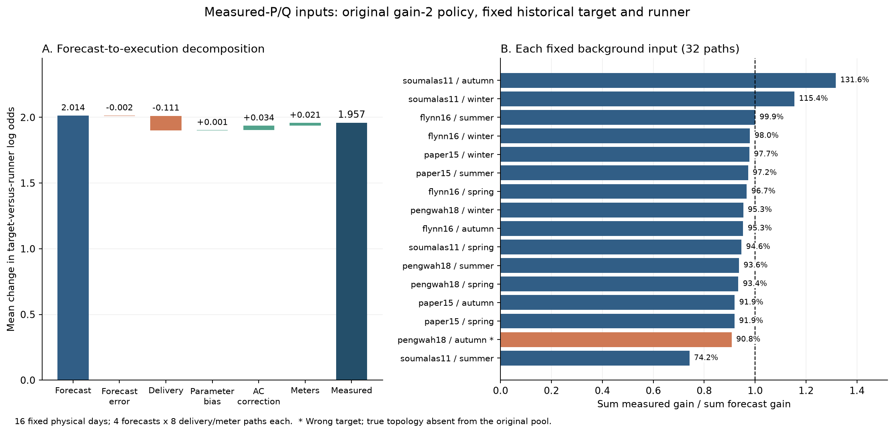

# 新 P/Q 下的公共响应、候选覆盖与灵活性效果

本轮已完成结构诊断、主批 512 条配对执行、补充 32 条配对执行、全 AC 背景缓存及独立结果复算。最明确的改善是：**旧增量方案对事前固定的最强竞争者，平均预测证据增加 2.0136，实际含量测误差增加 1.9573，实现比例 97.20%。**当前数据下，平均参数偏差的抵消已很小。

但恢复次数仍为 **480/512，增加 0、减少 0**。另外，完整参数库中有 **105/1792 次比较优势下降**；真正接近五五开的补充例，现有纯有功资源无法达到要求，**8 次报价均不可行**。这三项结果决定了本轮应定位为“收益预测核算和失败定位”，尚未得到新的辨识准确率改善。



图中橙色 Pengwah 秋季使用原始缺真候选库，增强的是错误历史目标的优势。每一条右图记录对应一个固定背景日的 32 条随机执行路径。

## 15/16 与 1/16 为什么相差很大

“内部拓扑恢复”检查真正分组的内部支路，忽略单节点项和全节点项。“全部活动响应项一致”进一步检查这些项。原 16 个选中结果中，15 个多出全节点项，其中 Pengwah 秋季还多一条内部支路。因此两个数的差别主要来自评分范围，不能把 1/16 直接解释为只有一个网络的内部结构正确。

四个物理网络都在量测根节点后直接分叉，没有覆盖全部末端的公共支路。代码 `trees.basis(n)` 却始终保留全节点基函数，清理保护它，内部结构惩罚不计它。它产生

\[
c(t)=a\sum_iP_i(t)+b\sum_iQ_i(t),\qquad
\widehat Y(t)\gets\widehat Y(t)+c(t)\mathbf 1.
\]

这里预测的是平方电压差，a、b 已是响应系数，不再额外乘 2，也不直接称为线路欧姆值。72 个原参数点中 54 个该项非零；选中结果为 15/16。

独立控制得到：去掉根表计噪声后 15/16 仍非零，干净 AC 数据下 14/16 非零；使用相同 P/Q、原线路的精确线性响应生成电压后，16/16 都降到数值零，最大 3.67×10⁻¹⁶。这说明真结构控制中，AC 线性近似误差本身足以产生该项；其在含噪观测中的来源占比尚未定量分清。

这个项会影响灵活性。不同候选的系数不同，会改变预测差和调度方向。13/16 输入的“公共部分差平方／完整预测差平方”超过 1，最高 88.85，说明公共项与其余参数有较强抵消；该比值不是可相加的贡献百分比。即使公共系数相同、候选差中抵消，整体拟合残差改变仍可能影响实际平方误差比较。

直接删除所有冻结候选的公共项后，16/16 选择不变，新日 MSE 改善 9 例、变差 6 例、相同 1 例，变化范围 −1.899%～+5.621%。另用真结构作离线控制、分别允许和禁止公共项后重新拟合，改善 7 例、变差 8 例、相同 1 例。主试验因此保留原参数，没有通过删除公共项更改结果。

同一优化动作、同一观测上再删除公共项进行诊断，平均实测增益从 1.9573 降为 1.7603，57/512 条固定最强竞争者比较转为负增益。这说明冻结参数之间有补偿；删除后重新辨识和重新规划的效果仍需另测。

## 为什么有一个池漏掉正确内部拓扑

Pengwah 秋季 `pengwah18__2024-10-14` 的正确 7 个内部支持都在原 E 搜索池中。原 30 秒总搜索预算下 W、E 超时，E 返回的结构多出 `[0,2,3,4]`，有限池间隙 3.739%。原池、原可行初值独立追加 60 秒预算，实际 53.40 秒达到该池最优，找到正确内部结构。过程只读训练数据，没有用真结构作初值；达到要求后没有再跑预留的 180 秒。

| 同一数据上冻结后评价 | 原返回点 | 追加搜索返回点 |
|---|---:|---:|
| 正则化训练目标 | 1.0239585323 | 1.0212449016 |
| 验证 MSE | 1.884007339×10⁻⁶ | 1.884013461×10⁻⁶ |
| 验证＋原既有新日 MSE | 2.192482209×10⁻⁶ | 2.190804808×10⁻⁶ |

因此有两个不同问题：搜索预算确实漏掉更好的训练结构；正确内部结构的验证 MSE 又略高 6.12×10⁻¹²，超过原严格数值并列容差，原历史选择仍会选错。增加搜索预算修复候选覆盖，不会自动修复历史验证排序。追加候选仍含公共项，只能称内部结构正确。

原 16 个主库完全保留。补充试验单独向该库追加这个原算法返回点，保留原 4 个参数点，新点为 native index 4；不同内部结构代表从 3 个变为 4 个。错误历史目标的权重 50.0702%，正确内部结构 49.9298%。真实结构固定支持 QP 只用于诊断，没有进入候选库。

## 本轮具体测了什么

原数据来源、聚合和训练检查见 [新 P/Q 说明](../measured_pq_20261114/README.md)，预先固定的安排见 [PROTOCOL.md](PROTOCOL.md)。同步实测 P/Q 驱动原四个物理网络；电压仍由 AC 模型生成，不能称为现场同步 P/Q/V 验证。

- 16 个网络／季节输入，每个 192 点训练、96 点历史验证、96 点新日。训练后参数冻结，最终用完整原参数库的“历史验证＋新日”严格 MSE 选模，训练集不重复计入评分。
- 每个背景日 4 份 5% 预测误差，每份计划 8 个交付／量测流，共 64 份预测、512 条配对执行、2560 条策略记录。固定网络×背景日组合有 16 个，共享 4 个源日期窗口；512 条路径不计为独立真实新日。
- 先有真实新日背景，再加预测误差供规划；冻结采购后，在真实背景上交付并算 AC，最后加 P/Q 0.5%、根及末端电压 0.05% 的量测误差。同组策略共用这些随机流。
- 最多 3 个 PV、2 个 EV、2 个电热水合同，按历史登记容量选择，落在 4～6 个节点；先取登记容量的 10%，合同功率合计 7.603～15.806 kW。纯有功调整，ΔQ=0。没有往实测净功率再添加设备基线。
- PV 在 10–14 时限发；EV 在 18–07 时移时，日净调节电量为零；热水有简单热量缓冲和日末恢复。资源约束是线性的。PV 的净反送上限只是合成可用合同的代理约束，所选节点同时存在电池或其他电源，净反送不能单独证明实际 PV 可用量。
- 每设备整日交付倍率为 [0.9,1]，PV 另受实际净反送上限截断。本批没有触发 PV 截断。

比较零采购、旧增量 `gamma=2`、现有对称恢复加方向保护方案，以及两者各自同计划费用的简单轮换。旧方案以历史胜者为目标，对每个代表竞争结构要求预测证据增量至少 2。对称恢复方案覆盖累计历史权重 99% 的候选集合，补充例同时覆盖两个候选，并取双向历史优势中较差的一侧；要求已满足时允许不采购。均保留原历史均值保护规则，真拓扑仅用于选后评价。

## 预测收益如何拆成实际收益

固定历史目标 t 和一个竞争者 j，令 X 是按时间排列、拼接 P/Q 的输入，D=H_t−H_j，σ²是冻结的共同验证残差尺度。定义

\[
J(X)=\frac{\|XD^\top\|_F^2}{2\sigma^2},\qquad
L(X,Y)=\frac{\|Y-XH_j^\top\|_F^2-\|Y-XH_t^\top\|_F^2}{2\sigma^2}.
\]

J 衡量两个冻结模型的预测距离；L 是同一观测支持目标而非竞争者的对数赔率。平方展开给出

\[
L=J+\frac{\langle Y-XH_t^\top,XD^\top\rangle}{\sigma^2}.
\]

因此，提高模型距离不自动等于同量的真实证据增加；差别取决于目标预测误差与候选预测差的方向。用原物理线路的线性响应 H_*，把干净 AC 输出写作 Y=XH_*^⊤+r_AC，可进一步区分冻结参数偏差与 AC 近似误差。H_* 只用于离线分解，规划没有读取真线路参数。

对同一动作减去同一随机流下的零动作，历史部分抵消。主统计固定事前最强竞争者，不随执行结果换比较对象。

| 主批 512 条路径的均值 | 数值 | 含义 |
|---|---:|---|
| 预测输入、计划动作的 ΔJ | 2.013579 | 报价时预计收益 |
| 真实背景、完全交付的 ΔJ | 2.011927 | 单独替换预测误差 |
| 真实背景、实际交付的 ΔJ | 1.901362 | 加入未足额交付 |
| 冻结参数偏差带来的增量 | +0.000839 | 目标拟合误差的方向影响 |
| AC 非线性带来的增量 | +0.034276 | 真实 AC 与物理线性式的差别 |
| 量测误差带来的增量 | +0.020797 | 由含噪与无额外噪声比较得到 |
| 实测 ΔL | **1.957274** | 最终可观察的证据变化 |

实际交付 ΔJ 加上参数偏差、AC 项和量测项，等于实测 ΔL。实际距离／预测距离为 94.43%，实测证据／预测距离为 **97.20%**；比值都用全部 512 个非零动作的合计值计算。这里所有预测增益均为正，没有为提高比例剔除负收益。主要平均损失来自交付不足；参数偏差的平均接近零，但各背景下仍有明显正负偏差。

正确历史目标的 480 条路径平均实测增益 1.9667，实现 97.63%；错误历史目标的 32 条路径平均实测增益 1.8156，实现 90.78%，强化了错误目标。候选缺失时较高权重会继续支持错误答案，这是当前有限库评价的实际失败。

| 固定背景输入 | 预测 ΔJ | 实测 ΔL | 合计实现比例 | 参数偏差增量 | 平均激活费／元 |
|---|---:|---:|---:|---:|---:|
| Flynn 冬 | 2.0000 | 1.9593 | 97.96% | −0.0067 | 0.0173 |
| Flynn 春 | 2.0000 | 1.9341 | 96.70% | −0.0254 | 0.0229 |
| Flynn 夏 | 2.0000 | 1.9985 | 99.93% | −0.0057 | 0.0332 |
| Flynn 秋 | 2.0000 | 1.9060 | 95.30% | −0.0123 | 0.0161 |
| Paper 冬 | 2.0000 | 1.9540 | 97.70% | +0.0048 | 0.0207 |
| Paper 春 | 2.0000 | 1.8375 | 91.87% | −0.0809 | 0.0154 |
| Paper 夏 | 2.0000 | 1.9445 | 97.22% | +0.0012 | 0.0224 |
| Paper 秋 | 2.0125 | 1.8504 | 91.94% | −0.0728 | 0.0160 |
| Pengwah 冬 | 2.0000 | 1.9063 | 95.31% | −0.1009 | 0.0526 |
| Pengwah 春 | 2.0000 | 1.8678 | 93.39% | −0.0437 | 0.0203 |
| Pengwah 夏 | 2.0000 | 1.8728 | 93.64% | −0.0220 | 0.0222 |
| Pengwah 秋，错误目标 | 2.0000 | 1.8156 | 90.78% | −0.1900 | 0.0318 |
| Soumalas 冬 | 2.0000 | 2.3084 | 115.42% | +0.3102 | 0.7437 |
| Soumalas 春 | 2.0000 | 1.8928 | 94.64% | +0.0145 | 0.2248 |
| Soumalas 夏 | 2.2047 | 1.6356 | **74.19%** | **−0.3783** | 0.1659 |
| Soumalas 秋 | 2.0000 | 2.6329 | **131.64%** | **+0.6215** | 0.2189 |

表中每行 32 条路径。Soumalas 夏仍有约四分之一的平均落差，Soumalas 秋的参数偏差则提高证据；均值相抵不能作为所有输入都校准好的依据。相比此前差的收益实现，新批直接核算有明显改善，但数据、历史长度和资源配置同时变化，本轮没有做严格的单因素因果对照。

## 恢复率、其他竞争者与费用

| 方案 | 内部恢复 | 相对零采购新增／损失 | 对最强竞争者的平均实测 ΔL | 平均实际激活费／元 |
|---|---:|---:|---:|---:|
| 零采购 | 480/512 | 0／0 | 0 | 0 |
| 旧增量 2 | 480/512 | 0／0 | +1.9573 | 0.1028 |
| 旧增量同费轮换 | 480/512 | 0／0 | −0.0350 | 0.1029 |
| 绝对恢复加方向保护 | 480/512 | 0／0 | 0 | 0 |
| 绝对恢复同费轮换 | 480/512 | 0／0 | 0 | 0 |

全部活动响应项一致均为 32/512。原主库历史最小对数赔率已经为 26.748～3117.86，归一化权重接近 1，包括缺真候选的错误目标；执行后权重在浮点输出中均为 1。原增量方案继续采购产生清楚的证据增加，但这批数据不需要它来维持原来的正确恢复。绝对方案的 64/64 零采购均已满足当前模型要求，和求解失败回退零采购有不同含义。

更完整的检查发现一个接口缺口：规划每种内部结构只使用一个代表参数点，最终严格选模却比较全部原参数点。

| 比较范围 | 比较次数 | 实测优势增加 | 实测优势下降 |
|---|---:|---:|---:|
| 规划中的代表竞争参数 | 1280 | 1280 | 0 |
| 原库所有不同内部结构参数点 | 1792 | 1687 | **105** |

105 次下降影响 105/512 条路径：Flynn 夏、Paper 夏、Pengwah 秋各 32 次，Soumalas 冬 9 次。最差为 −4.8042；该次预测增益仅 0.6548，本来就不受增量 2 的代表参数门槛保护，又受到负量测变化影响。所有这些下降尚未改变最终胜者，但说明只保护代表参数不足以覆盖实际选模库。

费用低的原因也已核算：旧方案每次平均只交付 **0.9224 kWh** 绝对调节电量，中位数 0.1695 kWh；平均激活费 **0.1028 元**，中位数 0.0227 元、范围 0.0141～0.7947 元。价格为示例 PV 0.30、EV 0.10、电热水 0.15 元/kWh，移走和补回都计费，容量预留费取零。全幅简单轮换可达约 4.75～17.55 元，当前报价小来自增量要求很小、已有证据很强。

以同一示例分时电价核算的原根节点日电能价值为 159.10～1002.46 元；旧方案使其平均变化 −0.0486 元，范围 −1.3189～+0.6013 元。这个电能价值和激活费分别记录，不能把一角钱称为配网全天总运营费用。正式合同若有容量费、最低激活费或聚合费用，应直接计入，当前没有凭空添加这些值。

## 近似五五开补充例为什么仍无改善

添加合法正确内部候选后，用与主批相同的 4 份预测和 32 条执行路径单独测一次。无采购恢复 **13/32**，真结构平均权重 0.4305，范围 0.0975～0.8303。原库相同路径恢复 0/32，因此这一变化来自候选覆盖。

两种方法各 4 次报价，全为求解器不可行状态 3；没有超时。每份预测构造了 29 个资源可行初值，但没有满足信息要求的初值。两种方案和轮换均回退零动作，恢复还是 13/32，费用 0。失败报价全部保留。

随后只用封存预测和候选求解析上界：放松能量平衡、跨时约束和均值保护，允许每个资源在功率边界内独立变化，再对每个电压输出分量独立取区间内最有利端点。这个进一步放宽的上界已经足以排除当前门槛。

| 合同参与量 | 最难竞争对的 ΔJ 上界，四份预测范围 | 旧方案要求 | 绝对 J 上界 | 绝对方案所需 J |
|---|---:|---:|---:|---:|
| 登记容量 10% | 0.003515～0.003582 | 2 | 0.27360～0.28366 | 6.73210 |
| 登记容量 25% | 0.009112～0.009279 | 2 | 0.27920～0.28936 | 6.73210 |

所以延长求解时间、换初值，或者仅将原设备从 10% 扩为 25%，都无法满足这两种已声明的要求。25% 只计算上界，没有额外运行优化或 AC。主批原增量 64/64 已有非零可行报价，也未触发协议中的增容重跑条件。

该对的有功响应差矩阵范数为 0.007099，无功为 0.044814；现有 4 个受控节点对应的有功响应差仅 0.0002754。范数本身受输入量纲影响，精确的上界才是不可达依据；它同时提示资源位置与方向的问题：当前动作只改 P，而主要可区分差别没有落在这些受控 P 列上。下一步应先检查其他已登记节点或逆变器无功调节，而非继续对相同位置加求解预算。

## 求解、核验与完整 AC 缓存

主批每个报价预算 20 秒，包含共享线性资源可行初值生成、可行性检查和原生非凸 QCQP 求解，最多 4 个进程、求解器单线程。初值是求解辅助；不可行补充例仍由原生求解器搜索并返回不可行。

- 旧方案 64/64 得到非零可行解，全部较初值降低费用，没有仅保留旧初值的案例。平均下降 0.0261 元，范围 0.0000641～0.2107 元。
- 63/64 在原 QCQP 域达到相对间隙 1e−5；1 次到时限，剩余间隙 **5.219%**。最优性仅针对冻结模型、已声明资源和这些约束。
- 唯一未闭合的是 Soumalas 冬第 4 份预测：可行初值 1.03068 元，返回方案 0.82200 元，有效原域下界 0.77910 元。该报价继续求解最多还有 0.04290 元的费用下降空间；当前没有把可行报价报成已证最优。
- 报价计时时间平均 1.461 秒、中位数 0.395 秒、最大 20.006 秒；使用 0.05 秒计时容差没有超预算。
- 绝对方案 64 次零采购，在非负费用模型下费用最优值为零。补充批的 8 次不可行结果单独保留。
- 主批和补充批均无正式任务异常、记录缺失或 AC 求解失败。源码从计划到完成哈希一致。

独立脚本不重新优化、不重新计算 AC，直接从封存 P/Q/V 复算原严格选择、平方误差、完整候选证据、费用、随机流配对及资源边界：

| 批次 | 路径数 | 原严格选模复算 | 有向证据比较 | 核验错误 |
|---|---:|---:|---:|---:|
| 主批 | 512 | 2560 | 8960 | 0 |
| 补充 | 32 | 160 | 640 | 0 |

主批平方误差最大复算差 1.39×10⁻¹⁷，证据分解最大差 1.35×10⁻¹¹，资源终端状态残差最大 3.16×10⁻¹⁰（容差 1e−7）。平均参数／AC 分解另按原物理网络哈希校验，最大闭合差 2.21×10⁻¹²。

完整背景 AC 已预计算 **16×384=6144 个时刻**，包括全母线复电压、幅值和相角，支路电流、送受端 P/Q、损耗、根节点供电和平衡残差。末端结果与原求解器及封存背景逐值一致，最大电流平衡残差 7.57×10⁻¹² pu，总功率平衡残差 4.89×10⁻⁹ kVA。两母线解析用例覆盖负荷、反送和零负荷。动作后重新计算 AC；原背景缓存不替代动作潮流。

主批全部策略的母线电压为 0.999770～1.036625 pu，无设定电压越界。网络没有完整热额定值，未做支路载流限值认证。

实施过程中保留了两项前置修复记录：首个小测试在准备阶段因不存在的源码条目停止，尚未报价；最初汇总调用有重复关键词错误，在生成正式汇总前修正。后续小测试、4 项资源／运行单元测试、AC 解析测试及正式独立复算通过。公共项诊断还修正过零分母展示，相关源数据未删除。上述代码问题与 8 次模型不可行分别记录。

## 后续最小改动

本轮支持的次序是：先修正候选评价范围，再检查资源能否作用到难区分方向，最后才扩充样本。

1. **让规划与最终选模使用相同参数范围。**保留同一内部结构的多个冻结参数点，对实际可能参与最终竞争的点加相应二次约束。增加约束数仍保持 QCQP；本批 105 次下降说明这项接口修正比改求解器名称更直接。它也不能单独消除随机量测造成的负收益，需在同一配对流程复测。
2. **把物理结构与公共拟合项分开解释。**已知量测根后直接分叉时，可另测禁止公共物理支路、同时允许明示的误差修正项；若删除应重新拟合，并比较历史外与调度方向误差。本轮没有证据支持对所有网络直接删公共项或一律加强正则。
3. **先算可达量，再调资源。**对近似五五开的例保留原候选、历史与门槛，优先看具备登记容量的其他节点及可购逆变器无功；资源可达量充足后，才需要扩大独立执行测试。当前上界已经排除原位置简单增容的两种要求。
4. **允许零采购，同时保留候选缺失失败。**历史优势充分的 15 个输入不必强求准确率上涨；接近竞争的补充例需要资源方向匹配。错误历史目标仍会被强化，候选覆盖和校准必须作为辨识流程的一部分。

已完成的是诊断、复测和可达性核算；上述下一轮算法／资源改动尚未实施。当前没有修改生产默认或重写辨识器。

## 文件与复现

公开文件只含代码、协议、汇总和图片。原 P/Q/V、拟合数值、报价与逐路径结果保留在 Git 忽略的 `outputs/`。

| 工作 | 本目录代码 | 私有结果目录或文件 |
|---|---|---|
| 公共项控制 | `common_audit.py` | `outputs/measured_pq_flex_20261114_audit/` |
| 原 E 池预算诊断 | `pool_diagnostic.py` | `outputs/measured_pq_pengwah_pool_diagnostic_20261114_v1/` |
| 合法候选追加 | `enriched_pool.py` | `outputs/measured_pq_pengwah_enriched_20261114_v1/` |
| 全 AC 缓存 | `full_ac.py` | `outputs/measured_pq_full_ac_20261114_v1/` |
| 主批运行 | `domain.py`、`runner.py` | `outputs/measured_pq_dfs_main_20261114_v1/` |
| 补充运行 | 同一 runner | `outputs/measured_pq_dfs_enriched_20261114_v1/` |
| 分解和汇总 | `analyze.py` | `outputs/measured_pq_dfs_{main,enriched}_analysis_20261114_v1/` |
| 完整参数范围检查 | `candidate_scope.py` | `outputs/measured_pq_dfs_main_candidate_scope_20261114_v1.json` |
| 放大资源的上界 | `reachability.py` | `outputs/measured_pq_dfs_enriched_reachability_20261114_v1.json` |
| 独立复算 | `verify_run.py` | `outputs/measured_pq_dfs_verify_{main,enriched}_20261114_v1/report.json` |
| 汇总图 | `figures.py` | 本目录 `results/` |

正式主批命令如下；原目录已有完成标记，不重复覆盖。需要独立复现时改成新的输出目录。

```powershell
python -m rnj_wzzt_dr.experiments.measured_pq_flex_20261114.runner --index outputs/measured_pq_sources_20261114/qualified_inputs_v2.json --ac-index outputs/measured_pq_full_ac_20261114_v1/index.json --out outputs/NEW_MAIN_RUN --forecasts 4 --repeats 8 --seconds 20 --workers 4 --seed 20261114
python -m rnj_wzzt_dr.experiments.measured_pq_flex_20261114.analyze --run outputs/measured_pq_dfs_main_20261114_v1 --out outputs/NEW_MAIN_ANALYSIS
python -m rnj_wzzt_dr.experiments.measured_pq_flex_20261114.reachability --run outputs/measured_pq_dfs_enriched_20261114_v1 --output outputs/NEW_REACHABILITY.json
```

补充运行将 index 换为 `outputs/measured_pq_pengwah_enriched_20261114_v1/qualified_enriched_input.json` 并使用独立 out；索引保留原 input index 7，确保复用同一随机流。输入、源码、环境和产物哈希均在各目录的 protocol、manifest、complete 或 report 中。
