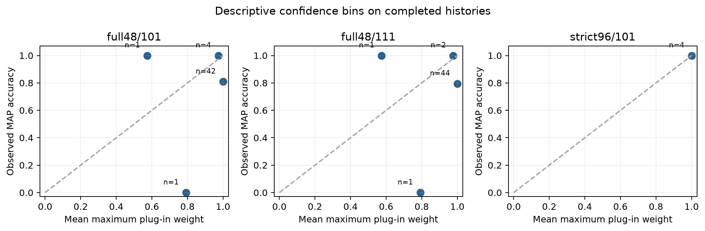
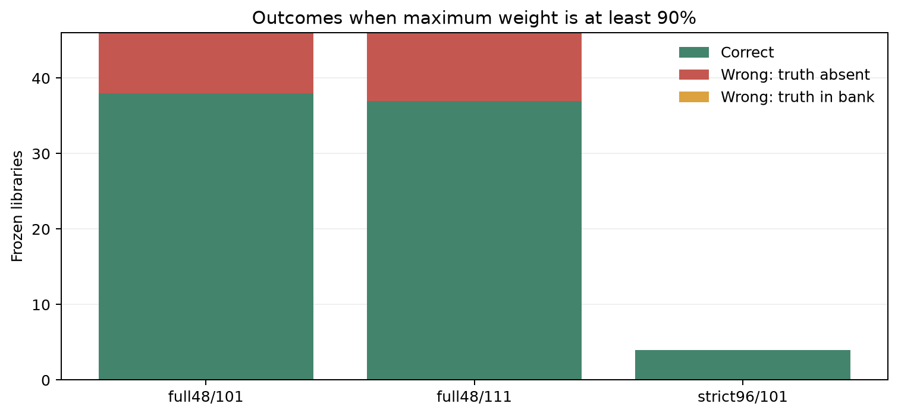

# 共同残差尺度的后验权重：既有算例验证

2026-11-12。只对已完成的冻结候选和原验证观测重新评分；没有重拟合、结构求解、实际新日或 DR。

协议锁定 `sigma²=min MSE`、`s=2 sigma²/N`，均匀拓扑先验；不按结果调温度。N 为所有节点×验证时槽的标量残差数。

同一活动拓扑保存多个参数点时，按训练 MSE 最小、原序号择一；所有点保留在私有审计中，不在验证集重拟合。另核验本次 MAP 与原整库选择的差异。

## 实际结果

| 数据／方法 | 完成／计划 | MAP完整恢复 | 库含真拓扑 | 最高权重≥90%：正确／入选 | 错误高置信 |
|---|---:|---:|---:|---:|---:|
| full48/101 | 48/48 | 39/48 | 39/48 | 38/46 | 8 |
| full48/111 | 48/48 | 38/48 | 38/48 | 37/46 | 9 |
| strict96/101 | 4/4 | 4/4 | 4/4 | 4/4 | 0 |

历史主组每例训练96＋验证288，48输入来自四网络、四组种子、三档电压噪声；两方法复用同一观测。补充组只有四例，总96点、前64训练后32验证，固定使用原相对门槛0的已完成结果。两组分开报告。

## 与原MSE选择及候选覆盖的关系

- full48/101：MAP与原选择拓扑不同 0 例；库含真但MAP选错 0 例；库缺真 9 例；只有一个不同拓扑 0 例。
- full48/111：MAP与原选择拓扑不同 0 例；库含真但MAP选错 0 例；库缺真 10 例；只有一个不同拓扑 0 例。
- strict96/101：MAP与原选择拓扑不同 0 例；库含真但MAP选错 0 例；库缺真 0 例；只有一个不同拓扑 0 例。

共同正尺度和均匀先验使MAP仍按MSE排序。验证对象是权重的数值与解释，不预期仅靠归一化提高恢复率。库缺真时真实拓扑权重为0，其无条件对数评分为无穷差；未用裁剪抹掉这一项。

## 原.003难区分门槛

- full48/101：原.003相对门槛内 7 例，其中MAP正确 6 例；平均整库最高权重 0.8941419121405233，前两者单独归一化平均权重 0.8941592313770325。
- full48/111：原.003相对门槛内 4 例，其中MAP正确 3 例；平均整库最高权重 0.8300805657419945，前两者单独归一化平均权重 0.8301108744058856。
- strict96/101：原.003相对门槛内 0 例，其中MAP正确 0 例；平均整库最高权重 None，前两者单独归一化平均权重 None。

该门槛用于描述既有难区分候选，不修改本次后验公式，也不筛除不利样本。单对概率只条件于前两者，与整库概率分开。

## 已核验与解释范围

独立检查逐支持重建P/Q预测，并用未平移高斯对数似然重算权重；另做解析二模型、相同损失、单位缩放、样本累积、极端数值和零方差检查。实际误差和测试记录见验收文件。

这些是已研究历史的回溯诊断，不是独立概率校准。节点／时槽全部独立是本次刻意采用的简单假设；最高权重不是现场准确率保证。真拓扑标签仅在所有权重及源码／输入哈希封存后进入评价。活动large96批次没有纳入。

原参数、MSE、方差、完整点表及逐项审计留在私有outputs；公开表只给候选数、概率及完整拓扑恢复指标。失败和零方差保留计划分母，未加任意噪声下限。

