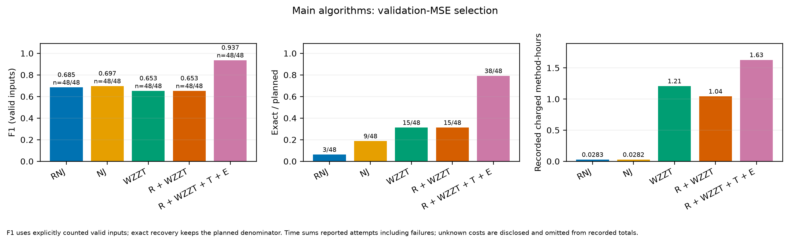
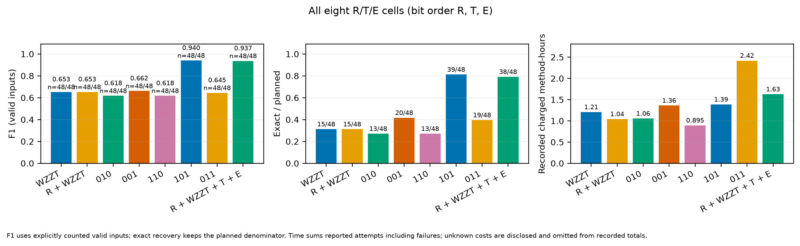
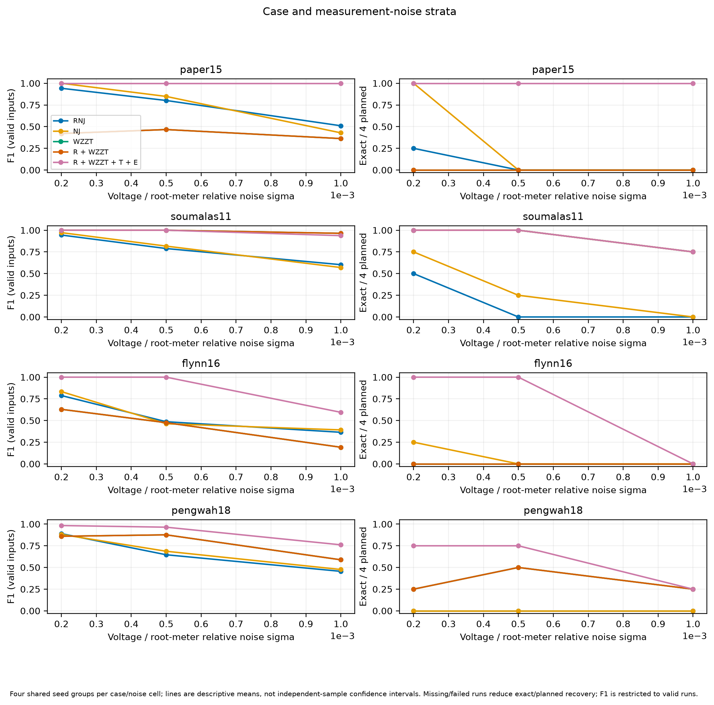

# 独立目录48输入：验证MSE选模、主方法与完整R/T/E消融

本轮480个方法配置全部新运行并通过独立复核。当前最终选模已经使用验证集MSE；MAE仅作为诊断保存。完整R/T/E版本的F1为0.936734，完整恢复38/48；本批消融表现最好的是不启用T的R＋W＋E版本，F1为0.940355，完整恢复39/48。

主要收益来自RNJ候选供给与可撤销E重构的配合。单独给W增加R，在本批没有改变预测模型或拓扑，只缩短了耗时。T在≤5块时接替后续W，改变了保存路径；两例负效应来自缺少原W中验证更好的中间点。

## 1. 最终到底按什么选模型

旧版最终主选使用MAE。本轮启动前改为验证MSE，并重新运行全部方法。对于训练得到、系数已经冻结的候选模型m，最终比较

\[
\operatorname{MSE}_{\rm val}(m)=\frac{1}{nT_{\rm val}}
\sum_{t,i}(Y_{ti}-\widehat Y_{ti}(m))^2.
\]

代码以MSE_val/M_ref比较；M_ref是同一输入固定的正训练参考，只改变单位。规范化分数相差≤1e−12时，优先少内部连接，再按MSE和路径顺序。最终排序不加入线路数惩罚。`selected`与`selected_mse_view`一致，`selected_mae_view`不参与采纳。

训练阶段仍统一使用

\[
J(\mathcal F)=\operatorname{MSE}_{\rm train}(\mathcal F)/M_{\rm ref}+0.003k,
\]

其中k只统计非单点、非全集的内部连接。提议经固定族QP拟合和允许的数值清零后，J下降超过1e−10才接收。所有训练权重由训练集估计；验证选择之后不再用验证或测试重新拟合。

新增5项MSE选模测试包含MAE/MSE排序相反的反例，全部26项单元测试通过。正式独立审计又从观测重建所有候选预测、验证MSE和最终选择索引，480/480一致。

## 2. 输入、算法与信息边界

数据为独立目录附带的48个历史观测输入：paper15、soumalas11、flynn16、pengwah18各12组，来自4组共享物理种子和3档电压/根表相对噪声（0.0002、0.0005、0.001）。每输入训练为连续一天96个15分钟点，验证为独立三天288点，测试为独立一天96点。P/Q相对噪声为0.005。本轮重新计算方法结果，观测数据字节沿用已归档面板。

原生拟合进程只加载训练/验证；全部480项终态、管理进程退出后，独立分析才读取真实层级和测试数组。参数、候选规则和求解预算在运行前冻结，过程中没有按F1调参或挑选输入。

当前独立版本的模块定义如下。

| 模块 | 实际操作 |
|---|---|
| R | 3种R/X几何与5种容差产生15个原始RNJ族。逐一拟合相容单候选并清零，提供候选和热启动；向E提供连接池。没有固定两个小种子。 |
| W | 从单点/全集基底逐步寻找一个未知、相容的新集合，联合重拟合旧权重并及时释放允许删除的零块。原生未知支持域不受R池限制。 |
| T | 当前最大直属子块数≤5时结束后续W；枚举宽度≤5的完整子树切面及其非平凡并，至多联合重构一次。 |
| E | 至多一次可撤销联合选择。候选为R池、自己的路径、T候选和全部终端对；仅基底必选，临时内部连接允许退出。 |

W类最后在自身已接收路径及单点保护模型中按验证MSE择优。没有独立完整RNJ整树的最终备用择优。RNJ/NJ基线分别输出自己的固定族QP重拟合和数值清零结果。

全部W类使用凸MIQP；固定层级的权重拟合为有界凸QP。响应系数界为[0,2]，没有新加正阻抗下界或0.24输出收缩。当前R定义与早期固定少量小种子的版本有区别，见[模型](../../MODEL.md)和[来源说明](../../PROVENANCE.md)；旧120输入成绩不并入本表。

## 3. 主比较

所有方法均为48/48有效。耗时为48个输入的累计方法记账分钟，包含各自一份公共预处理成本。

| 方法 | 平均F1 | 完整恢复 | 完整恢复率 | 累计分钟 |
|---|---:|---:|---:|---:|
| RNJ | 0.685044 | 3/48 | 6.25% | 1.70 |
| NJ | 0.697405 | 9/48 | 18.75% | 1.69 |
| 纯WZZT（000） | 0.652902 | 15/48 | 31.25% | 72.50 |
| RNJ＋WZZT，完整R/T/E（111） | 0.936734 | 38/48 | 79.17% | 97.74 |

完整111相对纯WZZT的F1提高0.283832，完整恢复净增23例：新增24例、损失1例。逐输入F1为30胜、16平、2负；相对NJ为37胜、11平、0负。代价是累计耗时高于几何基线，也比纯WZZT增加25.23分钟。

普通R＋W、不启用T/E的100作为消融保留，F1与纯WZZT相同，耗时62.61分钟。

完整恢复按非单点、非全集的真实下游终端集合完全相同计数；它评价可表示的层级，不等于所有物理阻抗数值和不可区分的串联节点均已恢复。

## 4. 完整八格消融

三位编号依次表示R、T、E的开关；W始终启用。

| 编号 | 结构 | F1 | 完整恢复 | 恢复率 | 累计分钟 |
|---|---|---:|---:|---:|---:|
| 000 | W | 0.652902 | 15/48 | 31.25% | 72.50 |
| 100 | R＋W | 0.652902 | 15/48 | 31.25% | 62.61 |
| 010 | W＋T | 0.617544 | 13/48 | 27.08% | 63.40 |
| 110 | R＋W＋T | 0.617544 | 13/48 | 27.08% | 53.71 |
| 001 | W＋E | 0.661953 | 20/48 | 41.67% | 81.84 |
| **101** | **R＋W＋E** | **0.940355** | **39/48** | **81.25%** | **83.26** |
| 011 | W＋T＋E | 0.644817 | 19/48 | 39.58% | 145.18 |
| 111 | R＋W＋T＋E | 0.936734 | 38/48 | 79.17% | 97.74 |

R在E关闭时的两对比较（000/100、010/110），48/48输入的最终支持、系数、验证MSE及W结构轨迹均相同。100比000的实测累计时间减少13.65%。这一结果支持R的求解引导作用；本批的拓扑提升发生在E能联合使用RNJ候选时。

100→101的F1增加0.287453，完整恢复增加24例，F1为30胜、18平、0负。001→101则体现R与E的配合：F1增加0.278402、完整恢复增加19例。R×E二阶交互在T关闭/开启时分别为+0.278402/+0.291917，明显强于单独R。

T的四种条件边际F1都为负：000→010、100→110均为−0.035358；001→011为−0.017136；101→111为−0.003621。101→111为0胜、46平、2负，完整恢复少1例，累计时间多14.48分钟。因此本批更简洁且表现较好的版本是101；代码同时保留预定完整111与全部消融入口。

Shapley分摊的平均F1贡献为R +0.143706、T −0.021742、E +0.161868。它是同一八格的描述性分摊。六种“加入顺序”图同样由这八格差分得到，没有额外运行把R移到W之后等时间顺序策略。

完整12种条件边际、二阶/三阶交互、逐输入配对结果均保存在CSV中。

## 5. T的两个负例：路径机会减少

T在≤5时接替W，会跳过后续W的部分中间模型。下面两例的101/111最终训练端点相同，最终验证选择的机会不同。

| 输入 | 101最终选择 | 111最终选择 | F1变化 |
|---|---|---|---:|
| soumalas11，seed2，噪声0.001 | 早期W，k=3，验证MSE 8.501275e−6 | T端点，k=4，验证MSE 8.580838e−6 | 0.857143→0.750000 |
| pengwah18，seed3，噪声0.0002 | W真族，k=7，验证MSE 3.163208e−7 | E错族，k=8，验证MSE 3.171700e−7 | 1.000000→0.933333 |

soumalas的保存计数路径由101的0→1→2→3→4变为111的0→1→2→4；较好的k=3验证点被跳过。pengwah的101保存了后续W产生的k=7真族，111切到T后没有生成并保存该点。两例111均多一个假二终端块。

两例E池分别为81⊂113和195⊂231，两个假终端对本来就在双方的全终端对池中；两个最终结构在双方E域都可行。双方最后训练端点的J也分别完全相同。soumalas错误端点优于真族的J差大于相关原生gap；pengwah在101较小池以gap=0也得到相同错误端点。因此，这两例支持“提前切换损失了可供验证回选的W路径点”，不支持把差异直接归给求解时限或T的数学模型固有缺陷。

## 6. 候选覆盖、最终MSE与线路数惩罚

| 版本 | E池覆盖全部真连接 | 自身保存库含完整真族 | 最终完整恢复 | 有真族却未选中 |
|---|---:|---:|---:|---:|
| 001 | 20/48 | 20/48 | 20/48 | 0 |
| 101 | 41/48 | 39/48 | 39/48 | 0 |
| 011 | 21/48 | 19/48 | 19/48 | 0 |
| 111 | 42/48 | 38/48 | 38/48 | 0 |

本批所有方法中，只要自身库里保存了完整真族，验证MSE均选中了它。剩余错误涉及候选连接缺失、未生成保存真族，以及训练目标对竞争错误结构的偏好。池覆盖全部真连接只是可行性条件，不能代替实际生成真族。

事后独立对48个真族做相同[0,2]界的训练BVLS拟合，并核验凸QP盒约束下界。对一个已冻结错误点定义

\[
\Delta J=J_{\rm wrong}-J_{\rm true}
=\frac{M_{\rm wrong}-M_{\rm true}}{M_{\rm ref}}
+0.003(k_{\rm wrong}-k_{\rm true}).
\]

真族诊断全部48/48通过，未进入搜索、参数选择或最终选模。101的9个最终错误中，7个E池缺至少一个真连接；6个最终点的J高于真族可行点，3个确实低于真族最优值的已验证下界。111的10个错误中，6个池缺连接；5个最终点J更高、5个确实更低。最终点可能来自早期路径，因此这组J对比应结合E提议和验证选择一起解释。

统一增强线路数惩罚缺少普遍依据。101的3个“训练J偏好错误”点中，2个与真树同k、1个更少；111的5个中，3个同k、1个更少、1个更多。同k时计数项严格为0；增大惩罚还会进一步偏向少块错误。

具体地，pengwah负例的拟合项为−0.003066417、计数项为+0.003，总差仍为−0.000066417；单独比较这两个固定族，alpha稍大于0.003066417可改变排序。soumalas负例与真族同k，拟合项为−0.000544717，改线路数罚项无法直接改变两者排名。这些为事后解释，本轮没有据此调参。

该诊断分开了拟合项与计数项，噪声和AC到线性响应模型的偏差仍共同包含在拟合项中。要因果拆分两者，需要固定结构和参数界的干净线性、带同噪声线性、干净AC、带噪声AC配对实验；本轮未增加这类实验。

## 7. 网络、噪声与末端小块

以下每个网络含12输入，单元格为F1／完整恢复数。

| 网络 | RNJ | NJ | W | R＋W＋E（101） | 完整111 |
|---|---|---|---|---|---|
| paper15 | 0.751470／1 | 0.759077／4 | 0.416712／0 | 1.000000／12 | 1.000000／12 |
| soumalas11 | 0.778704／2 | 0.786267／4 | 0.988095／11 | 0.988095／11 | 0.979167／11 |
| flynn16 | 0.546239／0 | 0.562854／1 | 0.432105／0 | 0.864899／8 | 0.864899／8 |
| pengwah18 | 0.663764／0 | 0.681421／0 | 0.774695／4 | 0.908425／8 | 0.902869／7 |

每档噪声含16输入：101的低/中/高噪F1分别为1.000000、0.991071、0.829993，完整恢复为16/16、15/16、8/16；111为0.995833、0.991071、0.823296，完整恢复15/16、15/16、8/16。

101与111均剩19个漏块，其中16个涉及3–4终端块；漏掉的8终端块已降为0。假二终端块则分别为6个和8个。数据支持把后续关注点放在弱末端连接及竞争小块上，而非继续扩大求解时限。

相近线路系数和终端负荷下，小块的聚合响应较弱；相似P/Q曲线、平方电压变换后的误差和共享根表噪声都会增加区分难度。本轮记录能定位困难输入与目标偏好，尚未构成理想无噪声条件下结构不可辨识的证明。

## 8. 实际预算、求解证据和统计范围

每方法、每输入总记账预算14,400秒，名义总上限480×4=1,920方法小时。W单次原生MIQP上限3,600秒；T使用前向阶段余额，E使用结构总预算余额。固定族QP300秒为不可抢占的事后软检查，输出预留600秒。E开启时先为W/T分配约半数结构余额。相对MIP gap为1e−4、绝对gap为1e−7；8工作进程，每个Gurobi/BLAS单线程。

| 计时口径 | 实际值 |
|---|---:|
| 所有逻辑方法累计（各自计一份公共成本） | 39,817.44秒＝11.0604小时 |
| 方法工作进程新增记账 | 39,261.51秒 |
| 公共工作进程物理执行一次/输入 | 55.59秒 |
| 实际共享后的进程墙钟工作量合计 | 39,317.10秒＝10.9214小时 |
| 8路并行批次墙钟 | 5,050.94秒＝84.18分钟 |

最长单方法为1,640.39秒，远小于总预算；W/T/E单次最大实测分别为78.89、71.39、1,506.38秒。E开启时最长结构路径也远小于前向半预算，预算分配没有实际截断搜索。

所有2840次原生MIQP为status=2并达到指定gap；3420个独立固定族QP盒证书通过；48公共和480方法均各只有一次attempt，无重跑、失败、中断、超预算或未知计时。原生gap只证明对应W/T/E编码域内的数值求解精度；W的后清理计数和全路径组合仍需按实际算法解释。

表中时间是实测工作进程墙钟成本合计，含并行竞争，不是CPU秒或串行整批实测值。进程启动、最终原子写盘和管理开销的边界见protocol；完整管理stdout未重定向保存，归档保留全部可用worker日志、attempt和终态记录，并明确该缺项。

48输入来自4组跨网络、噪声共享的种子。分层和配对结果均完整保存；四种子成组重采样只用于敏感性描述。本轮属于同一历史面板上的新计算，后续可在新增物理种子上复核101的简化收益。

## 9. 文件、图表与复算

- [逐方法汇总](summary.csv)、[逐输入结果](per_model.csv)、[条件边际](conditional_marginals_summary.csv)、[交互](interactions_summary.csv)、[配对结果](paired_summary.csv)。
- [覆盖检查](coverage_summary.csv)、[阶段触发与收益](stages.csv)、[错误块大小](errors_by_size.csv)、[真族分解](objective_decomposition.csv)。
- [独立主审计](verification.json)、[oracle来源](oracle_metadata.json)、[计时](timing.json)、[运行协议](protocol.json)。
- 8组正式图各提供PNG、SVG、PDF：[主比较](figures/main_comparison.pdf)、[八格](figures/factorial_ablation.pdf)、[网络/噪声](figures/case_noise.pdf)、[条件边际](figures/conditional_marginals.pdf)、[交互](figures/factorial_interactions.pdf)、[加入顺序视图](figures/module_orders.pdf)、[求解证据](figures/runtime_solver.pdf)、[配对变化](figures/paired_changes.pdf)。
- 完整原始记录、冻结运行源和本地观测/网络保存于records.zip，实际哈希与CRC见外部archive_receipt.json。它与可运行独立目录便携包分开发送，避免嵌套重复数据。
- [复算说明](REPRODUCE.md)随归档生成。主拟合与复算均使用本地代码/数据；MIQP需要有效Gurobi许可。

算法源于运行前提交3467697d（MSE主选）与c49166df（冻结运行器）；事后审计补强和oracle工具为08d2e1ec。全部原生源和数据以协议SHA为准。审计源的后续修改只补充失败计时/来源检查，正式评分前已锁定；拟合源码、目标和预算从启动至结束保持不变。
