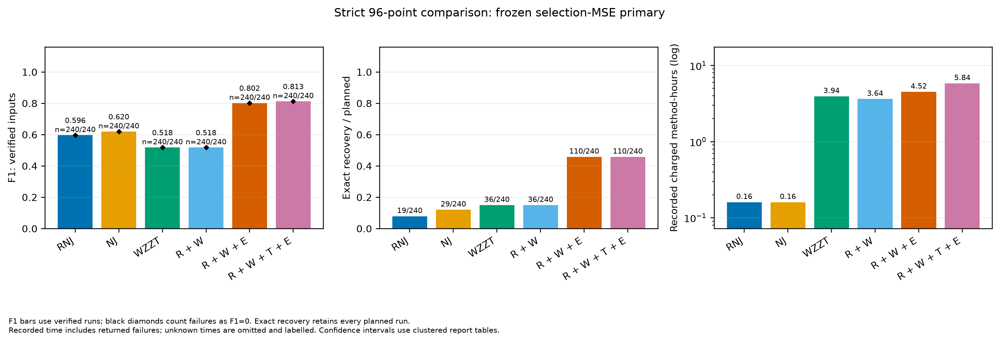

# 大规模单日96点实验汇总

主240输入和压力160输入均已完成：3040/3040个方法配置通过独立审计，失败、进程中断、预算超额和原生TimeLimit均为0。主要收益来自R候选与E联合退出的配合；T的综合收益尚不稳定。双候选能够分流部分错误，但候选对含真拓扑的比例偏低，当前瓶颈是竞争候选覆盖。

本批保持已批准的模型和参数。每输入只用一个连续96点日：64点训练、32点选择，没有额外日期或全96点重拟合。α=0.003、响应界[0,2]、T块宽5、搜索relative_gain=0、默认输出κ=0.003。R是15个RNJ族的连接候选/热启动，W是未知支持单候选MIQP，T是末端切面联合MIQP，E是允许全部临时块退出/替换的有限池MIQP。固定族权重用有界QP；最终按自身路径的选择MSE选模，无完整RNJ整树备用。详细数学见../../MODEL.md。

000关闭RNJ结构候选与热启动，仍与其他消融格共享同一个训练参考误差和共同前处理；其成本已计入各方法。这是结构搜索的纯W对照，不把它写成完全未计算RNJ相关前处理。

F1比较非平凡的活动下游终端集合，完整恢复表示该集合族完全相同，目标为观测终端的约化拓扑。单点/全集不计分，不区分无观测度二节点的串联物理线路。

## 主试验：240输入与完整八格

四网络各20个新日轨迹、三档电压/根表噪声0.0002/0.0005/0.001，共80个独立网络-日簇。所有方法使用相同观测和预算。耗时为全部输入的方法记账时间之和，包含对每方法各计一次的公共训练预处理。

| 方法 | R/T/E | 平均F1 | 完整恢复 | 恢复率 | 累计方法耗时 |
|---|---|---:|---:|---:|---:|
| RNJ | — | 0.596365 | 19/240 | 7.92% | 9.62分钟 |
| NJ | — | 0.619551 | 29/240 | 12.08% | 9.61分钟 |
| 纯WZZT | 000 | 0.517856 | 36/240 | 15.00% | 3.943小时 |
| 普通RNJ＋WZZT | 100 | 0.517777 | 36/240 | 15.00% | 3.637小时 |
| W＋T | 010 | 0.509886 | 33/240 | 13.75% | 3.496小时 |
| W＋E | 001 | 0.523877 | 41/240 | 17.08% | 4.246小时 |
| R＋W＋T | 110 | 0.509886 | 33/240 | 13.75% | 3.219小时 |
| 当前主线R＋W＋E | 101 | **0.801876** | **110/240** | **45.83%** | **4.523小时** |
| W＋T＋E | 011 | 0.528336 | 36/240 | 15.00% | 6.813小时 |
| R＋W＋T＋E | 111 | **0.812599** | **110/240** | **45.83%** | **5.840小时** |

100→101：F1增加0.284099，描述性95%配对区间[0.249535,0.320721]；完整恢复增加74例，恢复率差30.83个百分点，区间[25.42,36.25]。R单独加入W几乎不改精度，E单独加入W也只多5例完整恢复，主要是R×E互补收益。101比100的F1在144例提高、6例下降，完整恢复74增、0降。

101→111：F1点估计增加0.010723，区间[−0.001268,0.023776]；完整恢复9增9降，累计多79.04分钟。小块（≤3终端）的FP＋FN为265→267，较大块为244→204。T的净收益主要来自较大块；18个F1负例中14个缺少101原路径候选，另外4个涉及选择MSE与拓扑排序冲突。没有原生超时，当前负效应不能归因于这批求解时限。

区间按四网络分层、网络-日成簇进行2000次重采样，评价固定网络及此生成分布。六种模块加入顺序表由同一八格结果派生，未另外重排实际R→W→T→E执行次序。主批按噪声/网络、完整交互、逐例T路径及目标分解见[主报告](MAIN_RESULTS.md)和main/analysis。

图表：[八格消融](main/figures/rte_heatmap.pdf)、[条件模块效应](main/figures/ablation_effects.pdf)、[分网络/噪声](main/figures/case_noise.pdf)。

## 压力试验：160输入，四种方法

压力日重复号100..104与主批0..19隔离。四个因素各两档，每档20输入；同一网络-日共享潜在轨迹和标准化噪声，共20个独立网络-日簇。电压/根表量测噪声固定0.0005，P/Q为0.005。八种压力条件在主批真树评分前固定。

| 方法 | 平均F1 | 完整恢复 | 恢复率 | 累计方法耗时 |
|---|---:|---:|---:|---:|
| 纯WZZT 000 | 0.426917 | 9/160 | 5.63% | 2.626小时 |
| 普通R＋W 100 | 0.426917 | 9/160 | 5.63% | 2.349小时 |
| 主线R＋W＋E 101 | **0.626699** | 31/160 | 19.38% | **3.659小时** |
| R＋W＋T＋E 111 | 0.621197 | **34/160** | **21.25%** | 4.640小时 |

101−100的F1差0.199782，区间[0.147566,0.251707]；恢复率差13.75个百分点，区间[7.50,20.63]。111−101的F1差−0.005502，区间[−0.019260,0.009658]；恢复率差1.875个百分点，区间[−2.50,5.625]。T多恢复3例但平均F1略低、耗时增加26.8%，本批同样不支持稳定的综合优势。压力只运行预定四格，未把其写成另一套完整八格。

| 压力条件（每行20输入） | 101 F1 | 101完整恢复 | 111 F1 | 111完整恢复 |
|---|---:|---:|---:|---:|
| 负荷×0.5 | 0.510724 | 1/20 | 0.488123 | 1/20 |
| 负荷×1.5 | 0.915962 | 10/20 | 0.912344 | 11/20 |
| R/X比×0.5，保持各线模长 | 0.799361 | 8/20 | 0.784281 | 7/20 |
| R/X比×2，保持各线模长 | 0.871172 | 9/20 | 0.875820 | 10/20 |
| 独立节点扰动×0.1 | **0.000000** | **0/20** | **0.000000** | **0/20** |
| 独立节点扰动×0.3 | 0.219736 | 0/20 | 0.240365 | 1/20 |
| 固定内部弱边R/X×0.1 | 0.848606 | **0/20** | 0.837920 | **0/20** |
| 固定内部弱边R/X×0.3 | 0.848035 | 3/20 | 0.830723 | 4/20 |

弱激励是最明显的失效条件：独立节点扰动降到0.1时，四方法全部F1=0。101中7例选基底、1例选singleton-only保护、12例仍有错误内部块；F1=0不等于算法全部没加块。缩小独立变化同时保留公共日曲线，含噪设计矩阵即使满秩，也可能主要由量测噪声撑出小奇异方向。负荷缩小还降低了固定电压量测精度下的有效信号；其结果同时含信噪比及AC偏差变化，不能仅归为线性化误差。

弱边条件则体现F1与完整恢复的区别：大部分结构仍可恢复，弱边×0.1时101的F1为0.848606，但20例均不完整。事后真族QP有21/160例出现至少一条真内部线权重落零：独立扰动0.1有11例、0.3有1例；弱边0.1有8例、0.3有1例。它说明在这64点含噪有界拟合下，完整真族会与删去零响应的族给出相同拟合；尚未构成信息论不可辨识证明。增加求解时间或单纯放大输出κ不能补充有效激励。

各网络压力图见pressure/figures；全部原图及布局修正版都随原始记录保存。压力均值对预定八种条件等权，主批和压力不合并为一个恢复率。

图表：[压力总体比较](pressure/figures/main_comparison.pdf)、[各网络压力分层](pressure/figures/case_profile.pdf)。

## 双候选对DR复核的价值

默认输出取实际选择MSE最小的第一名，以及最佳不同活动拓扑的第二名。仅当(M2−M1)/M2≤κ（含统一数值并列容差）才返回两个。κ只改变输出，全部模型、系数和第一名不变。以下统计针对101。

| 批次 | κ | 双候选数 | 首选错误中被触发 | 错误中备选是真族 | 返回集合含真族 |
|---|---:|---:|---:|---:|---:|
| 主240输入 | 0.003 | 18/240 | 15/130 | **4/130** | 114/240 |
| 主240输入 | 0.01 | 54/240 | 44/130 | **4/130** | 114/240 |
| 主240输入 | 0.03 | 88/240 | 68/130 | **6/130** | 116/240 |
| 主240输入 | 0.1 | 141/240 | 97/130 | **6/130** | 116/240 |
| 压力160输入 | 0.003 | 29/160 | 25/129 | **2/129** | 33/160 |
| 压力160输入 | 0.01 | 57/160 | 53/129 | **2/129** | 33/160 |
| 压力160输入 | 0.03 | 94/160 | 87/129 | **2/129** | 33/160 |
| 压力160输入 | 0.1 | 124/160 | 108/129 | **2/129** | 33/160 |

默认主批18组中11组两个都错；压力29组中23组两个都错。放宽至0.1后分别有91组、106组两个都错。扩大κ提高错误分流召回，但新增正确备选很少。主批130个错误中真族只有7个进入保存库（6个排第二、1个第三）；123个库内缺真族中41个实际E池已有全部真连接、82个仍缺连接。压力129个错误中127个库内无真族，其中28个实际E池连接齐全、99个仍缺连接；仅有的2个正确备选均已被默认门槛捕获。完整覆盖分解见main/analysis/interpretation_review.json及pressure/analysis/interpretation_review.json。

这些数值是固定候选对中存在纠错机会的上限。此次未执行DR；实际干预后恢复率、观测成本和错误决策率仍需另测。若后续DR只做二选一，先提高竞争候选覆盖更重要；若允许DR后重新搜索，需另记干预观测预算与新增候选。单输出也有大量错误，有限库MSE分离不作正确性或唯一性认证。

图表：[主批DR复核负担/候选覆盖](main/figures/dr_tradeoff.pdf)、[压力DR复核负担/候选覆盖](pressure/figures/dr_tradeoff.pdf)。

## 总预算、实际耗时与失败记录

每方法/输入记账上限14400秒，W原生单次3600秒、QP返回后软检查300秒、输出预留600秒，8个单线程worker。主2400配置名义9600方法小时；压力640配置2560方法小时；合计12160方法小时。预算是记账约束，SciPy部分不能由本代码硬抢占。

| 耗时口径 | 主批 | 压力 | 合计 |
|---|---:|---:|---:|
| 逻辑方法累计，共同前处理对每方法各计一次 | 36.0378小时 | 13.2740小时 | **49.3118小时** |
| 物理共同前处理只计一次＋各方法新运行 | 35.2893小时 | 13.1104小时 | **48.3997小时** |
| 所有经理调用日历合计，8进程 | 4.5847小时 | 1.6961小时 | **6.2808小时** |
| 数据生成 | 13.545秒 | 4.560秒 | 18.106秒 |

两批共18695次原生调用，无TimeLimit、同族界冲突或未检查记录。400次封存后真族QP诊断使用原64/32点，0失败/超额，不改变正式选择；其日历耗时主49.604秒、压力12.559秒单列，不借记正式方法预算。T/E精确域的真族见证合计2247次事件，857次适用、1390次不适用，0跨族界矛盾。界核对覆盖每次声明的局部/有限域，未给整体树搜索全局最优证明。

3040方法的失败、中断、预算超额、审计无效数均0，生成400/400成功。完整原生输出、状态、预算、输入/源码/结果SHA、attempt和经理日志全部归档。另保留一次封存前过早truth调用被守卫拒绝的操作记录；没有读真树或重跑方法，封存完成后恢复成功。压力首版分层图的排版问题也保留原图及审核记录，布局修正版只改展示。

最终83项回归全部通过（21.428秒）。逐配置结果、完整八格、描述性区间、所有原生界/状态、独立物理评分、后验目标分解和图表位于main及pressure子目录。原始记录发布、移位复核和便携目录说明见[复现步骤](REPRODUCE.md)及records/manifest.json。

完整记录已发布为两个独立合法ZIP，共18195成员、400个单日NPZ，原始1148200801字节压缩为99600628字节。两卷均通过CRC和逐成员SHA，归档前后源字节及清单保持一致。请共同保留[第一卷](records/records-001.zip)、[第二卷](records/records-002.zip)、[文件清单](records/manifest.json)及[发布凭据](records/receipt.json)。

又将全部记录安全解压到新路径，用归档analyzer重算主2400项和压力640项；全部指标CSV（含F1、恢复数、耗时、DR及重采样区间）与原表一致。守卫只允许读取提取的400个NPZ，旧项目观测读取和拟合器导入均0，新增QP/MIQP均0；最终提取源和发表卷SHA不变。成功凭据为../../validation/large96_20261112/archive_replay_receipt_002.json。首次复核器错误地只在figures目录找绘图源，而实际源在postprocessing/source，已在启动分析前被自身守卫拦下；首次失败凭据同样保留，没有重跑正式方法。

## 结论与下一步的边界

101保留了本批主要恢复收益，并比111更省时；适合作为当前较简洁的主线。T在主批略增F1、压力略增完整恢复，两个比较区间均包含零，继续保留为可选消融。

后续DR最值得解决的是弱独立激励、弱内部线和真竞争候选缺失。当前κ不是统计置信参数；单纯提高κ主要增加复核负担。本批也未把噪声、P/Q输入误差和AC线性模型偏差单独分离，不能据这些结果把错误全部归咎于线路数惩罚或某一个模块。四个物理网络固定，结论适用于所测轨迹、噪声和预定压力范围。
