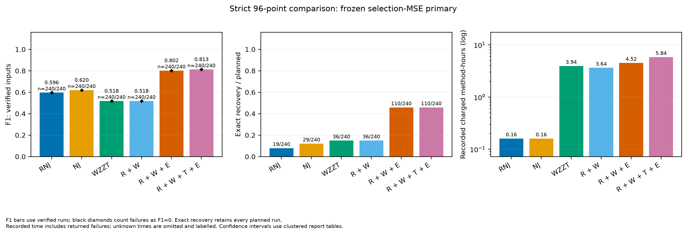
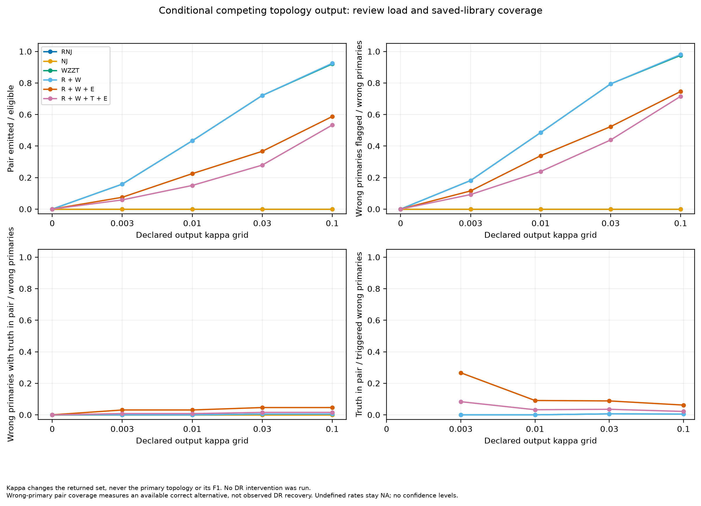

# 严格单日96点：主试验结果

240输入、2400个方法配置已全部完成，并由第二条独立评分路径复核。101（R＋W＋E）的平均F1为0.801876，完整恢复110/240；普通R＋W为0.517777、36/240。111加入T后F1为0.812599，完整恢复仍为110/240，耗时增加29.1%。本批支持以101作为较简洁的主线，T作为需要额外成本的可选模块。

本文件只报告已封存的主试验；预先固定的160输入压力试验单独汇总。正式模型参数没有根据本批真拓扑成绩调整。

## 数据与信息边界

四网paper15、soumalas11、flynn16、pengwah18，各20个新日轨迹，电压/根表相对噪声三档0.0002、0.0005、0.001，合计240输入。P/Q相对噪声0.005，物理根电压波动0.003。每输入只生成一个连续96时点观测文件，前64点训练、后32点选择；没有额外天数、预测测试集或全96点重拟合。

同一网络-日的三档噪声配对，独立网络-日簇为80个。区间按四网络分层、网络-日成簇进行2000次配对重采样。四个物理网络固定，因此评价的是新轨迹与观测条件，不是新图泛化。

真树和生成诊断位于worker观测域外。全2400项进入终态、选择封存完成后才暴露评价族。独立审计重算输入/源码/结果哈希、训练和选择MSE、训练目标、活动族、主选与双候选判别；2400/2400通过。另一路从冻结物理CSV重新构树、直接从原始系数提取活动族，复核全部F1、完整恢复及DR计数。

## 方法定义

所有W类从单点/全集基底开始。R使用三种R/X几何与五档分组容差生成的15个RNJ族，提供连接候选和热启动；本目录的简化实现不再硬固定历史版本的两个小种子。W为原始未知支持逐步加块MIQP。T在直属块数不超过5时，对所有允许子树切面的候选一次联合重构。E在自身路径、R/T候选及二元连接的有限池内，允许全部临时内部块删除或替换，至多求解一次。

固定族权重均以训练MSE进行有界QP拟合；结构目标为

\[
J(\mathcal F)=\operatorname{MSE}_{64}(\mathcal F)/M_{\rm ref}+0.003k(\mathcal F).
\]

响应系数界[0,2]；数值零块及时释放。搜索相对接收门槛为0，仅要求J超过数值容差下降。最终按本方法自身保存路径的32点选择MSE排序，数值并列优先少连接；没有完整RNJ整树备用或额外整树择优。RNJ/NJ各自只输出其固定族的QP重拟合及清零结果。

输出门槛κ与搜索门槛分开。主选选择MSE为M1、最佳不同活动族的MSE为M2；在数值容差外，只有(M2−M1)/M2≤κ才返回两个。默认κ=0.003，五档敏感性仅回放同一冻结库，不增加MIQP、不改变第一名。

## 主比较与完整八格

耗时为240项的方法记账时间之和，公共训练预处理对每方法各计一次；不是8进程并行后的日历时间。

| 方法 | R/T/E | 平均F1 | 完整恢复 | 恢复率 | 方法总耗时 |
|---|---|---:|---:|---:|---:|
| RNJ，QP重拟合与清零 | — | 0.596365 | 19/240 | 7.92% | 9.62分钟 |
| NJ，QP重拟合与清零 | — | 0.619551 | 29/240 | 12.08% | 9.61分钟 |
| 纯WZZT | 000 | 0.517856 | 36/240 | 15.00% | 3.943小时 |
| 普通RNJ＋WZZT | 100 | 0.517777 | 36/240 | 15.00% | 3.637小时 |
| W＋T | 010 | 0.509886 | 33/240 | 13.75% | 3.496小时 |
| W＋E | 001 | 0.523877 | 41/240 | 17.08% | 4.246小时 |
| R＋W＋T | 110 | 0.509886 | 33/240 | 13.75% | 3.219小时 |
| 当前主线R＋W＋E | 101 | **0.801876** | **110/240** | **45.83%** | **4.523小时** |
| W＋T＋E | 011 | 0.528336 | 36/240 | 15.00% | 6.813小时 |
| R＋W＋T＋E | 111 | **0.812599** | **110/240** | **45.83%** | **5.840小时** |

R单独加入W几乎不改变精度：F1差−0.000079，完整恢复相同，耗时减少7.8%。E单独加入W也只增加5例完整恢复。R与E共同启用后才出现主要收益：101比100的F1增加0.284099，完整恢复增加74例，耗时增加24.4%。R×E在T关闭时的F1交互为0.278078，描述性95%区间[0.241574,0.314651]；完整恢复交互为28.75个百分点，区间[23.33,34.17]。

101的F1区间[0.778825,0.826302]，完整恢复率区间[40.00%,51.67%]。101−100的F1差区间[0.249535,0.320721]、恢复率差区间[25.42,36.25]个百分点。111−101的F1差0.010723，区间[−0.001268,0.023776]；恢复率差为0，区间[−3.75,4.17]个百分点。T对个别输入有正负变化，不能概括为始终无效；本批尚未显示其完整恢复收益。

R主要改变候选来源，E允许同时撤掉旧块并组合这些候选，两者作用互补。101最终152例选中E产生的模型，其中74例完整恢复；另外88例选中W路径模型，其中36例完整恢复。这是最终来源统计，模块的因果贡献以八格配对差分判断。

加入T的111并不包含101所有原路径点。18个F1下降输入中，14个缺少101原活动族及同系数候选、且111最终选择MSE更高；另1个旧点也缺失但新MSE更低，3个保留旧点却因选择MSE更低而选中F1更差模型。完整恢复9增9降。以≤3终端定义小块，T使小块FP＋FN由265变267，较大块由244降至204，总错误509降至471；本批T的净收益主要来自较大块。逐输入证据见main/analysis/terminal_review.json。

| 网络（各60输入） | 100 F1 / 恢复数 | 101 F1 / 恢复数 | 111 F1 / 恢复数 |
|---|---:|---:|---:|
| paper15 | 0.405964 / 5 | 0.825890 / 32 | 0.854208 / 33 |
| soumalas11 | 0.766257 / 27 | 0.793399 / 29 | 0.783479 / 28 |
| flynn16 | 0.347218 / 2 | 0.748744 / 22 | 0.762752 / 21 |
| pengwah18 | 0.551667 / 2 | 0.839469 / 27 | 0.849958 / 28 |

按网络、噪声、全部模块加入顺序、条件边际和交互的明细位于main/analysis。101仍有130/240未完整恢复；目前收益与可靠辨识是两个不同层次。

三档噪声下101完整恢复依次为62/80、45/80、3/80，最高噪声贡献77/130个未完整恢复输入。因而平均F1的优势不应掩盖高噪声条件下的恢复不足。

## 双候选对后续DR复核的价值

以下仅评价候选对与复核触发。没有执行DR或加入干预观测，因此“含真拓扑”表示完美后续判别下的可用机会。

| κ | 返回两候选 / 240 | 捕获首选错误 / 130 | 其中备选是真拓扑 | 返回集合含真拓扑 / 240 |
|---:|---:|---:|---:|---:|
| 0 | 0 | 0 | 0 | 110 |
| 0.003 | 18 | 15 | **4** | 114 |
| 0.01 | 54 | 44 | **4** | 114 |
| 0.03 | 88 | 68 | **6** | 116 |
| 0.1 | 141 | 97 | **6** | 116 |

默认门槛复核18/240=7.5%的输入，捕获15/130=11.54%的首选错误，其中4/130=3.08%有正确备选。18组中3组原首选已正确、11组两者均错。放大至0.1后复核量为58.75%，捕获74.62%的首选错误，但只有6/130=4.62%有正确备选，91组两者均错。κ由0.03增至0.1多53次复核而未增加正确备选。

130个首选错误中，真族只在7个保存库中出现：6个排在不同拓扑第二名，1个排第三名。123个库内缺真族的输入中，41个实际E池已经包含全部真连接，但没有把真族组合并保存下来；82个至少缺一个真连接。扩大输出κ主要改变分流，补不出缺失或第三名的真族。

默认单输出仍有115/222=51.80%为错；κ=0.1时单输出中33/99=33.33%为错。单输出仅表示冻结库内的分离或无备选，不是正确性认证。若未来DR只在固定二选一中判别，先改善竞争候选的覆盖比继续放大κ更关键；若DR允许重新搜索，须另立干预数据预算并评价新增候选。

## 求解预算、审计与失败记录

每方法/输入总记账预算14400秒，W原生调用上限3600秒、QP返回后软检查300秒、输出预留600秒；8个单线程worker。T/E使用其实际剩余阶段预算。主试验名义总预算9600方法小时，实际方法记账36.0378小时；公共预处理物理只计一次时为35.2893小时。所有经理进程调用合计日历4.5847小时，生成13.545秒，事后分析另计。

2400项均fitted；失败0、预算超额0、进程中断0、原生TimeLimit 0。14254次原生调用的界记录均完成必要一致性检查，0同族界冲突。额外240个真族QP使用原64/32点，仅作封存后诊断；1816个T/E事件中667个真族符合该次精确候选域和计数限制，可作跨族界见证，0矛盾，其余1149个不适用。每次子问题的界只解释其声明的域，整体树搜索仍为路径与有限池搜索。

保留一次操作时序错误：经理尚未写完selection_seal时，过早调用truth被守卫拒绝，没有读入真树；待封存完成后重做后处理成功。原始拒绝和恢复说明保存在postprocessing_attempts/truth_before_seal_001.json。此项与方法失败分开记账，没有重跑算法或重置预算。

真族QP是后验对照，不能把其训练优势直接归因为噪声或AC线性化偏差；本批没有无噪声/精确线性配对分解。历史48输入使用训练96＋验证288＋测试96，生成面板也不同，其约0.94的F1不能直接作为本批总96点实验的同口径前值。

在101的130个首选错误中，58个训练MSE低于真族、72个更高；计入线路数惩罚后62个J低于真族、68个更高。惩罚静态改变了26个排序：15个拟合原本更差的模型因少线路而J更低，11个拟合原本更好的模型因多线路而J更高。前15个均处在最高噪声档0.001；低噪声档的18个错误则全部训练MSE已经低于真族。故惩罚是部分错误的影响因素，去掉惩罚不足以解决这批错误。参数改变也会改变搜索路径，这些静态计数不是改α后的恢复数预测。130个错误中89个与真族非嵌套、12个是真族子族、29个是真族超族；本批真族拟合均无零权重塌缩。32点选择MSE方面，22个错误模型低于真族、108个更高，说明候选没有生成或保存真族也是实质瓶颈。完整分解及区间见main/analysis/objective_review.json。

## 复核文件与封存

主协议SHA256：ceac935650e280105c507e26ce780191fde4340cdd3a8fd3ba29028f8a6a8fc4。

选择封存SHA256：17a378f999e2dde40eb8ce54137d571c34c47b47fcd72523952cb8bf6a581c2f。

main/analysis保存逐输入指标、候选、事件、原生调用、QP证书、配对区间、完整八格及独立解释；main/evidence保存协议、封存、完成和独立物理重评分证明。完整原始输入、冻结源码、公共拟合、逐次方法结果和日志随records分卷保存，见最终总报告的复现索引。
