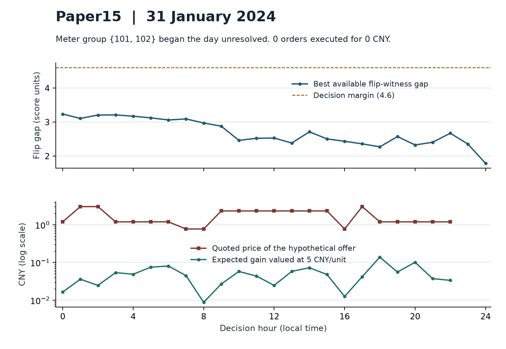

# Four-network scheduled probing

None of the four policies bought a block on 31 January 2024. Each policy began with the same five unresolved meter groupings across the four feeders. Natural measurements ruled out one grouping on Pengwah18 by the fifth hour. Four groupings stayed unresolved. All five groupings were outside the estimated tree and absent from the physical network. The initial and final trees had a grouping F1 of 1 on all four feeders.

| Feeder | Unresolved at the start | Correct / wrong / unresolved at hour 24, each policy | Hours with feasible P3 offers below their price | Lowest price per unit of positive predicted gain (CNY) |
| --- | ---: | --- | ---: | ---: |
| Soumalas11 | 1 | 0 / 0 / 1 | 23 | 322.91 |
| Paper15 | 1 | 0 / 0 / 1 | 23 | 43.04 |
| Flynn16 | 2 | 0 / 0 / 2 | 23 | 94.27 |
| Pengwah18 | 1 | 1 / 0 / 0 | 5 | 477.14 |

There were 23 opportunities to place an order on each day. Pengwah18 had 18 further gates with its group already decided or procurement stopped. P3 visited a feasible menu in all 74 gates with an eligible unresolved target and a passing model trust check. At every such gate, the largest expected monetary benefit less expenditure was negative among the nonzero offers. The configured value of one information-score unit was 5 CNY. The price per unit in the table is the minimum of expenditure divided by positive predicted incremental information over feasible nonzero offers on that feeder's observed path. It describes when an offer on this path would begin paying for itself. The behaviour after a different first purchase would require a new closed-loop run.



Paper15 had the lowest observed price per positive unit among the four networks. Each marker in the lower panel uses the feasible offer with the lowest price per positive unit at that hour. For example, at 18:00, an offer for an additional 0.996 kW at meter 102 during 19:00–20:00 cost 1.195 CNY. Its predicted incremental gain was 0.02777 units, worth 0.139 CNY. Consequently the actual order and payment were zero. The upper panel shows the score difference of a feasible tree containing the alternative grouping at meters 101 and 102 relative to the current tree. The gap stayed below 4.6 throughout. [Figure data](probe_offer_trajectory.json)

## Budget and two-day comparisons

Reducing the daily budget from 100 to 50 CNY gave the same outcomes for P1, P2 and P3 on Soumalas11 and Pengwah18. All six runs spent zero. On the observed 24-hour paths, the value of information per unit and the offered block prices determined the purchase decision before the daily limit became active.

The two-day runs started on 30 January with a new eight-day history for each feeder. Three policies shared each initial estimate and a 100 CNY daily budget. P0 observed throughout, `last24` allowed P3 deliveries on 31 January only, and P3 allowed deliveries on both days. All six runs bought zero blocks. Grouping F1 was 1 on both feeders from the initial to the final estimate, and all quarter-hour AC checks passed.

| Feeder | Initial unresolved groups | Correct / wrong / unresolved after 24 h | After 48 h | Observed changes across hourly assessments |
| --- | ---: | --- | --- | --- |
| Soumalas11 | 2 | 0 / 0 / 2 | 0 / 0 / 2 | One group was correctly decided during hours 15–21, 35–36 and 38–41. Both were unresolved at hour 48. |
| Pengwah18 | 1 | 0 / 0 / 1 | 0 / 0 / 1 | The group was correctly decided at hours 38 and 39. Procurement stopped at hour 39 under the two-consecutive-decision rule. Further measurements reopened the group at hour 40. |

The hourly results distinguish a first correct decision from one sustained through the end of the window. In particular, the two-consecutive-decision stopping rule ended procurement before the Pengwah18 group reopened. The 24-hour and two-day experiments use different starting histories and target sets.

## Equipment and observations

The experiment used the archived registration snapshot and feeder-to-meter scaling for each network. At each meter, 25% of mapped registered battery and EV power was available through the aggregator. Battery energy was set at 2.7 kWh per kW, initial state of charge at 50%, limits at 20–80%, and efficiency at 95%. EV charging was available from 18:00 to 08:00, with half of that charging power available for a pause. These are simulated participation and availability assumptions applied to dated equipment registrations. Enrolled battery/EV totals in kW were 7.12/9.60 on Soumalas11, 7.71/16.07 on Paper15, 7.72/13.88 on Flynn16 and 7.72/12.45 on Pengwah18.

P0 observed passively. P1 used the earlier whole-tree score on the common set of current fitted flip witnesses, coalescing equivalent forecasts, summing the pairwise Bhattacharyya risk surrogate, and valuing its decrease at 2,000 CNY as in the earlier strong-greedy selector. P2 froze the fitted trees, score gaps and same-hour forecasts at the start of the day, rolling forward projected device state and remaining budget. An infeasible or cancelled block was skipped at order time. P3 used the current T0 target and procurement score. Each arm used the same single-meter signed offers, voltage forecast checks, prices and budgets. The identifier updates hourly after orders stop.

An order placed at the start of hour h is delivered in hour h+1. For each delivery, the original AC network was solved at four quarter-hours, meter deviations were generated on the common random stream, and battery state was updated. The offer screen checked predicted meter voltages and available active-power headroom for upward blocks. The AC replay checked all bus voltages against 0.96–1.035 pu and transformer apparent power against 1.0 pu. In the main 16 policy days, attained network voltages ranged from 0.99774 to 1.02380 pu and maximum transformer apparent power was 0.6482 pu. No voltage or transformer violation occurred on these zero-action trajectories. Each feeder's 24 rolling anchored Tree MIQP solves closed the bound on their searched domains. Line uncertainty labels also depend on the separate flip trials and their solver budgets.

## Reproduction

From `topology_study`, run the offline PCC initialisation first. The day files below use those same initial trees. The input location is discovered from the project data or `PTID_FOUR_DATA`; `PTID_FOUR_CACHE` can point to the local results and gate cache. The public JSON gives source and trajectory hashes. The private AC archive retains six raw observation arrays, ordered bus voltages and transformer powers every 15 minutes, and hourly action and state-of-charge arrays. The gate records give available witnesses and their upper gaps. The summary replays the P3 action scores, checks the initial targets and compares measurement arrays, actions and outcomes across policies.

```powershell
foreach ($name in 'soumalas11','paper15','flynn16','pengwah18') {
    python -B -m ptid.runs.four_probe --case $name
}
foreach ($name in 'soumalas11','pengwah18') {
    python -B -m ptid.runs.four_probe --case $name --budget 50 --policies P1 P2 P3
    python -B -m ptid.runs.four_probe --case $name --days 2
}
python -B -m ptid.runs.four_probe_summary --illustrate paper15
```
